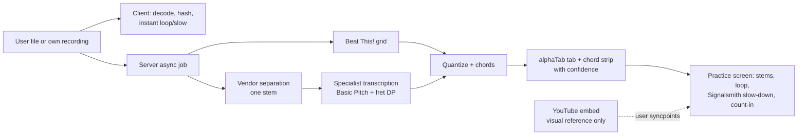

# Executive summary

This summary synthesises all five workstreams. No new web research went into it. Numbers are quoted from the linked docs, which hold the primary citations; recommendations are inference. **Not legal advice:** every content-rights point needs counsel.

## TL;DR
- **Thesis.** "Any song you choose, turned into a practice-ready lesson for your instrument and level."
  - No product found does all of the following together: take a learner-chosen performance, isolate the learner's part, give level-appropriate notes or chords with honest confidence, and wrap it in practice tools (`market/competitor-landscape.md`).
  - The strongest user evidence is about **trust** (wrong tabs and chords, muddy stems) and **billing**, not missing features (`users/voice-of-customer-pain-points.md`).
- **Lawful input.** The input must be the user's own files or recordings. A YouTube video can appear only as an embedded visual reference, and Splitune never fetches its audio (`legal/youtube-copyright-and-platform-policy.md`, Designs A, B and E).
- **Pipeline (feasible today).** Vendor separation, then open per-instrument specialists, then a beat grid, then notation, with client-side time-stretch. Guitar and piano stems are the biggest technical unknown (`ml/pipeline-overview.md`).
- **Launch shape.** Guitar and bass notation; a practice player for any instrument; web app first; subscription in the $8–12/month band with a published analysis cap (`product/recommendations-and-decisions.md`).
- **Next 4–6 weeks.** Retire the separation and transcription risks with seven ordered prototypes, engage counsel on four launch-gating questions, and test the practice screen with 8–10 guitar and bass learners.

## Findings

### Product thesis
- **Who.** Time-poor hobbyists who want to play songs, not finish a curriculum.
  - 61% of beginner and aspirational guitarists want songs to play alone or socially.
  - 53% practise two hours a week or less.
  - About 1 in 4 new players have stagnated.

  Sources: Fender data via `users/personas.md`. The oft-quoted "90% quit in year one" is an unsourced CEO statement, so it is used as motivation, not as data.
- **The job.** "Learn my part of this song from a video, at a pace I can manage." Today learners stitch 4–6 tools together (`users/jobs-to-be-done.md`).
- **The gap.** Each step exists somewhere: link to tab (Songsterr AI, Klangio), stems (Moises), practice tools (Soundslice, Anytune), curricula (Yousician, Simply). No one adapts a user-chosen song to the learner's level and wraps it in a practice loop (`market/feature-matrix.md`). The gap could narrow within a year, for example if Songsterr partners with a curriculum app or Muse Group combines its catalog with transcription.

### What the research says, by workstream

**ML / AI — confidence: medium** (`ml/pipeline-overview.md`)
- **Separation.** Four stems are good: 4-stem SOTA reaches about 9.7–10.0 dB cSDR on MUSDB18-HQ. Guitar and piano are weak: `htdemucs_6s` scores 3.07 and 1.60 dB on MoisesDB. Vendors publish no per-instrument numbers, and SDR does not predict listener preference (`ml/source-separation.md`). Hence a blind listening test, not leaderboards, picks the v1 vendor.
- **Transcription.** Specialist models on stems beat multi-instrument models. MT3 scores 32 zero-shot on GuitarSet.
  - Guitar: Basic Pitch (79 onset F1 on GuitarSet) feeding an in-house fret DP. Lowest-fret assignment is already 98.3% on simple material.
  - Bass: easy on a stem, but watch octave errors and tracker floors.
  - Piano: Transkun (0.983 onset F1 on MAESTRO) is strong, but its weights are amber and it is unmeasured on band mixes.
  - Drums: need an in-house model, because ADTOF is NC.

  Sources: `ml/transcription-guitar-and-bass-tabs.md`, `ml/transcription-piano.md`, `ml/transcription-drums.md`.
- **Rhythm and harmony.**
  - Beats: Beat This! (MIT code and weights; GTZAN beat F1 89.1) is the clear choice.
  - Chords: majmin is about 78–84%, so roughly one bar in six is wrong. Treat chords as an editable draft.
  - madmom models are NC and excluded.

  Source: `ml/chords-beats-key-structure.md`.
- **Licensing, not accuracy, is the binding constraint.** Code is mostly MIT or Apache-2.0, but weights are often unlicensed or trained on NC data (MUSDB18-HQ, MoisesDB, MAESTRO). A green/amber/red register is a release gate (`ml/datasets-metrics-and-licensing.md`).
- **Cost.** Self-hosted GPU runs about $0.0013–0.0044 per song-minute on an L4, but that assumes RTF 0.1. Music.AI's full stack is about $0.18 per song-minute or more. On-device separation has no verified phone timings (`ml/deployment-and-inference.md`).

**Legal / platform — confidence: medium (research, not legal advice)** (`legal/youtube-copyright-and-platform-policy.md`)
- **Ruled out.** Downloading, fetching or caching YouTube audio or video. The Developer Policies forbid it (III.E.1; III.I.7, which bars separating audio or "alternate audio tracks"), Apple 5.2.3 forbids it, and labels are litigating stream-ripping under § 1201 (Yout v. RIAA pending; ~$83M FLVTO default judgment).
- **Embed rules.** The YouTube embed is usable for viewing, speed and loops. It cannot carry overlays, background play or muted-video stem playback, and Splitune must not charge users to watch content in it (III.F.3.a).
- **Two copyrights per song.** A stem implicates the sound recording; a tab implicates the musical work. Keep both private to the user. Public tab sharing historically drew publisher takedowns; Ultimate Guitar and Songsterr license.
- **Uploads.** Accepting uploads requires a DMCA agent ($6, renewed every 3 years), takedown and repeat-infringer policies, and **no cross-user cache** without a licence. § 512(c) may not cover outputs Splitune derives itself, and fair use of paid per-user separation is unsettled.
- **Precedent.** Moises, Capo and Anytune accept only user files. The Cox v. Sony ruling (2026) lowers secondary-liability risk for general-purpose tools, but not direct liability.

**Market — confidence: medium** (`market/competitor-landscape.md`, `market/pricing-and-business-models.md`)
- **Clusters.** Four: utilities (Moises, LALAL.AI, Capo, Anytune), tab/chord tools (Chordify, Songsterr, Ultimate Guitar, Soundslice), AI transcription (Klangio, Chord ai, Songsterr AI), and curricula (Yousician, Simply, Fender Play, flowkey, Melodics, Rocksmith+). Teardowns are in `market/competitors/`.
- **Price bands.** Utilities $2–10/month; curricula $8–25/month ($100–280/year). Free tiers are capped by usage. Songsterr's AI cap is 50 tabs per month. LALAL.AI's retail separation is about $0.06/minute.
- **Failures.** Riffstation, Fender Songs, Jammit and NoteStar all depended on licensed or third-party content. Rocksmith+ sits at 18% positive on Steam after re-licensing its catalog.
- **Positioning.** Do not compete on stems or chords alone; Chord ai already bundles YouTube, stems, chords and MIDI for $69.99/year.

**Users — confidence: medium (drummer medium-low, singer low)** (`users/personas.md`)
- **Personas, in priority order:** P1 adult beginner guitarist (strong evidence); P3 self-taught bassist (strongest pain evidence: "can't hear the bass", distrust of tabs); P2 returning pianist (best premium candidate); then P4 drummer, P5 teen and P6 singer (provisional).
- **Billing.** Surprise trial-to-annual charges and paywalled basics are the dominant complaints. Chordify (4.8/5 on Trustpilot) shows this is avoidable.
- **Evidence limits.** Community evidence is BassBuzz plus Trustpilot and App Store samples. Reddit and several forums were unreachable, so themes are reliable but frequencies are not.

**UX / learning science — confidence: medium–low** (`ux/practice-tool-patterns.md`, `ux/learning-science-principles.md`)
- **Practice unit.** Build around a bounded, bar-snapped loop with a clean-pass counter, speed trainer and count-in. Deliberate practice explains about 21% of variance in music (Macnamara 2014), and error-targeting beat practice time in Duke et al. 2009.
- **Mic scoring is the riskiest feature.** No published phone-mic polyphonic accuracy exists, and Android cites about 10 ms round trip as what musicians need. Ship self-assessment first, and add an override when scoring arrives.
- **Hands-busy design.** Controls of 64 pt or more, pedals as keyboards, WCAG 2.2 AA, and colour always paired with a second cue (`ux/hands-busy-and-device-context.md`, `ux/accessibility.md`).
- **Thin evidence.** The display-type evidence rests on one piano study (P.I.A.N.O.), and retention mechanics rest mostly on company blogs (`ux/music-display-ui.md`, `ux/onboarding-retention-motivation.md`, both low confidence).

### Recommended pipeline and first prototype

- **Stage choices.** Detailed in `ml/pipeline-overview.md` and decisions D2–D6 in `product/recommendations-and-decisions.md`. Storage is per user, and every output carries confidence and a model-version tag.
- **First prototypes** (gates in `ml/pipeline-overview.md` §4):
  1. Separation blind listening test: 20 clips, 5+ learners and 2 teachers. Pass: median ≥4/5 on ≥70% of guitar clips and ≥60% of piano clips.
  2. Basic Pitch and Transkun on stems vs the mixture.
  3. Fret-assignment DP on GuitarSet.
  4. Latency and cost on one L4.
  5. Live mic pitch on phones.
  6. Chords on mixture vs no-drums stem.
  7. Time-stretch listening test at 0.5× and 0.75×.

  The user-facing first prototype is a **web practice screen**: file in, stem mixer, bar loop, slow-down, guitar/bass tab with confidence shading, chord strip. Run it with a bundled example song first.

### Three biggest risks
| Type | Risk | Early signal | Mitigation |
|---|---|---|---|
| Technical | Guitar and piano isolation, and transcription on bleeding stems, not good enough to practise with (errors compound; no end-to-end benchmark) | Prototype 1 medians; Prototype 2 onset F1 below 0.70 (guitar) or 0.80 (piano) | Mix-minus instead of solo; chords-first guitar; bass as notation hero; global fallback to chords or piano roll; confidence shading and edits |
| Legal | Paid per-user separation and transcription of commercial recordings is not clearly fair use; § 512(c) may not cover derived outputs; the embed paywall might breach III.F.3.a | Counsel opinion on the four gating questions | Designs A/B/E only; per-user private storage; DMCA operations; no YouTube audio; no sharing; on-device processing later; licensed catalog (C/D) as a long-term hedge |
| Product / business | Learners will not supply audio files; and vendor separation cost ($0.24–0.28 per 4-min song) plus a 30% store fee leaves thin margins, while self-hosting needs licensed training data of unknown cost | Drop-off at the "upload a file you own" step; songs per user per month | Bundled example songs and own-recording flows; published analysis cap; web billing first; start licensing multitracks early to unlock self-hosted separation |

## Implications for Splitune
### Recommended next 4–6 weeks
| Week | Track | Work | Exit criterion |
|---|---|---|---|
| 0–1 | Legal | Engage US copyright and platform counsel on: paywall vs III.F.3.a; fair use of paid per-user separation and transcription; § 512(c) scope; amber-model sign-off | Written guidance or a dated plan |
| 0–1 | ML infra | Evaluation harness (MSST, `mir_eval`, blind A/B listening page). Licensed in-house test set: own multitrack recordings with MIDI capture | Harness runs on 10 clips |
| 0–1 | Vendors | Trials with AudioShake, Music.AI and LALAL.AI. Ask about per-user caching, retention, training-on-uploads and volume price | Terms in writing |
| 1–2.5 | ML | Prototype 1 (separation blind test) and Prototype 3 (fret DP), in parallel | Gate results recorded |
| 2–4 | ML | Prototype 2 (stems vs mixture), Prototype 7 (time-stretch, including mobile Safari CPU), Prototype 4 (L4 latency/cost), Prototype 6 (chords) | Updated cost model and stem menu |
| 2–6 | Product/design | Web practice-screen prototype; 8–10 interviews each with P1 and P3; a fake-door pricing test; measure file-step drop-off | Go/no-go on D1 file step, D10 price band, D11 launch instruments |
| Ongoing | Licensing | Register entries for every model; emails to authors of amber models (Transkun, consonance-ACE, All-In-One, RMVPE, Basic Pitch weights); start multitrack-licensing conversations | Register v0 in CI |

Prototype 5 (live mic) can wait until week 5–6, because mic scoring is deferred to v1 (D12).

## Open questions
Consolidated, with priorities, in `open-questions-and-risks.md`. The highest-impact unknowns:
- vendor guitar and piano quality on real user audio;
- counsel's view on paid per-user processing and the embed paywall;
- whether learners will supply files;
- real cost per song;
- learners' willingness to pay.

## Sources
Cross-linked docs only; primary citations live in each: `ml/pipeline-overview.md`, `ml/source-separation.md`, `ml/transcription-guitar-and-bass-tabs.md`, `ml/transcription-piano.md`, `ml/transcription-drums.md`, `ml/chords-beats-key-structure.md`, `ml/datasets-metrics-and-licensing.md`, `ml/deployment-and-inference.md`, `legal/youtube-copyright-and-platform-policy.md`, `market/competitor-landscape.md`, `market/feature-matrix.md`, `market/pricing-and-business-models.md`, `users/personas.md`, `users/jobs-to-be-done.md`, `users/voice-of-customer-pain-points.md`, `ux/practice-tool-patterns.md`, `ux/learning-science-principles.md`, `ux/hands-busy-and-device-context.md`, `ux/accessibility.md`, `ux/music-display-ui.md`, `ux/onboarding-retention-motivation.md`, `product/recommendations-and-decisions.md`, `product/feature-roadmap-beginner-to-intermediate.md`, `open-questions-and-risks.md`.
