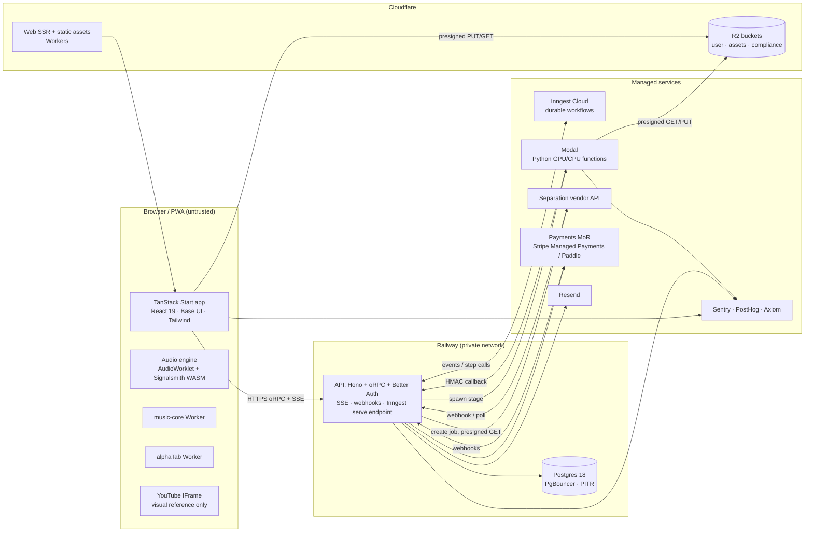
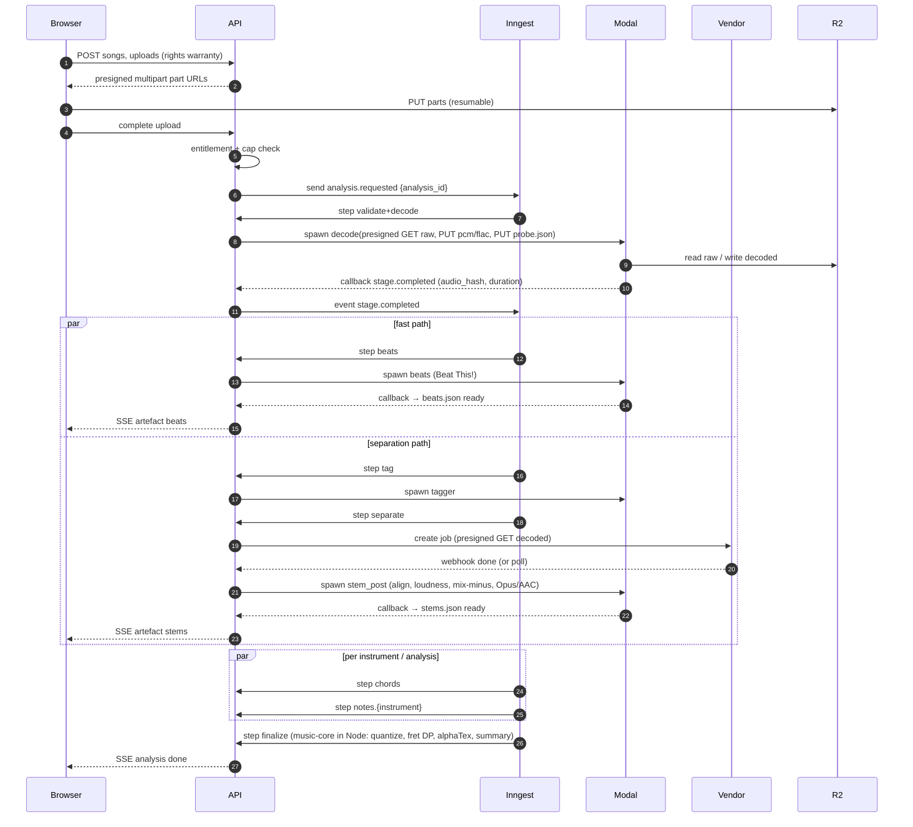

# System architecture

How the pieces chosen in `00-tech-stack.md` fit together: components, trust boundaries, the analysis job end to end, environments, and the rules that keep D1 (lawful input), D6 (server/client split) and D7 (per-user data) true by construction.

> **Personal mode is current:** the running topology is the hybrid layout in `25-personal-mode.md` §5 — Railway project `splitune` (`app` = web + API, Postgres), a Cloudflare R2 bucket, plus workers on the owner's Mac. Differences from the hosted design below: a Postgres job queue (`jobs` + `SKIP LOCKED` + `LISTEN/NOTIFY`) replaces Inngest; the ML and Node workers run on the Mac and reach Railway Postgres through its TCP proxy with restricted roles instead of presigned-URL-only access and HMAC callbacks; storage is a single R2 bucket; separation is self-hosted; there is no vendor; cache scope defaults to global. Everything else here (stage order, step contract fields, partial results, SSE, client/server split, degradations) applies unchanged.

## TL;DR
- **Five runtime parts:** web client (TanStack Start PWA on Cloudflare), API + orchestrator endpoint (Hono/oRPC on Node, Railway), Postgres 18 (Railway), object storage (Cloudflare R2), ML workers (Python on Modal, GPU and CPU). Managed services: Inngest (durable workflows), separation vendor, Better Auth (library, in our DB), payments MoR, Sentry, PostHog, Axiom, Resend.
- **The API is the only component with database credentials.** Modal workers get presigned URLs for exactly the objects a step reads and writes, and report back through an HMAC-signed callback. Vendors get a presigned GET of the decoded audio and nothing else.
- **One Inngest workflow per analysis.** Each stage is a step: spawn Modal function → `waitForEvent(stage.completed)` → record `stage_runs` → emit `job_events` → next step. Per-user cache keys let steps skip work; parallel steps fan out per stem/instrument.
- **Progress reaches the browser by SSE** from the API (`job_events` table + Postgres `LISTEN/NOTIFY`, `Last-Event-ID` replay, 15 s heartbeats).
- **Client does decode, playback DSP, rendering, music-core recomputes, and (v1) mic pitch.** Server does validation, decode/hash, beats, tagging, separation, chords, transcription and the finalize step.

## 1. Component diagram

## 2. Trust boundaries and least privilege
| Component | Can access | Cannot access |
|---|---|---|
| Browser | Its own session; presigned URLs for its own objects (GET 15 min, PUT parts 1 h) | Any bucket listing; any other user's keys; DB |
| API (Railway) | Postgres (role `app`, RLS enforced), R2 (signing keys), Inngest, Modal (token), vendor keys, payment keys | — |
| Modal workers | Only the presigned URLs in the step payload; the callback URL + HMAC secret; model weights baked into image/Volume | Postgres; R2 signing keys; other users' objects |
| Inngest | Event payloads with **IDs only** (no audio, no emails, no URLs with long expiry) | Data stores |
| Separation vendor | One presigned GET (≤1 h) to the decoded mixture; returns stems by its own download URL which the API copies into R2 | Anything else; contract forbids training on uploads (QL5) |
| Payments MoR | Email, country, plan | Audio, songs |

Rules enforced in code review and tests (`17-security.md`): every API handler resolves the resource through `user_id` from the session; every presign call takes `(user_id, object_key)` and asserts the key prefix `u/{user_id}/`.

## 3. Analysis job, end to end

- **Step contract:** each Modal function receives `{analysis_id, stage, cache_key, inputs: {name: presigned_get}, outputs: {name: presigned_put}, params, callback_url, callback_sig_nonce}` and must be idempotent (writes to fixed keys; re-runs overwrite identical content).
- **Skip logic:** before spawning, the step looks up `stage_runs.cache_key` for this user; if a successful run exists for the same key, it reuses the artefact (per-user only, D7).
- **Timeouts:** each `waitForEvent` has a stage timeout (e.g., beats 60 s, notes 300 s, vendor separation 600 s); on timeout the step retries once with backoff, then marks the stage `failed` and continues to the fallback path (`06-ml-pipeline-service.md`).
- **Preemption:** Modal's base GPU price is preemptible; idempotent stages + Inngest retries absorb restarts.
- **Partial results:** the workflow never aborts on a non-critical stage failure; `summary` explains what's missing.
- **Cost ledger:** every callback includes GPU seconds; vendor steps record billed minutes; finalize writes `analyses.cost_usd_estimate`.

## 4. Client/server split (D6)
| Concern | Where | Why |
|---|---|---|
| Decode user file for instant playback | Client (Mediabunny/WebCodecs) | M2: practice while the job runs |
| Authoritative decode, `audio_hash`, ffprobe validation | Server (Modal CPU) | Trust boundary; consistent hashing |
| Beat grid | Server (Beat This! final); optional client Beat This! small for local files (flagged) | ≤10 s target; client variant only if P4 misses it |
| Separation | Vendor via API (v1) | D2 |
| Tagging, chords, transcription | Server GPU | D3, D4 |
| Quantize, fret DP, level, transpose, corrections, alphaTex | Server finalize (default artefacts) **and** client Worker (instant recompute) — same `music-core` code | `07-music-algorithms.md` |
| Time-stretch, mixing, loop, click | Client AudioWorklet | D5 |
| Notation rendering | Client alphaTab Worker | D13 |
| Mic pitch (v1) | Client (ORT Web) / native plugin | D12 |

## 5. Realtime and sync
- **SSE endpoint** `GET /v1/analyses/{id}/events` streams `job_events` rows for that user's analysis: `stage.started`, `stage.completed {artefact, signed_url}`, `stage.failed`, `analysis.done`. Heartbeat every 15 s (Railway closes idle streams after 5 min, caps streams at 15 min; the client reconnects with `Last-Event-ID`).
- **Practice data sync** (loops, attempts, corrections) uses idempotent batched POSTs with client-generated UUIDv7 ids; offline queue in IndexedDB.

## 6. Environments
| Env | Web | API/DB | Storage | ML | Orchestration | Notes |
|---|---|---|---|---|---|---|
| Local / personal (current) | `pnpm dev` (Vite) or node server behind Caddy | Node + Docker Postgres 18 | SeaweedFS (S3-compatible) | Native ML worker (MPS) or mocks | Postgres job queue | `docker compose up` brings DB, SeaweedFS, Mailpit; see `25-personal-mode.md` |
| Preview (per PR) | Cloudflare preview | Railway PR environment + Postgres branch/fresh DB | R2 `-preview` bucket, 3-day lifecycle | Mocks by default; real GPU on label | Inngest branch env | No real user data |
| Staging | Cloudflare | Railway staging | R2 `-staging` | Modal `staging` env | Inngest staging | Real vendors in test mode where available |
| Production | Cloudflare | Railway prod (HA Postgres) | R2 `-prod` | Modal `prod` env | Inngest prod | Profiles: only `production` licence profile allowed |

## 7. Failure modes and degradations
| Failure | Behaviour |
|---|---|
| Vendor down / quota | Switch vendor by config flag (`separation.vendor`); else fallback to Spleeter "rough" stems or analysis without stems |
| Modal GPU capacity / cold starts | Retries; beat grid can fall back to CPU function; client keeps local playback working |
| Inngest outage | API rejects new analyses with a friendly retry message; practice of existing songs unaffected |
| R2 errors | Upload resumes; playback of cached stems from OPFS (v1 offline) |
| API down | Practice of already-loaded songs continues; sync queue holds edits |

## Implementation notes (step 09, 2026-10-21)
- **Orchestration = the job graph, enqueued in one transaction** by the API (`apps/api/src/pipeline.ts`): full `decode → {beats, tag} → separate → stem_post → {chords, notes.<i>} → finalize`, lite `decode → beats → chords (mixture) → finalize`, URL imports prepend `url_import`. There is no orchestrator process: workers claim what is runnable.
- **Partial failure** uses a second edge type, `jobs.soft_depends_on` (must have *finished*, not succeeded; never cancels): `tag → separate/stem_post`, `stem_post → chords/notes.*` and everything → `finalize` are soft, so a failed separation leaves chords and notes running on the mixture (§7 "analysis without stems"). Critical stages (url_import, decode, beats) are hard edges; when one fails the queue cancels what depends on it and finalize, which always runs last, ends the analysis `failed` (stage `skipped`) because no beats were recorded.
- **Optional inputs count only when an artefact row records their object** (Python executor and finalize), so a failed or cancelled upstream stage reads as "unavailable" even if an earlier attempt left an object behind.
- **Realtime:** a trigger `NOTIFY job_events, '<analysis_id>'` on every event insert; the API keeps one `LISTEN` connection, opened with the first SSE subscriber and closed with the last (no idle connection while Railway sleeps), plus a 5 s poll per stream.

## Open questions
- Whether the web app's SSR should also run on Railway to reduce vendors (trade-off: Cloudflare's CDN and R2 proximity).
- Whether Modal workers can reach R2 with presigned URLs fast enough for 50–100 MB decoded audio (measure in P4; else write FLAC instead of WAV for intermediates).

## Sources
Backend facts (Railway stream limits, Modal preemptible pricing, Inngest steps/limits, R2 lifecycle and presigned URLs) are cited in `00-tech-stack.md`. Cross-linked research: `ml/deployment-and-inference.md` (§6 async job architecture), `ml/pipeline-overview.md` (§1, §5), `product/recommendations-and-decisions.md` (D1, D2, D6, D7).
