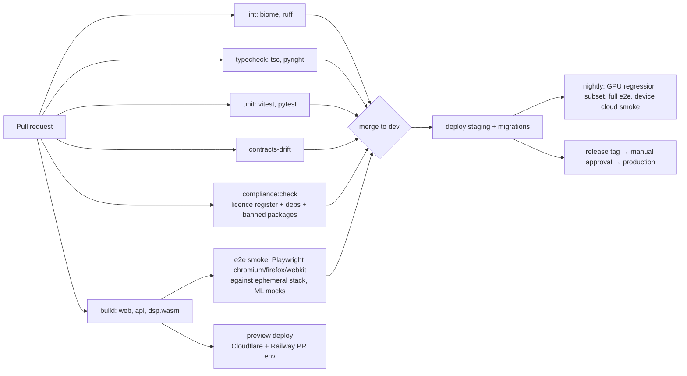

# Repository, tooling and CI

Monorepo layout, local development, coding standards and the CI pipeline. Step 1 of Phase 1 (E1) and partly Phase 0 (contracts + licence gate).

## TL;DR
- **One repo:** pnpm 12 workspaces + Turborepo 2 for TypeScript; a uv 0.13 workspace under `services/ml` for Python, invoked from Turborepo tasks.
- **Local dev in one command:** `pnpm run setup && pnpm dev` → Docker Compose (Postgres 18, SeaweedFS, Mailpit) + web + API + Node worker; ML stages run as mocks returning golden fixtures unless `ML_MODE=local` (native Python worker on the Mac, MPS) — which is also how the personal deployment runs (`25-personal-mode.md`).
- **Quality gates on every PR:** Biome (lint+format), `tsc` (TS 7), ruff + pyright, Vitest 5, pytest 9, contracts drift check, licence register check, Playwright smoke on Chromium/Firefox/WebKit, preview deploy.
- **Conventional commits, trunk-based on `dev`:** short-lived `impl/*` branches merged into `dev`; in personal mode `dev` auto-deploys to Railway production (the dormant hosted design would add staging and tagged releases). `docs/` and `prompts/` are local-only and untracked.

## 1. Layout
```
splitune/
  apps/
    web/                 # TanStack Start PWA (10-web-app-architecture.md)
    api/                 # Hono + oRPC + Better Auth + Inngest functions + finalize step
    listening/           # blind A/B listening test app (08-…)
  packages/
    contracts/           # Zod 4 schemas → JSON Schema → (Pydantic codegen) + oRPC router types
    db/                  # Drizzle schema + migrations, roles/RLS, user-scoped repositories, Postgres job queue (03-…)
    storage/             # S3 adapter (SeaweedFS locally, Cloudflare R2): presign, multipart, key builders (03-…)
    music-core/          # 07-music-algorithms.md (+ Node CLI for the eval harness)
    audio-dsp/           # C++ (Signalsmith wrapper) → dsp.wasm via Emscripten; CMake for native
    audio-engine/        # TS worklet processor, decode worker, clock
    notation/            # alphaTab wrapper + alphaTex helpers + confidence styling
    ui-tokens/           # "Music Stand" design tokens: CSS variables + Tailwind v4 @theme, token tests (26-design-system.md)
    analytics/           # typed event taxonomy shared by web/api (16-…)
    config/              # shared tsconfig, biome.json, vitest presets
  services/
    ml/                  # uv workspace (06-ml-pipeline-service.md)
  compliance/
    register/            # licence register YAML (09-…)
    register.schema.json
    data-map.yaml
  infra/
    tofu/                # OpenTofu: Cloudflare (R2 buckets + lifecycle, DNS, Workers routes)
    railway/             # config-as-code for project `splitune` (service `app`, Postgres)
    r2/                  # cors.json for the R2 bucket `splitune-media` (applied with `cf r2 buckets cors update`)
    docker-compose.yml   # local Postgres 18, SeaweedFS (S3), Mailpit, optional grafana/otel-lgtm
  docs/                  # research + implementation docs
  .github/workflows/
```

## 2. Tooling versions (pinned; see `00-tech-stack.md`)
- Node 24 LTS (`.nvmrc`, `engines`), pnpm 12 (`packageManager` field, Corepack), Turborepo 2.11.
- TypeScript 7.0 for `tsc --build`; `@typescript/typescript6` installed for tools that need the TS API.
- Biome 2.5 (lint + format for TS/JSON/CSS); oxlint optional for extra rules.
- Python 3.12 via uv (`.python-version`), ruff 0.17, pyright 1.1.414, pytest 9.1.
- Emscripten (pinned SDK version in `packages/audio-dsp/emsdk-version`) inside a Docker build image so CI and laptops produce identical `dsp.wasm`.
- Renovate (or Dependabot) with grouping, weekly schedule, and **no auto-merge for majors**; licence check runs on every dependency PR.

## 3. Local development
```bash
pnpm run setup      # (`pnpm setup` alone is pnpm's built-in) pnpm install, uv sync, emsdk docker pull, .env from .env.example
pnpm dev            # docker compose up (pg, seaweedfs, mailpit) + api + web + node worker (+ listening) with HMR
pnpm dev:all        # same + native ml-worker (ML_MODE=local)
pnpm db:migrate     # apply packages/db/migrations (Drizzle migrator, one transaction)
pnpm db:roles       # login passwords for ml_worker/node_worker/maintenance from DB_*_PASSWORD
pnpm db:check       # fail if the schema changed without a migration (CI step)
pnpm seed           # system user + a test user (example songs arrive with their step)
pnpm test           # turbo run test (vitest + pytest)
pnpm e2e            # playwright against local stack
```
- `.env.example` lists every variable with comments; secrets for local dev are fake/test keys only. Real secrets live in Railway/Modal/Cloudflare and GitHub environments — never in the repo (pre-commit secret scan with gitleaks).
- `ML_MODE=mock|local|modal` (`modal` is the dormant hosted option): mock stages read `packages/contracts/fixtures/*` so the whole app runs offline without GPUs.
- Vendor sandbox keys (if vendors offer test mode) only in staging.

## 4. Coding standards (summary)
- TypeScript strict; no `any` without a comment; Zod at every trust boundary (HTTP, worker messages, storage reads).
- Errors: typed error codes (`04-api-contract.md`), never leak raw exceptions to clients; Sentry for unexpected errors.
- Every user-scoped DB query goes through repository helpers that require `userId` (`scripts/check-db-access.mjs`, part of `pnpm lint`, bans raw `db.select/insert/update/delete/execute` outside `packages/db/src/repo/` and `packages/db/src/jobs/`; also allowed: `packages/db/src/rate-limit.ts` (request counters) and `apps/api/test/rls.test.ts`, which bypasses the repositories on purpose to prove RLS).
- Python: pure stage functions, Pydantic models from codegen, no network calls except presigned I/O and callbacks.
- Comments explain *why*; ADR-worthy decisions update the D# log in `product/recommendations-and-decisions.md` or a new `docs/implementation/adr/NNN-*.md`.

## 5. CI pipeline (GitHub Actions)

| Job | Fails when |
|---|---|
| `contracts-drift` | Regenerated JSON Schema or Pydantic models differ from committed (`pnpm contracts:check`; currently a step of the `checks` job, since it needs the same pnpm + uv setup) |
| `compliance:check` | Personal mode: validates register records (provenance, weights hashes) only — no tier, licence or package bans. Commercial profile (dormant) re-enables tier gating and bans |
| `music-core-bench` | Fret DP/quantize >20% slower than baseline |
| `bundle-size` | Practice route JS >300 KB gzip (excl. alphaTab/WASM) |
| `a11y` | axe violations (serious/critical) in Storybook stories or e2e pages |
| `ui-tokens` | Token contrast/gamut/CVD tests fail; raw colour literals or `outline: none` outside `packages/ui-tokens` (`scripts/check-ui-tokens.mjs`, part of `pnpm lint`) (`28-ui-quality-and-design-review.md` §3) |
| `visual` | Playwright screenshot diffs against committed baselines in the pinned Playwright image (`28-…` §4) |
| `migrations` | drizzle-kit generates a diff not committed; destructive migration without `-- allow-destructive` marker and review |
| `ml-regression` (local or free self-hosted runner on the Mac) | Metric drops beyond tolerance (`08-…` §4) |

Caching: Turborepo remote cache (self-hosted on R2 or Vercel's), uv cache, pnpm store, Docker layer cache for the Emscripten image.

## 6. Branching, reviews and releases
- Trunk-based; branch names `feat/…`, `fix/…`; Conventional Commits; squash merge.
- CODEOWNERS: `services/ml/**` and `compliance/**` need ML lead; `apps/api/src/billing/**` and `compliance/**` need a second reviewer; `infra/**` needs eng lead.
- Releases: semver tags for the app (`web@x.y.z`, `api@x.y.z`) and `pipeline_version` for `services/ml` (stamped into every artefact).
- Changelog generated from commits; release notes include the licence register snapshot and ML-BOM.

## Implementation notes (step 11, 2026-10-22)
- `pnpm --filter @splitune/audio-dsp build` runs `docker build` (BuildKit `--output`) with the image from `emsdk-version` (`6.0.10@sha256:…`) and fails unless `dist/dsp.wasm` matches the committed `dsp.wasm.sha256`; `--update` records a deliberate change. Clean arm64 and amd64 builds produced the same hash. `dist/` stays uncommitted; Turborepo builds it before `@splitune/audio-engine` tests (needs Docker, as CI has).
- `pnpm run setup` pulls the pinned Emscripten image when Docker is present.
- CI step "Audio engine offline render (Chromium, Firefox, WebKit)" after the unit tests.

## Open questions
- Remote cache host (Vercel vs self-hosted on R2).
- Whether to split `services/ml` into its own repo once a second ML engineer joins (keep together while contracts change often).

## Sources
Tool versions and links: `00-tech-stack.md`. Cross-linked: `05-analysis-schema.md` (codegen), `09-licence-register-and-release-gates.md` (compliance gate), `18-testing-strategy.md`, `19-deployment-and-operations.md`.
