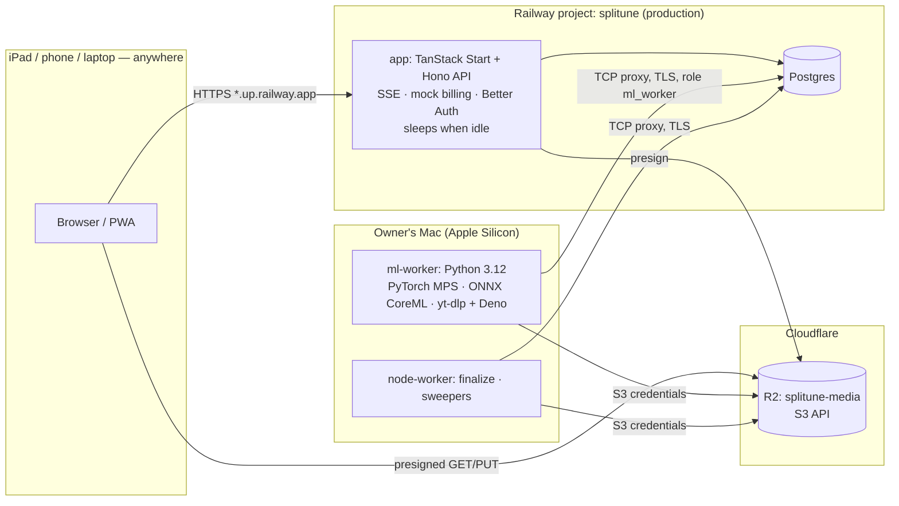

# Personal mode

**This is the current operating mode and overrides any conflicting guidance in docs 00–24.** Splitune is a personal project: no new paid services beyond the owner's **existing Railway Hobby workspace** and the **Cloudflare R2 free tier** (owner approved 2026-10-21), mock payments only, and copyright/licensing constraints are out of scope. The commercial design elsewhere in `docs/implementation/` stays as a dormant path for a possible future, clearly labelled where it appears.

## TL;DR
- **Hybrid topology.** Railway project `splitune` (created 2026-10-20, Hobby workspace) hosts the always-reachable, lightweight parts: one Node service `app` (web SSR + API + SSE) and Railway **Postgres**. Audio and artefacts live in a **Cloudflare R2** bucket `splitune-media`. The owner's **Mac (Apple Silicon)** runs the heavy parts: the Python ML worker (PyTorch MPS, ONNX CoreML, yt-dlp) and the Node worker (finalize, sweeps). Railway has no GPUs, and CPU separation there would be slow and costly.
- **Cost discipline.** The Hobby plan includes $5 of usage, and the workspace was already at $5.27 (estimate $8.08) this period before Splitune — so every Splitune service is real extra spend. Keep Railway to `app` (sleeps when idle) + Postgres: expected **≈ $2–5/month** extra (estimate; verify with `railway usage projects`). Storage is on R2, outside the Railway bill: free up to 10 GB-month, 1M Class A and 10M Class B operations a month, then $0.015/GB-month (Standard class only — never Infrequent Access, which has no free tier); egress free. No staging environment on Railway; develop locally.
- **Mock payments.** The Free/Plus split in `23-plans-free-and-paid.md` stays, enforced by the same entitlement code; "buying" Plus goes through a `MockBillingProvider` with simulated success/decline/renewal/cancel. No card fields are ever rendered or collected.
- **Copyright ignored.** No licence gating, counsel, DMCA, upload warranty or per-user-only cache. Any model can be used — including non-commercial and unlicensed checkpoints — chosen on quality and speed. The licence register stays as a provenance record only.
- **Best open models instead of vendors:** separation via `python-audio-separator` (Demucs, BS-/Mel-RoFormer, SCNet) on MPS; drums via ADTOF; chords/key candidates include madmom; lyrics via Whisper.
- **URL import is allowed** (YouTube and other sites) via `yt-dlp` + Deno + `yt-dlp-ejs` on the Mac; the downloaded video plays muted and slaved to the audio clock. (Against YouTube's Terms of Service — a contract matter, the owner's call for personal use.)
- **HTTPS comes free** from the Railway domain (`*.up.railway.app`), so iPad/phone practice works anywhere — no mkcert/Tailscale needed except for fully local development.
- **When the Mac is off,** analyses wait in the queue (UI shows "processing machine offline"); practising already-analysed songs keeps working because stems and artefacts live in R2.

## 1. What changes, component by component
| Area | Commercial design (dormant) | Personal mode (current) |
|---|---|---|
| Web + API | Cloudflare Workers + Railway API | **One Railway service `app`**: TanStack Start (Nitro `node` preset) serving the web app, with the Hono/oRPC API mounted under `/v1` and SSE; Railway "serverless" sleep when idle to save memory cost |
| Database | Railway Postgres 18 HA | **Railway Postgres** (single instance, no HA); the Mac connects via its public TCP proxy (`DATABASE_PUBLIC_URL`, TLS) with the restricted `ml_worker` role; nightly `pg_dump` from the Mac to a local/external disk |
| Object storage | Cloudflare R2 (user, assets and compliance buckets) | **Cloudflare R2**, one bucket `splitune-media` (Standard class, free tier; presigned GET/PUT/multipart against `<account_id>.r2.cloudflarestorage.com` — presigned URLs don't work on custom domains). CORS rules are in `infra/r2/cors.json`. Lifecycle: only R2's default 7-day abort of incomplete multipart uploads — no expiry rules, because personal mode keeps raw uploads and `video.mp4`, and stem expiry depends on `last_opened_at`, so the app's sweeper (`15`) does all expiry. Chosen over the Railway Bucket on 2026-10-21: 10 GB free, outside the Hobby usage, real lifecycle rules |
| Orchestration | Inngest Cloud | **Postgres job queue** (`jobs` table, `FOR UPDATE SKIP LOCKED`, `LISTEN/NOTIFY` over the TCP proxy with 5 s polling fallback) |
| Workers | Modal + API-side finalize | **On the Mac:** `ml-worker` (Python, MPS) and `node-worker` (music-core finalize, sweepers, lifecycle). Keeping workers off Railway lets `app` sleep and avoids paying for idle polling |
| ML compute | Modal L4 | Native Python on the Mac (PyTorch MPS; ONNX CoreML EP; CPU fallback) |
| Separation | AudioShake / Music.AI / LALAL.AI | Self-hosted open models (§3) |
| Auth email | Resend | Free SMTP account (or passkeys/Google OAuth only); Mailpit for local dev |
| Payments | Stripe Managed Payments / Paddle | `MockBillingProvider` (§2) |
| Errors/traces | Sentry, Axiom | Railway logs + structured JSON; optional Railway tracing (OTel) on `app`; optional local `grafana/otel-lgtm` for the Mac workers |
| Product analytics, flags | PostHog | `analytics_events` table + SQL/Grafana dashboards; flags in a `feature_flags` table |
| Environments | dev / preview / staging / prod | **local** (Docker Compose: Postgres 18, SeaweedFS as a local S3, Mailpit) and **Railway production** only |
| CI/CD | GitHub Actions + Railway deploy | GitHub Actions (free plan) for checks; deploy with Railway GitHub autodeploy on `dev` or `railway up`; ML regression runs locally |
| Device testing | Device cloud | Own devices |
| Native apps | App Store / Play | PWA; optional free sideload builds |
| Legal | Counsel, DMCA, licence gate | None |
| Cache scope | Per user only | `cache_scope: global` default |

## 2. Mock billing
- `apps/api/src/billing/mock.ts` implements the `BillingProvider` interface from `14-auth-billing-and-entitlements.md` §3; config `BILLING_PROVIDER=mock` (the only option in personal mode).
- **Checkout:** `createCheckout` returns `/billing/mock-checkout?session=…`. The page shows the plan and price from config with a "Demo mode — no real charges" banner and three buttons: *Simulate successful payment*, *Simulate declined card*, *Cancel*. Success posts a normalised `subscription.activated` event to `/internal/billing/webhook`, HMAC-signed with a local secret, so the **real webhook handler and entitlement code run unchanged**.
- **Portal:** `/billing/mock-portal` offers cancel at period end, resume, switch monthly ↔ yearly, *simulate payment failure*, *simulate refund*.
- **Dev clock:** `POST /internal/dev/clock { advance_days }` (dev/admin only) moves "now" for billing logic to exercise renewals, expiry, renewal reminders (emails land in Mailpit) and allowance resets.
- **Rules kept from the commercial design:** published allowances, failed analyses never consume them, one-tap cancel, no take-backs — so the product behaviour is what a real launch would have.
- **Never** render card number/CVC inputs, even fake ones.

## 3. Model stack (quality-first, licences ignored)
| Stage | Default candidate(s) | Notes |
|---|---|---|
| Separation | `python-audio-separator` 0.44.x running `htdemucs_6s` (guitar/piano), `htdemucs_ft` (4-stem), community BS-RoFormer / Mel-RoFormer checkpoints (vocals, instrumental, 4-stem), SCNet XL | On Apple Silicon it routes Demucs/RoFormer to PyTorch MPS and ONNX MDX models to CoreML (requires PyTorch ≥2.13). MSST 53-stem BS-RoFormer (guitar acoustic/electric, piano, keys, drum parts) if memory allows (author cites ≥16 GB VRAM; test with unified memory). P1 picks per instrument |
| Mix-minus | mixture − aligned stem, or the model's complementary stem if cleaner | Decide by listening in P1 |
| Beats | Beat This! final0 | Unchanged |
| Instrument presence | EfficientAT/PANNs | Unchanged |
| Chords | consonance-ACE vs BTC vs madmom CNN+CRF | P6 decides by WCSR; madmom installed from git |
| Key | madmom CNN key vs music-core estimator | madmom reported 74.6–85.1 weighted (pop/EDM) |
| Guitar/bass notes | Basic Pitch (ONNX) vs YourMT3+ | P2 compares on stems |
| Piano notes | Transkun V2 vs Aria-AMT | P2 |
| Drums | **ADTOF** (pretrained, 5 classes) | Removes the in-house training project from v1 (`21-v1-features.md` V6) |
| Vocals | RMVPE f0; ROSVOT or YourMT3+ notes | |
| Lyrics | Whisper (`faster-whisper` on CPU or an MLX Whisper port on Apple Silicon) | Lyrics display allowed |
| Sections | allin1 (legacy env) | |
| Slow-down | Signalsmith Stretch (client); Rubber Band R3 allowed for offline pre-render if P7 favours it | GPL is fine for personal use |
| Datasets | MUSDB18-HQ, MoisesDB, MAESTRO, GuitarSet, MDB Drums, etc. | Usable for evaluation and fine-tuning |

## 4. URL import (YouTube and other sites)
- **Flow:** paste a URL → API creates a song with `source_kind='url'` and a `url_import` job → Python worker runs `yt-dlp` (pinned; with **Deno** and **yt-dlp-ejs**, required for YouTube since yt-dlp 2025.11.12) to download best audio (and, if enabled, video ≤720p) into the user's storage prefix → normal analysis pipeline.
- **Video:** played from the downloaded file in a `<video muted playsinline>` element, slaved to the audio engine clock: `playbackRate` = engine rate, hard re-seek when drift >80 ms, soft rate nudging below that. Loops and slow-down apply to video too. Notation can render beside **or overlaid** on the video (no embed rules apply to a local file).
- **Sync is automatic** (same source), so syncpoints are only needed when the user pairs a URL video with a *different* audio file.
- **Embed fallback:** if download fails (geo-block, private video, extractor breakage), fall back to the IFrame embed with manual syncpoints as in `13-import-onboarding-and-youtube-embed.md`.
- **Maintenance:** extractors break when sites change; `yt-dlp -U`-style updates via the pinned dependency bumped by Renovate; surface "URL import temporarily broken — upload a file instead" on failure.
- **Caveat (one line, no gating):** downloading from YouTube violates YouTube's Terms of Service; keep the feature local to the personal deployment.

## 5. Topology

- **Worker trust:** `ml_worker`/`node_worker` DB roles limited to queue, stage, artefact and event tables; two R2 API tokens, each Object Read & Write scoped to `splitune-media` only — one in `app`, one on the Mac — so the Mac's can be revoked alone if it is lost.
- **Worker presence:** workers write a heartbeat row every 30 s; `app` shows "processing machine offline — your song is queued" when stale >2 min.
- **Concurrency:** one MPS job at a time; ≤2 CPU jobs.
- **Latency targets** (measured in P4 on the Mac): beat grid ≤15 s, full analysis ≤3 min, Lite ≤20 s for a 4-min song, plus Railway and R2 round-trips (bucket transfers of ~50 MB decoded audio are avoided by keeping intermediates on the Mac's disk and uploading only final stems/JSON).

## 6. Running it
**Railway:** project `splitune` (`b54dcab4-7140-43f7-a8a4-67398ebe70b7`), environment `production` (`44e23f0b-d4b3-4397-9748-54683296894a`). Since step 17 (2026-10-23) it holds `Postgres` and `app` in Singapore, declared in `infra/railway/railway.ts` (see `19` step-17 notes); the commands below are how it was first sketched:
```bash
railway add --database postgres --json          # when E1 starts
railway add --service app --json                 # then connect the GitHub repo or `railway up`
```
Set `app` variables: `DATABASE_URL` (reference to Postgres), `S3_*` (R2, below), `BETTER_AUTH_SECRET`, `BILLING_PROVIDER=mock`, `CACHE_SCOPE=global`. Enable serverless sleep on `app`. Generate a Railway domain for HTTPS.

**Cloudflare R2** (`cf` CLI; owner does the account steps):
```bash
cf auth whoami
cf r2 buckets create --name splitune-media --location-hint <hint>   # hint nearest the Mac and the Railway region
# after the Railway domain exists: put it in infra/r2/cors.json (replace the <app> placeholder), then
cf r2 buckets cors update splitune-media --rules @infra/r2/cors.json
cf r2 buckets cors get splitune-media
```
**State (2026-10-23, step 17):** bucket `splitune-media` (APAC, Standard, private — r2.dev off, default 7-day multipart abort only; an empty bucket `splitune` made earlier is unused). Exactly two account tokens, both *Workers R2 Storage Bucket Item Read + Write* on `splitune-media` only: `splitune-mac-workers` (its S3 credentials now in the Mac's `.env.worker`; `.env.r2` deleted) and `splitune-app` (created 2026-10-23 straight into the `app` service's Railway variables, never printed). CORS from `infra/r2/cors.json` with origin `https://app-production-d679.up.railway.app` (GET/HEAD/PUT, `content-type` + `range`, exposing `ETag` and the range headers); a preflight against a presigned PUT returns 204 for that origin and 403 for any other. `pnpm --filter @splitune/storage test` passes against R2 (50/50; R2 answers an unsigned GET with 400 InvalidArgument, SeaweedFS with 403 — the test accepts either denial). Token recipe: `cf accounts tokens create --name <name> --policies @policy.json` (permission groups `6a018a9f2fc74eb6b293b0c548f38b39` Item Read and `2efd5506f9c8494dacb1fa10a3e7d5b6` Item Write, resource `com.cloudflare.edge.r2.bucket.<account_id>_default_splitune-media`); the S3 access key ID is the token's `id` and the secret is the SHA-256 hex of its `value`. `S3_*` for `app` and `.env.worker`: `S3_ENDPOINT=https://<account_id>.r2.cloudflarestorage.com`, `S3_REGION=auto`, `S3_BUCKET=splitune-media`, `S3_ACCESS_KEY_ID`/`S3_SECRET_ACCESS_KEY` from that consumer's token, `S3_FORCE_PATH_STYLE=false`. Size 2026-10-23: 76 objects, 45 MB (examples 6.8 MB) of the 10 GB-month free tier.

**Mac workers:**
```bash
brew install deno ffmpeg@8 uv pnpm gitleaks   # ffmpeg@8 = FFmpeg 8.1 (keg-only; set FFMPEG_BIN_DIR)
pnpm run setup                        # not `pnpm setup` (pnpm built-in)
cp .env.worker.example .env.worker   # chmod 600; the production workers' whole configuration
pnpm workers install                  # node-worker + ml-worker as launchd agents (start at login, restart on crash)
pnpm workers status                   # also: restart, uninstall; logs in ~/Library/Logs/Splitune/
# Only the launchd agents read .env.worker; `pnpm dev:all`, E2E and manual runs read only .env.
```
**Local development:** `docker compose -f infra/docker-compose.yml up -d` (Postgres 18, SeaweedFS standing in for R2, Mailpit) + `pnpm dev:all`; HTTPS for testing on the iPad locally via Caddy + mkcert or Tailscale.

**Budget guard (recommended):** set a workspace usage alert/limit, e.g. `railway usage limit set --workspace <id> --target workspace --soft 10 --hard 15 --json` (the hard limit can stop *all* services in the workspace, including the owner's other projects — choose values deliberately).

## 7. Data and backups
- Postgres: nightly `pg_dump` run by the Mac's `node-worker` to an external disk (Railway Postgres backups/PITR availability on Hobby not verified).
- R2 bucket: originals, stems and artefacts; the sweeper deletes stems 180 days after last open and nothing else by default. Re-derivable data isn't backed up; uploads the owner cares about live in their own library anyway.

## 8. If this ever goes public or commercial
Re-enable, in this order: licence register gating (`09`), counsel review and DMCA program (`15`), remove URL import, switch cache scope to `user`, real billing provider (`14`), hosted GPU workers and HA infrastructure (`00`, `01`, `19`). The Railway project can stay; it becomes the API/DB tier of the commercial design. The interfaces were kept identical so each is a configuration or adapter swap.

## Implementation notes (step 09, 2026-10-21)
- Worker presence: `GET /v1/system/worker-status` and `analysis.waiting` SSE events (§5) use the 2-minute heartbeat window.
- URL import as built: see `06` and `04` step-09 notes. Deno installed on the owner's Mac with Homebrew (2026-10-21, owner approved).
- `tsconfig.base.json` now sets `erasableSyntaxOnly`: the workers and API run `.ts` directly with Node's type stripping, and the node worker could not start (`TypeScript parameter property is not supported in strip-only mode`) until step 09 removed its parameter properties.

## Implementation notes (step 10, 2026-10-22)
- **Railway `app` build and start:** build `pnpm install --frozen-lockfile && pnpm --filter @splitune/web build`; start `pnpm --filter @splitune/web start` (= `node apps/web/.output/server/index.mjs`, listens on `PORT`). The output is self-contained (no `node_modules` needed at runtime). Needs `DATABASE_URL`, `APP_URL`, `BETTER_AUTH_URL`, `BETTER_AUTH_SECRET`, `S3_*`, `SMTP_*`, `EMAIL_FROM`, `TRUST_PROXY=true`, `NODE_ENV=production`.
- Readiness probe: `/internal/ready` (DB ping).

## Implementation notes (step 13, 2026-10-22)
- **Example songs in production:** run `pnpm examples:build …` on the Mac with production's `DATABASE_URL` and R2 `S3_*` while the Mac workers serve production: the analyses run as the system user there and the files land under `assets/examples/` in `splitune-media`; commit the rewritten `apps/api/examples.json` and deploy. Today's manifest was built against the local stack (SeaweedFS), so production needs that run once (step 17).

## Implementation notes (step 14, 2026-10-22)
- Mock billing as built: see `14` step-14 notes. **Step 17 must set `BILLING_WEBHOOK_SECRET`** on Railway's `app` (any random ≥ 16 chars; the API refuses to start without it) and must not set `ENABLE_DEV_CLOCK`.
- Renewals and reminders run inside `app` (no worker): while Railway sleeps nothing settles; the first request for a user settles that user, and the 10-minute timer catches up the rest once awake.

## Implementation notes (step 15, 2026-10-22)
- The Mac's node worker now also needs `NODE_WORKER_MAINTENANCE_DATABASE_URL` (maintenance over the TCP proxy), `ANALYTICS_SALT` (same as `app`), optionally `PG_DUMP_DIR` (external disk), `DIGEST_EMAIL_TO` and the `SMTP_*` settings. `app` needs `ANALYTICS_SALT` (the API refuses to start without it) — step 17. R2 bucket size for the digest is listed through the storage adapter (Class A list operations: one per 1,000 objects per day).
## Implementation notes (step 17, 2026-10-23)
- Deployed: see `19` step-17 notes (topology, variables by name, runbooks) and `17` (TLS, worker account). Region Singapore for both services: Railway put the database in US West despite the IaC region, so it was moved (empty) right after creation.
- **Worker config isolation:** workers used to read `.env` then `.env.worker`, so a production `.env.worker` would have pointed every local and E2E worker at production. Now only the launchd agents read `.env.worker` (a complete config); everything else reads only `.env`. Production and development ML caches are separate (`ML_CACHE_DIR`); model weights are shared.
- **Examples in production:** built 2026-10-23 with `pnpm examples:build` against Railway Postgres + R2 from the same MUSDB18-HQ windows (`~/datasets/musdb18hq-p1/<track>/mixture.wav`; same audio hashes, tempi and loops as before) and committed. Local development that needs examples builds its own manifest and sets `EXAMPLES_MANIFEST`.
- **Serverless sleep:** Railway sleeps a service 5–10 min after its last *outbound* packet (private-network and database traffic count). `app` keeps no idle connections (pg pool idle timeout 10 s, no keepalive, SSE listener only while streams are open), and its billing timer runs every 10 min, so it can sleep between runs. The Mac workers hold Postgres awake (it never sleeps anyway).
- Answered open questions: Postgres image `postgres-ssl:18` (18.6); Railway builds are free; the storage suite's unsigned-GET assertion now accepts R2's 400.

## Open questions
- Unified-memory requirements of the larger RoFormer/MSST checkpoints on the owner's Mac (measure in P4).
- Actual monthly cost of the `splitune` project after a week of use (`railway usage projects --workspace <id> --project splitune --json`).
- Whether Railway serverless sleep interacts badly with SSE (first request after sleep has a cold start; SSE streams keep the service awake while open, which is fine).
- Railway Postgres backup features on the Hobby plan.
- MLX ports (Demucs/BS-RoFormer/Whisper) may be faster than PyTorch MPS on Apple Silicon — benchmark in P4 before committing.

## Sources
- [MinIO CE retired upstream / source-only (2026)](https://glukhov.org/data-infrastructure/object-storage/minio-dead/), [minio/minio GitHub (archived)](https://github.com/minio/minio), [Self-hosted S3 alternatives 2026](https://glukhov.org/data-infrastructure/object-storage/self-hosted-s3-alternatives/), [RustFS vs SeaweedFS vs Garage](https://blog.elest.io/rustfs-vs-seaweedfs-vs-garage-which-minio-alternative-should-you-pick/) — tier 3, accessed 2026-10-20
- [yt-dlp requires a JavaScript runtime (Deno) — GIGAZINE](https://gigazine.net/gsc_news/en/20251113-yt-dlp-required-deno-javascript-runtime/), [yt-dlp issue #15012](https://github.com/yt-dlp/yt-dlp/issues/15012), [yt-dlp EJS runtime support](https://www.mintlify.com/yt-dlp/ejs/concepts/runtime-support) — tier 2–3, accessed 2026-10-20
- [Tailscale pricing (Personal plan $0)](https://tailscale.com/pricing/) — tier 2, accessed 2026-10-20
- [R2 pricing](https://developers.cloudflare.com/r2/pricing/), [R2 presigned URLs](https://developers.cloudflare.com/r2/api/s3/presigned-urls/), [R2 CORS](https://developers.cloudflare.com/r2/buckets/cors/), [R2 upload objects (uniform multipart part sizes, 7-day abort default)](https://developers.cloudflare.com/r2/objects/upload-objects/), [R2 S3 API compatibility](https://developers.cloudflare.com/r2/api/s3/api/) — tier 1, accessed 2026-10-21; `cf` 1.0.0-beta.20 commands checked with `--dry-run`
- [Railway Buckets](https://docs.railway.com/storage-buckets) (not used since 2026-10-21), [Railway pricing](https://docs.railway.com/pricing/plans), [Railway networking limits](https://docs.railway.com/networking/public-networking/specs-and-limits) — tier 2, accessed 2026-10-20; account state (Hobby plan, usage $5.27 / estimate $8.08 for 2026-09-30 → 2026-10-30) read via Railway CLI 5.70.0 on 2026-10-20
- [python-audio-separator releases](https://github.com/nomadkaraoke/python-audio-separator/releases) and [PR #298 (Apple Silicon routing)](https://ithub.global.ssl.fastly.net/nomadkaraoke/python-audio-separator/pull/298/files) — tier 1, accessed 2026-10-20
- [MSST v1.0.21 53-stem release](https://github.com/ZFTurbo/Music-Source-Separation-Training/releases/tag/v1.0.21) — tier 1, accessed 2026-10-20
- Cross-linked: `ml/source-separation-model-comparison.md`, `ml/transcription-drums.md` (ADTOF), `ml/chords-beats-key-structure.md` (madmom), `ml/playback-time-stretch-pitch-shift.md`.
