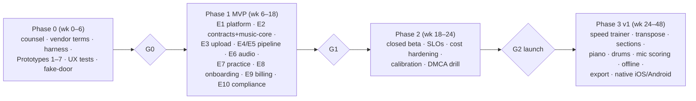

# Splitune implementation docs

How to build Splitune, step by step, from the research in `docs/`. These docs turn the decisions D1–D13 (`product/recommendations-and-decisions.md`), the reference pipeline (`ml/pipeline-overview.md`) and the roadmap (`product/feature-roadmap-beginner-to-intermediate.md`) into a stack, an architecture, contracts, specs, a delivery plan and operating procedures. Versions were verified on **2026-10-20**.

## Binding rules (current: personal mode — `25-personal-mode.md`)
1. **No new paid services.** Lightweight tier on the owner's existing **Railway Hobby** workspace (project `splitune`: one `app` service, Postgres — budget ≈ $2–5/month) plus a **Cloudflare R2** bucket kept within its free tier (owner approved 2026-10-21); heavy ML on the owner's Mac. No other paid services, domains or developer programs.
2. **Mock payments only.** Free/Plus features are real (`23-plans-free-and-paid.md`); purchases are simulated by `MockBillingProvider`; no card data is ever collected.
3. **Copyright and licensing are out of scope.** Any model or dataset may be used; URL import (YouTube etc.) is allowed for personal use; the licence register is a provenance record, not a gate.
4. **Confidence and versions are first-class data** from model to pixel; corrections are versioned overlays.
5. **Works in every mainstream browser** with feature detection and fallbacks (`24-browser-compatibility.md`); always served over HTTPS (Railway domain in production).
6. **Free is a real practice app;** Plus adds analysis volume and depth.

The original commercial constraints (user files only, per-user storage, licence gate, counsel/DMCA, vendors and hosted infrastructure) remain documented as a **dormant path**; `25-personal-mode.md` §8 lists how to re-enable them.

## Reading order
| If you are… | Read |
|---|---|
| Anyone, first | this README → **`25-personal-mode.md`** → `20-delivery-plan.md` → `00-tech-stack.md` → `01-system-architecture.md` |
| Full-stack / API engineer | `02`, `03`, `04`, `05`, `14`, `23`, `15`, `17`, `19` |
| Client / audio engineer | `10`, `26`, `27`, `11`, `12`, `13`, `07`, `24`, `18`, `28` |
| ML engineer | `08` (start here in Phase 0), `06`, `05`, `07`, `09` |
| Designer / PM | **`26`, `27`, `28`**, then `12`, `13`, `23`, `20`, `16`, `21` |
| Founder / counsel liaison | `20` (gates), `15`, `09`, `23`, `14` |

## Index
| # | Doc | What it decides / specifies |
|---|---|---|
| 00 | `00-tech-stack.md` | Every technology choice with verified versions, prices, rejected alternatives, upgrade watchlist |
| 01 | `01-system-architecture.md` | Components, trust boundaries, analysis job sequence, client/server split, environments, degradations |
| 02 | `02-repo-tooling-and-ci.md` | Monorepo layout, local dev, standards, CI jobs and gates, branching/releases |
| 03 | `03-data-model-and-storage.md` | Postgres schema, object-storage layout, cache/idempotency keys, retention and deletion cascade |
| 04 | `04-api-contract.md` | oRPC/OpenAPI procedures, errors, SSE events, internal callbacks/webhooks |
| 05 | `05-analysis-schema.md` | The confidence contract: artefact schemas, corrections overlay, `recommended_view` rule, codegen |
| 06 | `06-ml-pipeline-service.md` | Python stages on Modal, image islands, vendor adapters, stem post-processing, fallbacks |
| 07 | `07-music-algorithms.md` | music-core: beat grid, quantize, bass octave fix, key, fret-assignment DP, levels, transpose, exporters |
| 08 | `08-evaluation-harness-and-prototypes.md` | Phase 0: harness, owned test set, Prototypes 1–7 with gates, CI regression |
| 09 | `09-licence-register-and-release-gates.md` | Register format, CI enforcement, ML-BOM, copyleft obligations, re-tiering playbook |
| 10 | `10-web-app-architecture.md` | Routes and SSR modes, state, workers, PWA/offline, design system, i18n, budgets |
| 11 | `11-audio-engine.md` | AudioWorklet + Signalsmith WASM, loop seams, master clock and latency, memory, CPU tiers |
| 12 | `12-practice-screen-and-notation.md` | Layouts, alphaTab external-media sync, confidence styling, editing, loops, mixer, pedals, a11y |
| 13 | `13-import-onboarding-and-youtube-embed.md` | First-session flow, import/record, progressive results, library, embed + syncpoints, failure flows |
| 14 | `14-auth-billing-and-entitlements.md` | Better Auth, merchant-of-record billing, entitlement enforcement, billing hygiene |
| 15 | `15-privacy-dmca-and-data-lifecycle.md` | Lawful-input guardrails, DMCA program, lifecycle jobs, privacy baseline, launch checklist |
| 16 | `16-observability-analytics-experiments.md` | Sentry/OTel/PostHog, event taxonomy, dashboards, alerts, experiments |
| 17 | `17-security.md` | Threat model, RLS, media sandboxing, headers/CSP, secrets, supply chain |
| 18 | `18-testing-strategy.md` | Test pyramid, audio and ML tests, authz matrix, a11y, release gates |
| 19 | `19-deployment-and-operations.md` | IaC, deploy/rollback, SLOs, on-call, runbooks, backups/DR |
| 20 | `20-delivery-plan.md` | **All steps:** Phase 0 → MVP → beta → v1, epics, gates G0–G3, definition of done |
| 21 | `21-v1-features.md` | Implementation notes for V1–V13 |
| 22 | `22-native-apps.md` | Capacitor approach, native plugins, store rules, sequencing |
| 23 | `23-plans-free-and-paid.md` | Free vs Plus feature split, analysis types, unit economics, paywall UX rules |
| 24 | `24-browser-compatibility.md` | Support tiers and floor, capability fallbacks, browser-specific issues, test matrix |
| 25 | `25-personal-mode.md` | **Current mode:** Railway Hobby (app + Postgres) + R2 storage + Mac ML worker, mock billing, open-model stack (licences ignored), URL import — overrides 00–24 where they differ |
| 26 | `26-design-system.md` | "Music Stand" visual direction (chosen vs 3 alternatives), Light/Dark/Stage appearances, tokens with verified contrast, confidence encoding, type + reading sizes by distance, targets, motion, icons, component inventory |
| 27 | `27-screens-flows-and-content.md` | Shells and navigation, every screen's layout and states, practice regions + progressive states, voice/terminology/style, message catalogue |
| 28 | `28-ui-quality-and-design-review.md` | Storybook workbench, token/a11y/visual-regression checks, design QA checklist, usability rounds, review rubric |

## The steps at a glance

## Conventions for these docs
- Same frontmatter as the research docs, with `workstream: engineering`.
- Skeleton: `## TL;DR` → specification sections → `## Open questions` → `## Sources`. Research facts are cross-linked to the owning research doc rather than repeated; new external facts carry a link and access date.
- Numbers marked "proposal" are targets to validate, not measurements.
- When implementation changes a decision, update the D# entry in `product/recommendations-and-decisions.md` and the affected doc here in the same PR.
- Architecture decisions made during the build go in `docs/implementation/adr/NNN-title.md` (create the folder with the first ADR).

## Top risks for the build (from the research, plus stack-specific)
| Risk | Where handled |
|---|---|
| Guitar/piano separation and transcription quality (R1, R2) | `08` gates → `05` fallback rule → `12` chords-only mode |
| Legal gating (R4, R5) | Out of scope in personal mode; dormant path in `15`, `25` §8 |
| Getting audio in (R3) | URL import + upload + record-yourself (`13`, `25` §4) |
| Local compute time (replaces unit economics in personal mode) | `23` allowances; `25` §5 concurrency; `06` model choice |
| Web audio on phones (R13) | `11` CPU tiers; `24` fallbacks; `22` native escape hatch |
| New/fragile dependencies (TanStack Start 1.0, Drizzle RC, dormant ML libs) | `00` pins + fallbacks; `06` image islands |
| Notation unreadable at the stand / inconsistent UI as screens accumulate | `26` reading sizes + tokens; `28` checks, QA checklist and usability rounds; prompt steps 10a, 15a |
