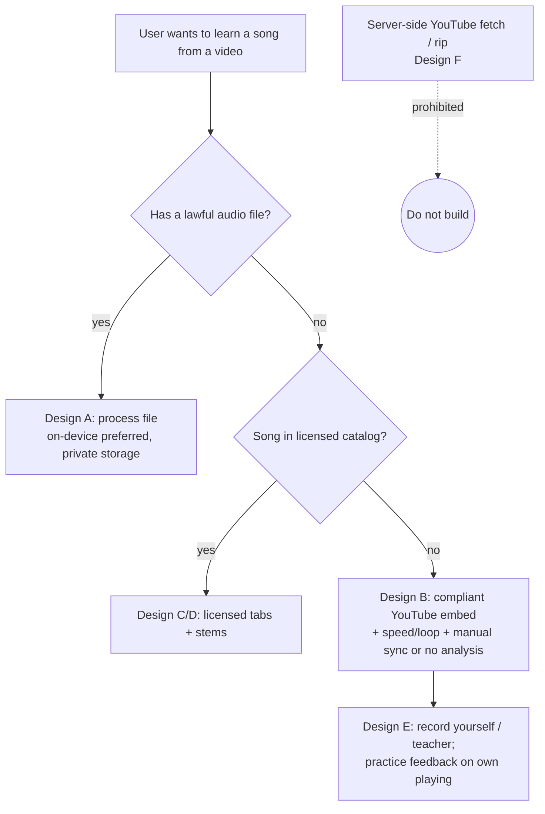

# YouTube, Copyright and Platform Policy Constraints

> **NOT LEGAL ADVICE. LEGAL REVIEW REQUIRED.** This document was written by a research agent, not a lawyer. It summarizes primary sources (terms of service, statutes, court filings and opinions) and reputable legal press as of 2026-10-20. Several key questions (notably whether YouTube's "rolling cipher" is a protected technological measure under 17 U.S.C. § 1201) are **unsettled and in active litigation**. Splitune must have qualified counsel (US copyright + platform/contract law; EU/UK counsel before launching there) review the chosen design before any public launch, and before any feature that ingests audio from a third-party platform. Jurisdiction is US unless stated otherwise.

## TL;DR

- **Not a lawyer; legal review required** before shipping any ingestion path, any sharing feature, or any paid tier built around embedded YouTube playback. Items marked "counsel" below are mandatory review points.
- **Do not download, rip, or server-side fetch YouTube audio/video (no yt-dlp/youtube-dl in the product).** YouTube's Terms prohibit downloading content unless the Service expressly authorizes it, and its API Developer Policies separately prohibit caching/storing audiovisual content without YouTube's prior written approval (§III.E.1.a) and separating or isolating audio components (§III.I.7). Record labels are actively litigating YouTube stream-ripping as § 1201 circumvention (Yout v. RIAA, 2d Cir., pending; labels' proposed § 1201(a) claim against Suno, D. Mass., 2025), and FLVTO/2conv drew an ~$83M default judgment in 2022. This is the highest-exposure design available and is ruled out.
- **The embedded YouTube IFrame player is usable but constrained:** no overlays on the player, a viewport of at least 200×200 px, no background play, no muting the video to play a separated stem in sync (our reading: the policy's own example is that you must not apply "alternate audio tracks" to videos), and **no charging users to watch content in the embed** (§III.F.3.a). Speed (`setPlaybackRate`, typically 0.25–2×), seeking and A–B looping via `seekTo` are standard API features.
- **Compliant defaults:** (1) user-provided audio files (purchased/owned/self-recorded) processed preferably on-device, stored privately per user; (2) YouTube embed used only as a *visual reference* synced to analysis derived from a user-owned file or licensed data; (3) licensed catalog/tab content for anything shared or pre-computed. Moises, Capo and Anytune all restrict processing to user files and refuse streaming-service links (Moises' help article cites copyright and DRM; that page returned 403 on re-check on 2026-10-20, so its wording is unverified, and the App Store listing is the corroborating source).
- **Two copyrights per song:** the sound recording (label) and the musical work (publisher/songwriter). A stem is a recapture of the recording's actual sounds (17 U.S.C. § 114(b)); a tab/transcription is a copy or arrangement of the musical work. Publicly shared tabs historically drew publisher takedowns (MPA/NMPA, 2005–2006) and are now licensed by Ultimate Guitar (publishers + Harry Fox Agency) and Songsterr (pays royalties). Keep generated stems and tabs **private to the user** unless licensed.
- **If users upload anything:** register a DMCA agent with the U.S. Copyright Office ($6, expires after 3 years), publish a takedown and repeat-infringer policy, and never build a cross-user shared cache of stems/transcriptions of copyrighted songs without a license.

## Findings

### 1. YouTube Terms of Service and API Services terms

**YouTube Terms of Service (consumer ToS), effective 2023-12-15 per the US-English page** ([YouTube Terms of Service](https://www.youtube.com/t/terms?hl=en&gl=US)):

- Permitted use: you may "view or listen to Content for your personal, non-commercial use."
- Restrictions (section "Permissions and Restrictions"): you may not "access, reproduce, download, distribute, transmit, broadcast, display, sell, license, alter, modify" any part of the Service or Content, except where (a) expressly authorized by the Service or (b) with prior written permission from YouTube and, if applicable, the rights holders.
- You may not "circumvent, disable, fraudulently engage with, or otherwise interfere with" any part of the Service.
- No automated access "(such as robots, botnets or scrapers)" except public search engines per robots.txt or with prior written permission.
- Note: a fetch of the Vietnamese-locale page showed an effective date of 2022-01-05, so the effective date differs by locale/version. Counsel should confirm which version governs Splitune and its users.

**YouTube API Services Developer Policies (last updated 2026-10-15)** ([Developer Policies](https://developers.google.com/youtube/terms/developer-policies)) — binding on any app that embeds the player or calls YouTube APIs:

| Clause | What it prohibits (paraphrase; quotes under 15 words) | Splitune relevance |
|---|---|---|
| III.E.1.a | "download, import, backup, cache, or store copies of YouTube audiovisual content" without YouTube's prior written approval | Rules out ripping, even transient server-side caching for analysis |
| III.E.1.b | "make content available for offline playback" | No offline practice mode for YouTube sources |
| III.I.6 | "modify, build upon, or block any portion or functionality of a YouTube player" | No custom audio graph on the player's output |
| III.I.7 | "separate, isolate, or modify the audio or video components"; the policy's example: you must not apply "alternate audio tracks" to videos | **Directly prohibits stem separation of YouTube content.** Muting the video to play a separated stem in sync is, in our reading (inference), applying an alternate audio track |
| III.I.8 | promoting audio or video components separately | No "audio-only" YouTube mode |
| III.I.9 | features that play content "from a background player" | No background/lock-screen playback of YouTube audio |
| III.I.14 | using non-API technology to access or retrieve API Data | Scraping is out |
| III.I.18 | "infringe copyrights or exploit copyright-infringing materials" | General |
| III.I.21 | nesting the player in a "nested or hierarchical iframe lineage" | Architecture constraint for web/WebView embedding |
| III.F.2.c | obscuring YouTube attribution, including in embedded players | No covering the YouTube logo/title |
| III.F.3.a | "must not charge users to watch content in an embedded YouTube player" | **Paywall design must not gate the video itself (counsel)** |
| III.F.3.b | gating a video behind any action other than play (e.g. subscribe, like) | No "sign up to watch" gate on the embed |
| III.I.1 | acting as a substitute for YouTube Applications | Product must add value beyond playback |
| III.E.4.c | stored authorized data must be deleted or refreshed after 30 calendar days | Applies to API Data (metadata), not audio |
| III.G.2.a | selling an API Client is allowed (subject to prohibitions) | Paid app is possible in principle |

The **YouTube API Services Terms of Service** (last updated 2026-09-14) incorporate the Developer Policies and state that no rights or licenses "are granted to reproduce or distribute audiovisual content" (§16.3) ([API Services ToS](https://developers.google.com/youtube/terms/api-services-terms-of-service)).

**YouTube Premium downloads** are an in-service authorization, not an export right. Google's help page says downloaded videos play offline for up to 29 days (48 hours in some regions), only while signed in to the same Premium account, and are removed at the next sync if no longer available ([Watch videos offline with YouTube Premium](https://support.google.com/youtube/answer/11977233?hl=en)). Inference: nothing in the Premium documentation authorizes extracting a Premium download for use by a third-party app; the ToS download restriction still applies. Counsel should confirm.

#### Enforcement history around downloaders and stream rippers

| Event | Date | What happened | Status (2026-10-20) |
|---|---|---|---|
| RIAA DMCA notice v. youtube-dl on GitHub | 2020-10-23 | RIAA alleged youtube-dl circumvents YouTube's "rolling cipher" in violation of 17 U.S.C. §§ 1201(a)(2), 1201(b)(1), citing a Hamburg court decision ([GitHub DMCA repo: RIAA notice](https://github.com/github/dmca/blob/master/2020/10/2020-10-23-RIAA.md)) | Repo reinstated 2020-11-16 after GitHub concluded the project "was not circumventing a technical protection measure"; GitHub created a $1M developer defense fund and a 1201 review process ([GitHub blog](https://github.blog/news-insights/policy-news-and-insights/standing-up-for-developers-youtube-dl-is-back/)). EFF argued the signature JavaScript is publicly delivered and the streams are not DRM-encrypted ([EFF, 2020-11-17](https://www.eff.org/deeplinks/2020/11/github-reinstates-youtube-dl-after-riaas-abuse-dmca)) |
| yt-dlp | ongoing | Note: the task brief's "yt-dlp takedown" is actually the youtube-dl takedown above. yt-dlp is a fork of youtube-dl via youtube-dlc, licensed `Unlicense` (some binaries include GPL-3.0-or-later code) ([yt-dlp repo](https://github.com/yt-dlp/yt-dlp)). A permissive code license grants no rights to the content it downloads | — |
| Sony/Warner/Universal (German subsidiaries) v. Uberspace (host of youtube-dl.org homepage) | LG Hamburg 2023; OLG Hamburg appeal rejected Nov 2024 | Courts held the host must stop assisting circumvention of "effective technical protection measures"; the lower court treated YouTube's rolling cipher as such a measure ([heise, 2024-11-27](https://www.heise.de/en/news/OLG-Hamburg-Uberspace-liable-for-hosting-Youtube-DL-10179284.html); [TorrentFreak, 2024-11-27](https://torrentfreak.com/court-rejects-appeal-of-youtube-dl-hosting-provider-uberspace-241127-1/)) | OLG did not admit a further appeal (Revision); any BGH challenge **unverified** |
| UMG Recordings v. Kurbanov (FLVTO.biz, 2conv.com) | 4th Cir. 2020-06-26; E.D. Va. judgment Feb 2022 | 4th Cir. reversed dismissal for lack of personal jurisdiction over the Russian operator ([Stanford Fair Use Project summary](https://fairuse.stanford.edu/case/umg-recordings-inc-v-kurbanov)). After the defendant stopped participating, the court entered default judgment of $82,922,500 for 1,618 infringements and DMCA violations, plus an injunction against circumventing technological measures ([TorrentFreak, 2022-02-14](https://torrentfreak.com/?p=215056)) | Final (default); single press source for the amount |
| Yout LLC v. RIAA (No. 22-2760, 2d Cir.) | D. Conn. dismissal 2022; argued Feb 2024 | Yout sought a declaration that its stream-ripper is lawful; Judge Underhill dismissed, finding Yout had not shown it does not circumvent YouTube's measures ([TorrentFreak, 2026-04-03](https://torrentfreak.com/yout-com-hopes-supreme-courts-cox-ruling-helps-its-case-riaa-disagrees/)) | **Still pending** as of April 2026; Yout cited *Cox v. Sony* in a 28(j) letter; RIAA says *Cox* is irrelevant to § 1201 ([Digital Music News, 2026-04-13](https://www.digitalmusicnews.com/2026/04/13/yout-v-riaa-cox-decision/)). The 2d Cir. invited further briefing on Suno's amicus brief on 2025-10-10 ([Suno sur-reply, D. Mass. Dkt. 157](https://storage.courtlistener.com/recap/gov.uscourts.mad.272063/gov.uscourts.mad.272063.157.0.pdf)). No decision found |
| UMG Recordings et al. v. Suno (D. Mass. 1:24-cv-11611) | motion to amend, 2025 | Labels sought to add a § 1201(a) claim alleging Suno circumvented YouTube's rolling cipher to obtain training audio; Suno argues the cipher is a copy control, not an access control, and that the recordings are "freely accessible" ([Suno sur-reply, filed 2025-10-27](https://storage.courtlistener.com/recap/gov.uscourts.mad.272063/gov.uscourts.mad.272063.157.0.pdf)) | Ruling on the amendment **unverified** |

Note: the task brief described the Yout appeal as a "Second Circuit 2024 decision". The sources found say it was *argued* in February 2024 and remains undecided. The task's "Hamburg 2023/2024 youtube-dl ruling" is the Uberspace case above.

**Evidence summary:** whether YouTube's signature scheme is an "access control" (§ 1201(a)) or a "copy control" (§ 1201(b)) is the open question. It matters because § 1201(a)(1)(A) bans the *act* of circumventing access controls, while for copy controls § 1201(b) bans only trafficking in tools ([17 U.S.C. § 1201](https://www.law.cornell.edu/uscode/text/17/1201)). A German appellate court has treated the cipher as an effective measure. US law is unresolved. **Inference:** a commercial service that fetches YouTube audio server-side exposes itself to ToS breach and § 1201 claims, plus reproduction claims, and the labels are actively pursuing that theory against AI companies.

### 2. IFrame / embedded player rules

From **Required Minimum Functionality (RMF)**, last updated 2026-10-15 ([RMF](https://developers.google.com/youtube/terms/required-minimum-functionality)) and the **IFrame Player API reference** ([IFrame API](https://developers.google.com/youtube/iframe_api_reference)):

- **Size:** "viewport that is at least 200px by 200px". Controls must fit without shrinking it below that. Recommended 16:9 minimum is 480×270 px.
- **Overlays:** no "overlays, frames, or other visual elements in front of" any part of the player, including its controls. Tabs, chords or fretboards must render **beside or below** the video, never on top of it.
- **Autoplay:** do not start automatic playback until the player is visible (more than half on screen). No more than one autoplaying player per screen. Thumbnails that trigger playback must be at least 120×70 px.
- **No undocumented player modifications:** "You must not make changes to the YouTube player that are not explicitly described by the API documentation."
- **WebView:** use OS-provided WebView types where available (relevant to iOS/Android shells).
- **Available controls (documented, so permitted):** `setPlaybackRate` (rates come from `getAvailablePlaybackRates`, e.g. 0.25, 0.5, 1, 1.5, 2, and are not guaranteed), `seekTo`, `getCurrentTime`, `onStateChange`, `mute`/`setVolume`, and `loadVideoById` with `startSeconds`/`endSeconds`. These are enough for speed control, A–B loops and timeline sync. The API exposes **no raw audio**. **Inference:** pitch shift, EQ, stem mute/solo and any audio analysis of the YouTube stream are impossible through the sanctioned API, and attempting them by capturing output would hit §III.I.6/7 (see `ml/playback-time-stretch-pitch-shift.md`).
- **Video frames:** the player is a cross-origin iframe, so the page cannot read its pixels. Analyzing fingering from a YouTube video's frames would require capturing or downloading the video, which hits §III.E.1 and §III.I.7. See `ml/video-and-audio-visual-analysis.md`. This is an inference from the policy text; counsel should confirm screen-capture approaches.

**Competitor evidence (embed pattern):** Soundslice lets creators add a "YouTube video" recording and sync notation via syncpoints. Videos set as non-embeddable "can't be used within Soundslice", and creators are told to upload MP3/video instead to avoid YouTube removals ([Soundslice help: YouTube](https://soundslice.com/help/en/creating/recordings/165/youtube)). The same page says Soundslice's system generates a *waveform* for YouTube videos. How that waveform is produced is not documented, so do not treat it as precedent for audio access.

### 3. Copyright and the DMCA

**Two copyrights.** The U.S. Copyright Office treats sound recordings and musical compositions as "two separate works". A composition's authors are composers, lyricists and songwriters; a sound recording's are performers, producers and engineers ([Circular 56A](https://www.copyright.gov/circs/circ56a.pdf)). In practice, labels hold recordings and publishers hold compositions.

**What Splitune outputs touch:**

| Output | Work implicated | Statutory hook | Notes |
|---|---|---|---|
| Separated stem (e.g. isolated bass) | Sound recording (and the embodied musical work) | § 114(b): the recording owner's rights cover works that "recapture the actual sounds" and versions where the sounds are "rearranged, remixed, or otherwise altered" ([17 U.S.C. § 114](https://www.law.cornell.edu/uscode/text/17/114)) | A stem is very likely a reproduction and/or derivative of the recording (inference; counsel) |
| Slowed or pitch-shifted playback of user's file | Sound recording | § 106(1), (2) ([17 U.S.C. § 106](https://www.law.cornell.edu/uscode/text/17/106)) | Private, personal use is the main defense (fair use) |
| Tab / notation / MIDI transcription | Musical work | § 106(1), (2); § 114(b) says an "independent fixation" imitating a recording does not infringe the *recording*, but the composition is still implicated | Publishers have long treated tabs as reproductions/arrangements requiring print licenses (below) |
| Chord chart (chord symbols + timing) | Musical work, weakly | Compendium § 802.5(A) lists "Chord symbols based on standard chord progressions" as uncopyrightable, and harmonization with "standard chords in common sequences such as C, F, G, C" is not registrable ([Compendium III, ch. 800](https://www.copyright.gov/comp3/chap800/ch800-performing-arts.pdf)) | Chordify relies on this position (below). Lyrics and melody shown with chords are protectable |
| Tempo, key, section labels, beat grid | Facts / metadata | — | Lowest risk (inference) |

**Tab history.** In 2006 the Music Publishers' Association and the National Music Publishers' Association shut down several fan-run tab sites, or forced them to remove all tabs, by threatening copyright suits ([Out-Law / Pinsent Masons, 2006-08-28](https://www.pinsentmasons.com/out-law/news/guitar-instruction-websites-shut-down-by-music-industry)). Ultimate Guitar now states it holds licenses from publishers including Sony/ATV, EMI, Alfred, Hal Leonard, Peermusic, Faber and Music Sales, plus a Harry Fox Agency agreement covering further publishers, and that some songs are blocked at owners' request ([Ultimate Guitar: licensing](https://www.ultimate-guitar.com/article/blog/licensing); undated page). Songsterr describes itself as user-contributed and "100% legal", saying paid users fund "royalties to music creators" ([Songsterr About](https://www.songsterr.com/about)). Chordify says chord progressions are not "sufficiently unique enough to be copyrighted on their own" and offers retraction by email (retract@chordify.net) ([Chordify support](https://support.chordify.net/hc/en-us/articles/360001420738-Does-this-not-infringe-copyright)). **No public source was found confirming a Chordify publisher licensing deal (unverified).** The brief's mention of MCPS-PRS deals is also unverified.

**Fair use (17 U.S.C. § 107)** weighs four factors: purpose and character, including commercial vs. "nonprofit educational" use; the nature of the work; the amount used; and market effect. The preamble lists "teaching" and "scholarship" among example purposes ([17 U.S.C. § 107](https://www.law.cornell.edu/uscode/text/17/107)). *Andy Warhol Foundation v. Goldsmith* (decided 2023-05-18) held that when the original and the secondary use "share substantially the same purpose" and the use is commercial, factor one can weigh against fair use ([Supreme Court opinion 21-869](https://www.supremecourt.gov/opinions/22pdf/21-869_87ad.pdf)).

**Inference (not settled law):** a learner privately slowing down a song they bought has a stronger position than a commercial service that makes the copies. Splitune, not the user, would perform the reproduction (separation/transcription) for a fee. Factor four is sensitive because licensed markets for stems (AudioShake label deals, below) and tabs (UG/Songsterr) exist, so unlicensed stems and tabs can be argued to substitute for them. This is exactly where counsel is required.

**DMCA safe harbor (17 U.S.C. § 512(c))** protects a service provider storing material "at the direction of a user" if it (a) lacks actual or red-flag knowledge, or removes material expeditiously on learning; (b) receives no financial benefit directly attributable to infringement it has the right and ability to control; (c) removes material on receiving a compliant notice; (d) designates an agent with the Copyright Office; and (e) under § 512(i), adopts and reasonably implements a repeat-infringer termination policy. § 512(g) sets counter-notice and restoration within 10–14 business days ([17 U.S.C. § 512](https://www.law.cornell.edu/uscode/text/17/512)). Agent designation costs "$6 per designation, amendment, or resubmission" and expires three years after registration unless renewed ([Copyright Office DMCA Directory FAQ](https://www.copyright.gov/dmca-directory/faq.html); [DMCA Directory](https://www.copyright.gov/dmca-directory/)).

**Open legal question (counsel):** § 512(c) covers *storage* at a user's direction. Whether it shields Splitune's *own* acts (running separation and transcription on uploaded audio, and storing derived stems/tabs it generated) is not established by any source found. Do not assume the safe harbor covers derived outputs.

**Secondary liability after *Cox v. Sony* (U.S. Supreme Court, No. 24-171, decided 2026-03-25 ([LII syllabus](https://www.law.cornell.edu/supremecourt/text/24-171))).** The Court held that a service provider is contributorily liable only if it intended its service to be used for infringement, shown through inducement or a service "tailored to infringement". Mere knowledge is insufficient ([Cornell LII: Cox v. Sony](https://www.law.cornell.edu/supremecourt/text/24-171)). Justice Thomas wrote for seven justices; Justices Sotomayor and Jackson concurred in the judgment. Services "capable of substantial or commercially significant noninfringing uses" are not "tailored to infringement" ([Mayer Brown, 2026-03-25](https://www.mayerbrown.com/en/insights/publications/2026/03/supreme-court-significantly-narrows-liability-for-contributory-copyright-infringement)). **Inference:** this lowers *secondary* liability risk for a general-purpose practice tool that processes user files. It does **not** help with *direct* liability for copies Splitune makes itself, nor with § 1201, as RIAA argues in Yout. Marketing copy that encourages ripping songs could look like inducement, so avoid it.

### 4. AI and fair-use case law relevant to processing copyrighted audio

| Case | Court / date | Holding (from the order) | Relevance to Splitune |
|---|---|---|---|
| *Bartz v. Anthropic*, No. C 24-05417 WHA | N.D. Cal., Order on Fair Use, filed 2025-06-23 (Alsup, J.) | Summary judgment for Anthropic that training was fair use, and the print-to-digital format change was fair use for a different reason. Denied as to pirated library copies, which went to trial on liability and damages ([Order, Dkt. 231](https://storage.courtlistener.com/recap/gov.uscourts.cand.434709/gov.uscourts.cand.434709.231.0.pdf)). The settlement website reports final approval on 2026-07-20 ([settlement site](https://www.anthropiccopyrightsettlement.com/)); the amount is not stated there (unverified here) | **Source acquisition matters independently of downstream use.** Copies obtained from unauthorized sources were not excused by a transformative later use. Analogy: an analysis-only pipeline fed by ripped YouTube audio is not cleaned by the benign output |
| *Kadrey v. Meta*, No. 23-cv-03417-VC | N.D. Cal., 2025-06-25 (Chhabria, J.) | Partial summary judgment for Meta on these 13 plaintiffs' record. The court said the ruling "does not stand for the proposition" that the training is lawful, and stressed market dilution as a potentially decisive factor-four harm ([Order, Dkt. 598](https://storage.courtlistener.com/recap/gov.uscourts.cand.415175/gov.uscourts.cand.415175.598.0.pdf)) | Factor four (market substitution) is the battleground. Stems and tabs have licensed markets |
| UMG / Sony / Warner labels v. Suno (D. Mass.) and v. Udio (S.D.N.Y.) | filed 2024 | UMG and Udio settled on 2025-10-29 with recorded-music and publishing licenses. Udio's interim product was moved into a "walled garden" with fingerprinting and filtering ([UMG press release](https://www.universalmusic.com/universal-music-group-and-udio-announce-udios-first-strategic-agreements-for-new-licensed-ai-music-creation-platform/)). In Suno, labels sought to add a YouTube-rolling-cipher § 1201(a) claim (2025, see above) | The industry's settlement template is **license + fingerprinting/filtering + walled garden**. Status of the other label–Suno/Udio claims after Oct 2025 is **unverified** (research budget exhausted) |

**Caveats:** these are generative-AI *training* cases about books (Bartz, Kadrey) or generative music. Splitune's core use (per-user separation and transcription of a specific song so the user can learn it) is different. It produces outputs that embody the specific work, which arguably makes it *less* transformative than training. Using copyrighted audio to *train* Splitune's own models is a separate question covered in `ml/datasets-metrics-and-licensing.md`.

**EU / UK text-and-data-mining (TDM), brief:**

- EU Directive 2019/790 (DSM) art. 2(2) defines TDM as automated analysis "to generate information" such as patterns, trends and correlations. Art. 4 permits reproductions of "lawfully accessible works" for TDM, retained "for as long as is necessary", unless rightholders have expressly reserved rights, e.g. by "machine-readable means" ([Directive (EU) 2019/790](https://eur-lex.europa.eu/legal-content/EN/TXT/HTML/?uri=CELEX:32019L0790)). **Inference:** art. 4 is aimed at mining for information, not at producing a usable stem or tab of a specific song, and major labels widely reserve TDM rights (unverified here). Do not rely on it for Splitune's core feature (counsel).
- The same Directive's art. 17 makes "online content-sharing service providers" that give the public access to user uploads responsible for obtaining authorization, for example through licensing. The definition **excludes** "cloud services that allow users to upload content for their own use" ([same source](https://eur-lex.europa.eu/legal-content/EN/TXT/HTML/?uri=CELEX:32019L0790)). **Inference:** keeping uploads and derived outputs private per user keeps Splitune out of the art. 17 regime; public sharing pulls it in.
- UK CDPA s.29A permits copies for computational analysis only "for the sole purpose of research for a non-commercial purpose", by a person with lawful access ([CDPA 1988 s.29A](https://www.legislation.gov.uk/ukpga/1988/48/section/29A)). It does not cover a commercial app.

### 5. App store policy

**Apple App Store Review Guidelines** ([App Review Guidelines](https://developer.apple.com/app-store/review/guidelines/); page date not captured):

- **5.2.1:** no protected third-party copyrighted works without permission.
- **5.2.2:** an app that "uses, accesses, monetizes access to, or displays content from a third-party service" must be permitted by that service's terms, with authorization provided on request.
- **5.2.3 Audio/Video Downloading:** apps must not include the ability to "save, convert, or download media from third-party sources". Apple Music, YouTube, SoundCloud and Vimeo are named examples, and the bar applies "without explicit authorization from those sources". Streaming may also violate terms of use.
- **4.5.2 (Apple Music/MusicKit):** users must initiate Apple Music playback. The app may not require payment for or indirectly monetize access to Apple Music, and may not download or share music files sourced from MusicKit.

**Google Play Developer Policy:**

- Intellectual Property: "We don't allow apps that infringe copyright." Under "Encouraging Infringement", violations include apps that let users "download a local copy of copyrighted content without authorization" ([Google Play: Intellectual Property](https://support.google.com/googleplay/android-developer/answer/9888072?hl=en)).
- Device and Network Abuse: prohibits apps that "access or use a service or API in a manner that violates its terms of service" ([Google Play: Device and Network Abuse](https://support.google.com/googleplay/android-developer/answer/9888379?hl=en)). Combined with YouTube §III.I.9, this makes background YouTube playback a Play policy violation (inference).

**Spotify (for "Spotify-connected" ideas):** the Developer Terms (v10, effective 2025-05-15) prohibit "modifying, editing, altering, creating derivative works" of Spotify Content (§IV.2.1(b)), training or ingesting content into ML/AI models (§IV.2.1(a)), and facilitating "stream ripping" (§IV.2.2(c)) ([Spotify Developer Terms](https://developer.spotify.com/terms)). The Developer Policy adds "Do not synchronize any sound recordings with any visual media" and no mixing or overlapping of Spotify Content ([Spotify Developer Policy](https://developer.spotify.com/policy)). **Inference:** Spotify can at most be a "now playing" or launch link, not an audio source for analysis or practice playback.

### 6. How competitors handle it (as publicly documented)

| Product | Audio source model | Licensing / rights posture (documented) | Source |
|---|---|---|---|
| **Moises** | Upload, plus import from Google Drive, Dropbox, iCloud and "public URL". Explicitly **refuses streaming-service URLs** | Help center (page returned 403 on re-check, 2026-10-20; wording unverified): streaming licenses permit playback only, a subscription grants no modification rights, extracting stems would be "an unauthorized derivative work", and users must supply audio they own or may use | [Moises help: streaming links](https://help.moises.ai/hc/en-us/articles/18322457396508-How-do-streaming-services-work-and-why-can-t-we-accept-their-URL-links-on-Moises); [App Store listing](https://apps.apple.com/us/app/1515796612) |
| **Chordify** | Music "from YouTube, SoundCloud, or your private collection" turned into chords via DNNs, shown in a synced player | Says chord progressions are not copyrightable; retraction by email. **How it obtains YouTube audio is not documented**; publisher licensing deals unverified | [What is Chordify?](https://support.chordify.net/hc/en-us/articles/360002221018-What-is-Chordify); [copyright FAQ](https://support.chordify.net/hc/en-us/articles/360001420738-Does-this-not-infringe-copyright) |
| **Songsterr** | User-contributed tabs with synthesized playback | Says it is "100% legal" and pays royalties from subscriptions | [Songsterr About](https://www.songsterr.com/about) |
| **Soundslice** | Creator-supplied notation synced to YouTube (embed), Vimeo, Wistia, Mux, or uploaded MP3/video | Non-embeddable YouTube videos unusable; recommends direct upload. Its "licensing" product is embedding lessons, not music rights | [Soundslice YouTube help](https://soundslice.com/help/en/creating/recordings/165/youtube); [Soundslice licensing](https://www.soundslice.com/licensing) |
| **Capo** | Audio files you own (MP3, WAV, AIFF, M4A, FLAC) and DRM-free iTunes purchases | "can't access streaming tracks from services like Spotify or Apple Music" | [Capo product page](https://supermegaultragroovy.com/products/capo/) |
| **Anytune** | Music library, Wi-Fi/Open-In/Dropbox imports, audio extracted from *user's* video files. On Android, tempo change of Spotify/Apple Music streams | No rights statement found. The Android stream feature's mechanism is undocumented | [Anytune site](https://www.anytune.app/) |
| **Ultimate Guitar** | User-submitted tabs plus official tabs | Publisher licenses plus Harry Fox Agency agreement; some songs blocked at owners' request | [UG licensing](https://www.ultimate-guitar.com/article/blog/licensing) |
| **LALAL.AI** | User uploads | User "solely responsible" for uploaded and result files; DMCA agent designated, though it says it is not subject to US law. No URL import in terms | [LALAL.AI Terms](https://www.lalal.ai/terms-of-service/) |
| **AudioShake** | B2B: rights holders and enterprises upload their catalogs | MSA (effective 2026-10-01): customer warrants it "has all rights required to upload". Content is not used to train models that generate new music. Label deals, e.g. EMPIRE (2025-03-11) for sync and immersive uses. Also sells a "Copyright Compliance System" (detect, identify, remove music) | [AudioShake MSA](https://audioshake.ai/terms); [EMPIRE release](https://www.audioshake.ai/press-releases/empire-partners-with-audioshake-to-deliver-stems-and-lyrics-for-empire-catalog); [Copyright compliance](https://audioshake.ai/use-cases/copyright-compliance) |
| **Yousician** | Own licensed song catalog | Artist partnerships (Billie Eilish 2024, Metallica 2022). Licensing terms not public | [Digital Music News, 2024-06-20](https://www.digitalmusicnews.com/2024/06/20/billie-eilish-partners-with-music-education-platform-yousician/) |
| **Rocksmith+** | Own catalog of "official songs" (5,000+ at 2022 launch) | Grown "through partnerships with famed labels such as Sony and Universal" | [Ubisoft News, 2022-08-29](https://news.ubisoft.com/en-us/article/2rF9lMho0EwEXvH9D5RrbE/rocksmith-launching-on-pc-september-6-with-over-5000-songs-and-more-to-come) |
| **Spotify-connected apps** | Cannot use Spotify audio for derivative or ML purposes | See Spotify Developer Terms/Policy above | [Spotify Developer Terms](https://developer.spotify.com/terms) |

**Pattern:** separation tools (Moises, LALAL.AI, Capo) push rights responsibility onto users and accept only user files. Catalog products (Yousician, Rocksmith+, UG, Songsterr) license. Chordify is the outlier that processes YouTube-sourced music and publicly relies on a chords-are-not-copyrightable argument. For competitor depth see `market/competitor-landscape.md` and `market/feature-matrix.md`.

## Implications for Splitune

### Compliant (and non-compliant) designs for "learn from a video I watched"

Exposure ratings are the author's inference from the sources above, **not legal conclusions**. Every row requires counsel sign-off before launch.

| # | Design | What it allows | What it blocks | Legal exposure | UX cost | Mandatory legal review |
|---|---|---|---|---|---|---|
| **A** | **User-provided audio** (purchased file, own recording, rehearsal recording), processed **on-device** where feasible, else server-side with private per-user storage | Full feature set: separation, transcription, speed/pitch, loops, export to the user | Nothing technically. Users must already have a file, and most YouTube-first learners won't | **Low–medium.** Splitune still makes copies and derivatives of copyrighted works for a fee (fair-use questions remain), but with no ToS or § 1201 issue. On-device processing reduces Splitune's own copying (inference) | Medium: an "I have the file" step. Moises, Capo and Anytune show users accept it | Upload ToS (user warrants rights), fair-use posture for paid separation/transcription, DMCA program, retention policy |
| **B** | **YouTube IFrame embed as visual reference + analysis from a lawful source.** The video plays in an RMF-compliant embed. Chords, tabs and beat grid come from (i) the user's own file of the same recording, aligned by user-tapped or assisted syncpoints (the Soundslice model), or (ii) licensed or curated data. Video controlled only via documented API (`setPlaybackRate`, `seekTo`, A–B loop) | The "learn from this video" feel: watch the performer while chords/tabs scroll beside the player, slow down, loop | Stem solo/mute over the video (III.I.7), pitch shift, background play (III.I.9), offline (III.E.1.b), overlays on the video (RMF), video-frame/fingering analysis (frames inaccessible), charging to watch the embed (III.F.3.a) | **Low–medium**, *if* no YouTube audio is ever fetched or captured. Residual risk: paywall design vs. III.F.3.a, and how (i)'s alignment works without YouTube audio | Medium–high: two sources (video + user file), manual sync for (i). Embeds can disappear or be non-embeddable | III.F.3.a paywall structure; whether showing the derived tab beside the video is a "derivative" display problem (musical work); RMF review of layouts |
| **C** | **Licensed catalog:** tabs/notation licensed from publishers (direct or via HFA-style administrators), recordings or stems licensed from labels or distributors | Shareable, pre-computed, high-quality lessons; public song pages; SEO | Long tail of songs, live versions and covers; depends on deal coverage; blocked songs | **Low** within licensed scope | Low for users, high for the business (deal cost, minimum guarantees, reporting) | Contract review of each license (print vs. display vs. sync vs. stems; territories) |
| **D** | **Licensed B2B stems** (AudioShake / Music.AI-style) **for catalogs Splitune has licensed**, or rights-holder-supplied multitracks | Better separation quality on licensed titles | Using a B2B vendor does **not** confer rights: AudioShake's MSA requires the customer to warrant rights | Low with a rights grant; **high without one** | Low | Vendor MSA and the underlying content license |
| **E** | **Bring-your-own-performance:** user records themselves, a teacher, a bandmate, or a performance they have permission to use; mic-based practice feedback on the user's own playing | Self-assessment, teacher-lesson workflows, feedback on own playing | Learning an arbitrary commercial song from its recording | **Low** (user's own performance; note the user still performs a composition, which is fine for private practice) | Low–medium | Standard UGC terms |
| **F** | **Analysis-only metadata from ephemeral processing of the YouTube stream** (server fetches audio, extracts chords/tempo/structure, deletes audio) | Chordify-like automatic chords for any YouTube link | — | **High.** Fetching is itself prohibited by ToS and Dev Policy III.E.1 and III.I.7 regardless of retention. It is the exact § 1201 theory labels are litigating (Yout, Suno), and *Bartz* indicates unlawful acquisition is not excused by a benign later use | Lowest UX cost, which is why it is tempting | **Do not build** without a written YouTube authorization and counsel opinion |
| **F′** | **Ambient "listen mode":** the YouTube video plays normally (on YouTube or in a compliant embed on another device), and Splitune analyzes only microphone input on-device in real time, storing only derived chords/tempo | Approximate chords/beat for anything the user can hear, without touching YouTube's stream | Quality (room acoustics), no stems, no tabs of single instruments in dense mixes | **Medium / unclear.** No YouTube API or stream access, but whether mic capture of a playing embed or tab counts as "separating" YouTube audio, and the copyright status of transient RAM copies, are **untested here** | Medium: user must play audio aloud | Mandatory: ToS reading of mic capture; transient-copy doctrine; on-device-only guarantee |

**Recommended default (for `product/recommendations-and-decisions.md`, pending counsel):** launch with **A + B + E**. Make B the "video I watched" entry point. Run separation and transcription only on audio the user supplies, on-device where the ML budget allows (see `ml/deployment-and-inference.md`). Add **C/D** as the business grows. Exclude **F** and keep **F′** as a research spike gated on legal review.

### UGC policy requirements (if users upload audio)

1. Register a DMCA designated agent ($6, renew every 3 years) and publish the agent's contact details in-app and on the site ([DMCA Directory FAQ](https://www.copyright.gov/dmca-directory/faq.html)).
2. Terms of Service clauses (counsel to draft): the user warrants they own or are licensed to process the upload (as in AudioShake §8.2 and the LALAL.AI user-responsibility model); a narrow license to Splitune to process the upload only for that user; prohibited sources (ripped streams, explicitly naming YouTube/Spotify/Apple Music downloads, mirroring Moises' help article); repeat-infringer termination (§ 512(i)); counter-notice procedure (§ 512(g)).
3. Takedown operations: a notice intake form and email, deletion of the upload **and all derived stems/tabs**, logging, and repeat-infringer strikes.
4. Product copy: never market "rip", "download from YouTube" or similar. After *Cox*, inducement is the remaining contributory-liability path.
5. Store submission: be ready to show authorization per Apple 5.2.2/5.2.3 for any third-party source. With Design A/B there is no third-party media download to justify.

### Data handling

- **Per-user private storage** of uploads, stems and transcriptions is materially lower exposure than a **shared cache**. A shared cache means Splitune serves copies it made from one user's upload to other users, which looks like Splitune's own distribution or public availability rather than "storage at the direction of a user". In the EU it also moves Splitune toward art. 17 OCSSP status (inference; counsel). Deduplicating *compute* by audio fingerprint is a tempting cost optimization. If used, keep outputs per-user, or limit shared reuse to non-protectable metadata (tempo, key, section boundaries), and get legal sign-off.
- Set a retention policy: auto-delete raw uploads after processing, or after N days of inactivity. Offer user deletion that cascades to derived artifacts. Note that YouTube API Data (titles, IDs) has a 30-day refresh/delete rule (III.E.4.c).
- **Training data:** do not train models on user uploads without an explicit, separate license and an opt-in. AudioShake's MSA notably promises not to use customer content to train generative music models. See `ml/datasets-metrics-and-licensing.md`.

### Distribution of generated tabs

- **Private to the user (default):** lowest exposure. Similar to a learner writing out a transcription for personal use, though Splitune generates it commercially (fair-use question; counsel).
- **Export (PDF, Guitar Pro, MusicXML) to the user's own device:** moderate. It is still a single copy to the requester, but it is portable.
- **Public sharing or a community tab library:** requires publisher licensing (the UG/HFA model) or a takedown-heavy UGC model. This is the exact activity behind the 2006 MPA/NMPA tab-site shutdowns. Chord-only charts are lower risk (Compendium § 802.5(A)), but lyrics and melody shown with chords are protectable.

## Open questions

Questions for counsel (all mandatory before launch unless noted):

1. **Paid tiers and YouTube embed:** does a subscription that unlocks synchronized practice tools (tabs, loops, speed) next to a free-to-play embed violate Developer Policy III.F.3.a ("must not charge users to watch content")? How do Chordify and Soundslice structure this? Their arrangements are not public; ask YouTube API Services support for written guidance.
2. **Fair use of paid, per-user separation and transcription** of user-supplied commercial recordings under § 107 after *Warhol*. Does on-device processing (the user's device makes the copy, using Splitune's software) change direct-liability analysis compared with server processing?
3. **§ 512(c) scope:** are derived stems/transcriptions generated by Splitune "stored at the direction of a user"? What retention minimizes exposure?
4. **§ 1201:** monitor *Yout v. RIAA* (2d Cir. No. 22-2760) and the Suno § 1201(a) amendment ruling (D. Mass. 1:24-cv-11611). Both are unresolved as of this research. Also monitor whether any BGH appeal was filed in the Uberspace case.
5. **Design F′ (ambient mic listening):** does analyzing microphone audio of a YouTube video the user is playing implicate YouTube ToS or Dev Policy III.I.7? What is the copyright status of transient buffers?
6. **Video/fingering analysis:** is any compliant path to analyze performer video frames from YouTube available (e.g. a creator partnership with written permission)? Otherwise restrict video analysis to user-recorded video (see `ml/video-and-audio-visual-analysis.md`).
7. **Tab and chord display licensing:** which rights (print, display, lyric) are needed for privately displayed auto-transcriptions versus shared ones? Are HFA or publisher direct deals available to a startup at what cost (see `market/pricing-and-business-models.md`)? Is Chordify licensed (unverified)?
8. **EU/UK:** applicability of DSM art. 4 opt-outs, art. 17 (if any sharing), and national private-copy rules. UK s.29A excludes commercial use.
9. **Premium downloads and Apple Music/Spotify:** confirm no authorization path exists to analyze content a user has "downloaded" inside those services. The current reading of the sources is no.
10. **Not resolved by this research (search budget exhausted):** post-Oct-2025 status of the Sony/Warner claims against Suno and Udio; the Bartz settlement amount; GEMA (Germany) suits against AI music companies; YouTube's enforcement against third-party clients (e.g. modded apps). Re-check before relying on this section.

## Sources

- [YouTube Terms of Service (US English)](https://www.youtube.com/t/terms?hl=en&gl=US) — tier 2, accessed 2026-10-20
- [YouTube API Services Developer Policies](https://developers.google.com/youtube/terms/developer-policies) — tier 2, accessed 2026-10-20
- [YouTube API Services: Required Minimum Functionality](https://developers.google.com/youtube/terms/required-minimum-functionality) — tier 2, accessed 2026-10-20
- [YouTube API Services Terms of Service](https://developers.google.com/youtube/terms/api-services-terms-of-service) — tier 2, accessed 2026-10-20
- [YouTube IFrame Player API reference](https://developers.google.com/youtube/iframe_api_reference) — tier 2, accessed 2026-10-20
- [Watch videos offline with YouTube Premium (Google Help)](https://support.google.com/youtube/answer/11977233?hl=en) — tier 2, accessed 2026-10-20
- [RIAA DMCA notice to GitHub re youtube-dl (2020-10-23)](https://github.com/github/dmca/blob/master/2020/10/2020-10-23-RIAA.md) — tier 2, accessed 2026-10-20
- [GitHub Blog: Standing up for developers: youtube-dl is back](https://github.blog/news-insights/policy-news-and-insights/standing-up-for-developers-youtube-dl-is-back/) — tier 2, accessed 2026-10-20
- [EFF: GitHub reinstates youtube-dl after RIAA's abuse of the DMCA](https://www.eff.org/deeplinks/2020/11/github-reinstates-youtube-dl-after-riaas-abuse-dmca) — tier 3, accessed 2026-10-20
- [yt-dlp repository](https://github.com/yt-dlp/yt-dlp) — tier 1, accessed 2026-10-20
- [heise: OLG Hamburg: Uberspace liable for hosting Youtube-DL](https://www.heise.de/en/news/OLG-Hamburg-Uberspace-liable-for-hosting-Youtube-DL-10179284.html) — tier 3, accessed 2026-10-20
- [TorrentFreak: Court rejects appeal of youtube-dl hosting provider Uberspace](https://torrentfreak.com/court-rejects-appeal-of-youtube-dl-hosting-provider-uberspace-241127-1/) — tier 3, accessed 2026-10-20
- [Stanford Fair Use Project: UMG Recordings v. Kurbanov](https://fairuse.stanford.edu/case/umg-recordings-inc-v-kurbanov) — tier 3, accessed 2026-10-20
- [TorrentFreak: RIAA wins $83 million in damages from YouTube rippers](https://torrentfreak.com/?p=215056) — tier 3, accessed 2026-10-20
- [TorrentFreak: Yout.com hopes Supreme Court's Cox ruling helps its case](https://torrentfreak.com/yout-com-hopes-supreme-courts-cox-ruling-helps-its-case-riaa-disagrees/) — tier 3, accessed 2026-10-20
- [Digital Music News: Yout v. RIAA invokes Supreme Court's Cox decision](https://www.digitalmusicnews.com/2026/04/13/yout-v-riaa-cox-decision/) — tier 3, accessed 2026-10-20
- [UMG v. Suno, D. Mass. 1:24-cv-11611, Dkt. 157 (Suno sur-reply, 2025-10-27)](https://storage.courtlistener.com/recap/gov.uscourts.mad.272063/gov.uscourts.mad.272063.157.0.pdf) — tier 1, accessed 2026-10-20
- [Cornell LII: Cox Communications v. Sony Music Entertainment, No. 24-171](https://www.law.cornell.edu/supremecourt/text/24-171) — tier 1, accessed 2026-10-20
- [Mayer Brown: Supreme Court significantly narrows liability for contributory copyright infringement](https://www.mayerbrown.com/en/insights/publications/2026/03/supreme-court-significantly-narrows-liability-for-contributory-copyright-infringement) — tier 3, accessed 2026-10-20
- [U.S. Copyright Office Circular 56A](https://www.copyright.gov/circs/circ56a.pdf) — tier 1, accessed 2026-10-20
- [17 U.S.C. § 106](https://www.law.cornell.edu/uscode/text/17/106) — tier 1, accessed 2026-10-20
- [17 U.S.C. § 107](https://www.law.cornell.edu/uscode/text/17/107) — tier 1, accessed 2026-10-20
- [17 U.S.C. § 114](https://www.law.cornell.edu/uscode/text/17/114) — tier 1, accessed 2026-10-20
- [17 U.S.C. § 512](https://www.law.cornell.edu/uscode/text/17/512) — tier 1, accessed 2026-10-20
- [17 U.S.C. § 1201](https://www.law.cornell.edu/uscode/text/17/1201) — tier 1, accessed 2026-10-20
- [U.S. Copyright Office DMCA Designated Agent Directory](https://www.copyright.gov/dmca-directory/) — tier 1, accessed 2026-10-20
- [U.S. Copyright Office DMCA Directory FAQ](https://www.copyright.gov/dmca-directory/faq.html) — tier 1, accessed 2026-10-20
- [Compendium of U.S. Copyright Office Practices, Third Edition, ch. 800](https://www.copyright.gov/comp3/chap800/ch800-performing-arts.pdf) — tier 1, accessed 2026-10-20
- [Andy Warhol Foundation v. Goldsmith, 598 U.S. (2023), slip opinion](https://www.supremecourt.gov/opinions/22pdf/21-869_87ad.pdf) — tier 1, accessed 2026-10-20
- [Bartz v. Anthropic, Order on Fair Use, N.D. Cal. Dkt. 231 (2025-06-23)](https://storage.courtlistener.com/recap/gov.uscourts.cand.434709/gov.uscourts.cand.434709.231.0.pdf) — tier 1, accessed 2026-10-20
- [Anthropic Copyright Settlement website](https://www.anthropiccopyrightsettlement.com/) — tier 2, accessed 2026-10-20
- [Kadrey v. Meta, Order on cross-motions, N.D. Cal. Dkt. 598 (2025-06-25)](https://storage.courtlistener.com/recap/gov.uscourts.cand.415175/gov.uscourts.cand.415175.598.0.pdf) — tier 1, accessed 2026-10-20
- [UMG press release: UMG and Udio strategic agreements (2025-10-29)](https://www.universalmusic.com/universal-music-group-and-udio-announce-udios-first-strategic-agreements-for-new-licensed-ai-music-creation-platform/) — tier 2, accessed 2026-10-20
- [Directive (EU) 2019/790 (DSM Directive)](https://eur-lex.europa.eu/legal-content/EN/TXT/HTML/?uri=CELEX:32019L0790) — tier 1, accessed 2026-10-20
- [UK Copyright, Designs and Patents Act 1988, s.29A](https://www.legislation.gov.uk/ukpga/1988/48/section/29A) — tier 1, accessed 2026-10-20
- [Apple App Store Review Guidelines](https://developer.apple.com/app-store/review/guidelines/) — tier 2, accessed 2026-10-20
- [Google Play Policy: Intellectual Property](https://support.google.com/googleplay/android-developer/answer/9888072?hl=en) — tier 2, accessed 2026-10-20
- [Google Play Policy: Device and Network Abuse](https://support.google.com/googleplay/android-developer/answer/9888379?hl=en) — tier 2, accessed 2026-10-20
- [Spotify Developer Terms](https://developer.spotify.com/terms) — tier 2, accessed 2026-10-20
- [Spotify Developer Policy](https://developer.spotify.com/policy) — tier 2, accessed 2026-10-20
- [Moises Help: Why can't we accept streaming URL links](https://help.moises.ai/hc/en-us/articles/18322457396508-How-do-streaming-services-work-and-why-can-t-we-accept-their-URL-links-on-Moises) — tier 2, accessed 2026-10-20
- [Moises: The Musician's App (App Store listing)](https://apps.apple.com/us/app/1515796612) — tier 2, accessed 2026-10-20
- [Chordify Support: What is Chordify?](https://support.chordify.net/hc/en-us/articles/360002221018-What-is-Chordify) — tier 2, accessed 2026-10-20
- [Chordify Support: Does this not infringe copyright?](https://support.chordify.net/hc/en-us/articles/360001420738-Does-this-not-infringe-copyright) — tier 2, accessed 2026-10-20
- [Songsterr: About](https://www.songsterr.com/about) — tier 2, accessed 2026-10-20
- [Soundslice Help: YouTube recordings](https://soundslice.com/help/en/creating/recordings/165/youtube) — tier 2, accessed 2026-10-20
- [Soundslice Licensing](https://www.soundslice.com/licensing) — tier 2, accessed 2026-10-20
- [Capo (SuperMegaUltraGroovy)](https://supermegaultragroovy.com/products/capo/) — tier 2, accessed 2026-10-20
- [Anytune](https://www.anytune.app/) — tier 2, accessed 2026-10-20
- [Ultimate Guitar: licensing](https://www.ultimate-guitar.com/article/blog/licensing) — tier 2, accessed 2026-10-20
- [Out-Law (Pinsent Masons): Guitar instruction websites shut down by music industry (2006)](https://www.pinsentmasons.com/out-law/news/guitar-instruction-websites-shut-down-by-music-industry) — tier 3, accessed 2026-10-20
- [LALAL.AI Terms of Service](https://www.lalal.ai/terms-of-service/) — tier 2, accessed 2026-10-20
- [AudioShake Master Subscription Agreement](https://audioshake.ai/terms) — tier 2, accessed 2026-10-20
- [AudioShake: EMPIRE partnership press release](https://www.audioshake.ai/press-releases/empire-partners-with-audioshake-to-deliver-stems-and-lyrics-for-empire-catalog) — tier 2, accessed 2026-10-20
- [AudioShake: Copyright Compliance System](https://audioshake.ai/use-cases/copyright-compliance) — tier 2, accessed 2026-10-20
- [Digital Music News: Billie Eilish partners with Yousician (2024)](https://www.digitalmusicnews.com/2024/06/20/billie-eilish-partners-with-music-education-platform-yousician/) — tier 3, accessed 2026-10-20
- [Ubisoft News: Rocksmith+ launching on PC with over 5,000 songs (2022)](https://news.ubisoft.com/en-us/article/2rF9lMho0EwEXvH9D5RrbE/rocksmith-launching-on-pc-september-6-with-over-5000-songs-and-more-to-come) — tier 2, accessed 2026-10-20
