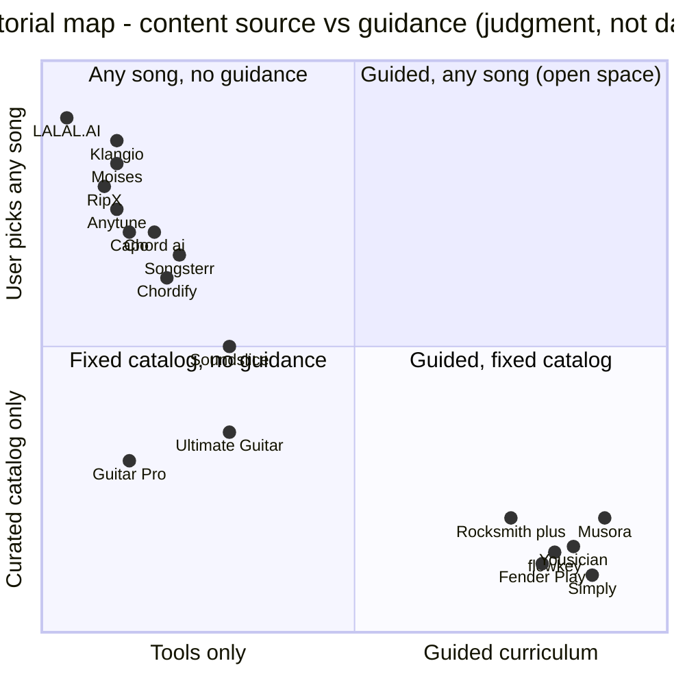

# Competitive landscape

## TL;DR
- The space has four clusters: (1) practice and separation utilities (Moises, LALAL.AI, RipX, Capo, Anytune, Transcribe!); (2) chord and tab libraries (Chordify, Songsterr, Ultimate Guitar, Guitar Pro, Soundslice); (3) AI transcription specialists (Klangio, Chord ai, Songsterr AI); (4) structured-learning apps on curated catalogs (Yousician, Simply, Fender Play, flowkey, Skoove, Melodics, Rocksmith+, Musora, JustinGuitar). Per-product teardowns are in `market/competitors/`.
- Capabilities are converging from both sides: tab libraries added link-to-tab AI (Songsterr, 2025) and separation utilities add chords and sync (Moises, Soundslice auto stems Nov 2025), but learning apps still do not accept a learner-chosen song.
- Differentiation gap: no product we found takes a specific performance video, isolates the learner's instrument, produces playable notes or tab matched to their level, and wraps it in practice tools and progression. See the "Differentiation gap" section.
- Failures are instructive: Riffstation (mobile apps pulled May 2018), Fender Songs (discontinued June 2020 per Fender's notice), Jammit (servers vanished, per community posts), Yamaha NoteStar (closed Mar 2019 per Yamaha's notice) all depended on licensed or third-party-controlled content; Rocksmith+ shows catalog-licensing pain even with Ubisoft's budget.
- Quality complaints cluster around billing practices, microphone-based feedback accuracy, and auto-generated chords/tabs needing cleanup; these are the trust issues Splitune must design around.

## Findings

### Category map

The empty top-right quadrant is the opportunity; Rocksmith+ UGC and Songsterr AI inch toward it from opposite sides.

### One-paragraph summaries
**Practice and separation utilities**
- **Moises**: category leader for AI stems plus practice tools (speed, pitch, key, metronome, chords, setlists); web, desktop, iOS, Android; no curriculum; file-host imports only (YouTube reportedly unsupported); App Store Premium $5.99/mo or $39.99/yr. See `market/competitors/moises.md`.
- **LALAL.AI**: stem-splitting service priced by minutes with fast/relaxed queues and an API, 10 stem types, two stems per run; no practice layer. See `market/competitors/lalal-ai.md`.
- **RipX DAW**: desktop AI DAW with 6+ stems and note-level editing, chord/fingering/capo overlays and MIDI export; $99/$198 one-time. See `market/competitors/ripx-daw.md`.
- **Capo**: Mac/iOS on-device chord, beat and key detection with slowing/looping and chord diagrams for own files; free edition plus $19.99-$49.99/yr. See `market/competitors/capo.md`.
- **Anytune**: Apple-platform slow-downer with extreme slow speeds, loops and Step-it-Up trainer; $14.99 one-time. See `market/competitors/anytune.md`.
- **Transcribe!**: desktop manual-transcription assistant; $39 one-time since decades. See `market/competitors/transcribe.md`.

**Chord and tab tools**
- **Chordify**: paste/search a song, get synced chord diagrams for guitar/piano/ukulele; Dutch company with publisher partnerships; Premium on App Store about $42-$54/yr. See `market/competitors/chordify.md`.
- **Songsterr**: ~400K-song UGC tab library with synced player, plus AI link-to-tab for multiple instruments (50 full tabs per month on Plus). See `market/competitors/songsterr.md`.
- **Ultimate Guitar**: largest tab/chord community (Muse Group), Pro/Official tabs and Courses; strong catalog, weak Trustpilot score (3.1). See `market/competitors/ultimate-guitar.md`.
- **Guitar Pro**: the standard tab editor/player and file format; $69.95. See `market/competitors/guitar-pro.md`.
- **Soundslice**: web notation player synced to YouTube/MP3, scanning and teacher tools, new auto-stems; Plus $5/mo. See `market/competitors/soundslice.md`.

**AI transcription specialists**
- **Klangio**: instrument-specific AI transcription from YouTube links/files with ticket-based pricing; web, mobile, DAW plugin. See `market/competitors/klangio.md`.
- **Chord ai**: mobile app that combines YouTube chords, 4-stem separation, audio-to-MIDI and lyrics; Pro $69.99/yr. See `market/competitors/chord-ai.md`.

**Structured learning**
- **Yousician**: five-instrument gamified curriculum with listening feedback; 20M+ monthly users claimed. See `market/competitors/yousician.md`.
- **Simply Piano / Simply Guitar**: largest beginner mic-feedback apps (858K/399K iOS ratings); billing complaints. See `market/competitors/simply-piano-guitar.md`.
- **Fender Play**: brand-led video lessons with MatchMySound feedback for guitar, bass, ukulele. See `market/competitors/fender-play.md`.
- **flowkey** and **Skoove**: piano apps with Wait Mode/AI feedback; mic detection complaints. See `market/competitors/flowkey.md`, `market/competitors/skoove.md`.
- **Melodics**: drum lessons with per-hit feedback from the phone mic; $34.99/mo. See `market/competitors/melodics.md`.
- **Rocksmith+**: Ubisoft's real-instrument game-subscription; Steam sentiment "Overwhelmingly Negative". See `market/competitors/rocksmith-plus.md`.
- **Musora (Drumeo, Pianote...)**: premium human-taught platform at $279/yr. See `market/competitors/musora-drumeo-pianote.md`.
- **JustinGuitar app**: beginner guitar course app from a trusted teacher brand. See `market/competitors/justinguitar.md`.

### Failures and shutdowns, and why
| Product | What happened | Evidence | Likely reason (labelled) |
|---|---|---|---|
| Riffstation (Sonic Ladder, Dublin) | Launched 2012; Fender acquired the company; mobile apps removed from the App Store in May 2018 and desktop version made free; site gone by Aug 2019 per a reader comment | [Music Inc.](https://www.musicincmag.com/legacy/News/2017/061217/061217_Fender.html), [ifun.de, 18 May 2018](https://www.ifun.de/riffstation-fuer-mac-fender-verschenkt-gitarren-lern-app-122397/). Acquisition date conflicts: a 2015 report (search result, not opened) vs a Music Inc. page whose URL is dated June 2017 | Not stated by Fender (it said it was building a new mobile offering "in coordination with the music industry"); ifun.de says it was unclear whether labels threatened action. Inference: a chord/stem analysis tool on commercial audio was hard to keep as a standalone product, and Fender folded its team into digital products |
| Fender Songs | Launched Oct 2019 (iOS only, $4.99/mo or $41.99/yr); ML chords for Apple Music songs with a Warner Music deal; aimed at 300-500K songs; discontinued 19 June 2020 per Fender's notice (we could not open it; reported via search snippet) | [Digital Music News](https://www.digitalmusicnews.com/2019/10/22/new-fender-songs-app/), [Marketing Dive](https://marketingdive.com/news/guitar-maker-fender-strikes-chord-with-new-songs-subscription-app/565629); notice at [fender.com/songs](https://www.fender.com/songs/) (HTTP 403) | No reason found in sources. Inference: one-platform, one-streaming-service dependency and chord-only output with uncertain label licensing |
| Jammit | App for playing along with licensed multitrack recordings; community posts say it stopped working, auth servers shut and purchased songs became inaccessible | [Fractal Audio forum, Mar 2021](https://forum.fractalaudio.com/threads/remember-the-dead-jammit-app.171132/) (one anecdotal post). PitchBook listing "out of business" appears in search results but was not opened | Unverified; a lesson regardless: server-gated purchases die with the company |
| Yamaha NoteStar | Sheet-music app closed 31 March 2019 after about six years, per Yamaha's notice as summarized in search results (page returned HTTP 403) | [Yamaha notice](https://au.yamaha.com/en/products/musical_instruments/pianos/apps/notestar/index.html) | Not stated; unverified |
| Rocksmith+ (not shut down) | Re-licensed whole catalog, most Rocksmith 2014 songs missing at launch, team smaller, Steam reviews 18% positive of 1,421 | [Steam](https://store.steampowered.com/app/2834910/Rocksmith/), [dev diary](https://www.ubisoft.com/pl-pl/game/rocksmith/plus/news-updates/1R73uTJE3SninROom780EG/rocksmith-dev-diary-july-2021), [dev update](https://www.ubisoft.com/en-gb/game/rocksmith/plus/news-updates/6QLRU2tVz1xa2X2qFNS9b/rocksmith-dev-team-update-where-we-are-whats-next-and-where-we-stand) | Content licensing cost and expectations set by the 2014 edition |

Checked but not verified, so excluded: Chromatik (search results only mention a 2017 acquisition by TakeLessons), Jam Origin and Chrome Music Lab (not researched). Common thread of the verified cases (inference): dependence on licensed or third-party-controlled audio, thin catalogs relative to expectations, and no durable retention loop. Fender itself said the real problem it targeted was about 90% first-year abandonment of guitar lessons ([Marketing Dive](https://marketingdive.com/news/guitar-maker-fender-strikes-chord-with-new-songs-subscription-app/565629)).

### Differentiation gap

Claim: no product we found takes a learner-chosen performance (a YouTube link or file) and delivers an instrument-specific, level-appropriate, practice-ready lesson.

Evidence by pipeline step (what each cluster covers):

| Step | Who does it | Who does not |
|---|---|---|
| 1. Accept a learner-chosen performance link | Chordify (YouTube), Songsterr AI and Klangio (YouTube link), Chord ai (YouTube), Soundslice (YouTube sync, manual) | Moises (file-host URLs only; YouTube reported unsupported), LALAL.AI (uploads), all curriculum apps (closed catalogs) |
| 2. Isolate the learner's instrument | Moises, LALAL.AI, RipX, Chord ai (4 stems), Soundslice (4 stems, MP3) | Chordify, Songsterr library, all curriculum apps |
| 3. Notes or tab for that instrument | Songsterr AI and Klangio (multi-instrument), RipX (notes + MIDI) | Moises (chords; tab claim unverified), Chordify (chords only) |
| 4. Make it fit the learner's level (simplify, pick chords they know) | Ultimate Guitar "Simplify" (Pro, on UGC tabs); JustinGuitar/Fender Play pick songs by known chords from fixed catalogs | every AI tool above; none adapts a user-chosen song |
| 5. Practice tools (slow, loop, count-in) | Most utilities and tab tools | LALAL.AI |
| 6. Listen-and-score feedback | Yousician, Simply, Fender Play, flowkey, Skoove, Melodics, Rocksmith+ | all link-based tools |
| 7. Progression across songs | Curriculum apps | all link-based tools |

Supporting evidence:
- Songsterr states the AI works from a pasted YouTube link and produces editable multi-instrument tabs, but the output is a transcription to be published, with no practice or progression layer ([Songsterr help](https://www.songsterr.com/help)); forum users call results a starting point needing cleanup ([BassBuzz forum](https://forum.bassbuzz.com/t/new-songsterr-ai-is-impressive/70519)).
- Klangio accepts YouTube links and exports notation formats, again without a learning layer ([Klangio](https://www.klang.io/)).
- Moises offers stems, chords and practice tools but, per its listing, imports via files and public URLs and offers no tab-level transcription we could verify ([App Store](https://apps.apple.com/us/app/id1515796612)).
- Curriculum apps ship curated libraries: Yousician cites 2,000+ songs ([Yousician](https://yousician.com/)); Simply Piano lists named songs ([App Store](https://apps.apple.com/us/app/simply-piano-learn-piano-fast/id1019442026)); Rocksmith+ uses licensed songs, with UGC limited to arrangements of licensed songs ([Ubisoft](https://www.ubisoft.com/en-gb/game/rocksmith/plus/news-updates/6QLRU2tVz1xa2X2qFNS9b/rocksmith-dev-team-update-where-we-are-whats-next-and-where-we-stand)).
- Video-derived fingering: we found no shipping consumer product that infers fretting-hand fingering from an arbitrary performance video; the 2024 TapToTab paper is a research system built on YOLO fretboard detection and audio note identification, and its abstract reports no numbers ([arXiv 2409.08618](https://arxiv.org/abs/2409.08618v1)). See `ml/video-and-audio-visual-analysis.md`.
- Pain points that a better design could address: unreliable microphone feedback (flowkey, Skoove, Simply reviews), billing opacity (Trustpilot samples for UG, Yousician, Moises, Simply), and machine tabs requiring cleanup (BassBuzz forum, Klangio reviews). See `users/voice-of-customer-pain-points.md`.

Where the gap is narrower than it looks:
- Songsterr plus a curriculum partner, or Muse Group (Ultimate Guitar, MuseScore, StaffPad, Hal Leonard) combining content and transcription, could close part of it within a year ([ScoringNotes](https://www.scoringnotes.com/news/muse-group-acquires-hal-leonard/) cites AI transcription and publisher content as a rationale).
- Absence-of-evidence caveat: ❌ in `market/feature-matrix.md` means not found in sources we opened; some vendors may ship unannounced features.

## Implications for Splitune
1. Position as the missing top-right quadrant: "any song you choose, turned into a lesson for your instrument and level", not another stem splitter or tab library.
2. Do not compete on table stakes (stems, chords, slow-down). Treat them as pipeline stages and buy/borrow quality (see `ml/pipeline-overview.md`).
3. Win on trust: confidence indicators, easy correction, honest free-tier limits, clean billing (the dominant negative themes across competitors).
4. Plan for legal fragility: the verified failures all relied on third-party-controlled content; see `legal/youtube-copyright-and-platform-policy.md` and design a compliant path before building features that depend on it.
5. Instrument focus is a hypothesis to test, not a finding: guitar is the most contested for link-to-tab (Songsterr AI, Klangio, UG), piano and drums have strong mic-feedback incumbents. See `product/recommendations-and-decisions.md`.
6. Pricing target and unit economics: see `market/pricing-and-business-models.md`.

## Open questions
- Does any vendor already ship video-based fingering detection? (Monitor Songsterr, Klangio, Yousician release notes; run quarterly checks.)
- How accurate are Songsterr AI and Klangio on typical learner songs? Needs a fixed-song bake-off (`ml/transcription-guitar-and-bass-tabs.md`).
- Retention evidence: no competitor publishes retention; Fender's 90% first-year abandonment claim is the only datapoint found.
- Verify Fender Songs and Yamaha NoteStar shutdown notices directly (pages were blocked).
- Android and web coverage for several apps remains unverified.

## Sources
- [Moises (US App Store)](https://apps.apple.com/us/app/id1515796612) — tier 2, accessed 2026-10-20
- [Yousician homepage](https://yousician.com/) — tier 2, accessed 2026-10-20
- [Simply Piano: Learn Piano Fast (US App Store)](https://apps.apple.com/us/app/simply-piano-learn-piano-fast/id1019442026) — tier 2, accessed 2026-10-20
- [Songsterr help / questions](https://www.songsterr.com/help) — tier 2, accessed 2026-10-20
- [Klangio homepage](https://www.klang.io/) — tier 2, accessed 2026-10-20
- [New Songsterr AI is impressive! (BassBuzz forum)](https://forum.bassbuzz.com/t/new-songsterr-ai-is-impressive/70519) — tier 4, accessed 2026-10-20
- [Rocksmith+ on Steam](https://store.steampowered.com/app/2834910/Rocksmith/) — tier 2, accessed 2026-10-20
- [Rocksmith+ dev diary July 2021 (Ubisoft)](https://www.ubisoft.com/pl-pl/game/rocksmith/plus/news-updates/1R73uTJE3SninROom780EG/rocksmith-dev-diary-july-2021) — tier 2, accessed 2026-10-20
- [Rocksmith Dev Team Update (Ubisoft, 13 Jul 2026)](https://www.ubisoft.com/en-gb/game/rocksmith/plus/news-updates/6QLRU2tVz1xa2X2qFNS9b/rocksmith-dev-team-update-where-we-are-whats-next-and-where-we-stand) — tier 2, accessed 2026-10-20
- [Fender acquires Sonic Ladder (Music Inc.)](https://www.musicincmag.com/legacy/News/2017/061217/061217_Fender.html) — tier 3, accessed 2026-10-20
- [Riffstation: Fender gives away its guitar-learning app (ifun.de, 18 May 2018)](https://www.ifun.de/riffstation-fuer-mac-fender-verschenkt-gitarren-lern-app-122397/) — tier 3, accessed 2026-10-20
- [New Fender Songs app (Digital Music News, 22 Oct 2019)](https://www.digitalmusicnews.com/2019/10/22/new-fender-songs-app/) — tier 3, accessed 2026-10-20
- [Guitar maker Fender strikes chord with new Songs subscription app (Marketing Dive)](https://marketingdive.com/news/guitar-maker-fender-strikes-chord-with-new-songs-subscription-app/565629) — tier 3, accessed 2026-10-20
- [Fender Songs page (not opened; HTTP 403, notice reported via search snippet)](https://www.fender.com/songs/) — tier 2, accessed 2026-10-20
- [Remember the dead Jammit app? (Fractal Audio forum)](https://forum.fractalaudio.com/threads/remember-the-dead-jammit-app.171132/) — tier 4, accessed 2026-10-20
- [Yamaha NoteStar discontinued notice (not opened; HTTP 403, reported via search snippet)](https://au.yamaha.com/en/products/musical_instruments/pianos/apps/notestar/index.html) — tier 2, accessed 2026-10-20
- [TapToTab: Video-Based Guitar Tabs Generation (arXiv 2409.08618)](https://arxiv.org/abs/2409.08618v1) — tier 1, accessed 2026-10-20
- [Muse Group acquires Hal Leonard (ScoringNotes)](https://www.scoringnotes.com/news/muse-group-acquires-hal-leonard/) — tier 3, accessed 2026-10-20
