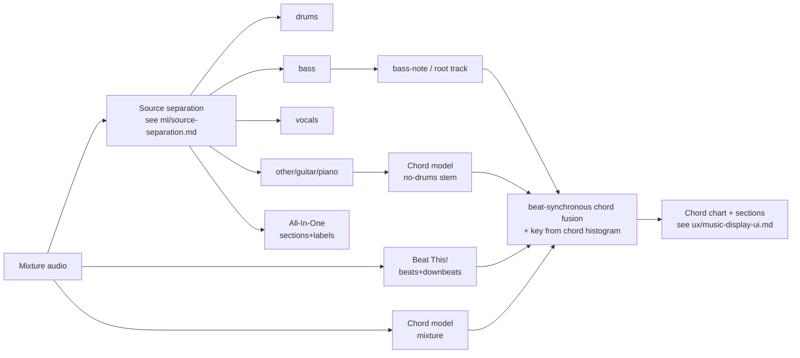

# Chords, beats, tempo, key and song structure

## TL;DR
- **Beats/downbeats: use Beat This! (`beat_this`, MIT code + weights).** It is the strongest open beat tracker found (GTZAN beat F1 89.1, downbeat F1 78.3, with no DBN). It is the only top-tier option whose weights are permissively licensed. madmom's models are CC-BY-NC-SA-4.0, so they cannot ship commercially without a licence from JKU ([beat_this repo](https://github.com/CPJKU/beat_this), [paper](https://arxiv.org/abs/2407.21658), [madmom repo](https://github.com/CPJKU/madmom)).
- **Song sections: All-In-One (`allin1`, MIT code)** outputs beats, downbeats, tempo and labelled sections (intro/verse/chorus…) in one pass. It runs Demucs internally. On Harmonix it scores beat F1 .958, downbeat F1 .915 and segment HR.5F .660 ([repo](https://github.com/mir-aidj/all-in-one), [paper](https://arxiv.org/html/2307.16425)). It is trained only on Harmonix (912 Western pop songs), so expect weaker results outside pop.
- **Chords are the weakest link.** Major/minor recognition sits at roughly 77–84% weighted chord symbol recall (WCSR) and has barely moved since 2016. Sevenths are about 64–72%, and inversions about 60–76% depending on the vocabulary ([Korzeniowski & Widmer 2016](https://ar5iv.labs.arxiv.org/html/1612.05082), [ChordFormer 2025](https://arxiv.org/html/2502.11840v1), [Poltronieri et al. ISMIR 2025](https://arxiv.org/abs/2509.01588)). Treat chord output as an editable draft, never as ground truth.
- **Licensing is the main constraint, not accuracy.** Permissive options: Beat This! (MIT), All-In-One (MIT code), consonance-ACE (MIT code, checkpoint licence unstated), BTC (MIT code), BeatNet (CC-BY-4.0). Non-commercial or copyleft: madmom models (CC-BY-NC-SA-4.0), Essentia (AGPL-3.0; models non-commercial, with a licence conflict: CC-BY-NC-ND-4.0 on the licensing page vs CC-BY-NC-SA-4.0 on the [models page](https://essentia.upf.edu/models.html); commercial licence on request), Chordino/NNLS Chroma (GPL) ([Essentia licensing](https://essentia.upf.edu/licensing_information.html), [Vamp RDF](https://vamp-plugins.org/rdf/plugins/nnls-chroma)).
- **Separated stems help structure and downbeats.** All-In-One's ablation says removing demixing "drastically" hurts all four tasks ([paper](https://arxiv.org/html/2307.16425)). Evidence for chords-on-stems is anecdotal and unquantified. Recommendation: since Splitune separates anyway (see `ml/source-separation.md`), run rhythm and structure on the demixed stems. A/B test chords on the mixture vs. a drums-removed stem.
- **No open model gives key accuracy beyond about 75–85% weighted on pop/EDM** (madmom CNN key: GiantSteps 74.6, Billboard 85.1 weighted) ([Korzeniowski & Widmer 2018](https://ar5iv.arxiv.org/html/1808.05340)). Its weights are non-commercial. A permissive substitute is to derive the key from the chord sequence plus pitch-class histograms (inference; not benchmarked).

## Findings

### Metrics primer
- **Chords** are scored with `mir_eval.chord`, as duration-weighted accuracy (commonly called WCSR) under a given vocabulary ([mir_eval docs](https://mir-eval.readthedocs.io/stable/api/chord.html)):
  - `root`: root only.
  - `majmin`: maj/min/N.
  - `majmin_inv`: majmin plus the bass note, which must be a triad tone.
  - `sevenths`: maj, min, 7, maj7, min7, N.
  - `sevenths_inv`, `triads`, `tetrads`, `thirds`.
  - `mirex`: correct if at least 3 pitch classes are shared.
- **Beats** are scored with F1 at a ±70 ms window (standard), plus the continuity metrics CMLt and AMLt.
- **Segment boundaries** are scored with hit-rate F-measure at ±0.5 s (HR.5F) and ±3 s (HR3F).
- **Key** uses the MIREX weighted score: partial credit for fifth, relative and parallel errors.

### Chord recognition

| Model / tool | Year | Vocabulary | Reported WCSR (dataset) | Code licence | Weights licence | Training data | Commercial use |
|---|---|---|---|---|---|---|---|
| madmom CNN+CRF (`CNNChordFeatureProcessor` + `CRFChordRecognitionProcessor`) | 2016 | 25 classes (12 maj, 12 min, N) ([docs](https://madmom.readthedocs.io/en/v0.16/modules/features/chords.html)) | majmin 82.9 Isophonics, 82.8 Robbie Williams, 82.5 RWC ([paper](https://ar5iv.labs.arxiv.org/html/1612.05082)) | BSD | CC-BY-NC-SA-4.0 ([repo](https://github.com/CPJKU/madmom)) | Isophonics (217 songs), RWC Pop (100), Robbie Williams (65) | No, without a JKU licence |
| BTC (Bi-directional Transformer for Chord recognition) | 2019 | majmin and large vocabulary | not shown in README | MIT ([repo](https://github.com/jayg996/BTC-ISMIR19)) | unstated | Isophonics, Robbie Williams, UsPop2002 labels; audio not distributed ([repo](https://github.com/jayg996/BTC-ISMIR19)) | Code yes; weights unclear |
| ChordFormer (conformer) | 2025 | large vocabulary (structured root/triad/bass/extension) | root 84.69, majmin 84.09, triads 77.55, sevenths 72.28, tetrads 65.32, mirex 83.62 ([paper Table II](https://arxiv.org/html/2502.11840v1)) | no release found | none found | Humphrey & Bello set: 1,217 songs (Isophonics + Billboard + MARL) | n/a |
| consonance-ACE (conformer + decomposed decoder + consonance smoothing) | ISMIR 2025 | vocabulary-free (root + bass + pitch set) | root 84.0, majmin 77.8, thirds 80.3, triads 72.7, tetrads 60.8, sevenths 66.0, mirex 79.8; majmin_inv 75.6, sevenths_inv 64.4 (test: RWC Pop + USPop) ([paper](https://arxiv.org/abs/2509.01588)) | MIT ([repo](https://github.com/andreamust/consonance-ACE)) | checkpoint shipped in repo, licence not separately stated | Isophonics + McGill Billboard (via ChoCo) | Code yes; weights ask authors |
| Chordino / NNLS Chroma (Vamp plugin, Mauch) | 2010 | maj/min/7/dim etc. (rule + HMM) | not re-benchmarked here | GPL ([Vamp RDF](https://vamp-plugins.org/rdf/plugins/nnls-chroma)) | n/a (no learned weights) | n/a | Only under GPL obligations |
| Essentia chord descriptors | ongoing | maj/min | not benchmarked here | AGPL-3.0 | models non-commercial; **conflict:** CC-BY-NC-ND-4.0 ([licensing](https://essentia.upf.edu/licensing_information.html)) vs CC-BY-NC-SA-4.0 ([models](https://essentia.upf.edu/models.html)) | n/a | Commercial licence from UPF MTG |

Evidence notes:
- **Same-test-set baseline.** In Poltronieri et al.'s table, BTC retrained on the same split reaches majmin 77.3 and sevenths 65.7. The proposed model reaches 77.8 and 66.0. On standard metrics, model differences are "often marginal" (paper §4.1, [arXiv:2509.01588](https://arxiv.org/abs/2509.01588)). Its decomposed decoder mainly improves inversions: majmin_inv rises from 71.5 to 75.6.
- **Possible anomaly in ChordFormer.** ChordFormer reports a "BTC+CNN" baseline at majmin 49.00 ([Table II](https://arxiv.org/html/2502.11840v1)). That is far below BTC's 77.3 in the ISMIR 2025 paper and suggests a baseline-reproduction problem. Do not use the ChordFormer-vs-BTC gap as evidence.
- **Rare chords stay poor.** ChordFormer's class-averaged accuracy (acc_class) is only 0.39–0.45 ([Table III](https://arxiv.org/html/2502.11840v1)). Rare qualities (dim, aug, sus, extended) are mostly wrong.
- **Chordify (competitor).** The only public accuracy statement is a 2013 co-founder estimate of "70% to 95%" depending on genre ([TNW 2013](https://thenextweb.com/apps/2013/05/02/chordify-taps-soundcloud-and-youtube-to-show-you-the-chords-to-your-favorite-songs/)). It is tier 3 and dated.

Inference: about 84% majmin means roughly one bar in six is wrong on studio pop. For a beginner following along, the error budget must be absorbed by UX: chord simplification, a confidence display, one-tap correction, and crowd edits.

### Beat and downbeat tracking

| Model | Venue | Beat F1 / Downbeat F1 (dataset, protocol) | Params / size | Code licence | Weights licence | Commercial use |
|---|---|---|---|---|---|---|
| Beat This! (`beat_this` 1.1.0, Apr 2026, [PyPI](https://pypi.org/project/beat-this/)) | ISMIR 2024 | GTZAN 89.1 / 78.3 (held-out test). 8-fold CV: Ballroom 97.5/95.3, Beatles 94.5/88.8, Harmonix 95.8/90.7, GuitarSet 92.0/88.1, SMC 62.7 ([paper Tables 1–2](https://arxiv.org/pdf/2407.21658)) | ~20 M params, ~78 MB checkpoint; "small" ~2 M params, 8.1 MB, GTZAN 88.8 / 77.2 ([repo](https://github.com/CPJKU/beat_this)) | MIT | MIT | Yes. Training data includes copyrighted or limited-CC files and the authors tell users to assess this ([repo](https://github.com/CPJKU/beat_this)) |
| Hung et al. SpecTNT-TCN | ICASSP 2022 | GTZAN 88.7 / 75.6; Harmonix 95.3 / 90.8 ([Beat This! Table 1–2](https://arxiv.org/pdf/2407.21658)) | 4.7 M | no public code found | — | — |
| All-In-One (`allin1`) | WASPAA 2023 | Harmonix 8-fold .958 / .915 ([paper](https://arxiv.org/html/2307.16425)) | 300 K (plus Demucs) | MIT ([repo](https://github.com/mir-aidj/all-in-one)) | not separately stated | Code yes; weights trained on Harmonix (see dataset licence) |
| madmom RNN + DBN (Böck et al.) | ISMIR 2016 | benchmark baseline for most later work | small | BSD | CC-BY-NC-SA-4.0 | No, without a licence |
| BeatNet (CRNN + particle filter; streaming / online / offline modes) | ISMIR 2021 ([arXiv](https://arxiv.org/abs/2108.03576)) | not verified (abstract gives no numbers) | small | CC-BY-4.0 LICENSE file ([repo](https://github.com/mjhydri/BeatNet), [LICENSE](https://raw.githubusercontent.com/mjhydri/BeatNet/main/LICENSE)) | weights in repo, same file | Yes, with attribution; the only causal/real-time option here |

Key observations from the Beat This! paper ([arXiv:2407.21658](https://arxiv.org/pdf/2407.21658)):
- **No DBN.** Dropping the DBN raises F1 but lowers the continuity metrics. Adding a DBN back gives GTZAN 88.1 / 77.4 F1 but better downbeat CMLt.
- **Weak spots.** Classical (RWC Classical 77.1, ASAP 76.3) and SMC (62.7) are weak. The authors stress that beat tracking "is not a solved problem."
- **Training cost.** About 8 h on one RTX 2080 Ti, or 4 h on an A100. Fine-tuning on Splitune-specific genres is cheap.

### Tempo
Tempo is usually derived from the beat grid; the median inter-beat interval works well when the tempo is stable. Böck & Davies (ISMIR 2020) jointly estimate tempo, beat and downbeat. They report gains "up to 6% points" over earlier systems ([ISMIR 2020 programme](https://program.ismir2020.net/poster_4-14.html)), but their code ships within madmom's licence regime. All-In-One also outputs BPM directly ([repo](https://github.com/mir-aidj/all-in-one)).

Recommendation: compute the displayed BPM from Beat This! beats. Show a half/double toggle, because octave errors are the dominant tempo failure (inference from AMLt vs. CMLt gaps in the Beat This! results).

### Key detection
- **madmom CNN key classifier** (Korzeniowski & Widmer, ISMIR 2018). MIREX weighted score / exact accuracy ([ar5iv](https://ar5iv.arxiv.org/html/1808.05340)):
  - GiantSteps (EDM) 74.6 / 67.9
  - Billboard 85.1 / 79.9
  - Isophonics 82.5 / 76.3
  - Robbie Williams 81.2 / 72.4
  - Classical 96.6 / 95.2

  Its weights are CC-BY-NC-SA-4.0 ([madmom](https://github.com/CPJKU/madmom)).
- **Essentia** has key extractors (profile-based). They are AGPL-3.0, with a commercial licence available ([licensing](https://essentia.upf.edu/licensing_information.html)). No independent accuracy figure was verified for this doc.
- **No permissive, recently benchmarked key model was found.** Gap: the evidence is thin.

### Song-section / structure segmentation

| Model / framework | Output | Reported results | Code licence | Weights / data licence | Notes |
|---|---|---|---|---|---|
| All-In-One (Kim & Nam, WASPAA 2023) | beats, downbeats, BPM, section boundaries plus functional labels | Harmonix 8-fold: HR.5F .660, label PWF .738, Sf .769. Baseline DSF+Scluster HR.5F .497; SpecTNT .558 ([paper](https://arxiv.org/html/2307.16425)) | MIT ([repo](https://github.com/mir-aidj/all-in-one)) | Harmonix Set: repo MIT, but mel-spectrogram download carries its own separate licence ([harmonixset](https://github.com/urinieto/harmonixset)) | 10 songs / 33 min processed in 73 s on an RTX 4090, including Demucs ([repo](https://github.com/mir-aidj/all-in-one)) |
| SongFormer (Hao et al., arXiv 2025, rev. Apr 2026) | boundaries plus functional labels | Claims state-of-the-art HR.5F and label accuracy on its SongFormBench (300 songs) ([arXiv](https://arxiv.org/abs/2510.02797)) | CC-BY-4.0 per README ([repo](https://github.com/ASLP-lab/SongFormer)) | weights and SongFormDB (>14k songs) licence not stated; depends on MuQ/MusicFM SSL encoders | Promising but very new and not peer-reviewed at access date |
| MSAF (Nieto) | framework of classic boundary and label algorithms | n/a (framework) | MIT ([repo](https://github.com/urinieto/msaf)) | n/a | Useful baseline harness; unsupervised algorithms have no weights licence issue |

Datasets:
- **Harmonix Set:** 912 tracks with beats, downbeats and sections. No audio; YouTube URLs only ([repo](https://github.com/urinieto/harmonixset)).
- **SALAMI:** annotations are CC0-1.0. Audio is not shared; a YouTube-matching list is provided ([salami-data-public](https://github.com/DDMAL/salami-data-public)).

See `ml/datasets-metrics-and-licensing.md` for dataset licence detail.

### Stems vs. mixture
- **Evidence (rhythm/structure).** All-In-One with Demucs stems beat the same TCN without demixing:
  - downbeat F1: .886 → .894
  - HR.5F: .594 → .619
  - label PWF: .687 → .715

  Beat F1 dipped slightly (.954 → .946), and the two configurations differ in parameter count. The paper's ablation states that removing demixing "drastically decreases" all four tasks ([paper](https://arxiv.org/html/2307.16425)).
- **Evidence (chords).** Chang et al. (arXiv, Sep 2025) run a 301-class chord model on the full mix, an HT-Demucs drums-removed track and a drums-and-vocals-removed track. They use the bass stem only for root/bass notes and let GPT-4o pick and correct the results, with beats from Beat This!. The whole pipeline gains 1–2.77 points on the MIREX metric, but the stems' own contribution is not isolated ([abs](https://arxiv.org/abs/2509.18700), [PDF](https://www.arxiv.org/pdf/2509.18700)). No peer-reviewed quantification of the chord gain from stems was found.
- **Inference.**
  - The bass stem is a strong cue for chord inversions and roots. Consonance-ACE's explicit bass head improved `_inv` metrics.
  - Drum removal plausibly helps chroma-like features.
  - Vocals sometimes carry the harmony implied by the melody.

  Treat stems as extra inputs, not replacements.

## Implications for Splitune
- **Beat grid first.** Everything the learner sees (bar lines, loop points snapping to bars, count-in, metronome alignment) hangs off downbeats. Beat This! (MIT) is the default; budget an AMLt-style "half/double tempo" correction control. Loop UX is covered in `ux/practice-tool-patterns.md`.
- **Sections.** All-In-One gives "Verse / Chorus" loop presets for free. Its Demucs dependency can reuse Splitune's separation output rather than re-running it (implementation detail to verify; `allin1` has a `-k` keep-stems option, per its [repo](https://github.com/mir-aidj/all-in-one)).
- **Chords.**
  - Ship a beat-synchronous majmin chord chart by default, with an optional sevenths view behind a "more detail" toggle.
  - Snap chord changes to beats; this is cheap smoothing.
  - Store confidence, and support user corrections that are versioned per song. Rendering is covered in `ux/music-display-ui.md`.
- **Licensing gate.** madmom's pretrained chord, key and DBN models and Essentia models must not ship without a negotiated licence. If key detection is needed at launch, prefer a chord-histogram key estimate or a model trained in-house on CC0 SALAMI-style data. Note the latter still lacks audio.
- **Compute.** These models are small compared with separation. Beat This! small is 8.1 MB and All-In-One is 300 K params excluding Demucs, so they can run on-device or server-side. See `ml/deployment-and-inference.md`.
- Upstream timing for notes and transcription is covered in `ml/transcription-general.md`.

## Open questions
- **Chord accuracy on Splitune's actual material** (acoustic singer-songwriter, worship, rock covers on YouTube) on the mixture vs. separated stems. Experiment: hand-annotate about 30 songs; compute mir_eval majmin/sevenths/inv on mixture, no-drums and no-vocals inputs.
- **Licence status of the consonance-ACE checkpoint and All-In-One/SongFormer weights.** Ask the authors in writing.
- Whether JKU (Widmer group) offers commercial licences for madmom key/chord models, and at what cost.
- **Beat This! failure modes on rubato solo performances** (piano/guitar covers), which are common in learner videos. RWC Classical 77.1 suggests risk.
- **A permissive key detector with a published benchmark.** None was found; evaluate candidates in-house.

## Sources
- [Beat This! repository (CPJKU/beat_this)](https://github.com/CPJKU/beat_this) — tier 1, accessed 2026-10-20
- [Beat this! Accurate beat tracking without DBN postprocessing (arXiv abs)](https://arxiv.org/abs/2407.21658) — tier 1, accessed 2026-10-20
- [Beat this! paper PDF](https://arxiv.org/pdf/2407.21658) — tier 1, accessed 2026-10-20
- [beat-this on PyPI](https://pypi.org/project/beat-this/) — tier 2, accessed 2026-10-20
- [madmom repository](https://github.com/CPJKU/madmom) — tier 1, accessed 2026-10-20
- [madmom chords module docs v0.16](https://madmom.readthedocs.io/en/v0.16/modules/features/chords.html) — tier 1, accessed 2026-10-20
- [All-In-One repository (mir-aidj/all-in-one)](https://github.com/mir-aidj/all-in-one) — tier 1, accessed 2026-10-20
- [All-In-One paper HTML (arXiv 2307.16425)](https://arxiv.org/html/2307.16425) — tier 1, accessed 2026-10-20
- [ChordFormer (arXiv 2502.11840)](https://arxiv.org/html/2502.11840v1) — tier 1, accessed 2026-10-20
- [From Discord to Harmony, ISMIR 2025 (arXiv 2509.01588)](https://arxiv.org/abs/2509.01588) — tier 1, accessed 2026-10-20
- [consonance-ACE repository](https://github.com/andreamust/consonance-ACE) — tier 1, accessed 2026-10-20
- [A Fully Convolutional Deep Auditory Model for Musical Chord Recognition (ar5iv)](https://ar5iv.labs.arxiv.org/html/1612.05082) — tier 1, accessed 2026-10-20
- [BTC-ISMIR19 repository](https://github.com/jayg996/BTC-ISMIR19) — tier 1, accessed 2026-10-20
- [NNLS Chroma / Chordino Vamp plugin RDF](https://vamp-plugins.org/rdf/plugins/nnls-chroma) — tier 2, accessed 2026-10-20
- [Essentia licensing information](https://essentia.upf.edu/licensing_information.html) — tier 2, accessed 2026-10-20
- [Essentia models](https://essentia.upf.edu/models.html) — tier 1, accessed 2026-10-20
- [BeatNet repository](https://github.com/mjhydri/BeatNet) — tier 1, accessed 2026-10-20
- [BeatNet LICENSE](https://raw.githubusercontent.com/mjhydri/BeatNet/main/LICENSE) — tier 1, accessed 2026-10-20
- [Genre-Agnostic Key Classification with CNNs (ar5iv)](https://ar5iv.arxiv.org/html/1808.05340) — tier 1, accessed 2026-10-20
- [Deconstruct, Analyse, Reconstruct (ISMIR 2020 programme)](https://program.ismir2020.net/poster_4-14.html) — tier 1, accessed 2026-10-20
- [SongFormer (arXiv 2510.02797)](https://arxiv.org/abs/2510.02797) — tier 1, accessed 2026-10-20
- [SongFormer repository](https://github.com/ASLP-lab/SongFormer) — tier 1, accessed 2026-10-20
- [MSAF repository](https://github.com/urinieto/msaf) — tier 1, accessed 2026-10-20
- [Harmonix Set repository](https://github.com/urinieto/harmonixset) — tier 1, accessed 2026-10-20
- [SALAMI public annotations](https://github.com/DDMAL/salami-data-public) — tier 1, accessed 2026-10-20
- [mir_eval chord documentation](https://mir-eval.readthedocs.io/stable/api/chord.html) — tier 1, accessed 2026-10-20
- [Enhancing Automatic Chord Recognition through LLM Chain-of-Thought Reasoning (arXiv 2509.18700 abs)](https://arxiv.org/abs/2509.18700) — tier 1 (preprint), accessed 2026-10-20
- [Same paper, PDF](https://www.arxiv.org/pdf/2509.18700) — tier 1 (preprint), accessed 2026-10-20
- [BeatNet paper (arXiv 2108.03576)](https://arxiv.org/abs/2108.03576) — tier 1, accessed 2026-10-20
- [TNW: Chordify taps SoundCloud and YouTube (2013)](https://thenextweb.com/apps/2013/05/02/chordify-taps-soundcloud-and-youtube-to-show-you-the-chords-to-your-favorite-songs/) — tier 3, accessed 2026-10-20
