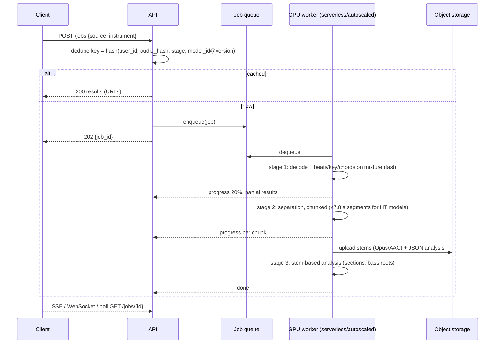

# Deployment and inference

## TL;DR
- **Recommended v1: server-side GPU separation and analysis as async jobs.** Do the playback DSP and the small models on the client. Separation is the only heavy step. Demucs runs at about 1.5× track duration on CPU ([Demucs README](https://github.com/facebookresearch/demucs)). In the browser it took 9–41 min for a 7-min track, depending on worker count ([free-music-demixer](https://github.com/sevagh/free-music-demixer)). A desktop GPU did 33 min of audio, including Demucs, in 73 s ([All-In-One](https://github.com/mir-aidj/all-in-one)).
- **Self-hosted GPU cost is roughly $0.0002–0.002 per song-minute; an API costs about 100× more.**
  - The low end: RTF 0.037 (measured, RTX 4090 incl. Demucs) on RunPod: RTX 4090 Pods $0.34/h (Community) to $0.89/h (Secure); Serverless 4090 $1.10/h (pricing page updated 2026-10-08). The high end: an assumed RTF of 0.1 on an L4 at about $0.80/h ([RunPod](https://www.runpod.io/pricing), [Modal](https://modal.com/pricing), [Vantage/AWS g6](https://instances.vantage.sh/aws/ec2/g6.xlarge)).
  - music.ai charges $0.07/min for musical stems, plus $0.04 chords, $0.03 beats and $0.04 sections: ≈ $0.18 per song-minute ([music.ai pricing](https://music.ai/pricing/)). The pricing page lists $0.07/min per musical stem as its own line item and does not say whether each requested stem is billed separately; ≈ $0.18 assumes one stems charge, and it could be up to ≈ $0.39 if four stems bill separately.
  - Self-hosting wins on unit cost once volume justifies the engineering. An API is a fast way to prototype.
- **Model sizes**:
  - HT-Demucs 4-stem ≈ 81 MB in fp16; htdemucs_6s ≈ 53 MB; htdemucs_ft = 4 × 81 MB ([demucs.cpp](https://github.com/sevagh/demucs.cpp)).
  - BS-RoFormer (L=12) has 93.4 M params, about 187 MB fp16 / 374 MB fp32 by arithmetic ([BS-RoFormer](https://ar5iv.labs.arxiv.org/html/2309.02612)).
  - Beat This! ≈ 78 MB, small 8.1 MB ([repo](https://github.com/CPJKU/beat_this)).

  All are app-downloadable, but on-device *speed* is the blocker, not size.
- **On-device separation is commercially proven only with custom-optimised models.** djay's Neural Mix embeds AudioShake separation via Core ML on Apple devices in real time ([Algoriddim](https://www.algoriddim.com/neural-mix)). Capo says all processing is local ([Capo](https://supermegaultragroovy.com/products/capo/)). Open-source mobile ports exist (demucs.cpp, MIT; browser demixer), but no verified phone timings were found.
- **Design the job pipeline for caching and progressive results.**
  - Key results per user by (user, audio hash, model version); no cross-user shared cache until counsel approves.
  - Return beats, chords and sections (seconds) before stems (tens of seconds).
  - Report progress per chunk; HT models process ≤ 7.8 s segments ([Demucs](https://github.com/facebookresearch/demucs)).

  Caching across users has legal implications; see `legal/youtube-copyright-and-platform-policy.md`.
- **Demucs upstream is effectively frozen.** The Meta repo was archived on 1 Jan 2025. The author's fork lists v4.1.0 with "no new feature for now" ([facebookresearch/demucs](https://github.com/facebookresearch/demucs), [adefossez/demucs](https://github.com/adefossez/demucs)). Plan for model swaps; see `ml/source-separation-model-comparison.md`.

## Findings

### 1. Model footprint (published or derived)

| Model | Size | Source | Notes |
|---|---|---|---|
| htdemucs (4-stem) | ≈ 81 MB (fp16 ggml) | [demucs.cpp](https://github.com/sevagh/demucs.cpp) | MUSDB-HQ SDR 9.00 dB ([Demucs](https://github.com/facebookresearch/demucs)) |
| htdemucs_6s (adds guitar, piano) | ≈ 53 MB (fp16 ggml) | [demucs.cpp](https://github.com/sevagh/demucs.cpp) | README: piano stem "doesn't work well yet" |
| htdemucs_ft (4 fine-tuned models) | ≈ 4 × 81 MB | [demucs.cpp](https://github.com/sevagh/demucs.cpp) | About 4× slower than htdemucs ([Demucs](https://github.com/facebookresearch/demucs)) |
| hdemucs_mmi (v3) | ≈ 160 MB | [demucs.cpp](https://github.com/sevagh/demucs.cpp) | |
| BS-RoFormer L=12 / L=6 | 93.4 M / 72.2 M params → ≈ 187 / 144 MB fp16 (derived: params × 2 bytes) | [BS-RoFormer paper](https://ar5iv.labs.arxiv.org/html/2309.02612) | L=12 trained 4 weeks on 16× A100-80GB. No inference time reported |
| SCNet | not stated | [SCNet](https://arxiv.org/abs/2401.13276) | ICASSP 2024: 9.0 dB SDR, CPU inference time 48% of HT Demucs |
| Beat This! (final / small) | ≈ 78 MB / 8.1 MB | [beat_this](https://github.com/CPJKU/beat_this) | see `ml/chords-beats-key-structure.md` |
| MediaPipe Hand Landmarker | float16 bundle | [guide](https://developers.google.com/edge/mediapipe/solutions/vision/hand_landmarker) | 12–17 ms per frame on Pixel 6 |

Memory:
- **Demucs (PyTorch):** needs at least 3 GB of GPU RAM, about 7 GB with default arguments. A 4-min track used about 1.5 GB with `PYTORCH_NO_CUDA_MEMORY_CACHING=1`, at the cost of speed ([adefossez/demucs](https://github.com/adefossez/demucs)).
- **demucs.cpp:** is "designed for low-memory environments" at a speed cost ([demucs.cpp](https://github.com/sevagh/demucs.cpp)).

### 2. Measured or published speeds

| Setting | Workload | Time | Real-time factor (RTF) = processing time / audio time | Source |
|---|---|---|---|---|
| RTX 4090 GPU | All-In-One on 10 songs, 33 min, including Demucs separation | 73 s | **0.037** | [all-in-one README](https://github.com/mir-aidj/all-in-one) |
| CPU (unspecified) | Demucs v4 | "roughly 1.5× the track duration" | **≈ 1.5** | [Demucs README](https://github.com/facebookresearch/demucs) |
| CPU, htdemucs_ft | Demucs v4 fine-tuned | ≈ 4× htdemucs | ≈ 6 (derived) | [Demucs README](https://github.com/facebookresearch/demucs) |
| Browser WASM (demucs.cpp, unspecified hardware) | 7-min track, htdemucs | ≈ 41 min with 1 worker; ≈ 9 min with 8 workers | **≈ 5.9 / ≈ 1.3** | [free-music-demixer](https://github.com/sevagh/free-music-demixer) |
| Phone (iOS/Android), open models | — | **no verified published timings** | — | gap |

Battery impact on phones: no published measurements found (gap).

### 3. Runtimes for on-device and browser inference

| Runtime | Licence | Targets | Acceleration | Notes for Splitune |
|---|---|---|---|---|
| Core ML (Apple) | Proprietary OS framework | iOS 11+, macOS 10.13+, visionOS | CPU, GPU, Neural Engine ([Apple](https://developer.apple.com/tutorials/data/documentation/coreml.json)) | Used by djay's AudioShake integration ([Algoriddim](https://www.algoriddim.com/neural-mix)). Apple's docs now also point to "Core AI" for the newest architectures (not investigated) |
| LiteRT (ex-TensorFlow Lite) | Apache-2.0 code samples ([Google](https://developers.google.com/edge/litert)) | Android 24+, iOS 15+, macOS, Web, desktop, MCU | CPU, GPU, NPU (Tensor, Qualcomm, MediaTek, Samsung, Intel) | PyTorch → `.tflite` conversion path |
| ONNX Runtime / ONNX Runtime Web | MIT ([repo](https://github.com/microsoft/onnxruntime)) | Server, mobile, browser | Web: wasm (full op coverage), WebGPU (experimental, limited ops), WebGL (maintenance), WebNN (flagged) ([ORT Web README](https://github.com/microsoft/onnxruntime/blob/main/js/web/README.md)) | The README's browser matrix lists WebGPU only for Chromium (Windows, Android, macOS); this may be stale |
| ExecuTorch (PyTorch) | BSD ([repo](https://github.com/pytorch/executorch)) | Android, iOS, macOS, Linux, Windows, WASM (experimental), MCU | XNNPACK, Core ML, Vulkan, Qualcomm | Shortest path from PyTorch separation code |
| demucs.cpp (ggml / Eigen) | MIT ([repo](https://github.com/sevagh/demucs.cpp)) | C++17, WASM build dir | CPU | Port of Demucs v3/v4; basis of freemusicdemixer. Note: that site's own weights are proprietary ([free-music-demixer](https://github.com/sevagh/free-music-demixer)) |
| python-audio-separator | MIT ([repo](https://github.com/nomadkaraoke/python-audio-separator)) | Server and desktop Python | CUDA; CoreML EP for ONNX MDX models; MPS; DirectML (experimental) | Convenient server wrapper for UVR models (Demucs, MDX, RoFormer). Asks for UVR credit |

### 4. What commercial products appear to do

| Product | Where separation runs | Evidence |
|---|---|---|
| music.ai (B2B API; corporate relation to Moises not verified here) | Cloud API, per-minute pricing | [music.ai pricing](https://music.ai/pricing/) |
| Moises (consumer) | Not stated on homepage (web, desktop, mobile apps) | [moises.ai](https://moises.ai/). Cloud processing is widely assumed, but **unverified** here |
| LALAL.AI | Server queues ("as server capacity allows") plus local processing in the desktop app on the Pro plan | [LALAL.AI pricing](https://www.lalal.ai/pricing/) |
| AudioShake | REST API plus a "real-time SDK"; on-edge for some tasks | [audioshake.ai](https://www.audioshake.ai/) |
| djay (Algoriddim) Neural Mix | On Apple devices via Core ML, real time, AudioShake engine | [Algoriddim](https://www.algoriddim.com/neural-mix) |
| Capo | "All processing happens locally" (chords, slowing); separation not mentioned | [Capo](https://supermegaultragroovy.com/products/capo/) |
| Anytune | "Demix" (Android) and "ReFrame" (Apple) isolation sold with credits; location not stated | [anytune.app](https://www.anytune.app/) |
| freemusicdemixer | Client-side WASM (archived example); proprietary weights | [free-music-demixer](https://github.com/sevagh/free-music-demixer) |

Inference: per-use credits (Anytune Demix, LALAL top-ups) usually indicate server compute cost passed on to the user.

### 5. Cost-per-song-minute estimate (server GPU)

**Prices** (accessed 2026-10-20, on-demand):

| Provider | GPU | $/hour |
|---|---|---|
| RunPod Pods ([pricing](https://www.runpod.io/pricing)) | RTX 4090 | $0.34 (Community) / $0.89 (Secure) |
| RunPod Pods | L4 | $0.44 / $0.59 |
| RunPod Serverless | RTX 4090 | $1.10 |
| RunPod Serverless | L4 | $0.69 |
| Modal ([pricing](https://modal.com/pricing)), per-second billing | L4 | $0.000222/s = $0.80/h |
| Modal | A10 | $0.000306/s = $1.10/h |
| AWS g6.xlarge, 1× L4, us-east-1 ([Vantage](https://instances.vantage.sh/aws/ec2/g6.xlarge), tier 3) | L4 | $0.805 (spot $0.645) |
| Lambda ([pricing](https://lambda.ai/pricing)) | A10 | $1.29 |

L4 at about $0.80/h is corroborated by two independent sources (Modal, AWS via Vantage).

**Arithmetic (labelled estimate):**
1. Measured RTF on an RTX 4090 (All-In-One including Demucs) = 73 s / 1,980 s = **0.0369**. GPU time per song-minute = 60 s × 0.0369 = **2.21 s**.
2. RTX 4090 on RunPod:
   - Community: 2.21 s × $0.34 / 3,600 = **$0.00021 per song-minute**.
   - Secure: 2.21 × 0.89 / 3,600 = **$0.00055**.
   - Serverless: 2.21 × 1.10 / 3,600 = **$0.00068**.
3. L4. *Assumption*: RTF 0.1, i.e. about 2.7× slower than the 4090. No L4 benchmark was found; this must be measured. GPU time per song-minute = 6 s.
   - Modal: 6 × $0.000222 = **$0.0013 per song-minute**, about $0.005 for a 4-min song.
   - AWS g6: 6 × 0.805 / 3,600 = **$0.0013**.
4. Heavier models. htdemucs_ft is about 4× slower, giving about $0.005 per song-minute on an L4. BS-RoFormer-class models are probably slower still (unmeasured).
5. Utilisation overhead. Real fleets idle; assuming 30% utilisation, divide by 0.3 → ×3.3.

**Monthly cost model sketch** (illustrative assumptions: 10,000 MAU × 20 new songs per month × 4 min = 800,000 song-minutes):

| Approach | Unit cost | Monthly compute |
|---|---|---|
| Self-host L4, RTF 0.1, 100% utilisation | $0.0013/min | ≈ $1,070 |
| Self-host L4, 30% utilisation | ≈ $0.0044/min | ≈ $3,550 |
| music.ai API (stems $0.07 + chords $0.04 + beats $0.03 + sections $0.04) | $0.18/min (up to ≈ $0.39/min if four stems bill separately) | ≈ $144,000 (up to ≈ $312,000) |

Self-hosting excludes storage, egress, CPU pre/post-processing, engineering and on-call. Stem storage is roughly 4 stems × 4 min of compressed audio per song. These figures assume no cross-user cache reuse: results are stored privately per user, and sharing analysis of the same song across users is not assumed in the cost model and would need counsel approval (see `legal/youtube-copyright-and-platform-policy.md`).

### 6. Async job architecture

- **Idempotency.** Use content hash plus `model_version` so model upgrades do not serve stale results, and so retries are safe.
- **Progressive delivery.** The learner can start looping and slowing the full mix (see `ux/practice-tool-patterns.md`) while stems finish.
- **Scaling.** Serverless GPU (Modal, RunPod Serverless) bills per second and absorbs bursty load; idle reserved GPUs dominate cost at low volume. Cold starts must load 80–400 MB of weights, so measure them.
- **Timeouts and partial failure.** If separation fails or times out, still return the analysis. Retry separation with a smaller or faster model.

### 7. Decision table: on-device vs server

| Criterion | On-device (phone / browser) | Server GPU |
|---|---|---|
| Latency to first stems | Minutes on CPU: RTF ≈ 1.3–5.9 in WASM; phone timings unverified | Seconds: RTF ≈ 0.04 on a 4090; plus queue, upload and download |
| Marginal cost | ≈ $0 to Splitune | ≈ $0.0002–0.005 per song-minute (section 5) |
| Fixed cost | High engineering: model conversion, per-device QA | Infra and on-call; lower ML portability work |
| Privacy | Audio never leaves the device (Capo's positioning) | Audio and stems pass through and are stored on Splitune servers |
| Offline use | Yes | No (cached results can be downloaded for offline practice) |
| Model freshness | App or model update needed; size budget about 50–200 MB per model | Swap anytime; A/B testable |
| Quality ceiling | Constrained by device memory and thermals | Best models (RoFormer ensembles, `_ft`) affordable |
| Battery and thermals | Significant for a minutes-long full-song job (unmeasured) | None on device |
| Legal exposure (content handling) | Lower: Splitune does not host copies; still depends on how audio is acquired | Higher: server stores user-provided copyrighted audio and derived stems per user (it never fetches audio from YouTube). See `legal/youtube-copyright-and-platform-policy.md` |
| Platform reach | Hard on low-end Android; WebGPU support uneven | Uniform across platforms |

Recommendation (inference):
- **v1:** server GPU for separation and heavy analysis. On the client: playback DSP (`ml/playback-time-stretch-pitch-shift.md`), plus optionally Beat This! small (8.1 MB) for instant beat grids on local files.
- **Revisit on-device separation** once a fast model (SCNet-class, or a distilled model) is benchmarked on target phones, or if legal review requires that audio never touches Splitune servers.

## Implications for Splitune
- Build the backend around a **versioned, cached, async job API** from day one. All ML outputs (see `ml/source-separation.md`, `ml/transcription-general.md`) plug into the same stage pipeline.
- Prototype with the **music.ai API** (≈ $0.18–0.39 per song-minute for stems plus analysis, depending on per-stem billing) to validate UX. Move to self-hosted models before scale. Only the Demucs/RoFormer-family *code* is MIT; the public checkpoints were trained on non-commercial data (Demucs weights' licence unclear; MUSDB-only RoFormer checkpoints not commercially usable), so self-hosting means training on licensed data (see `ml/source-separation-model-comparison.md`, "Do not ship community checkpoints", and `ml/datasets-metrics-and-licensing.md`).
- **Measure RTF and cold start on an L4** for each candidate model before finalising unit economics. The L4 figure here is an assumption.
- Store stems in a compressed format and **expire them** per legal guidance. Do not build a shared cross-user cache until legal sign-off.

## Open questions
- Real RTF of htdemucs, htdemucs_ft, BS-RoFormer and SCNet on L4/A10 at batch size 1, including cold-start weight load. Run a benchmark.
- On-device timings and battery for htdemucs via Core ML or ExecuTorch on an iPhone 15-class phone and a mid-range Android. Prototype needed; no published numbers found.
- Does Moises separate in the cloud? (Unverified; check its privacy policy and help centre, which returned 403 here.)
- AudioShake SDK and API pricing (not public on homepage).
- Is a cross-user cache of stems legally permissible? See `legal/youtube-copyright-and-platform-policy.md`.

## Sources
- [facebookresearch/demucs README](https://github.com/facebookresearch/demucs) — tier 1, accessed 2026-10-20
- [adefossez/demucs README](https://github.com/adefossez/demucs) — tier 1, accessed 2026-10-20
- [demucs.cpp repository](https://github.com/sevagh/demucs.cpp) — tier 1, accessed 2026-10-20
- [free-music-demixer repository](https://github.com/sevagh/free-music-demixer) — tier 1, accessed 2026-10-20
- [All-In-One repository (speed figure)](https://github.com/mir-aidj/all-in-one) — tier 1, accessed 2026-10-20
- [BS-RoFormer paper (ar5iv 2309.02612)](https://ar5iv.labs.arxiv.org/html/2309.02612) — tier 1, accessed 2026-10-20
- [SCNet (arXiv 2401.13276)](https://arxiv.org/abs/2401.13276) — tier 1, accessed 2026-10-20
- [Beat This! repository](https://github.com/CPJKU/beat_this) — tier 1, accessed 2026-10-20
- [MediaPipe Hand Landmarker guide](https://developers.google.com/edge/mediapipe/solutions/vision/hand_landmarker) — tier 2, accessed 2026-10-20
- [python-audio-separator repository](https://github.com/nomadkaraoke/python-audio-separator) — tier 1, accessed 2026-10-20
- [Apple Core ML documentation (JSON)](https://developer.apple.com/tutorials/data/documentation/coreml.json) — tier 2, accessed 2026-10-20
- [LiteRT overview](https://developers.google.com/edge/litert) — tier 2, accessed 2026-10-20
- [ONNX Runtime repository](https://github.com/microsoft/onnxruntime) — tier 1, accessed 2026-10-20
- [ONNX Runtime Web README](https://github.com/microsoft/onnxruntime/blob/main/js/web/README.md) — tier 1, accessed 2026-10-20
- [ExecuTorch repository](https://github.com/pytorch/executorch) — tier 1, accessed 2026-10-20
- [RunPod pricing](https://www.runpod.io/pricing) — tier 2, accessed 2026-10-20
- [Modal pricing](https://modal.com/pricing) — tier 2, accessed 2026-10-20
- [Lambda pricing](https://lambda.ai/pricing) — tier 2, accessed 2026-10-20
- [Vantage: AWS g6.xlarge pricing](https://instances.vantage.sh/aws/ec2/g6.xlarge) — tier 3, accessed 2026-10-20
- [music.ai pricing](https://music.ai/pricing/) — tier 2, accessed 2026-10-20
- [LALAL.AI pricing](https://www.lalal.ai/pricing/) — tier 2, accessed 2026-10-20
- [AudioShake homepage](https://www.audioshake.ai/) — tier 2, accessed 2026-10-20
- [Algoriddim Neural Mix](https://www.algoriddim.com/neural-mix) — tier 2, accessed 2026-10-20
- [Capo product page](https://supermegaultragroovy.com/products/capo/) — tier 2, accessed 2026-10-20
- [Anytune site](https://www.anytune.app/) — tier 2, accessed 2026-10-20
- [Moises homepage](https://moises.ai/) — tier 2, accessed 2026-10-20
