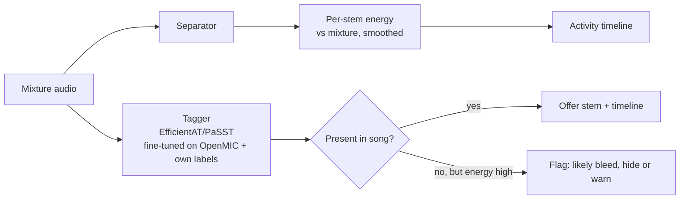

# Instrument recognition and activity detection

## TL;DR
- **Splitune needs three things:**
  1. Song-level presence: which stems to offer and which instruments the song can be practised on.
  2. Frame-level activity: where in the song each instrument plays, for loop and section suggestions and to hide silent stems.
  3. Sub-type: acoustic vs electric guitar, piano vs synth or organ.
- **Mature clip-level taggers exist; frame-level, pop-music-specific instrument activity detection is not a solved, benchmarked problem.** On OpenMIC-2018 (20 classes, 10-s clips), the best supervised models reach about 0.84–0.855 mAP (PaSST-S 84.3, DyMN-L 85.5).
- **Licence-friendly building blocks:**
  - EfficientAT MN/DyMN: MIT code, 1–68M params, AudioSet mAP 0.43–0.49.
  - PaSST: Apache-2.0 code.
  - PANNs: MIT code, weights CC-BY-4.0, frame-level "DecisionLevel" variants.
  - OpenMIC-2018: CC-BY-4.0 data.
  - All AudioSet-trained weights inherit unresolved provenance from YouTube audio.
- **Avoid for commercial use:** MERT weights (CC-BY-NC-4.0) and Essentia models (non-commercial; licence text conflicts between NC-SA and NC-ND; a proprietary licence is available).
- **Recommended pragmatic design:** a tagger fine-tuned on OpenMIC-style labels decides presence. Activity over time comes from stem energy after separation, gated by the tagger, so bleed alone does not create phantom instruments. Validate on 50–100 annotated songs before trusting it in the UI.

## Findings

### 1. Task definitions
- **Clip or song-level tagging (multi-label):** which instruments occur at all. The standard benchmark is OpenMIC-2018: 20,000 ten-second Creative Commons clips from the Free Music Archive, *partially* labelled for 20 instrument classes ([OpenMIC paper](https://ismir2018.ismir.net/doc/pdfs/248_Paper.pdf); [Zenodo, CC-BY-4.0](https://zenodo.org/records/1432913)).
- **Frame-level activity detection:** whether an instrument is active at each time step. Research exists, for example frame-level recognition using timbre plus pitch on MusicNet ([Hung & Yang 2018](https://arxiv.org/abs/1806.09587)). MedleyDB ships instrument-activation annotations for 122 multitracks ([MedleyDB](https://medleydb.weebly.com/)) under a non-commercial licence ([Zenodo](https://zenodo.org/records/1649325)). No current public leaderboard for frame-level activity in commercial pop or rock was found (gap; web search budget exhausted before a deeper search).
- **Sound-event-detection framing:** AudioSet taggers can be applied on sliding windows. PANNs' decision-level models output frame-wise probabilities, and its demo tags consecutive 2-s segments ([PANNs repo](https://github.com/qiuqiangkong/audioset_tagging_cnn)).

### 2. Candidate models
| Model | What it gives | Accuracy evidence | Size | Code licence | Weights licence | Training data | Commercial use |
|---|---|---|---|---|---|---|---|
| **PANNs** CNN14 / CNN14-DecisionLevelMax | 527 AudioSet classes, including guitar, piano, drums, strings; frame-wise SED variant | AudioSet mAP 0.431 (CNN14), 0.385 (DecisionLevelMax) ([repo](https://github.com/qiuqiangkong/audioset_tagging_cnn)) | Not stated on repo page | MIT | **CC-BY-4.0** ([Zenodo](https://zenodo.org/records/3987831)) | AudioSet (YouTube audio; labels CC-BY-4.0) | Likely yes for the weights' licence; AudioSet audio provenance unresolved |
| **EfficientAT** MN / DyMN | AudioSet tagging, fine-tunable; efficient on mobile | AudioSet mAP: mn04 43.2 (0.98M params), dymn10 47.7 (10.6M), mn40 48.4 (68M) ([repo](https://github.com/fschmid56/EfficientAT)). OpenMIC mAP: DyMN-L 85.5, DyMN-M 84.4, MN α=1 83.8 ([paper T1](https://arxiv.org/html/2310.15648)) | 1–68M | MIT | Not stated (GitHub releases) | AudioSet (KD from PaSST) | Likely yes; same AudioSet caveat |
| **PaSST** | AudioSet transformer; Banquet uses it as the instrument query encoder ([query-bandit](https://github.com/kwatcharasupat/query-bandit)) | AudioSet mAP 0.476 single model ([repo](https://github.com/kkoutini/PaSST)). OpenMIC 84.3 ([DyMN paper T1](https://arxiv.org/html/2310.15648)) | Not stated on repo page | Apache-2.0 | Not stated | AudioSet | Likely yes; same caveat |
| **MERT-v1-330M** | General music embeddings, 75 Hz frame rate, 24 kHz input | NSynth instrument accuracy 72.6% (previous SOTA 78.2). MTG-Jamendo instrument ROC 78.1 / AP 19.8 ([MERT paper](https://arxiv.org/html/2306.00107)) | 330M | Apache-2.0 ([repo](https://github.com/yizhilll/MERT)) | **CC-BY-NC-4.0** ([HF](https://huggingface.co/m-a-p/MERT-v1-330M)) | 160k h mined from the Internet ([paper](https://arxiv.org/html/2306.00107)) | **No** |
| **LAION-CLAP** (music checkpoints) | Zero-shot tags via text prompts ("electric guitar", "upright piano") | ESC-50 zero-shot 90.14%, GTZAN 71% for `music_audioset_epoch_15` ([repo](https://github.com/LAION-AI/CLAP)). No instrument benchmark found | HTSAT-base | CC0-1.0 | **CC0-1.0** HF tag ([HF](https://huggingface.co/lukewys/laion_clap)) | LAION-Audio-630K + AudioSet + undisclosed music/speech; full set not released "for copyright reasons" ([repo](https://github.com/LAION-AI/CLAP)) | Unclear (permissive tag, mixed-rights data) |
| **MS-CLAP** 2022/2023 | Zero-shot classification and captioning | ESC-50 93.9% (2023) ([repo](https://github.com/microsoft/CLAP)) | – | MIT (repo archived) | Not stated | Not stated | Unclear |
| **Essentia** MTG-Jamendo instrument, NSynth instrument | Ready-made instrument taggers | Not reviewed | Small | Library AGPL-3.0 ([licensing](https://essentia.upf.edu/licensing_information.html)) | **Conflict:** models page says CC-BY-NC-SA-4.0 ([models](https://essentia.upf.edu/models.html)); licensing page says CC-BY-NC-ND-4.0 ([licensing](https://essentia.upf.edu/licensing_information.html)). Proprietary licence on request | MTG-Jamendo (NC) | **No** without a commercial licence |
| **Music.AI metadata module** (API) | Instrument, mood, genre tags (demo shows bass, percussion, electric guitar) ([product](https://music.ai/product/)) | No public accuracy | Cloud | Proprietary | Proprietary | Undisclosed | Yes, per contract |

The AudioSet ontology groups musical instruments under plucked string (44,565 annotations), percussion (16,948), keyboard (10,473), bowed string (10,296), brass, woodwind and others ([AudioSet ontology](https://research.google.com/audioset/ontology/musical_instrument_1.html)). AudioSet distributes only YouTube IDs, labels (CC-BY-4.0) and features, never audio ([AudioSet download](https://research.google.com/audioset/download.html)). So every AudioSet-trained model was trained on YouTube audio that the model authors fetched themselves.

### 3. Separate-then-measure (pragmatic alternative)
- **Method:** run separation (see `ml/source-separation.md`), compute per-stem short-time energy (for example RMS or LUFS over 0.5–1 s hops) relative to the mixture, smooth it, and threshold it into active and inactive segments. This needs no extra model, and the timeline is aligned with the stems the user actually hears.
- **Evidence that it is not sufficient alone:** separators leak energy between stems. `htdemucs_6s` piano has "a lot of bleeding" ([Demucs README](https://github.com/facebookresearch/demucs)) and scores 1.60 dB on MoisesDB ([MoisesDB T3](https://arxiv.org/pdf/2307.15913)). Energy in a piano stem therefore does not prove a piano is present. MoisesDB's authors also expect "other plucked" (banjo, mandolin, ukulele, harp) to be confused with guitar ([MoisesDB §3](https://arxiv.org/pdf/2307.15913)). Even the challenge metric has to special-case silent stems: MDX'21 averaged only three stems for a song with a silent bass ([MDX21](https://arxiv.org/html/2108.13559v3)).
- **Inference:** combine the two signals. Tagger probability above a threshold over the whole song decides whether to offer the stem. Within an offered stem, energy above a threshold gives the activity timeline. Where they disagree (high stem energy but low tag probability), flag it as possible bleed.

### 4. Sub-type distinctions learners care about
- OpenMIC's 20 classes are coarse. MTG-Jamendo has 40 instrument tags over about 25k tracks, but its licence is non-commercial ([MTG-Jamendo](https://github.com/MTG/mtg-jamendo-dataset)). MoisesDB track labels split guitar into acoustic, clean electric and distorted electric, and keys into piano, electric piano, organ and synth ([MoisesDB T2](https://arxiv.org/pdf/2307.15913)). That is the right taxonomy for Splitune, but the data is CC-BY-NC-SA-4.0 ([repo](https://github.com/moises-ai/moises-db)).
- Commercial separators already expose acoustic vs electric guitar and piano vs synth stems (LALAL.AI; see `ml/source-separation-model-comparison.md`). A vendor separator's stem set can therefore double as a sub-type detector.

## Implications for Splitune
- **v1:** derive presence and activity from the separation vendor's stems plus a small permissively licensed tagger (EfficientAT `mn10`/`dymn10`, about 5–11M params, cheap on CPU). Use the result to (a) hide empty stems, (b) suggest "your part starts at 0:42", and (c) pick default practice loops. Feed sections from `ml/chords-beats-key-structure.md`.
- **Data:** fine-tune on OpenMIC-2018 (CC-BY-4.0) plus Splitune's own labelled clips. Do not use MTG-Jamendo, MedleyDB, MoisesDB or MERT in production training without a licence (see `ml/datasets-metrics-and-licensing.md`).
- **UX:** present detection as a suggestion ("We think this song has piano. Isolate it?") and let users correct it. Corrections become training labels, subject to privacy terms. See `ux/practice-tool-patterns.md`.
- **Video:** if a performance video shows the instrument, visual detection can confirm presence. See `ml/video-and-audio-visual-analysis.md`.

## Open questions
- What is the frame-level accuracy of the energy-plus-tagger approach on mastered pop and rock? Build a 50–100 song annotated set (instrument on/off per bar) and measure segment-level F1.
- Is AudioSet-derived weight provenance acceptable to Splitune's counsel? This affects PANNs, EfficientAT and PaSST.
- Is there a newer peer-reviewed frame-level instrument activity benchmark (2024–2026)? Not found in this pass because the web search quota was exhausted; re-check.
- Can the separation vendor return instrument-presence metadata directly? The Music.AI metadata module suggests yes; confirm accuracy and granularity.

## Sources
- [OpenMIC-2018 ISMIR paper](https://ismir2018.ismir.net/doc/pdfs/248_Paper.pdf) — tier 1, accessed 2026-10-20
- [OpenMIC-2018 on Zenodo](https://zenodo.org/records/1432913) — tier 1, accessed 2026-10-20
- [Frame-level Instrument Recognition by Timbre and Pitch (arXiv:1806.09587)](https://arxiv.org/abs/1806.09587) — tier 1, accessed 2026-10-20
- [MedleyDB site](https://medleydb.weebly.com/) — tier 1, accessed 2026-10-20
- [MedleyDB audio on Zenodo](https://zenodo.org/records/1649325) — tier 1, accessed 2026-10-20
- [PANNs: qiuqiangkong/audioset_tagging_cnn](https://github.com/qiuqiangkong/audioset_tagging_cnn) — tier 1, accessed 2026-10-20
- [PANNs weights on Zenodo](https://zenodo.org/records/3987831) — tier 1, accessed 2026-10-20
- [fschmid56/EfficientAT](https://github.com/fschmid56/EfficientAT) — tier 1, accessed 2026-10-20
- [Dynamic CNNs as Efficient Pre-trained Audio Models (arXiv:2310.15648)](https://arxiv.org/html/2310.15648) — tier 1, accessed 2026-10-20
- [kkoutini/PaSST](https://github.com/kkoutini/PaSST) — tier 1, accessed 2026-10-20
- [kwatcharasupat/query-bandit](https://github.com/kwatcharasupat/query-bandit) — tier 1, accessed 2026-10-20
- [MERT paper (arXiv:2306.00107)](https://arxiv.org/html/2306.00107) — tier 1, accessed 2026-10-20
- [yizhilll/MERT repo](https://github.com/yizhilll/MERT) — tier 1, accessed 2026-10-20
- [m-a-p/MERT-v1-330M model card](https://huggingface.co/m-a-p/MERT-v1-330M) — tier 1, accessed 2026-10-20
- [LAION-AI/CLAP](https://github.com/LAION-AI/CLAP) — tier 1, accessed 2026-10-20
- [lukewys/laion_clap (Hugging Face)](https://huggingface.co/lukewys/laion_clap) — tier 1, accessed 2026-10-20
- [microsoft/CLAP](https://github.com/microsoft/CLAP) — tier 1, accessed 2026-10-20
- [Essentia models](https://essentia.upf.edu/models.html) — tier 1, accessed 2026-10-20
- [Essentia licensing information](https://essentia.upf.edu/licensing_information.html) — tier 1, accessed 2026-10-20
- [Music.AI product page](https://music.ai/product/) — tier 2, accessed 2026-10-20
- [AudioSet ontology: Musical instrument](https://research.google.com/audioset/ontology/musical_instrument_1.html) — tier 1, accessed 2026-10-20
- [AudioSet download page](https://research.google.com/audioset/download.html) — tier 1, accessed 2026-10-20
- [facebookresearch/demucs README](https://github.com/facebookresearch/demucs) — tier 1, accessed 2026-10-20
- [MoisesDB paper PDF (arXiv:2307.15913)](https://arxiv.org/pdf/2307.15913) — tier 1, accessed 2026-10-20
- [moises-ai/moises-db repo](https://github.com/moises-ai/moises-db) — tier 1, accessed 2026-10-20
- [MDX'21 challenge paper (arXiv:2108.13559v3)](https://arxiv.org/html/2108.13559v3) — tier 1, accessed 2026-10-20
- [MTG/mtg-jamendo-dataset](https://github.com/MTG/mtg-jamendo-dataset) — tier 1, accessed 2026-10-20
