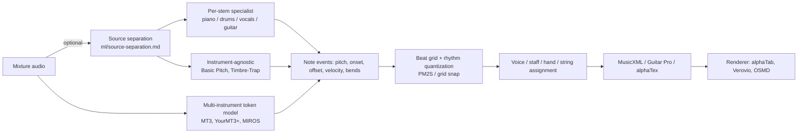

# Automatic music transcription (AMT): landscape and path to notation

## TL;DR
- **No single model does everything well.** Multi-instrument token models (MT3 → YourMT3+ → challenge winner MIROS) lead on synthetic/benchmark data. On real pop recordings they degrade badly: YourMT3+ scores <10% on "non-main" instruments of RWC-Pop ([YourMT3+](https://arxiv.org/html/2407.04822)). Plan for **per-instrument specialist models on separated stems**, with a multi-instrument model as fallback/second opinion.
- **Basic Pitch (Spotify) is the only general-purpose model that is production-shaped today.** It has Apache-2.0 code, a ~17k-parameter network, pitch bends in MIDI output, and ships as Python (TF/CoreML/TFLite/ONNX) and an npm TypeScript package ([repo](https://github.com/spotify/basic-pitch), [TS port](https://github.com/spotify/basic-pitch-ts), [paper](https://arxiv.org/abs/2203.09893)). It works "best on one instrument at a time", so feed it a separated stem. Accuracy is clearly below specialist models: 0.71 vs 0.95 no-offset note F on MAESTRO piano ([paper PDF](https://arxiv.org/pdf/2203.09893)).
- **Licensing is the real blocker, not code.** Most code is permissive (Apache-2.0/MIT), but weights usually have no stated license, and most training data includes MAESTRO (CC-BY-NC-SA-4.0). YourMT3's code is GPL-3.0 on GitHub while its Hugging Face model card says Apache-2.0. Legal review must happen before any weights ship commercially (see `legal/youtube-copyright-and-platform-policy.md`, `ml/datasets-metrics-and-licensing.md`). Minor flag: the Basic Pitch READMEs contain an unexplained GPL mention alongside Apache-2.0 ([repo](https://github.com/spotify/basic-pitch), [TS repo](https://github.com/spotify/basic-pitch-ts)), although the LICENSE file is Apache-2.0.
- **MIDI is not notation.** Getting from performance MIDI to a readable score or tab needs beat tracking, rhythm quantization, voice/staff/hand assignment, and key/meter inference. Each is its own research problem. Use a beat grid from `ml/chords-beats-key-structure.md` and do quantization as a separate stage (PM2S, MIT). Render with alphaTab (MPL-2.0), Verovio (LGPL-3.0) or OpenSheetMusicDisplay (BSD-3-Clause). See `ux/music-display-ui.md`.
- **Treat every transcription as a draft.** Even piano SOTA drops to ~82–94% F1 once offsets are scored ([Rubato table](https://arxiv.org/html/2605.24291)). Out-of-domain audio loses much more. Show confidence and make editing first-class, rather than presenting output as ground truth.

## Findings

### 1. Evaluation conventions (what the numbers mean)
Almost every paper uses `mir_eval.transcription` ([docs](https://mir-eval.readthedocs.io/latest/api/transcription.html)). Its defaults:
- **Onset tolerance:** ±50 ms.
- **Pitch tolerance:** ±50 cents.
- **Offset tolerance:** max(20% of the reference note's duration, 50 ms).

The metric names map to those tolerances as follows:
- **Note F1 / Onset F1 / "Fno" / "F50":** pitch + onset only.
- **Note-with-offset F1 / "Onset+Offset":** onset + offset must also match. This is far stricter.
- **Note-with-velocity:** velocity must also match (`transcription_velocity`).
- **Frame F1:** piano-roll overlap per frame.
- **Multi-instrument F1 (MT3):** onset + offset + correct instrument program ([MT3 paper](https://arxiv.org/pdf/2111.03017)).
- **Variant used by Perceiver-TF:** onset + program only. The YourMT3+ authors warn that the two variants are not comparable ([YourMT3+](https://arxiv.org/html/2407.04822)).

Full metric definitions live in `ml/datasets-metrics-and-licensing.md`.

### 2. Model families

- **Frame/onset CNN-RNN specialists.** Examples: Onsets and Frames (Magenta) and Kong et al.'s high-resolution regression model. They predict per-pitch onset/frame/offset/velocity posteriors that are then decoded to notes. Strongest on piano. Details in `ml/transcription-piano.md`.
- **Instrument-agnostic lightweight models.**
  - **Basic Pitch** jointly predicts onsets, note activations and a 3-bins-per-semitone contour (for bends). Total size is 16,782 parameters ([paper PDF](https://arxiv.org/pdf/2203.09893)). Its range is 88 piano keys from 27.5 Hz at 22.05 kHz input ([constants.py](https://raw.githubusercontent.com/spotify/basic-pitch/main/basic_pitch/constants.py)).
  - **Timbre-Trap** (Sony, ICASSP 2024; MIT code) unifies transcription and audio reconstruction in one autoencoder. Base weights are on a Hugging Face Space, with no weights license stated ([repo](https://github.com/sony/timbre-trap)).
  - **Harmonica** (arXiv Sep 2026, submitted to ICASSP 2027) reports a 26.3k-parameter "nano" variant at 0.796 frame F1 on its dev set, "14.6 points" above Basic Pitch, at 1,622× real time. No code is released ([arXiv](https://arxiv.org/abs/2609.04640)). Not usable yet; watch it.
- **Multi-instrument sequence-to-sequence ("token") models.**
  - **MT3** (Google, ICLR 2022) uses T5X and decodes MIDI-like tokens including instrument program. It is trained on a mixture of six datasets ([repo](https://github.com/magenta/mt3), [paper](https://arxiv.org/pdf/2111.03017)).
  - **Perceiver-TF** (ICASSP 2023) is a time-frequency Perceiver over 12 instrument classes plus vocals ([arXiv](https://arxiv.org/abs/2306.10785)). We could not locate an official code release (unverified).
  - **YourMT3+** (MLSP 2024) adds a hierarchical time-frequency attention encoder, mixture-of-experts, multi-channel decoding for partially labelled data, and cross-dataset stem augmentation. It transcribes vocals without separation ([arXiv](https://arxiv.org/abs/2407.04822)). It is trained on 10 datasets: MusicNet-EM, GuitarSet, MIR-ST500, ENST-Drums, Slakh, EGMD, MAESTRO, CMedia, URMP, SMT-Bass ([HTML](https://arxiv.org/html/2407.04822)).
  - **2025 AMT Challenge** (NeurIPS 2025 AI4Music workshop; report Mar 2026). Its test set is 76 newly composed, FluidSynth-rendered pieces with ≤3 of 8 orchestral instruments.
    - Winner MIROS (YourMT3+ framework with a MusicFM encoder): 0.600 multi-instrument onset F1.
    - YourMT3-YPTF-MoE-M: 0.594.
    - MT3: 0.393.
    - The organizers suggest YourMT3+ may overfit Slakh ([arXiv HTML](https://arxiv.org/html/2603.27528)).
- **Emerging (no usable artifacts yet).**
  - **Cycle-consistent training on unpaired audio and scores.** Reported gains, especially for low-resource instruments ([arXiv 2605.24193](https://arxiv.org/abs/2605.24193), May 2026; no numbers in abstract).
  - **Diffusion decoders.** Seen in drums (`ml/transcription-drums.md`) and guitar tab (`ml/transcription-guitar-and-bass-tabs.md`).

### 3. Benchmark numbers (as reported; datasets differ, do not compare across rows blindly)

**MT3 (ICLR 2022, Table 2), mixture-trained model.** Onset F1 / Onset+Offset F1 ([paper](https://arxiv.org/pdf/2111.03017)):

| Dataset | Onset F1 | Onset+Offset F1 | Multi-instr. F1 ("Full") | Melodyne baseline Onset F1 |
|---|---|---|---|---|
| MAESTRO v3 (piano) | 0.95 | 0.80 | 0.82 | 0.52 |
| Slakh2100 (synth multi-instr.) | 0.76 | 0.57 | 0.55 | 0.30 |
| GuitarSet | 0.90 | 0.78 | 0.78 | 0.28 |
| MusicNet (classical) | 0.50 | 0.33 | 0.34 | 0.04 |
| URMP (chamber) | 0.77 | 0.58 | 0.50 | 0.09 |

**YourMT3+ (YPTF.MoE+Multi, no pitch-shift / with pitch-shift), Onset F1 %** ([HTML, Table 2/14](https://arxiv.org/html/2407.04822)):

| Dataset | MT3 (Colab re-eval) | YourMT3+ | Best other reported |
|---|---|---|---|
| MAESTRO v3 | 94.86 | 96.98 / 96.52 | 97.44 |
| MAPS (unseen) | 80.62 | 87.88 / 86.25 | 88.40 |
| Slakh, agnostic non-drum | 75.20 | 84.14 / 84.56 | 81.9 (Perceiver-TF) |
| Slakh, multi F1 | 57.69 | 73.98 / 74.84 | 62.0 |
| URMP multi F1 | 58.71 | 67.22 / 67.98 | 59.0 |
| GuitarSet | 89.10 | 91.65 / 88.87 | 91.10 |
| MIR-ST500 vocals (no separation) | 3.62 | 70.59 / 71.07 | 78.50 |
| ENST-Drums DTM | 70.31 | 85.92 / 87.27 | 79.00 |

**Basic Pitch (ICASSP 2022), note F without offset (Fno) / with offset (F)** ([paper PDF, Table 2/3](https://arxiv.org/pdf/2203.09893)):

| Dataset | Fno | F |
|---|---|---|
| GuitarSet | 0.79 | 0.56 |
| MAESTRO | 0.71 | 0.11 |
| Slakh | 0.42 | 0.21 |
| Molina (vocals) | 0.52 | 0.35 |

The comparison with specialist models runs both ways:
- **Piano:** Onsets and Frames reaches 95.2% Fno on MAESTRO, versus 70.9% for Basic Pitch.
- **Vocals:** VOCANO beats Basic Pitch.
- **Guitar:** Basic Pitch beats TENT on GuitarSet solo (84.0 vs 76.3 Fno).
- **Efficiency:** On a 7m45s file, Basic Pitch used 951 MB peak memory and took 24 s on a 2017 MacBook Pro CPU.

**Generalization warning (evidence).** The GAPS paper (ISMIR 2024) evaluated zero-shot on GuitarSet. MT3 fell from 90.0 (supervised) to 32.0 F1, while a Kong-style CRNN trained on other guitar data held 86–88 ([GAPS](https://arxiv.org/html/2408.08653v2)). Token models appear to overfit to training-set acoustics.

### 4. Mixture vs separated stem as input
The evidence is thin, and no controlled study across instruments was found:
- **Vocals, YourMT3+ on MIR-ST500:** onset F1 is 71.60 with separated input vs 70.59 on the mixture, a ~1 point gain ([YourMT3+](https://arxiv.org/html/2407.04822)).
- **Vocal pitch trackers:** in the RMVPE paper, pYIN/CREPE run on Spleeter-separated vocals lose to RMVPE run on the mixture. On MIR-1K, RPA is 91.05 for CREPE-on-stem vs 95.42 for RMVPE ([RMVPE](https://arxiv.org/html/2306.15412v1)). So a model trained on mixtures can beat separation + monophonic tracker.
- **Drums:** separation enables finer classes. ADTOF on Demucs/DrumSep stems expands 5 to 7 classes and beats an 8-class baseline on MDB (0.84 vs 0.72) ([Riley & Dixon 2025](https://arxiv.org/html/2509.24853)).
- **Basic Pitch:** officially "works best on one instrument at a time" ([repo](https://github.com/spotify/basic-pitch)), so separation is effectively mandatory for it.
- **Inference:** separation helps most for (a) instrument-agnostic models, which otherwise transcribe every instrument, and (b) class expansion. It helps least for models trained on mixtures. Separation artifacts (bleed, smeared transients) are an untested risk for onset accuracy.

### 5. From note events to notation
- **Rhythm quantization is its own problem.**
  - **PM2S** (Liu et al., ISMIR 2022; MIT) is a CRNN that predicts beats, quantized onsets, time signature, key signature, and hand part from performance MIDI. It beats commercial software on MV2H ([poster](https://ismir2022program.ismir.net/poster_335.html), [repo](https://github.com/cheriell/PM2S)).
  - **Beyer & Dai** (ISMIR 2024) is an end-to-end transformer from performance MIDI to score tokens. It predicts note values, staff, trills and stem direction ([arXiv](https://arxiv.org/abs/2410.00210)). Its code repo has **no license file** ([repo](https://github.com/TimFelixBeyer/MIDI2ScoreTransformer)), so treat it as unusable without permission. It is trained on piano only (ASAP/ACPAS).
  - **Simpler practical option (inference):** snap onsets to a 1/16 grid derived from a beat tracker. This is what the TART guitar pipeline does, using BeatNet beats and a 1/16 grid exported to MusicXML ([TART](https://arxiv.org/html/2609.11904v1)). Beat tracking is covered in `ml/chords-beats-key-structure.md`.
- **Toolkits.**
  - **music21:** BSD-3-Clause ([repo](https://github.com/cuthbertLab/music21)).
  - **partitura:** Apache-2.0 ([repo](https://github.com/CPJKU/partitura)).
  - **MuseScore Studio:** GPL-3.0 ([repo](https://github.com/musescore/MuseScore)). Usable as an offline converter, but do not link it into a closed product.
- **Renderers** (detail in `ux/music-display-ui.md`):
  - **alphaTab:** MPL-2.0. Reads Guitar Pro 3–8, MusicXML and alphaTex. Renders standard notation and tab with a built-in synth and audio/video sync. Runs in the browser, .NET and Android; iOS is not listed ([repo](https://github.com/CoderLine/alphaTab)).
  - **Verovio:** LGPL-3.0. MEI/MusicXML/Humdrum/ABC to SVG, with a JS toolkit ([repo](https://github.com/rism-digital/verovio)).
  - **OpenSheetMusicDisplay:** BSD-3-Clause. Renders MusicXML (VexFlow) in the browser, including guitar tab with bends and glissandi ([repo](https://github.com/opensheetmusicdisplay/opensheetmusicdisplay)).

### 6. Models summary

| model | task | input | reported metric (dataset) | code license | weights license | training-data license | commercial use | production-readiness |
|---|---|---|---|---|---|---|---|---|
| Basic Pitch (Spotify, 2022) | instrument-agnostic notes + pitch bends | mono stem, 22.05 kHz | Fno 0.79 GuitarSet, 0.71 MAESTRO ([paper](https://arxiv.org/pdf/2203.09893)) | Apache-2.0 ([repo](https://github.com/spotify/basic-pitch)) | bundled in Apache-2.0 repo; no separate weights license | mixed: GuitarSet CC-BY-4.0, Slakh CC-BY-4.0, MAESTRO CC-BY-NC-SA-4.0, others unverified | code yes; weights likely, legal review (NC training data) | **Production-usable**: Python + npm, CoreML/TFLite/ONNX |
| MT3 (Google, 2022) | multi-instrument notes + program | mixture | Onset F1 0.95 MAESTRO, 0.76 Slakh ([paper](https://arxiv.org/pdf/2111.03017)) | Apache-2.0 ([repo](https://github.com/magenta/mt3)) | not stated | MAESTRO NC-SA, Slakh CC-BY, GuitarSet CC-BY, MusicNet/URMP unverified | unclear | Research: T5X/JAX, Colab-oriented, training unsupported |
| YourMT3+ (2024) | multi-instrument incl. vocals, drums | mixture | Slakh multi F1 74.84; MAESTRO onset 96.98 ([HTML](https://arxiv.org/html/2407.04822)) | GPL-3.0 on GitHub ([repo](https://github.com/mimbres/YourMT3)) | HF model card says Apache-2.0 ([HF API](https://huggingface.co/api/models/mimbres/YourMT3)), which conflicts with the GitHub license | includes MAESTRO NC-SA, MIR-ST500 (YouTube audio, no license) | **risky** (GPL + NC data) | Research / pre-release; GPU; HF Space demo |
| MIROS (2025 challenge) | multi-instrument | mixture | 0.600 multi onset F1 (challenge set) ([report](https://arxiv.org/html/2603.27528)) | unverified | unverified | unverified | unknown | Research |
| Perceiver-TF (2023) | 12 instr. + vocals | mixture | Slakh agnostic onset F1 81.9 (as cited in [YourMT3+](https://arxiv.org/html/2407.04822)) | no public code found (unverified) | n/a | n/a | n/a | Research |
| Timbre-Trap (Sony, 2024) | agnostic MPE/AMT + reconstruction | mixture or stem | no numbers in repo | MIT ([repo](https://github.com/sony/timbre-trap)) | not stated (HF Space) | URMP, Bach10 among others | code yes; weights unclear | Research |
| Harmonica (2026 preprint) | agnostic AMT | stem | nano: frame F1 0.796 dev ([arXiv](https://arxiv.org/abs/2609.04640)) | no code | no weights | unverified | n/a | Not available |
| PM2S (2022) | performance MIDI → quantized score | MIDI | beats MV2H > commercial ([poster](https://ismir2022program.ismir.net/poster_335.html)) | MIT ([repo](https://github.com/cheriell/PM2S)) | in repo (MIT) | ASAP / piano | likely yes (legal review) | Research code, usable |
| MIDI2ScoreTransformer (2024) | perf. MIDI → score | MIDI | "significant improvements" ([arXiv](https://arxiv.org/abs/2410.00210)) | **none** ([repo](https://github.com/TimFelixBeyer/MIDI2ScoreTransformer)) | unverified | ASAP/ACPAS | no (all rights reserved) | Research |

### 7. Per-instrument docs
- Guitar and bass, including tablature and string/fret assignment: `ml/transcription-guitar-and-bass-tabs.md`.
- Piano, including hand separation and simplification: `ml/transcription-piano.md`.
- Drums: `ml/transcription-drums.md`.
- Vocals, melody and lyrics alignment: `ml/transcription-vocals-melody.md`.
- **Other instruments (feasibility only).**
  - **Violin/strings and winds:** covered by MT3/YourMT3+. MusicNet/URMP results are much lower: MT3 onset+offset F1 is 0.33 on MusicNet and 0.58 on URMP ([MT3](https://arxiv.org/pdf/2111.03017)). Expect monophonic pitch tracking (see vocals doc) to work better on separated solo lines.
  - **Ukulele:** no dedicated model or dataset was found. Basic Pitch on a stem plus a guitar-style fret assigner adapted to re-entrant tuning is a plausible path (inference).

## Implications for Splitune
- **Architecture:**
  - Run separation first (`ml/source-separation.md`), then route each stem to a specialist.
  - Keep a multi-instrument model as an optional server-side "second opinion" for instruments without a specialist.
  - Represent transcription output internally as **note events with confidence + pitch-bend curves**, not as MIDI files. Quantize to notation in a separate, re-runnable stage that consumes the beat grid.
- **MVP default:** Basic Pitch on separated stems is the lowest-risk, lowest-cost generic transcriber (permissive code, on-device-capable). Upgrade per instrument where specialists are clearly better: piano and drums first.
- **Licensing gate:**
  - Inventory weights and training data for every model before shipping.
  - Prefer models whose weights are trained on CC-BY / CC0 data, or retrain on such data.
  - Avoid GPL code (YourMT3) in distributed clients.
- **UX:** Transcription and notation are imperfect. Expose per-note confidence, an easy "fix this note" editor, and play-along with the original audio as the ground truth. Learners can then trust their ears over the score.

## Open questions
- **Does separation actually help each specialist on real YouTube-quality audio?** Run an in-house A/B on 20–50 annotated songs per instrument: mixture vs HT-Demucs/BS-RoFormer stems, measuring onset F1 and offset F1.
- **What is the weights license and training-data provenance** of Basic Pitch, MT3 checkpoints, Timbre-Trap and Transkun? Ask the authors directly, then put the answers through legal review.
- **How much does rhythm quantization degrade on rubato pop performances,** and is grid snapping to a beat tracker good enough for beginners? Prototype and test with users.
- **Is there a realistic (non-synthetic) multi-instrument pop benchmark?** RWC-Pop is the only one in the YourMT3+ paper. Splitune may need its own small, licensed evaluation set.

## Sources
- [spotify/basic-pitch (GitHub)](https://github.com/spotify/basic-pitch) — tier 1, accessed 2026-10-20
- [spotify/basic-pitch-ts (GitHub)](https://github.com/spotify/basic-pitch-ts) — tier 1, accessed 2026-10-20
- [Basic Pitch constants.py](https://raw.githubusercontent.com/spotify/basic-pitch/main/basic_pitch/constants.py) — tier 1, accessed 2026-10-20
- [Bittner et al., A Lightweight Instrument-Agnostic Model… (arXiv abs)](https://arxiv.org/abs/2203.09893) — tier 1, accessed 2026-10-20
- [Bittner et al. (arXiv PDF)](https://arxiv.org/pdf/2203.09893) — tier 1, accessed 2026-10-20
- [magenta/mt3 (GitHub)](https://github.com/magenta/mt3) — tier 1, accessed 2026-10-20
- [Gardner et al., MT3 (arXiv PDF)](https://arxiv.org/pdf/2111.03017) — tier 1, accessed 2026-10-20
- [mimbres/YourMT3 (GitHub)](https://github.com/mimbres/YourMT3) — tier 1, accessed 2026-10-20
- [YourMT3 Hugging Face model metadata](https://huggingface.co/api/models/mimbres/YourMT3) — tier 2, accessed 2026-10-20
- [Chang et al., YourMT3+ (arXiv abs)](https://arxiv.org/abs/2407.04822) — tier 1, accessed 2026-10-20
- [Chang et al., YourMT3+ (arXiv HTML)](https://arxiv.org/html/2407.04822) — tier 1, accessed 2026-10-20
- [Lu et al., Multitrack Music Transcription with a Time-Frequency Perceiver](https://arxiv.org/abs/2306.10785) — tier 1, accessed 2026-10-20
- [Results from the 2025 AMT Challenge (arXiv abs)](https://arxiv.org/abs/2603.27528) — tier 1, accessed 2026-10-20
- [Results from the 2025 AMT Challenge (arXiv HTML)](https://arxiv.org/html/2603.27528) — tier 1, accessed 2026-10-20
- [sony/timbre-trap (GitHub)](https://github.com/sony/timbre-trap) — tier 1, accessed 2026-10-20
- [Harmonica (arXiv)](https://arxiv.org/abs/2609.04640) — tier 1, accessed 2026-10-20
- [Music Transcription with (Almost) No Supervision (arXiv)](https://arxiv.org/abs/2605.24193) — tier 1, accessed 2026-10-20
- [mir_eval.transcription docs](https://mir-eval.readthedocs.io/latest/api/transcription.html) — tier 1, accessed 2026-10-20
- [GAPS (arXiv HTML)](https://arxiv.org/html/2408.08653v2) — tier 1, accessed 2026-10-20
- [RMVPE (arXiv HTML)](https://arxiv.org/html/2306.15412v1) — tier 1, accessed 2026-10-20
- [Riley & Dixon, Enhanced ADT via Drum Stem Separation (arXiv HTML)](https://arxiv.org/html/2509.24853) — tier 1, accessed 2026-10-20
- [Liu et al., Performance MIDI-to-score conversion by neural beat tracking (ISMIR 2022 poster)](https://ismir2022program.ismir.net/poster_335.html) — tier 1, accessed 2026-10-20
- [cheriell/PM2S (GitHub)](https://github.com/cheriell/PM2S) — tier 1, accessed 2026-10-20
- [Beyer & Dai, End-to-end Piano Performance-MIDI to Score Conversion (arXiv)](https://arxiv.org/abs/2410.00210) — tier 1, accessed 2026-10-20
- [TimFelixBeyer/MIDI2ScoreTransformer (GitHub)](https://github.com/TimFelixBeyer/MIDI2ScoreTransformer) — tier 1, accessed 2026-10-20
- [TART (arXiv HTML)](https://arxiv.org/html/2609.11904v1) — tier 1, accessed 2026-10-20
- [Rubato: Transcribing Piano Music with Timestamps (arXiv HTML)](https://arxiv.org/html/2605.24291) — tier 1, accessed 2026-10-20
- [cuthbertLab/music21 (GitHub)](https://github.com/cuthbertLab/music21) — tier 1, accessed 2026-10-20
- [CPJKU/partitura (GitHub)](https://github.com/CPJKU/partitura) — tier 1, accessed 2026-10-20
- [musescore/MuseScore (GitHub)](https://github.com/musescore/MuseScore) — tier 1, accessed 2026-10-20
- [CoderLine/alphaTab (GitHub)](https://github.com/CoderLine/alphaTab) — tier 1, accessed 2026-10-20
- [rism-digital/verovio (GitHub)](https://github.com/rism-digital/verovio) — tier 1, accessed 2026-10-20
- [opensheetmusicdisplay (GitHub)](https://github.com/opensheetmusicdisplay/opensheetmusicdisplay) — tier 1, accessed 2026-10-20
