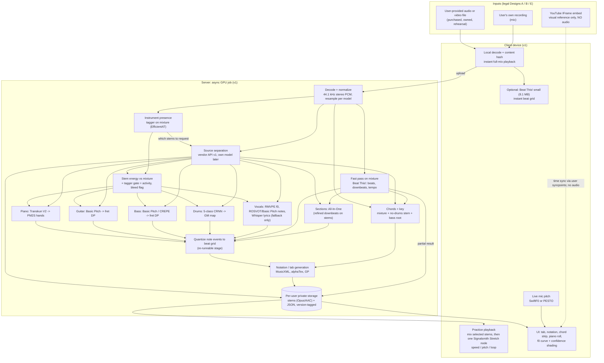

# ML reference pipeline overview

This is a synthesis document. Almost every number below comes from the topic docs it links to; follow the link for the primary citation. Only two URLs were re-opened for this doc (Music.AI pricing, Beat This! repo). Unless a statement is marked *evidence*, read it as inference or recommendation.

## TL;DR
- **Input is the user's own audio, never a YouTube stream.** The pipeline ingests files the user owns or records. A YouTube embed can only be a visual reference beside the analysis, with no audio access (Designs A, B and E in `research/legal/youtube-copyright-and-platform-policy.md`). Every output is stored per user. There is no cross-user cache until counsel signs off.
- **v1 shape: one async server job per song.** The job decodes the audio, runs a fast beat grid on the mixture, tags which instruments are present, and runs separation. It then runs per-stem specialists, quantizes to the beat grid and emits notation. The client handles playback DSP (Signalsmith Stretch, MIT), live mic pitch tracking (SwiftF0 or PESTO) and rendering (alphaTab and others).
- **Separation comes from a vendor API in v1** (AudioShake, Music.AI or LALAL.AI, chosen by blind listening test). Everything else uses open models with permissive code: Beat This! (MIT code and weights), Basic Pitch (Apache-2.0), Transkun (MIT code), RMVPE (Apache-2.0 code), Whisper (MIT), plus an in-house fret-assignment DP. Several of these have **amber** weights: unstated weights licence or non-commercial training data. Each needs a licence-register entry and counsel sign-off (`datasets-metrics-and-licensing.md`).
- **Self-hosting costs about 100× less than an API.** Self-hosted GPU runs about $0.0013–0.0044 per song-minute on an L4, versus at least about $0.18 per song-minute through the Music.AI API (`deployment-and-inference.md`). The API price may be higher, because Music.AI lists each stem as a separate $0.07/min line item ([Music.AI pricing](https://music.ai/pricing/)). Start with the API for time-to-MVP. Move stage by stage to models trained in-house on licensed data once volume justifies it.
- **Biggest technical risk: guitar and piano on real user audio.** The chain is separation (`htdemucs_6s` scores 3.07 dB on guitar and 1.60 dB on piano on MoisesDB; vendors publish no per-instrument numbers), then transcription on a bleeding stem (never measured), then fret or hand assignment. Errors compound at each step, and no benchmark measures the whole chain. Prototypes 1–3 below exist to retire this risk first.
- **Every stage emits confidence and a model-version tag.** The UI needs them to show uncertainty, offer alternatives and fall back to chords-only (`research/ux/music-display-ui.md`).

## Findings

### 1. Reference pipeline (v1 placement)

Notes on the diagram:
- **Order follows `deployment-and-inference.md`.** Fast mixture analysis (beat grid) returns first, in seconds. Stems and per-stem results follow, in tens of seconds. The learner can loop and slow the full mix immediately. Downbeats and sections are refined on stems, because All-In-One's ablation shows demixing helps downbeats and structure (`chords-beats-key-structure.md`).
- **Instrument tagging runs before separation, then gates its output.** Running the tagger first lets the job request only the stems that are present. Vendors price per module or stem: Music.AI lists $0.07/min per musical stem line item ([pricing](https://music.ai/pricing/)), and LALAL.AI multiplies minutes by stem count (`research/market/pricing-and-business-models.md`). After separation, stem energy gated by the tagger yields the activity timeline and a bleed flag (`instrument-recognition.md`).
- **Solo-instrument input skips separation.** For solo piano or solo guitar recordings, the specialist runs on the mixture, because separation can only add artefacts (`transcription-piano.md`).
- **Video is display-only in v1.** The analysis pipeline never takes video. Video analysis (fingering, audio-visual separation) is research-grade, and YouTube frames are legally off-limits (`video-and-audio-visual-analysis.md`).
- **On-device in v1:** decode, hash, playback DSP, live mic f0 and rendering, plus optionally Beat This! small. Everything else runs server-side. This is compatible with legal Design A ("on-device where feasible, else server-side with private per-user storage"). See section 3, option C, for when separation can move to the device.

### 2. Stage-by-stage table

Licence tiers follow `datasets-metrics-and-licensing.md`:
- **Green:** permissive code, explicit permissive weights, and commercially usable data.
- **Amber:** weights unstated, or trained on non-commercial or undisclosed data. Allowed for R&D; production needs counsel sign-off.
- **Red:** explicitly non-commercial. Do not ship.

Readiness levels:
- **Prod:** production-ready.
- **Risky:** usable, but quality or licence is unresolved.
- **Research:** research-grade.

| Stage | Recommended component (v1) | Licence status (code / weights / data → verdict) | Readiness | Expected quality (metric, dataset) | Alternatives | Detail |
|---|---|---|---|---|---|---|
| Ingest / decode | User file or recording; decode to 44.1 kHz stereo; resample per model (Basic Pitch 22.05 kHz, CREPE 16 kHz, Transkun 44.1 kHz); content hash of decoded audio | Decoder library choice not researched here; input rights warranted by user (UGC terms) | Prod | n/a. Inputs are often lossy and mastered; both degrade separation | Licensed catalogue audio (Design C/D) | `research/legal/youtube-copyright-and-platform-policy.md`, `source-separation.md` |
| Instrument presence + activity | EfficientAT `mn10`/`dymn10` fine-tuned on OpenMIC-2018 + own labels; activity = stem energy gated by tagger | MIT / not stated / AudioSet (YouTube audio, provenance unresolved) + OpenMIC CC-BY-4.0 → **amber** | Risky | OpenMIC mAP 85.5 (DyMN-L, 20 classes, clip-level). Frame-level accuracy on pop is **unbenchmarked** | Music.AI instrument detection ($0.02/min, [pricing](https://music.ai/pricing/)); PANNs (weights CC-BY-4.0); vendor stem set as sub-type detector | `instrument-recognition.md` |
| Source separation | Vendor API: AudioShake / Music.AI / LALAL.AI, chosen by blind test | Proprietary service → **yes per contract** (caching and retention terms unreviewed) | Prod (service); guitar/piano quality unverified | No public per-instrument SDR from any vendor. Open reference: `htdemucs` 9.00 dB cSDR MUSDB18-HQ (4 stems); `htdemucs_6s` guitar 3.07 / piano 1.60 dB (MoisesDB) | `htdemucs` (MIT code, weights unclear → amber); BS-RoFormer / SCNet trained in-house on licensed data (MIT code → green if data licensed); Spleeter (MIT weights, green, about 3 dB behind) | `source-separation.md`, `source-separation-model-comparison.md` |
| Beats / downbeats / tempo | Beat This! (`beat_this` 1.1.0); BPM from median inter-beat interval + half/double toggle | MIT / **MIT** / includes copyrighted and limited-CC files; authors leave the assessment to users ([repo](https://github.com/CPJKU/beat_this)) → green-ish; record data caveat | Prod | GTZAN beat F1 89.1, downbeat F1 78.3; Harmonix 95.8 / 90.7 (8-fold CV). Weak on rubato and classical (RWC Classical 77.1) | BeatNet (CC-BY-4.0, the only causal/real-time option); madmom DBN (**red**) | `chords-beats-key-structure.md` |
| Sections | All-In-One (`allin1`) on separated stems | MIT / not stated / Harmonix (912 pop songs); runs Demucs internally → **amber** | Risky | Harmonix 8-fold: segment HR.5F .660, label PWF .738; pop-only training | Music.AI sections ($0.04/min); SongFormer (new, not peer-reviewed); MSAF (MIT, unsupervised) | `chords-beats-key-structure.md` |
| Key | Key from chord histogram + pitch-class profile (in-house, no learned weights) | Own code → green | Research (unbenchmarked) | No permissive benchmarked model exists. Reference: madmom CNN key 74.6–85.1 MIREX weighted (pop/EDM), but its weights are **red** | Essentia key (AGPL-3.0; commercial licence on request) | `chords-beats-key-structure.md` |
| Chords | consonance-ACE (or BTC), beat-synchronous majmin with optional sevenths; fused from mixture, no-drums stem and bass root | MIT / checkpoint licence unstated / Isophonics + Billboard (annotations) → **amber** | Risky | majmin 77.8, sevenths 66.0, majmin_inv 75.6 (RWC Pop + USPop). About 1 bar in 6 wrong on studio pop | Music.AI chords ($0.04/min); madmom CNN+CRF majmin about 82.9 (**red**); Chordino (GPL) | `chords-beats-key-structure.md` |
| Piano notes | Transkun V2 (`pip install transkun`) → PM2S hand/staff split | MIT / not stated / MAESTRO CC-BY-NC-SA-4.0 → **amber** | Risky (good model; licence and domain gap) | Onset F1 0.983 MAESTRO; 0.922 MAPS; 0.988 SMD. Estimated 5–15 points lower on real recordings (inference). Never measured on separated piano stems | Kong et al. (weights CC-BY-4.0, inference package unlicensed); Basic Pitch (Fno 0.71 MAESTRO); retrain on own Disklavier recordings | `transcription-piano.md` |
| Guitar notes | Basic Pitch on guitar stem | Apache-2.0 / bundled in repo / mixed incl. MAESTRO NC-SA → **amber** (low) | Prod (Py, npm, CoreML, TFLite, ONNX) | 79.0 onset F1 GuitarSet (supervised SOTA about 91). Distorted electric guitar is the main unknown | Kong-style CRNN fine-tuned in-house on GuitarSet (CC-BY-4.0); YourMT3+ (GPL-3.0, **risky**); MT3 (32.0 zero-shot, avoid) | `transcription-guitar-and-bass-tabs.md` |
| Fret assignment (guitar + bass) | In-house cost DP: open-position bias, span ≤4 frets, capo/tuning as input; 4/5-string config for bass | Own code → green | Research → buildable | Lowest-fret already 98.30% tab accuracy on simple material (GuitarToday); learned Fretting-Transformer 72.19% on jazz (Leduc). No code release for learned assigners | Learned assigner trained later (MIDI-to-Tab-style); video-based fingering (research only) | `transcription-guitar-and-bass-tabs.md` |
| Bass notes | Basic Pitch or CREPE (floor about 32 Hz) on bass stem + octave correction from chord root | Apache-2.0 / MIT; weights not separately stated → **amber** (low) | Risky | Slakh bass onset F1 about 93 (synthetic, YourMT3+). No real-recording bass-tab benchmark. **Not SwiftF0** (46.9 Hz floor misses the open E at 41.2 Hz) | pYIN with `fmin`=30 (ISC, no weights) | `transcription-guitar-and-bass-tabs.md` |
| Drums | 5-class CRNN trained in-house on E-GMD + Groove MIDI + Slakh (all CC-BY-4.0) on the drum stem; map to GM percussion | Own weights on CC-BY data → green; ADTOF (CC-BY-NC-SA-4.0) is **red** | Risky (needs training) | ADTOF 0.87 MDB / 0.84 ENST (5-class). E-GMD-trained models generalise worse (OaF 75.19 MDB). Hi-hat open/closed and crash/ride shown as approximate | Licence ADTOF from its authors; DrumSep kit separation (R&D only) | `transcription-drums.md` |
| Vocal pitch curve | RMVPE on mixture or vocal stem (server) | Apache-2.0 / not stated, no download listed / unverified → **amber** | Risky | RPA 95.42 MIR-1K (polyphonic); 89.32 MIR-ST500 | CREPE (MIT); SwiftF0 (MIT, RPA 89.90 at 10 dB SNR) | `transcription-vocals-melody.md` |
| Vocal notes | Basic Pitch or ROSVOT on vocal stem, quantized; shown under the f0 curve | Apache-2.0; ROSVOT MIT code with unlicensed weights → **amber** | Research | ROSVOT COnPOff 47.4 out of domain (MIR-ST500); Basic Pitch Fno 0.52 (Molina) | YourMT3+ (GPL) | `transcription-vocals-melody.md` |
| Lyrics | Licensed lyrics text + alignment preferred. Fallback: Whisper on vocal stem + WhisperX alignment | Whisper MIT code **and** weights → green. WhisperX BSD-2-Clause, alignment models per-language licences. **Displaying lyrics is a rights question** | Prod (ASR); singing alignment untested | SOTA open-source on Jam-ALT with separation (WER not in abstract) | Music.AI lyrics ($0.17/min transcription, $0.09/min word alignment, [pricing](https://music.ai/pricing/)) | `transcription-vocals-melody.md`, `research/legal/youtube-copyright-and-platform-policy.md` |
| Quantization | 1/16 grid snap to Beat This! downbeats (all instruments); PM2S for piano | Own code; PM2S MIT → green | Risky (rubato untested) | No metric for grid-snap on pop. PM2S beats commercial software on MV2H | MIDI2ScoreTransformer (no licence; unusable) | `transcription-general.md` |
| Notation / tab generation | Internal note events → alphaTex / MusicXML / Guitar Pro; render with alphaTab (tab, drums), Verovio or OSMD (notation), custom piano roll | alphaTab MPL-2.0; Verovio LGPL-3.0; OSMD BSD-3-Clause → green with copyleft obligations | Prod | n/a | music21 (BSD-3-Clause), partitura (Apache-2.0) for conversion | `transcription-general.md`, `research/ux/music-display-ui.md` |
| Practice playback | Mix selected stems, then one Signalsmith Stretch node (Option C), on-device | MIT → green | Prod (0.5× quality untested) | No metric. Author targets 0.75–1.5×; learners use 0.5–0.8× | Rubber Band R3 (GPL-2.0-or-later, or £590–£9,320 commercial); `AVAudioUnitTimePitch` spectral | `playback-time-stretch-pitch-shift.md` |
| Live mic feedback | SwiftF0 (ONNX) or PESTO v2 (streaming, <10 ms) on-device | MIT / LGPL-3.0 (static-linking obligations on mobile) → green / check LGPL | Prod-shaped | SwiftF0 RPA 89.90 at 10 dB SNR; PESTO latency <10 ms. On-phone end-to-end latency unmeasured | CREPE tiny; pYIN | `transcription-vocals-melody.md`, `deployment-and-inference.md` |

### 3. Alternative pipelines

All three share the same stage graph and data contract (section 5). They differ in who runs separation and where.

| | **A. Vendor API first** (recommended for v1) | **B. All open-source, self-hosted** | **C. On-device first** |
|---|---|---|---|
| Separation | AudioShake / Music.AI / LALAL.AI behind a `separate(audio, stems[]) → stems + model_id + version` interface | BS-RoFormer, Mel-RoFormer or SCNet (MIT code) **trained by Splitune on licensed multitracks**; `htdemucs` only as an amber stop-gap | SCNet-class or distilled model via Core ML / ExecuTorch / LiteRT; or a licensed vendor SDK (AudioShake has a real-time SDK; djay ships it via Core ML) |
| Other stages | Open models from the table above; optionally vendor chords, beats and sections | Same open models; retrain amber ones (drums on E-GMD/GMD/Slakh; piano on own recordings) | Beat This! small, Basic Pitch (CoreML/TFLite/ONNX), SwiftF0/PESTO already fit. Piano: Mobile-AMT shows on-device is feasible, but no code exists |
| Cost shape | Variable, per song-minute. Music.AI: stems $0.07/min per stem line item, chords $0.04, beats $0.03, sections $0.04 ([pricing](https://music.ai/pricing/)). Total ≈ $0.18/min if stems bill once, and up to ≈ $0.39/min for 4 stems if each stem bills separately (billing not stated on the page). LALAL.AI about $0.06/min × stems. At 800k song-min/month: ≈ $144k+ (`deployment-and-inference.md`) | GPU about $0.0013/min (L4, assumed RTF 0.1) to about $0.0044/min at 30% utilisation, ≈ $1.1–3.6k/month at 800k song-min. **Plus** fixed costs: licensed training data (cost unknown), training (BS-RoFormer L=12 took 4 weeks on 16× A100), MLOps and on-call | ≈ $0 marginal compute. High fixed engineering (model conversion, per-device QA). Battery and thermals unmeasured |
| Legal exposure | Lowest model-licence risk (vendor contract). Content exposure unchanged: Splitune still makes copies server-side. **Vendor use confers no content rights** (AudioShake MSA requires a customer warranty). Check vendor terms on caching and retention | Lowest long-term *if* training data is licensed. Using community or MUSDB-trained checkpoints instead = amber/red | Lowest content exposure: audio never leaves the device, matching legal Design A's preference. Model licence is the same as A or B |
| Quality | Plausibly best on guitar/piano (vendors sell instrument-specific models), but **unverified**: no public per-instrument numbers | Matches published SOTA on 4 stems (about 9.7–10 dB cSDR) if recipes transfer. Guitar/piano depends on licensed multitracks containing those stems | Lowest ceiling: device memory and thermals; WASM Demucs RTF 1.3–5.9; no verified phone timings |
| Time to MVP | Weeks (inference): integration + listening test | Months (inference): data licensing is the critical path, not code | Months: and only once a fast model is benchmarked on target phones |
| When to choose | v1, and while volume is low | When API spend exceeds the fixed cost of self-hosting (inference; no threshold researched), or vendor terms block per-user caching | When legal review requires audio to stay on-device, or a phone benchmark shows RTF ≲ 1 at acceptable quality |

**Recommended path (inference):** start with A, using the open models already in the table for non-separation stages. Build the evaluation harness and provider interface so B can replace A one stage at a time: drums and beats first (cheap), separation last (data-gated). Ship C's pieces that are already viable in v1 (playback, mic f0, optional beat grid). Revisit on-device separation after the phone benchmark in `deployment-and-inference.md`.

### 4. Prototype first (ordered by risk retired per week of effort)

Thresholds below are **proposed product gates (inference)**, set relative to the published numbers in the linked docs. Adjust them after the first run, but write them down before running.

All test audio must be lawfully obtained: purchased files, licensed catalogue, or Splitune's own recordings. "YouTube-style" means matching the *characteristics* of YouTube audio (about 128 kb/s AAC/Opus, loud masters, live rooms). It does **not** mean ripped YouTube audio (`research/legal/youtube-copyright-and-platform-policy.md`).

1. **Separation blind listening test (about 1.5 weeks).** Compare AudioShake, Music.AI and LALAL.AI against `htdemucs_6s`, with BS-Roformer SW as an R&D-only ceiling. Use 20 clips of 30 s, re-encoded to about 128 kb/s AAC/Opus: pop, rock, acoustic singer-songwriter, live. Focus on the guitar and piano stems, plus "mix minus instrument". Raters are 5+ learners and 2 teachers. They rate blind, 1–5, "could I practise with this?", plus pairwise preference.
   - *Why first:* this is the biggest quality unknown, SDR does not predict preference (SDX'23), and the result decides the v1 stem menu (`source-separation.md`).
   - *Pass:* at least one vendor has median ≥ 4 on ≥ 70% of guitar clips and ≥ 60% of piano clips, and is preferred over `htdemucs_6s` in ≥ 70% of pairs.
   - *Fail:* v1 offers vocals, drums and bass stems plus "mix minus" only, and guitar/piano isolation is labelled "rough".
   - Also request each vendor's terms on per-user stem caching.
2. **Transcription on stems vs mixture (about 2 weeks).** Run Basic Pitch (guitar, bass, vocals) and Transkun V2 (piano) on (a) the mixture and (b) the winning vendor's stems. Score onset F1 and onset+offset F1 with `mir_eval` on an in-house labelled set: 10 excerpts per instrument. The cheapest ground truth is Splitune's own multitrack recordings with MIDI capture (digital piano, MIDI pickup or hand-verified tabs).
   - *Why:* no study measures transcription on separated stems for piano or guitar (`transcription-general.md`, `transcription-piano.md`). This is the second half of the compounding-error risk.
   - *Pass:* stem input ≥ mixture input on onset F1, and absolute onset F1 ≥ 0.70 on guitar (vs 0.79 published on clean GuitarSet) and ≥ 0.80 on piano in a band (vs 0.92 MAPS).
   - *Fail:* v1 shows chords plus a piano roll or f0 curve for that instrument and hides note-exact tab or notation (the "global fallback" in `research/ux/music-display-ui.md`).
3. **Fret-assignment DP on GuitarSet (about 1 week).** Feed ground-truth GuitarSet notes (CC-BY-4.0, with string/fret labels) into the cost DP, then feed it Basic Pitch output.
   - *Why:* the assigner is an in-house build. No learned assigner has usable code (`transcription-guitar-and-bass-tabs.md`).
   - *Pass:* on ground-truth notes, string/fret agreement ≥ 0.90 (in the range of TabCNN's TDR 0.899), 100% of chords within the configured span, and 3 guitarists rate playability ≥ Guitar Pro-level on 10 excerpts.
   - *Fail:* add a learned model to the roadmap, and default to chord diagrams for rhythm parts.
4. **End-to-end latency and cost on one L4 (about 1 week).** Run the full chain per song-minute: decode, `htdemucs` as a self-hosted proxy for separation, Beat This!, `allin1`, Basic Pitch ×3, Transkun, RMVPE, quantize and export. Measure GPU seconds, peak VRAM, cold start (80–400 MB of weights) and time-to-first-result.
   - *Why:* the $0.0013/min figure rests on an *assumed* RTF of 0.1 (`deployment-and-inference.md`).
   - *Pass:* total GPU time ≤ 6 s per song-minute, beat grid back in ≤ 10 s for a 4-min song, and full results in ≤ 90 s at p50 (warm).
   - *Fail:* re-run the cost model, consider smaller models (SCNet-S, Beat This! small), and keep vendor separation longer.
5. **Live mic pitch tracking on phones (about 1 week).** Run SwiftF0 and PESTO v2 on an iPhone 15-class phone and a mid-range Android: sung scales, guitar single notes and bass open strings in a quiet room and with the backing track playing aloud.
   - *Why:* live feedback is a core practice feature, and on-device latency is unmeasured (`transcription-vocals-melody.md`).
   - *Pass:* mic-to-display latency < 50 ms, RPA ≥ 90% on voice and guitar, and bass E1 tracked by at least one tracker.
   - *Fail:* use per-instrument trackers, or show delayed rather than live feedback.
6. **Chords on mixture vs no-drums stem (about 1 week).** Hand-annotate 30 songs from Splitune's target genres and compute majmin, sevenths and `_inv` WCSR for each input (`chords-beats-key-structure.md`).
   - *Pass:* majmin ≥ 0.75 on the best input.
   - *Fail:* make chord correction and crowd edits central to the UX.
7. **Time-stretch listening test at 0.5× and 0.75× (about 1 week).** Use the 10-clip × 5-engine design in `playback-time-stretch-pitch-shift.md`.
   - *Pass:* Signalsmith is not rated meaningfully worse than Rubber Band R3 at 0.5× (e.g. median within 0.5 on a 5-point scale).
   - *Fail:* budget a Rubber Band commercial licence or offline pre-render.

### 5. Confidence and quality contract

`research/ux/music-display-ui.md` asks for confidence "as first-class data from the ML layer to the pixel". It needs per-note and per-chord confidence, top alternatives, a global low-confidence fallback, and version stamps for "report wrong note". The pipeline should emit the fields below (field names are a proposal).

| Scope | Fields | Source of the signal |
|---|---|---|
| Job / song | `job_id`; `user_id` (outputs scoped to user); `audio_hash` (hash of decoded PCM, so re-encodes of the same file collide); `pipeline_version`; `stage_versions{stage: model_id@version}`; `created_at`; `source_kind` (upload \| recording \| licensed); per-stage `status` (done \| failed \| fallback) | Job runner |
| Cache key | `hash(user_id, audio_hash, stage, model_id@version, params)`. Per-user by default; cross-user reuse only for non-protectable metadata (tempo, key, section times) after legal sign-off | `research/legal/youtube-copyright-and-platform-policy.md`, `deployment-and-inference.md` |
| Model registry entry | `name, version, repo_url, code_spdx, weights_licence, weights_url, training_data[] (name, licence, commercial_ok), eval{dataset, metric, value, date}, tier(green\|amber\|red), reviewer, date` | `datasets-metrics-and-licensing.md` |
| Instrument presence | per instrument: `present_prob` (tagger), `activity[]` segments with `energy_ratio`, `bleed_suspected` flag | `instrument-recognition.md` |
| Stems | per stem: `stem_id`, `provider`, `energy_ratio_to_mix`, `quality_hint` (good \| rough, from the tagger/energy disagreement and from listening-test calibration) | `source-separation.md` |
| Beat grid | beats and downbeats with per-beat activation, `bpm`, `tempo_octave_ambiguous` flag, `meter` | `chords-beats-key-structure.md` |
| Sections | segments with label, boundary confidence | `chords-beats-key-structure.md` |
| Chords | per beat-synchronous segment: `label`, `prob`, `top_k[] (label, prob)`, `vocabulary` (majmin \| sevenths), `bass` | `chords-beats-key-structure.md` |
| Notes (all pitched instruments) | `onset_s, offset_s, pitch_midi, velocity, confidence, bend_curve?, stem_id`; after quantization also `bar, beat, tick` and `quantize_residual_ms`; guitar/bass also `string, fret, alt_fingerings[]`; piano also `hand`/`staff` | `transcription-general.md` |
| Drums | `onset_s, gm_note, velocity?, confidence, approximate` (true for cymbal/tom choices without kit separation) | `transcription-drums.md` |
| Vocals | f0 frames (10 ms) with `voicing_prob`; note layer as above; lyrics words with `t_start, t_end, align_conf, text_source` (licensed \| asr) | `transcription-vocals-melody.md` |
| Song quality summary | per instrument: `note_confidence_mean`, `fraction_low_conf`, `recommended_view` (tab \| notation \| roll \| chords-only) | Derived |

Rules (inference):
- **Calibrate before display.** Raw posteriors (onset activations, softmax) are not calibrated probabilities. Fit a per-model calibration on the Prototype 2 labelled set before mapping confidence to UI shading.
- **Keep both coordinates.** Note events stay in seconds. Quantization is a separate, re-runnable stage that adds bar/beat coordinates. Users can then fix the beat grid (half/double tempo, downbeat shift) without re-running transcription.
- **Corrections are versioned data.** Store user edits keyed by `(user_id, audio_hash, stage_versions)`. Never overwrite model output. Using corrections for training requires an explicit opt-in (legal doc, Data handling).

## Implications for Splitune
- **Async, versioned job API from day one.** Use `POST /jobs` → `202` + progress events, with progressive results (beat grid first, then stems, then per-stem analysis). If separation fails, still return the analysis (`deployment-and-inference.md`).
- **Per-user private storage and retention.** Keep uploads, stems and transcriptions private, with cascading deletion and auto-expiry of raw uploads. Do not build a shared stem cache without a licence and counsel sign-off (`research/legal/youtube-copyright-and-platform-policy.md`).
- **Model-version pinning.** Every artefact records `model_id@version`, and caches key on it. A model upgrade never silently changes a user's saved edits; offer "re-analyse with the new model" instead. Demucs upstream is frozen and community checkpoints churn, so pin by file hash.
- **Licensing register as a release gate.** Each model gets a provenance record and a green/amber/red tier, enforced in CI: red never ships, amber needs recorded sign-off (`datasets-metrics-and-licensing.md`). Today the amber list includes Transkun, consonance-ACE, All-In-One, RMVPE, EfficientAT and, at low risk, Basic Pitch.
- **Evaluation harness before the model zoo.** Build MSST (separation benchmarking), `mir_eval` scripts, a blind A/B listening page and an in-house licensed test set (own multitrack and MIDI-captured recordings) first. Each prototype above reuses it, and it is what makes swapping A → B safe.
- **Provider interfaces per stage.** Vendor vs in-house separation, vendor vs open chords, server vs on-device beats. Each stage is selectable by config so it can be A/B tested.
- **Design the UI for partial failure.** Instrument stems and note-level views must degrade gracefully to chords, a piano roll or an f0 curve, driven by the song quality summary (`research/ux/music-display-ui.md`, `research/ux/practice-tool-patterns.md`).

## Open questions
Aggregated from the topic docs; details live there.
- **Separation:**
  - Vendor per-instrument quality on real user audio, and whether vendor terms allow per-user stem caching (`source-separation-model-comparison.md`).
  - How much codec loss costs (`source-separation.md`).
  - Whether Splitune can license multitracks for training (`datasets-metrics-and-licensing.md`).
  - Music.AI's per-stem vs per-job billing (not stated on the pricing page).
- **Licensing:**
  - Weights licences and data provenance for Transkun, hFT, Basic Pitch, RMVPE, ROSVOT, SwiftF0, PESTO, consonance-ACE, All-In-One, TART, Fretting-Transformer and MIDI-to-Tab. Ask the authors (each topic doc).
  - Counsel's position on amber weights and TDM/fair use (`datasets-metrics-and-licensing.md`).
- **Transcription on stems:** does separation help or hurt each specialist on real audio (`transcription-general.md`)? How does Basic Pitch perform on distorted electric guitar (`transcription-guitar-and-bass-tabs.md`)? How does piano perform in band mixes (`transcription-piano.md`)? How well do E-GMD-trained drum models handle real music (`transcription-drums.md`)?
- **Notation:**
  - Is grid-snap quantization good enough on rubato covers (`transcription-general.md`)?
  - Can capo and tuning be detected automatically (`transcription-guitar-and-bass-tabs.md`)?
  - Do learners prefer easiest or as-played fingerings (`research/users/jobs-to-be-done.md`)?
- **Rhythm, harmony and lyrics:**
  - Is there a permissive key detector with a benchmark (`chords-beats-key-structure.md`)?
  - How does Beat This! do on rubato solo performances (same doc)?
  - How accurate is word alignment on singing (`transcription-vocals-melody.md`)?
- **Instrument activity:** what is frame-level accuracy on mastered pop (`instrument-recognition.md`)?
- **Compute:**
  - Real L4 RTF and cold start per model, and phone timings and battery for on-device separation (`deployment-and-inference.md`).
  - Signalsmith CPU cost on mid-range Android and Safari (`playback-time-stretch-pitch-shift.md`).
- **Video:** MediaPipe accuracy on instrument hands, and V2N/GuiFiR licences. Research track only (`video-and-audio-visual-analysis.md`).
- **Legal gating the pipeline:**
  - Fair use of paid per-user separation and transcription.
  - Whether § 512(c) covers derived outputs.
  - Whether on-device processing changes direct liability (`research/legal/youtube-copyright-and-platform-policy.md`).

## Sources
Cross-linked docs (primary citations live in each):
- `source-separation.md`
- `source-separation-model-comparison.md`
- `instrument-recognition.md`
- `transcription-general.md`
- `transcription-guitar-and-bass-tabs.md`
- `transcription-piano.md`
- `transcription-drums.md`
- `transcription-vocals-melody.md`
- `chords-beats-key-structure.md`
- `video-and-audio-visual-analysis.md`
- `playback-time-stretch-pitch-shift.md`
- `deployment-and-inference.md`
- `datasets-metrics-and-licensing.md`
- `research/legal/youtube-copyright-and-platform-policy.md`
- `research/ux/music-display-ui.md`
- `research/ux/practice-tool-patterns.md`
- `research/market/pricing-and-business-models.md`
- `research/users/jobs-to-be-done.md`

URLs opened for this doc:
- [Music.AI pricing](https://music.ai/pricing/) — tier 2, accessed 2026-10-20
- [Beat This! repository (CPJKU/beat_this)](https://github.com/CPJKU/beat_this) — tier 1, accessed 2026-10-20
