# Playback DSP: time-stretch and pitch-shift

## TL;DR
- **Default engine: Signalsmith Stretch (MIT).** It is permissively licensed, polyphonic, has a C++ core plus an official Web Audio (WASM/AudioWorklet) build on npm, and handles multi-octave pitch shifts. The author says it sounds best at about 0.75×–1.5×, so it must be tested at the 0.5× learners use ([repo](https://github.com/Signalsmith-Audio/signalsmith-stretch)).
- **Quality upgrade path: Rubber Band v4 with the R3 ("Finer") engine.** R3 is better on complex mixes, vocals and bass. It uses "much more CPU" than R2 ([repo](https://github.com/breakfastquay/rubberband)).
  - It is GPL-2.0-or-later; shipping it in a closed-source or App Store app needs a commercial licence ([Rubber Band licensing](https://breakfastquay.com/rubberband/license.html)). Prices are one-time, in GBP, excl. VAT: £590 Standard (with attribution), available to publishers of any size; £1,490 without attribution, only for publishers with fewer than ten employees; £9,320 without attribution for ten or more employees ([price list](https://breakfastquay.com/technology/license.html)).
- **Platform built-ins are the zero-cost baseline.**
  - Apple `AVAudioUnitTimePitch`, or `AVAudioTimePitchAlgorithm.spectral` ("highest-quality… suitable for music") ([Apple](https://developer.apple.com/tutorials/data/documentation/avfoundation/avaudiotimepitchalgorithm.json)).
  - Android Media3 `SonicAudioProcessor` (Apache-2.0). It is based on Sonic, a library designed for *speech* speed-up ([Media3 source](https://github.com/androidx/media/blob/release/libraries/common/src/main/java/androidx/media3/common/audio/SonicAudioProcessor.java), [Sonic](https://github.com/waywardgeek/sonic)).
  - Browser `HTMLMediaElement.playbackRate` with `preservesPitch=true`. Chromium implements this with WSOLA ([MDN](https://developer.mozilla.org/en-US/docs/Web/API/HTMLMediaElement/preservesPitch), [Chromium](https://github.com/chromium/chromium/blob/main/media/filters/audio_renderer_algorithm.h)).

  Android's and the browser's built-ins are speech-oriented, so music quality at 0.5× is likely mediocre (inference; validate by listening test).
- **Stretch stems independently, then mix.** Separated stems are simpler signals: percussive in the drums stem, harmonic in the others. Per-stem stretching with different settings (transient-preserving for drums) mirrors the harmonic-percussive hybrid approach to time-scale modification (TSM) ([TSM Toolbox refs](https://www.audiolabs-erlangen.de/resources/MIR/TSMtoolbox/)) (inference). It costs N× CPU in real time. The alternative is pre-rendering fixed speeds (50/60/70/75/80/90%) offline.
- **Avoid SoundTouch for new native code.** It is LGPL-2.1 in C++, which is awkward for static linking on iOS. Its JS port SoundTouchJS is now MPL-2.0 and has an AudioWorklet package ([SoundTouch](https://www.surina.net/soundtouch/), [SoundTouchJS](https://github.com/cutterbl/SoundTouchJS)).
- **Transposition (capo or vocal range) uses the same engines** (pitch = resample + inverse stretch). Formant preservation matters for vocals (avoids the "chipmunk" effect). élastique PRO advertises it ([zplane](https://licensing.zplane.de/technology)). Signalsmith offers a "tonality limit" and frequency maps to preserve timbre ([repo](https://github.com/Signalsmith-Audio/signalsmith-stretch)). Rubber Band's formant option was not verified in the pages read.

## Findings

### Algorithms (what goes wrong at 50–75% speed)

| Family | Examples | Strengths | Typical artifacts when slowing |
|---|---|---|---|
| Time-domain OLA / SOLA / WSOLA | SoundTouch, Chromium `AudioRendererAlgorithm` (WSOLA), Sonic | Cheap, low latency; coherent on monophonic sources and speech | Repeated or doubled transients ("stutter"); pitch-period errors on dense polyphony. Wikipedia notes SOLA fails when the period is misestimated on complex harmonic material ([Wikipedia](https://en.wikipedia.org/wiki/Audio_time_stretching_and_pitch_scaling)) |
| PSOLA | Speech and monophonic vocal tools | Pitch-synchronous; good for a single voice | Needs reliable pitch marks; unsuitable for mixes |
| Phase vocoder (PV) | librosa `time_stretch` (PV on STFT) ([source](https://github.com/librosa/librosa/blob/main/librosa/effects.py)) | Handles sinusoidal/harmonic content well at any ratio | "Phasiness" and transient smearing ([Wikipedia](https://en.wikipedia.org/wiki/Audio_time_stretching_and_pitch_scaling)) |
| Enhanced PV / hybrid | Rubber Band R2: PV with phase reset at transients and "lamination" ([technical notes](https://breakfastquay.com/rubberband/technical.html)). Rubber Band R3. Signalsmith Stretch. élastique. HPSS-TSM (Driedger, Müller & Ewert 2014: PV for harmonic, OLA for percussive) ([TSM Toolbox](https://www.audiolabs-erlangen.de/resources/MIR/TSMtoolbox/)) | Best general music quality | Higher CPU; residual smearing; latency of tens of ms (inference) |
| Neural | Research only (Wikipedia flags vendor claims as uncited) | Potentially best on extreme ratios | No production library found; unverified |

Practical note: learners mostly use 50–80% speed. At 0.5× every algorithm is pushed outside its comfort zone; Signalsmith's README targets 0.75–1.5× ([repo](https://github.com/Signalsmith-Audio/signalsmith-stretch)). Transcribe! advertises a range from 1/20 speed to 2× and shows half-speed guitar-solo samples ([overview](https://www.seventhstring.com/xscribe/overview.html)). Learners expect clean 50%.

### Library comparison

| Library / API | Algorithm family | Platforms | Licence (SPDX) | Commercial use | Real-time | Notes |
|---|---|---|---|---|---|---|
| **Signalsmith Stretch** | Hybrid spectral (ADC22 "Four Ways to Write a Pitch-Shifter", final method) | C++11 (Mac/Win tested; others aimed for); official Web Audio WASM/AudioWorklet build on npm; community Python and Rust bindings | MIT ([repo](https://github.com/Signalsmith-Audio/signalsmith-stretch)) | Yes | Yes. Reports `inputLatency()`/`outputLatency()`; `splitComputation` smooths CPU spikes | "Computationally heavy"; Accelerate/IPP/PFFFT FFT backends; Apple Clang 16 `-ffast-math` SIMD bug noted |
| **Rubber Band Library v4.0.0** (25 Oct 2024, [home](https://breakfastquay.com/rubberband/)) | Enhanced PV (R2 "Faster") and R3 "Finer" | C/C++; CI on Linux, macOS, iOS, Windows; LADSPA/LV2/Vamp; .NET | GPL-2.0-or-later ([repo](https://github.com/breakfastquay/rubberband)) | With commercial licence: £590 Standard (attribution, any company size) / £1,490 (no attribution, <10 employees) / £9,320 (no attribution, 10+ employees), perpetual, no royalties, ex-VAT ([licence page](https://breakfastquay.com/technology/license.html)) | Yes (real-time mode, `RubberBandLiveShifter`) | GPL not distributable via Apple App Stores ([Rubber Band licensing](https://breakfastquay.com/rubberband/license.html)). Offline mode is sample-accurate ([technical](https://breakfastquay.com/rubberband/technical.html)) |
| **SoundTouch** (+ SoundStretch CLI) | Time-domain (OLA family) | Any gcc/MSVC target incl. Android and iOS; SSE/OpenMP | LGPL-2.1; commercial non-LGPL licence on request ([site](https://www.surina.net/soundtouch/)) | LGPL obligations or a paid licence | Yes | Listed users include Audacity, Firefox and AnyTune ([applications list](https://www.surina.net/soundtouch/applications.html)); the list may be historical |
| **SoundTouchJS** | Port of SoundTouch (+ PV worklet packages) | Web (AudioWorklet) | MPL-2.0 ([repo](https://github.com/cutterbl/SoundTouchJS)) | Yes (file-level copyleft) | Yes | `@soundtouchjs/audio-worklet` exposes `playbackRate`, `pitchSemitones`; offline render |
| **zplane élastique** (PRO / EFFICIENT / TUNE) | Proprietary | SDK; SSE/AVX/NEON; demos for PC/Mac | Proprietary | Licence on request; no public price ([zplane tech](https://licensing.zplane.de/technology)) | Yes (all variants) | PRO has formant-preserving pitch shift; EFFICIENT targets full mixes at low CPU |
| **Apple `AVAudioUnitTimePitch`** | Undisclosed | iOS 8+, macOS 10.10+, tvOS, visionOS ([Apple](https://developer.apple.com/tutorials/data/documentation/avfaudio/avaudiounittimepitch.json)) | OS API | Yes | Yes | Properties `rate`, `pitch`, `overlap`. `AVAudioTimePitchAlgorithm.spectral` = "highest-quality… suitable for music"; `timeDomain` = "modest quality… suitable for voice" ([Apple](https://developer.apple.com/tutorials/data/documentation/avfoundation/avaudiotimepitchalgorithm.json)) |
| **Android Media3 `SonicAudioProcessor`** | Sonic (speech-oriented time-domain) | Android | Apache-2.0 ([source](https://github.com/androidx/media/blob/release/libraries/common/src/main/java/androidx/media3/common/audio/SonicAudioProcessor.java); [Sonic](https://github.com/waywardgeek/sonic)) | Yes | Yes | Speed and pitch must be > 0; no upper bound in code. Sonic was built for speeding up TTS for blind users and is tuned for speed-ups above 2× |
| **Browser `<audio>.playbackRate` + `preservesPitch`** | Chromium: WSOLA ([source](https://github.com/chromium/chromium/blob/main/media/filters/audio_renderer_algorithm.h)); Firefox listed as a SoundTouch user | All modern browsers; Baseline since Dec 2023 ([MDN](https://developer.mozilla.org/en-US/docs/Web/API/HTMLMediaElement/preservesPitch)) | Browser | Yes | Yes | Chromium mutes at "very low or very high" rates. Per-element only, so no sample-accurate multi-stem sync |
| **Web Audio `AudioBufferSourceNode.playbackRate`** | Resampling (varispeed) | Browsers | — | Yes | Yes | Changes pitch together with speed ([MDN](https://developer.mozilla.org/en-US/docs/Web/API/AudioBufferSourceNode/playbackRate)). Not a time-stretcher |
| **librosa `effects.time_stretch` / `pitch_shift`** | Plain PV; pitch = stretch + `soxr_hq` resample ([source](https://github.com/librosa/librosa/blob/main/librosa/effects.py)) | Python (offline) | ISC (librosa licence not re-verified here) | Yes | No | Prototyping only; audible phasiness expected |
| **pyrubberband** | Wraps the Rubber Band CLI via temp files | Python (offline) | ISC wrapper ([repo](https://github.com/bmcfee/pyrubberband)); Rubber Band itself GPL | Only with Rubber Band licence | No | Server-side pre-render of stretched stems |

### What competitors say they use
- **Transcribe! (Seventh String):** real-time slowdown from 1/20× to 2×, with fine-tuning in cents and up to ±3 octaves. The algorithm is not named ([overview](https://www.seventhstring.com/xscribe/overview.html)).
- **Capo (SuperMegaUltraGroovy):** "Your music never leaves your device, and all processing happens locally." Slowing works offline, and a testimonial praises quality "even at 1/4 speed". The algorithm is not named ([product page](https://supermegaultragroovy.com/products/capo/)).
- **Anytune:** listed on SoundTouch's applications page as an iPhone tempo/pitch app ([list](https://www.surina.net/soundtouch/applications.html)). Its current site names no algorithm ([anytune.app](https://www.anytune.app/)). Current engine unverified.
- **Moises:** the homepage lists speed changer and chord finder tools across web, desktop and mobile but discloses no DSP engine ([moises.ai](https://moises.ai/)). Unverified.

### Architecture options for Splitune

```mermaid
flowchart TD
  subgraph Realtime[Option A: real-time per-stem stretch]
    S1[stems: drums/bass/vocals/other] --> TS1[N × stretcher instances<br/>shared rate + pitch]
    TS1 --> MIX1[mixer with per-stem gain/mute] --> OUT1[output]
  end
  subgraph Prerender[Option B: offline pre-render]
    S2[stems] --> R[server or background job:<br/>Rubber Band R3 offline at 50/60/70/75/80/90%] --> C[(cached stretched stems)]
    C --> P[plain sample-accurate playback<br/>+ crossfade on speed change]
  end
  subgraph Hybrid[Option C: hybrid]
    S3[stems] --> MIX3[mix active stems first] --> TS3[1 stretcher on the submix] --> OUT3[output]
  end
```

| Criterion | A: per-stem real-time | B: pre-render fixed speeds | C: mix-then-stretch |
|---|---|---|---|
| CPU at playback | High (N stretchers; Signalsmith and R3 are "heavy") | Minimal | Low (one stretcher) |
| Continuous speed slider | Yes | No (steps only, or fall back to A/C) | Yes |
| Quality | Best: drum-specific settings possible | Best available (offline R3, sample-accurate) | Good |
| Storage and bandwidth | None extra | ~6 speeds × 4 stems × song (large) | None extra |
| Mute/solo changes | Instant | Instant | Re-mix before stretch; instant if done in the same graph |

Recommendation (inference): ship **C** for v1 (one stretcher on the user-selected submix: Signalsmith on web and native, MIT). Evaluate **A** on target devices. Consider **B** only if listening tests at 50% show a clear quality gap that offline R3 fixes, and only if the business case covers a Rubber Band licence.

### Latency and sync
- Stretchers introduce fixed latency: Signalsmith exposes input/output latency, and R3 is heavier than R2. The UI playhead, loop points and the synced video must be compensated by `outputLatency` (see `research/ux/practice-tool-patterns.md` for loop behaviour).
- `preservesPitch` on `<audio>`/`<video>` cannot keep multiple stems sample-locked. Use one Web Audio graph (AudioWorklet) for all stems.

### Transposition
- Use cases: capo transposition, matching vocal range, detuned recordings (fine cents). Same engine, `pitch` in semitones or cents.
- **Formant preservation** matters for vocal stems, where naive scaling gives a "chipmunk" sound ([Wikipedia](https://en.wikipedia.org/wiki/Audio_time_stretching_and_pitch_scaling)). élastique PRO advertises formant-preserving shift ([zplane](https://licensing.zplane.de/technology)). Signalsmith offers a tonality limit and frequency maps ([repo](https://github.com/Signalsmith-Audio/signalsmith-stretch)).
- When transposing, displayed chords and notes must transpose too (see `research/ux/music-display-ui.md`).

## Implications for Splitune
- Pick an **MIT engine (Signalsmith)** to keep platform and business-model options open. GPL Rubber Band is incompatible with App Store distribution unless licensed ([Rubber Band](https://breakfastquay.com/rubberband/license.html)).
- Build **one audio graph per platform** (AVAudioEngine on iOS, Oboe/AAudio or Media3 custom processor on Android, AudioWorklet on web). It mixes stems and then applies a single stretch/pitch node. Avoid relying on `preservesPitch` or Sonic for music quality.
- Budget a **listening test** before committing: 10 clips × {Signalsmith, Rubber Band R3, AVAudioUnitTimePitch, Chromium WSOLA, Sonic} × {50%, 75%} × {full mix, guitar stem, drum stem}, rated by guitarists and pianists.
- **Server pre-rendering** (Option B) adds storage and egress cost; see `deployment-and-inference.md`.

## Open questions
- CPU load of Signalsmith vs Rubber Band R3 on a mid-range Android phone and in Safari's AudioWorklet. No published numbers were found; benchmark needed.
- Whether Rubber Band's App Store restriction is resolved by the £590 Standard licence (the licence page does not mention app stores explicitly; ask Breakfast Quay).
- zplane élastique licence cost for a startup (not public; contact needed).
- Which engines Moises, Anytune and Capo actually use today (not disclosed; could be inferred by listening comparison, which is low priority).
- Is pitch-preserving slowdown below 50% (e.g. 25% for solos) worth supporting? Needs user research (see `research/users/jobs-to-be-done.md`).

## Sources
- [Signalsmith Stretch repository](https://github.com/Signalsmith-Audio/signalsmith-stretch) — tier 1, accessed 2026-10-20
- [Rubber Band Library home](https://breakfastquay.com/rubberband/) — tier 2, accessed 2026-10-20
- [Rubber Band licensing (GPL / commercial)](https://breakfastquay.com/rubberband/license.html) — tier 2, accessed 2026-10-20
- [Breakfast Quay commercial licence price list](https://breakfastquay.com/technology/license.html) — tier 2, accessed 2026-10-20
- [Rubber Band technical notes](https://breakfastquay.com/rubberband/technical.html) — tier 2, accessed 2026-10-20
- [Rubber Band GitHub repository](https://github.com/breakfastquay/rubberband) — tier 1, accessed 2026-10-20
- [SoundTouch home](https://www.surina.net/soundtouch/) — tier 2, accessed 2026-10-20
- [SoundTouch applications list](https://www.surina.net/soundtouch/applications.html) — tier 2, accessed 2026-10-20
- [SoundTouchJS repository](https://github.com/cutterbl/SoundTouchJS) — tier 1, accessed 2026-10-20
- [zplane technology licensing (élastique)](https://licensing.zplane.de/technology) — tier 2, accessed 2026-10-20
- [Apple AVAudioUnitTimePitch documentation (JSON)](https://developer.apple.com/tutorials/data/documentation/avfaudio/avaudiounittimepitch.json) — tier 2, accessed 2026-10-20
- [Apple AVAudioTimePitchAlgorithm documentation (JSON)](https://developer.apple.com/tutorials/data/documentation/avfoundation/avaudiotimepitchalgorithm.json) — tier 2, accessed 2026-10-20
- [Media3 SonicAudioProcessor source](https://github.com/androidx/media/blob/release/libraries/common/src/main/java/androidx/media3/common/audio/SonicAudioProcessor.java) — tier 1, accessed 2026-10-20
- [Sonic library repository](https://github.com/waywardgeek/sonic) — tier 1, accessed 2026-10-20
- [MDN HTMLMediaElement.preservesPitch](https://developer.mozilla.org/en-US/docs/Web/API/HTMLMediaElement/preservesPitch) — tier 2, accessed 2026-10-20
- [MDN AudioBufferSourceNode.playbackRate](https://developer.mozilla.org/en-US/docs/Web/API/AudioBufferSourceNode/playbackRate) — tier 2, accessed 2026-10-20
- [Chromium audio_renderer_algorithm.h (WSOLA)](https://github.com/chromium/chromium/blob/main/media/filters/audio_renderer_algorithm.h) — tier 1, accessed 2026-10-20
- [librosa effects.py source](https://github.com/librosa/librosa/blob/main/librosa/effects.py) — tier 1, accessed 2026-10-20
- [pyrubberband repository](https://github.com/bmcfee/pyrubberband) — tier 1, accessed 2026-10-20
- [TSM Toolbox (AudioLabs Erlangen)](https://www.audiolabs-erlangen.de/resources/MIR/TSMtoolbox/) — tier 1, accessed 2026-10-20
- [Wikipedia: Audio time stretching and pitch scaling](https://en.wikipedia.org/wiki/Audio_time_stretching_and_pitch_scaling) — tier 3, accessed 2026-10-20
- [Transcribe! overview](https://www.seventhstring.com/xscribe/overview.html) — tier 2, accessed 2026-10-20
- [Capo product page](https://supermegaultragroovy.com/products/capo/) — tier 2, accessed 2026-10-20
- [Anytune site](https://www.anytune.app/) — tier 2, accessed 2026-10-20
- [Moises homepage](https://moises.ai/) — tier 2, accessed 2026-10-20
