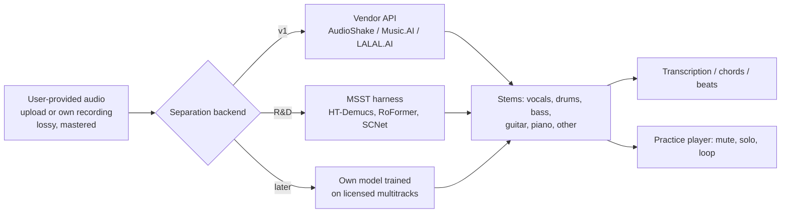

# Music source separation (stem isolation)

## TL;DR
- **Quality leaders are band-split spectrogram-mask transformers** (BS-RoFormer, Mel-Band RoFormer) and the lighter SCNet family. On MUSDB18-HQ without extra data they reach roughly 9.7–10.0 dB average SDR. The SDX'23 winner (ByteDance BS-RoFormer, extra data) scored 9.97 dB global SDR. HT-Demucs v4 is about 1 dB behind but remains the best documented general open model. Per-model numbers and licences are in `source-separation-model-comparison.md`.
- **Four stems (vocals/drums/bass/other) work well. Guitar and piano are the weak point, and they are core instruments for Splitune.** The only widely used open 6-stem model, `htdemucs_6s`, scores **3.07 dB on guitar and 1.60 dB on piano** on MoisesDB. A newer community 6-stem checkpoint (BS-Roformer SW) reports 9.05 dB guitar and 7.83 dB piano, but on MVSep's private benchmark, and its provenance is unclear.
- **Licensing, not quality, is the binding constraint.** Nearly every strong open checkpoint was trained on MUSDB18-HQ (academic/educational use only; commercial use requires permission from the copyright holders) or MoisesDB (non-commercial), or on undisclosed data. Open code is almost always MIT or Apache-2.0, but weights are not cleanly usable commercially. See `datasets-metrics-and-licensing.md`.
- **SDR is a weak proxy for what learners hear.** In the SDX'23 listening test, the #3 system by SDR ranked #1 with professionals, and the authors found no clear correlation between SDR differences and listener preference. Splitune needs its own listening evaluation on real YouTube-style inputs.
- **Real inputs are harder than benchmarks.** The pipeline input is user-provided audio (file upload or the user's own recording), never a YouTube stream, but such files are realistically of YouTube-style lossy quality (about 128–135 kb/s AAC or Opus, AAC low-passed near 16 kHz), and commercial masters are loud and limited; both cause measurable degradation. Live recordings and dense mixes add bleed. Budget for "good enough to practise with", not "studio stems".
- **Recommendation:** for v1, buy separation from a vendor with commercially licensed models (AudioShake, Music.AI/Moises or LALAL.AI; evaluate all three), or train an MIT-licensed architecture (BS-RoFormer, Mel-RoFormer or SCNet code) on licensed data. Use open community checkpoints only for internal R&D and benchmarking.

## Findings

### 1. What "stems" mean in practice
| Granularity | Typical stems | Examples |
|---|---|---|
| 2-stem | vocals / accompaniment | Spleeter 2-stem, most vocal models |
| 4-stem ("VDBO") | vocals, drums, bass, other | MUSDB18 standard; HT-Demucs, BS-RoFormer, SCNet |
| 5–6-stem | + piano, + guitar | Spleeter 5-stem (adds piano), `htdemucs_6s`, BS-Roformer SW |
| Sub-stems | kick/snare/toms/hi-hat/cymbals; lead vs backing vocals | DrumSep (MDX23C/Mel-RoFormer), LALAL.AI lead/back splitter |
| Query/prompted | any named instrument | Banquet (query by instrument), Meta SAM Audio (text, time-span or video prompt) |

Benchmarks are almost all 4-stem because MUSDB18 only provides vocals/drums/bass/other ([SigSep MUSDB18](https://sigsep.github.io/datasets/musdb.html)). MoisesDB (240 songs) was created to support finer stems. Its taxonomy has 11 top-level stems: bass, bowed strings, drums, guitar, other, other keys, other plucked, percussion, piano, vocals and wind ([MoisesDB paper, Table 2](https://arxiv.org/pdf/2307.15913)).

### 2. Architecture families (2026 status)
- **Hybrid waveform/spectrogram U-Net with a transformer bottleneck: HT-Demucs v4** (Meta). It reaches 9.00 dB SDR on MUSDB HQ, or 9.20 dB with sparse attention plus per-source fine-tuning (the sparse model is not released). It was trained with 800 extra songs ([Demucs README](https://github.com/facebookresearch/demucs); [HT-Demucs paper](https://arxiv.org/abs/2211.08553)). The repo has been **archived since 1 Jan 2025**, and a maintenance fork at `adefossez/demucs` takes only important bug fixes ([Demucs README](https://github.com/facebookresearch/demucs)).
- **Band-split RoPE transformers: BS-RoFormer** (ByteDance SAMI). It splits the spectrogram into sub-bands and runs inter-band and intra-band transformers to estimate masks. A smaller model trained only on MUSDB18-HQ reaches 9.80 dB average SDR. The SDX'23 submission was trained with 500 extra songs and won the MSS track ([BS-RoFormer paper](https://arxiv.org/abs/2309.02612)). **Mel-Band RoFormer** replaces the band split with mel-scale bands. It improves vocals (11.21 vs 10.78 dB at 6 layers) and drums but is worse on bass ([Mel-RoFormer paper, Table 1](https://arxiv.org/html/2310.01809)). ByteDance has released no official weights. Community re-implementations ([lucidrains/BS-RoFormer](https://github.com/lucidrains/BS-RoFormer), MIT) and checkpoints ([ZFTurbo MSST](https://github.com/ZFTurbo/Music-Source-Separation-Training)) fill the gap.
- **SCNet** (Sparse Compression Network). It reaches 9.0 dB on MUSDB18-HQ with no extra data, with CPU inference at **48% of HT-Demucs's time** ([SCNet paper](https://arxiv.org/abs/2401.13276)). Larger community variants (SCNet XL IHF) reach 10.08 dB on MUSDB test when trained on MUSDB18-HQ only ([MSST pretrained list](https://github.com/ZFTurbo/Music-Source-Separation-Training/blob/main/docs/pretrained_models.md)).
- **TFC-TDF U-Net v3 / MDX23C** (KUIELab). It placed 1st on SDX'23 leaderboard B (bleeding) and 3rd on A (label noise) ([kuielab/sdx23](https://github.com/kuielab/sdx23)). ZFTurbo's MDX23C vocal checkpoint scores 10.17 dB on the MVSep Multisong set ([MSST pretrained list](https://github.com/ZFTurbo/Music-Source-Separation-Training/blob/main/docs/pretrained_models.md)).
- **Efficient band-split U-Nets: Moises-Light** (Moises, Oct 2025). The paper reports 9.96 dB average on MUSDB-HQ with 5M×4 parameters, versus 9.80 for BS-RoFormer at 72M×4 ([Moises-Light, Table 4](https://arxiv.org/html/2510.06785v1)). The paper does not say whether code or weights are released ([arXiv abs](https://arxiv.org/abs/2510.06785)). It matters because a commercial vendor is publicly optimising for cheap inference.
- **Query-based separation: Banquet.** A single-decoder band-split model is conditioned on a PaSST instrument embedding, with 24.9M parameters. On MoisesDB it beat `htdemucs_6s` on guitar and piano and came close to it on VDBO stems ([Banquet paper](https://arxiv.org/abs/2406.18747); [code, MIT](https://github.com/kwatcharasupat/query-bandit)).
- **Generative, prompted separation: Meta SAM Audio** (Dec 2025). It is a flow-matching diffusion transformer with 500M, 1B and 3B variants. Prompts can be text, a time span, or a masked video region ([SAM Audio paper](https://arxiv.org/html/2512.18099); [The Register](https://www.theregister.com/2025/12/16/meta_sam_ai_audio/)). The paper reports subjective overall scores, not SDR. On MUSDB instruments it scored 4.45 vs AudioShake 4.28, Demucs 4.26 and Spleeter 3.90. On in-the-wild instruments it scored 4.00 vs MoisesAI 3.12 and AudioShake 3.43. Large on an A100 takes about **7.3 s per 10 s of audio** ([SAM Audio paper §7](https://arxiv.org/html/2512.18099)). Meta says isolating "highly similar" sources, such as one instrument in an orchestra, is still hard ([The Register](https://www.theregister.com/2025/12/16/meta_sam_ai_audio/)). The video-prompt mode is relevant to `video-and-audio-visual-analysis.md`.
- **Legacy:** Spleeter (Deezer, 2019, TensorFlow U-Net) and Open-Unmix (2019) are fast and easy to deploy but 2–4 dB behind the current state of the art (see the comparison doc).

### 3. Benchmarks and where the numbers come from
**MUSDB18-HQ test (50 songs), no extra data, SDR in dB.** Source: [Mel-RoFormer paper, Table 1](https://arxiv.org/html/2310.01809), museval median-of-medians over 1-s chunks.

| Model | Vocals | Bass | Drums | Other | Avg | Params |
|---|---|---|---|---|---|---|
| HDemucs (v3) | 8.04 | 8.67 | 8.58 | 5.59 | 7.72 | – |
| BSRNN | 10.01 | 7.22 | 9.01 | 6.70 | 8.24 | – |
| TFC-TDF-UNet v3 | 9.59 | 8.45 | 8.44 | 6.86 | 8.34 | – |
| BS-RoFormer (L=6) | 10.78 | 11.43 | 9.61 | 7.86 | 9.92 | 72.2M |
| Mel-RoFormer (L=6) | 11.21 | 9.64 | 9.91 | 7.81 | 9.64 | 84.2M |
| BS-RoFormer (L=9) | 11.02 | 11.58 | 9.66 | 7.80 | 10.02 | 82.8M |

The Moises-Light paper reproduces most of these values and adds SCNet-L at 9.69 (42M), SCNet-S at 9.00 (10M) and Moises-Light at 9.96 (5M×4) ([Table 4](https://arxiv.org/html/2510.06785v1)). The two tables differ slightly for the same models: BS-RoFormer is 9.80 vs 9.92, depending on the paper and configuration. Treat differences under ~0.3 dB as noise.

**Challenges** (global "utterance" SDR, not comparable to the chunk-median numbers above; see `datasets-metrics-and-licensing.md`):
- **MDX'21:** leaderboard A (MUSDB only) was won by Hybrid Demucs at 7.33 dB. Leaderboard B (extra data) was won by **AudioShake at 8.33 dB** ([MDX21 paper](https://arxiv.org/html/2108.13559v3)).
- **SDX'23 standard track:** SAMI-ByteDance 9.97, ZFTurbo 9.26, kimberley_jensen 9.18, kuielab 8.97 ([SDX'23 MDX paper, TISMIR](https://transactions.ismir.net/articles/171)). This is +1.64 dB over the MDX'21 winner ([arXiv](https://arxiv.org/abs/2308.06979)). The robust tracks (label noise, bleeding) topped out at 7.46 and 6.58 dB, which shows how imperfect training stems hurt ([TISMIR](https://transactions.ismir.net/articles/171)).
- **No 2024 or 2025 Sound Demixing Challenge was found.** The 2025–26 "Music Source Restoration" challenge (ICASSP) focuses on restoring degraded stems. Only participant reports were found, no official results page (unverified; see Open questions).

**Community leaderboard (MVSep "Multisong", 100 one-minute songs, SDR)** ([MVSep quality checker](https://de.mvsep.com/en/quality_checker); [MVSep algorithms](https://mvsep.com/en/algorithms)):
- Best listed vocals: BS-Roformer 124-band (2026.07) at 12.33 dB vocals / 18.64 dB instrumental.
- BS-Roformer SW 6-stem: bass 14.62, drums 14.11, guitar 9.05, piano 7.83.
- `htdemucs_6s`: bass 11.42, drums 10.59, other 2.63.
- These are tier-2 self-reported numbers from a commercial separation site, on a private test set. They are useful for ranking checkpoints, but not peer-reviewed and not comparable to MUSDB.

### 4. Beyond four stems: guitar and piano (Splitune-critical)
- **MoisesDB baselines** ([paper, Table 3](https://arxiv.org/pdf/2307.15913)), SDR mean in dB, 6-stem songs (N=88):

  | Method | Vocals | Bass | Drums | Other | Piano | Guitar |
  |---|---|---|---|---|---|---|
  | `htdemucs_6s` | 9.55 | 11.93 | 11.02 | **0.28** | **1.60** | **3.07** |
  | Oracle IRM (upper bound) | 9.73 | 7.92 | 9.19 | 4.67 | 4.71 | 5.28 |

  Spleeter 5-stem piano scores 1.17 dB (N=104). Even ideal-ratio-mask oracles reach only about 5 dB on piano and guitar, which shows how much these sources overlap spectrally with other instruments ([MoisesDB paper](https://arxiv.org/pdf/2307.15913)).
- The Demucs authors call the 6-stem piano source poor ("a lot of bleeding and artifacts") and guitar "okay" ([Demucs README](https://github.com/facebookresearch/demucs)).
- MVSep reports piano at 7.83 dB (BS-Roformer SW) down to 2.23 dB (Demucs 6-stem) on its own guitar and piano leaderboards ([MVSep algorithms](https://mvsep.com/en/algorithms)). On the same leaderboards, the newer models are about 3–5 dB better than `htdemucs_6s`.
- Commercial vendors now sell separate instrument models. AudioShake released drums, bass, piano, guitar, winds, strings and "other" models on 23 Sep 2025, with no published SDR ([AudioShake post](https://www.audioshake.ai/post/audioshake-debuts-new-instrument-separation-models)). LALAL.AI lists acoustic guitar, electric guitar, piano, synth, strings, wind and lead/backing vocals ([LALAL.AI](https://www.lalal.ai/)). The Music.AI product page shows vocals, bass, drums and guitar, and claims "15.8% higher average SDR than the nearest competitor" without naming the competitor or the test set ([Music.AI product](https://music.ai/product/)).
- **Inference:** acoustic vs electric guitar, rhythm vs lead guitar, and piano vs synth/keys are exactly the distinctions a learner needs. They are where open models are weakest and where vendors are differentiating. MoisesDB's authors also expect "other plucked" to be confused with guitar ([paper §3](https://arxiv.org/pdf/2307.15913)).

### 5. Quality vs compute
| Model | Params | Speed indicator | Source |
|---|---|---|---|
| Spleeter 4-stem | small U-Net | ~100× real time on an RTX 2080 (3 h 27 min of MUSDB in <2 min) | [JOSS paper](https://joss.theoj.org/papers/10.21105/joss.02154.pdf) |
| HT-Demucs v4 | – (~81 MB f16 file per 4-source model in demucs.cpp) | CPU ≈1.5× track duration; GPU needs ≥3 GB, ~7 GB at default settings; `htdemucs_ft` ~4× slower | [Demucs README](https://github.com/facebookresearch/demucs); [demucs.cpp](https://github.com/sevagh/demucs.cpp) |
| SCNet-S / SCNet-L | 10M / 42M | CPU time 48% of HT-Demucs | [SCNet](https://arxiv.org/abs/2401.13276); [Moises-Light T4](https://arxiv.org/html/2510.06785v1) |
| BS-RoFormer / Mel-RoFormer | 72–95M per stem | Heaviest of the mask models (one model per stem in the paper setup); no official RTF published | [Mel-RoFormer T1](https://arxiv.org/html/2310.01809) |
| Moises-Light | 5M×4 | Designed for low resource use; no RTF in abstract | [Moises-Light](https://arxiv.org/html/2510.06785v1) |
| SAM Audio S/B/L | 0.5B / 1B / 3B | Large: ~7.3 s per 10 s of audio on an A100 (16 ODE steps) | [SAM Audio §7.6](https://arxiv.org/html/2512.18099) |

Ports exist for constrained targets: [demucs.cpp](https://github.com/sevagh/demucs.cpp) (MIT, C++, WASM folder, "practically identical" SDR to PyTorch). On-device vs server trade-offs are in `deployment-and-inference.md`.

### 6. Known failure modes
- **Bleed between stems.** It is worst for piano, guitar and "other". Measured: `htdemucs_6s` "other" falls to 0.28 dB on MoisesDB once guitar and piano are carved out ([MoisesDB](https://arxiv.org/pdf/2307.15913)). Bleed also appears when training stems themselves contain it ([SDX'23 bleeding track](https://transactions.ismir.net/articles/171)).
- **Similar timbres and dense arrangements.** Doubled guitars, piano plus synth pads, and orchestral sections are hard. SAM Audio's authors list one instrument within an orchestra as a known failure ([The Register](https://www.theregister.com/2025/12/16/meta_sam_ai_audio/)).
- **Loud, limited commercial masters.** Jeon & Lee (ISMIR 2022) built musdb-L and musdb-XL by mimicking mastering. State-of-the-art models performed "significantly worse" on them, and LimitAug augmentation reduces the gap ([arXiv:2208.14355](https://arxiv.org/abs/2208.14355)). MoisesDB stems are unmastered, so training on them alone carries the same domain-shift risk ([MoisesDB §3.2](https://arxiv.org/pdf/2307.15913)).
- **Lossy, band-limited (YouTube-style) user audio.** One small community measurement found YouTube itag 140 (AAC) at about 127 kb/s with content cut just below 16 kHz, and itag 251 (Opus) at about 135 kb/s with the band above ~15 kHz largely replaced ([audiomisc, tier 4](https://audiomisc.co.uk/YouTube/SpotTheDifference.html)). No peer-reviewed study was found that measures separation SDR versus codec bitrate. Restoration models such as [Apollo](https://github.com/JusperLee/Apollo) (trained on simulated 24–128 kb/s MP3, CC-BY-SA-4.0) exist and could be tested as a pre- or post-process. Splitune does not fetch YouTube audio; the input is user-provided audio (file upload or the user's own recording), whose realistic quality is this kind of lossy, band-limited encode. See `research/legal/youtube-copyright-and-platform-policy.md`.
- **Live recordings.** Room reverb, crowd noise and mic bleed in the source make clean stems impossible. No benchmark was found (unverified). Community dereverb and crowd-removal checkpoints exist: Mel-RoFormer "crowd" at 5.99 dB, plus dereverb models ([MSST pretrained list](https://github.com/ZFTurbo/Music-Source-Separation-Training/blob/main/docs/pretrained_models.md)).
- **Long-form input.** Chunked inference needs overlap-add. HT-Demucs segments are capped at 7.8 s ([Demucs README](https://github.com/facebookresearch/demucs)), and SAM Audio degrades on inputs longer than its training clips ([SAM Audio](https://arxiv.org/html/2512.18099)).
- **Metric blind spots.** SDR rewards energy accuracy, not musical usefulness. In SDX'23, seven professional assessors made 583 comparisons; they ranked the #3 SDR system first, and the three systems' draw probabilities were about 0.98 ([TISMIR](https://transactions.ismir.net/articles/171)). AudioShake makes the same argument and says it sometimes ships lower-SDR models ([AudioShake](https://www.audioshake.ai/post/what-is-an-sdr-score)), though as a vendor it has an interest in that view.

### 7. Community model zoo (UVR and MSST)
- **Ultimate Vocal Remover** ([UVR GUI](https://github.com/Anjok07/ultimatevocalremovergui), MIT code, v5.6) bundles VR-arch, MDX-Net/MDX23C and Demucs models. Most of its weights were trained by its core developers (Anjok07, aufr33) on undisclosed data, and **no licence for the weights is stated**. A rewrite adding "newer models released since 2023" was announced on 6 Oct 2026 for roughly six weeks later ([issue #2399](https://github.com/Anjok07/ultimatevocalremovergui/issues/2399)).
- **ZFTurbo Music-Source-Separation-Training (MSST)** ([repo](https://github.com/ZFTurbo/Music-Source-Separation-Training), MIT, maintained by MVSep.com). It is the de facto training and inference harness for 17 architectures (MDX23C, HT-Demucs, BS/Mel-RoFormer, SCNet variants, BandIt v2, Apollo, BS-Mamba2 and others). Its pretrained list mixes MUSDB-only checkpoints (non-commercial data) with community checkpoints of undisclosed provenance ([pretrained list](https://github.com/ZFTurbo/Music-Source-Separation-Training/blob/main/docs/pretrained_models.md)). **Inference:** this is the fastest path for Splitune to benchmark candidates and to train its own models on licensed data with proven recipes.

### 8. Vendor landscape (separation only; business detail in `research/market/competitor-landscape.md`)
| Vendor | Public stems | Public quality evidence |
|---|---|---|
| AudioShake | Vocals, drums, bass, guitar, piano, winds, strings, other, plus dialogue/music/effects; API, SDK and real-time SDK | Won MDX'21 leaderboard B, 8.33 dB ([MDX21](https://arxiv.org/html/2108.13559v3)); Sept 2025 instrument models, no SDR ([post](https://www.audioshake.ai/post/audioshake-debuts-new-instrument-separation-models)); label customers listed ([site](https://www.audioshake.ai/)) |
| Music.AI / Moises | Vocals, bass, drums, guitar shown, plus chords, sections, lyrics and instrument tagging modules | Self-claimed +15.8% SDR, unspecified ([product](https://music.ai/product/)); SAM Audio paper scores "MoisesAI" 3.90 music / 3.12 instruments-in-the-wild ([SAM Audio](https://arxiv.org/html/2512.18099)) |
| LALAL.AI | Vocals, drums, bass, acoustic and electric guitar, piano, synth, strings, wind, lead/back vocals; API | Marketing only ([site](https://www.lalal.ai/)) |
| Moises (consumer app) | "vocals, drums, bass, or other instruments" plus chord, key, tempo and section tools | Marketing only ([features](https://moises.ai/features/)) |

## Implications for Splitune
- **Stem menu per instrument.** Vocals, drums and bass are reliable today. Guitar and piano are new enough that the stem menu should be decided by measured quality, not by what is possible. Treat "isolate guitar" as best-effort in v1 and design the practice UI to still work when stems bleed. Mute-the-part ("play along with the band minus your instrument") is often more forgiving than solo-the-part, because the mute stem is mix minus stem. See `research/ux/practice-tool-patterns.md`.
- **Pipeline placement.** Separation runs first and is the most expensive step. Its stems feed transcription (`transcription-general.md`), chords and beats (`chords-beats-key-structure.md`) and instrument detection (`instrument-recognition.md`). Cache stems per user, keyed by (user, audio hash, model version); no cross-user shared cache until counsel approves (see `research/legal/youtube-copyright-and-platform-policy.md`). See `pipeline-overview.md`.
- **Model strategy.** (1) For v1, integrate one or two vendor APIs behind an interface, after a blind listening test on 30–50 representative clips of YouTube-style (lossy, mastered) quality. (2) In parallel, use MSST to benchmark open checkpoints, R&D only. (3) Only if unit economics demand it, train BS-RoFormer, Mel-RoFormer or SCNet (MIT code) on licensed multitracks. Licensing rules are in `datasets-metrics-and-licensing.md`.
- **Compute.** Even 4-stem state-of-the-art models are server-GPU workloads for minutes-long songs. SCNet and Moises-Light-class models are the realistic on-device candidates; see `deployment-and-inference.md`.
- **Expose uncertainty.** Store per-stem confidence signals, such as residual energy or a stem-to-mix ratio, so the UI can warn "guitar isolation is rough on this track".

## Open questions
- **Real-input quality:** how do the top models compare on user-provided, mastered, lossy (YouTube-style quality) pop, rock and acoustic tracks, especially guitar and piano? Run a blind listening test with learners and teachers rather than relying on SDR.
- **Vendor quality and price:** AudioShake, Music.AI and LALAL.AI publish no per-instrument SDR. Request trial evaluations; pricing is in `research/market/pricing-and-business-models.md`.
- **Commercial status of community checkpoints:** BS-Roformer SW, viperx and Kimberley Jensen checkpoints have no documented training data. Ask the authors or assume they are unusable.
- **Is there a 2025/26 MSS challenge with official results?** Only participant reports for the Music Source Restoration challenge were found. Check the ICASSP 2026 Grand Challenge pages.
- **Codec impact:** quantify SDR loss from 128 kb/s AAC or Opus versus lossless on a held-out set, and test whether Apollo-style restoration helps.
- **Live and acoustic performances:** no benchmark exists. Build a small internal test set.

## Sources
- [ZFTurbo Music-Source-Separation-Training repo](https://github.com/ZFTurbo/Music-Source-Separation-Training) — tier 2, accessed 2026-10-20
- [MSST pretrained models list](https://github.com/ZFTurbo/Music-Source-Separation-Training/blob/main/docs/pretrained_models.md) — tier 2, accessed 2026-10-20
- [facebookresearch/demucs README](https://github.com/facebookresearch/demucs) — tier 1, accessed 2026-10-20
- [Hybrid Transformers for Music Source Separation (arXiv:2211.08553)](https://arxiv.org/abs/2211.08553) — tier 1, accessed 2026-10-20
- [SigSep MUSDB18 dataset page](https://sigsep.github.io/datasets/musdb.html) — tier 1, accessed 2026-10-20
- [MoisesDB paper PDF (arXiv:2307.15913)](https://arxiv.org/pdf/2307.15913) — tier 1, accessed 2026-10-20
- [Mel-Band RoFormer paper (arXiv:2310.01809)](https://arxiv.org/html/2310.01809) — tier 1, accessed 2026-10-20
- [BS-RoFormer paper (arXiv:2309.02612)](https://arxiv.org/abs/2309.02612) — tier 1, accessed 2026-10-20
- [lucidrains/BS-RoFormer](https://github.com/lucidrains/BS-RoFormer) — tier 2, accessed 2026-10-20
- [SCNet paper (arXiv:2401.13276)](https://arxiv.org/abs/2401.13276) — tier 1, accessed 2026-10-20
- [kuielab/sdx23](https://github.com/kuielab/sdx23) — tier 1, accessed 2026-10-20
- [Moises-Light paper HTML (arXiv:2510.06785v1)](https://arxiv.org/html/2510.06785v1) — tier 1, accessed 2026-10-20
- [Moises-Light arXiv abstract](https://arxiv.org/abs/2510.06785) — tier 1, accessed 2026-10-20
- [Banquet paper (arXiv:2406.18747)](https://arxiv.org/abs/2406.18747) — tier 1, accessed 2026-10-20
- [kwatcharasupat/query-bandit](https://github.com/kwatcharasupat/query-bandit) — tier 1, accessed 2026-10-20
- [SAM Audio paper (arXiv:2512.18099)](https://arxiv.org/html/2512.18099) — tier 1, accessed 2026-10-20
- [The Register: Meta SAM Audio](https://www.theregister.com/2025/12/16/meta_sam_ai_audio/) — tier 3, accessed 2026-10-20
- [MDX'21 challenge paper (arXiv:2108.13559v3)](https://arxiv.org/html/2108.13559v3) — tier 1, accessed 2026-10-20
- [SDX'23 Music Demixing Track (TISMIR)](https://transactions.ismir.net/articles/171) — tier 1, accessed 2026-10-20
- [SDX'23 Music Demixing Track (arXiv:2308.06979)](https://arxiv.org/abs/2308.06979) — tier 1, accessed 2026-10-20
- [MVSep quality checker](https://de.mvsep.com/en/quality_checker) — tier 2, accessed 2026-10-20
- [MVSep algorithms list](https://mvsep.com/en/algorithms) — tier 2, accessed 2026-10-20
- [AudioShake: new instrument separation models](https://www.audioshake.ai/post/audioshake-debuts-new-instrument-separation-models) — tier 2, accessed 2026-10-20
- [AudioShake: what is an SDR score](https://www.audioshake.ai/post/what-is-an-sdr-score) — tier 2, accessed 2026-10-20
- [AudioShake homepage](https://www.audioshake.ai/) — tier 2, accessed 2026-10-20
- [LALAL.AI homepage](https://www.lalal.ai/) — tier 2, accessed 2026-10-20
- [Music.AI product page](https://music.ai/product/) — tier 2, accessed 2026-10-20
- [Moises features](https://moises.ai/features/) — tier 2, accessed 2026-10-20
- [Spleeter JOSS paper PDF](https://joss.theoj.org/papers/10.21105/joss.02154.pdf) — tier 1, accessed 2026-10-20
- [sevagh/demucs.cpp](https://github.com/sevagh/demucs.cpp) — tier 2, accessed 2026-10-20
- [Towards robust music source separation on loud commercial music (arXiv:2208.14355)](https://arxiv.org/abs/2208.14355) — tier 1, accessed 2026-10-20
- [YouTube audio quality measurements (audiomisc)](https://audiomisc.co.uk/YouTube/SpotTheDifference.html) — tier 4, accessed 2026-10-20
- [JusperLee/Apollo](https://github.com/JusperLee/Apollo) — tier 1, accessed 2026-10-20
- [Ultimate Vocal Remover GUI](https://github.com/Anjok07/ultimatevocalremovergui) — tier 2, accessed 2026-10-20
- [UVR development update, issue #2399](https://github.com/Anjok07/ultimatevocalremovergui/issues/2399) — tier 4, accessed 2026-10-20
