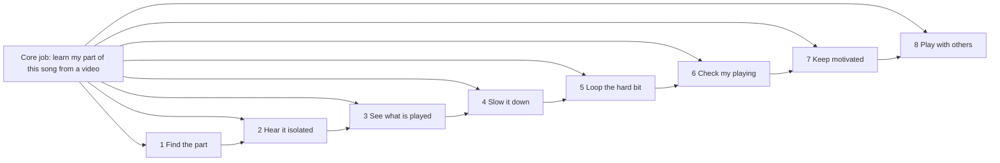

# Jobs to be done

## TL;DR
- Core job: *get from "I want to play that song I just watched" to "I can play my part of it" with the fewest dead ends.* Everything else is a sub-job that removes one dead end: finding the part, hearing it alone, seeing what is played, slowing it, looping the hard bit, checking my playing, staying motivated, playing with others.
- Today users stitch this together from 4-6 tools: YouTube (or a purchased audio file), a stem splitter (Moises, UVR, Demucs front-ends), a tab/chord site (Ultimate Guitar, Songsterr, Chordify), a transcription/slow-down tool (Transcribe!), and a forum to ask whether the tab is right. A BassBuzz thread lists Moises, Transcribe!, Ultimate Guitar, UVR5, Songsterr AI, Audials and Qobuz/Bandcamp in one conversation about a single bass line ([BassBuzz, Oct 2025](https://forum.bassbuzz.com/t/how-can-i-make-the-bassline-more-audible/84933)).
- The most evidenced unmet outcome is **trust in what is shown** (wrong tabs, wrong chords, muddy stems), not feature absence: nearly every feature already exists somewhere.
- Sub-jobs "check my playing" and "keep motivated" are where curriculum apps compete (Yousician, Simply Piano, Melodics), and where their reviews show weakness (mic misses notes, lenient scoring, fragmented lessons). Splitune should treat them as phase 2 after "learn this song" works.
- Evidence quality: forum and review evidence is anecdotal (tier 4); survey evidence is company-sponsored (tier 3); academic evidence is about school-age or music-school populations and transfers by analogy.

## Findings

### Job map

### Core job
- **Statement.** When I find a performance of a song I love (usually on YouTube), I want to learn the part my instrument plays at a pace I can manage, so I can play it recognisably, alone or with others.
- **Evidence.** 61% of beginner/aspirational players in Fender's 2018 research wanted to learn to play songs for themselves rather than to pursue a music career, and 46% wanted to make music with others ([Fender release reprint, 12fret](https://archive.12fret.com/?p=90708)). Guitar learners are split between self-teaching (36%), lessons (39%) and informal teaching (25%); electric guitar (52%), electric bass (50%) and drums (47%) skew self-taught ([YouGov, 2022, n=3,000](https://yougov.com/en-us/articles/43512-young-americans-increasingly-exposed-music)). Ethnographic work notes YouTube has shifted informal learning from "listening and copying" to "watching and copying" and allows learning a riff without hearing the song ([Rush, IASPM Journal 2023](https://iaspmjournal.net/index.php/IASPM_Journal/article/download/1269/1975/9547); single-site, small).
- **Desired outcomes** (phrased as measurable, "minimise the time/likelihood of..."):
  - time from providing the song (own file/recording, optionally with a reference link) to first playable audible/visual result;
  - likelihood I learn a wrong note, chord or rhythm;
  - effort to keep the source video and the practice view in sync;
  - number of tools I must switch between.
- **Current workarounds.** YouTube at reduced speed; tab sites; cover videos and "isolated bass" videos; a teacher; forums. A returning bassist was told to use tabs as a starting point, listen to covers, learn by ear and slow down videos to see fingering ([BassBuzz, Jan 2026](https://forum.bassbuzz.com/t/bass-tab-transcription-service/92595)). Note: the YouTube speed feature's exact range and behaviour were not verified here (the YouTube help page fetch failed).

### Sub-jobs

#### J1. Find the part
- **Statement.** When a song has several instruments and versions (studio, live, cover), I want to identify which version and which part is "mine", so I do not waste time learning the wrong thing.
- **Evidence.** Forum posters debate whether to copy the recorded bass line or a cover; some YouTube covers ignore the real bass part ([BassBuzz, Apr 2024](https://forum.bassbuzz.com/t/actual-tabs-vs-bass-covers)). Tabs are "someone's interpretation" and most online tab is inaccurate ([BassBuzz, 2020-2021](https://forum.bassbuzz.com/t/learning-a-new-song/5705)). The Moises guitarist page advertises lead vs rhythm and acoustic vs electric separation, with lead/rhythm behind Pro (vendor claim, [Moises](https://moises.ai/made-for/guitarists/)).
- **Outcomes.** Know in under a minute which instruments are present; pick the right guitar (rhythm/lead); avoid misidentified parts (a Jazz Guitar forum snippet said Moises struggles to tell guitar from piano; I could not open that thread, so treat as unverified).
- **Workarounds.** Listening repeatedly; asking forums; searching for isolated-track videos ([BassBuzz, Jan 2026](https://forum.bassbuzz.com/t/bass-tab-transcription-service/92595)). See `research/ml/instrument-recognition.md`.

#### J2. Hear it isolated
- **Statement.** When I cannot pick my instrument out of the mix, I want to hear it alone (and then back in context), so I can copy the notes and feel.
- **Evidence.** A bassist who could hear chords and melody but not the bass line used Moises, found it "pretty blurry", and was told bass stems are often muddy, especially on live recordings ([BassBuzz, Oct 2025](https://forum.bassbuzz.com/t/how-can-i-make-the-bassline-more-audible/84933)). Members say people are trained to track melody, not bass ([BassBuzz, 2020](https://forum.bassbuzz.com/t/learning-a-new-song/5705)). Moises App Store reviewers praise bass isolation and slow-down ([App Store reviews, 2023-2024](https://apps.apple.com/app/apple-store/id1515796612)); a Trustpilot reviewer calls the separation good but slow and crash-prone, another says output sounds overcompressed ([Trustpilot](https://nl.trustpilot.com/review/moises.ai?page=3)).
- **Outcomes.** Audible clarity of the target part; low artefacts; quick toggle between isolated, mix-minus-me and full mix.
- **Workarounds.** Moises free tier, UVR5/Demucs, EQ boosting in Transcribe! ([BassBuzz, 2020-2021](https://forum.bassbuzz.com/t/learning-a-new-song/5705)). See `research/ml/source-separation.md`.

#### J3. See what is played
- **Statement.** When I hear the part, I want to see the notes, chords or hits (and fingering where possible), so I know what to do with my hands.
- **Evidence.** Tabs are the default and are distrusted: Songsterr gets main grooves but often misses fills and picks suboptimal fingerings ([BassBuzz, Feb-Mar 2025](https://forum.bassbuzz.com/t/tab-sites/71538?page=2)); a mixed view of Songsterr accuracy depends on uploader ([BassBuzz, Aug-Oct 2024](https://forum.bassbuzz.com/t/bassborg-collective-thoughts-on-songsterr/60757?page=2)). Ultimate Guitar users advise checking each song's chords ([App Store review, 2024](https://apps.apple.com/us/app/ultimate-guitar-tabs-chords/id357828853)). Chordify users report wrong auto-detected chords without a human-verified signal ([App Store review, 2023](https://apps.apple.com/us/app/-/id1073624757)). Songsterr Trustpilot reviewers complain about AI-generated edits over official tabs and wrong tabs, though one transcriber says about 85% of songs were right (anecdotal, 13 reviews) ([Trustpilot](https://www.trustpilot.com/review/songsterr.com)).
- **Outcomes.** Correctness; a visible confidence indicator; easy correction; playable fingering rather than technically correct but awkward.
- **Workarounds.** Cross-check two sites, paid transcribers (about a week turnaround, [BassBuzz 2026](https://forum.bassbuzz.com/t/bass-tab-transcription-service/92595)), learn by ear. See `research/ml/transcription-guitar-and-bass-tabs.md`, `research/ml/chords-beats-key-structure.md`, `research/ux/music-display-ui.md`.

#### J4. Slow it down
- **Statement.** When the original tempo is beyond my hands, I want to reduce speed without changing pitch, so I can play accurately before building speed.
- **Evidence.** Chordify's slow-down and loop are Premium features ([App Store listing](https://apps.apple.com/us/app/-/id1073624757)); Moises markets pitch-preserving speed change ([Moises](https://moises.ai/made-for/guitarists/)). Opposite complaint: flowkey users want a slower minimum (one-third or one-quarter tempo) and control over the preset starting speed, and a beginner is frustrated when the app keeps slowing songs ([Trustpilot, Aug-Oct 2026](https://www.trustpilot.com/review/flowkey.com)).
- **Outcomes.** Fine-grained speed steps; speed that persists per song; progressive speed-up ("speed trainer") as accuracy improves (design idea; see `research/ux/practice-tool-patterns.md`); good audio quality at 50% and below (see `research/ml/playback-time-stretch-pitch-shift.md`).

#### J5. Loop the hard bit
- **Statement.** When one bar or phrase trips me up, I want to repeat just that section, so I can fix it without rewinding manually.
- **Evidence.** Loop is a paid Chordify feature and a headline Moises feature ([App Store](https://apps.apple.com/us/app/-/id1073624757), [Moises](https://moises.ai/made-for/guitarists/)); Drumeo's Moises tutorial lists looping and tempo detection with click track as the practice toolkit (partner content, [Drumeo](https://www.drumeo.com/beat/moises-drumless-tracks-tutorial/)). Hands-busy: a guitarist or drummer mid-phrase cannot reach for the screen (inference; `research/ux/hands-busy-and-device-context.md`).
- **Outcomes.** Create/adjust a loop with one gesture; loop snaps to bars/beats; loops saved across sessions.

#### J6. Check my playing
- **Statement.** When I play a part, I want to know whether notes and timing were right, so I can fix errors I cannot hear.
- **Evidence.** Mixed. Positive: instant accuracy feedback and progress indicators are valued ([Trustpilot, Simply Piano/JoyTunes, 2022](https://www.trustpilot.com/review/joytunes.com)). Negative: apps miss real notes ("cannot hear certain notes", [JoyTunes](https://www.trustpilot.com/review/joytunes.com); notes missed on the low E string above fret 5, [Yousician](https://www.trustpilot.com/review/yousician.com)) or are too lenient (green for sloppy hits, [Melodics App Store](https://apps.apple.com/us/app/melodics-real-drum-learning/id6504540940)). Singers' main barrier may be social, not technical (inference from [Wise & Halpern 2024](https://digitalcommons.bucknell.edu/fac_journ/2148)).
- **Outcomes.** Low false-negative rate on correct notes; adjustable strictness; feedback that points to where in the bar the error is. Treat as phase 2; see `research/ml/pipeline-overview.md`.
- **Workarounds.** Record and compare ([Roland](https://articles.roland.com/lapsed-player-returning-to-the-piano/), vendor advice); a teacher.

#### J7. Keep motivated
- **Statement.** When progress feels slow or I have missed a week, I want visible progress and small wins, so I do not give up.
- **Evidence.** About one in four new guitarists have stagnated, and 17% said a reward would help ([Loudwire](https://loudwire.com/study-who-are-16-million-americans-learned-play-guitar-last-two-years/)); 33% of beginners felt skills were not growing as fast as expected and nearly half cited time constraints ([12fret reprint](https://archive.12fret.com/?p=90708)). Theory: ceasing music is associated with lower competence, relatedness and autonomy ([Evans et al. 2013](https://selfdeterminationtheory.org/wp-content/uploads/2021/06/2013_EvansMcPhersonDavidson_Roleof.pdf)); intrinsic motivation tracks lower dropout tendency ([Wieser et al. 2024](https://pmc.ncbi.nlm.nih.gov/articles/PMC11337299/)). Adult beginners given a self-regulation worksheet practised more self-regulation but did not gain self-efficacy (pilot, n not reported; [Ritchie & Kearney 2018](https://eprints.chi.ac.uk/id/eprint/3927/)) so generic checklists are not a safe retention bet. Positive anecdote: daily practice and streak tracking credited with a year of improvement ([Yousician Trustpilot](https://www.trustpilot.com/review/yousician.com)). Negative: "doesn't properly track progress" ([Drumeo Trustpilot](https://www.trustpilot.com/review/drumeo.com)); lost songs make a learner avoid starting new pieces ([flowkey Trustpilot](https://www.trustpilot.com/review/flowkey.com)).
- **Outcomes.** Feel competent, choose my own song (autonomy), share with someone (relatedness). See `research/ux/onboarding-retention-motivation.md`, `research/ux/learning-science-principles.md`.

#### J8. Play with others
- **Statement.** When I am rehearsing or jamming, I want my part to fit the song's tempo, key and structure (and to play along with the rest of the band minus me), so I can perform with others confidently.
- **Evidence.** 46% want to make music with others ([12fret reprint](https://archive.12fret.com/?p=90708)). A bassist needed the original's bass line for a band rehearsal ([BassBuzz, Oct 2025](https://forum.bassbuzz.com/t/how-can-i-make-the-bassline-more-audible/84933)). A student who could play a riff precisely still needed prompting to play on the downbeat with the band ([Rush 2023](https://iaspmjournal.net/index.php/IASPM_Journal/article/download/1269/1975/9547)). Drum "minus-one" tracks are used to play along and film covers ([Drumeo](https://www.drumeo.com/beat/moises-drumless-tracks-tutorial/)).
- **Outcomes.** Mute-my-part mix, count-in/click, chord/lyric chart for the band, key/capo changes (Chordify exposes transpose and capo as Premium, [App Store](https://apps.apple.com/us/app/-/id1073624757)).

### Supporting job: get the audio in
- **Statement.** When I have a song in a streaming service or on YouTube, I want to bring it into the tool with no file juggling.
- **Evidence.** Users ask how to turn Spotify tracks into MP3s and are pointed to ripping software or lossless stores ([BassBuzz, Oct 2025](https://forum.bassbuzz.com/t/how-can-i-make-the-bassline-more-audible/84933)). That workaround raises legal issues; see `research/legal/youtube-copyright-and-platform-policy.md`. Another view: catalog-bound apps lose songs to licensing (flowkey, Drumeo reviewers; [flowkey](https://www.trustpilot.com/review/flowkey.com), [Drumeo](https://www.trustpilot.com/review/drumeo.com)), which is the opposite risk.

### Jobs vs current solutions

| Job | Typical workaround today | Best-known tools | Typical failure (evidence) |
|---|---|---|---|
| Find the part | Listen repeatedly; forum | YouTube, Moises | Wrong version/part; muddy bass ([BassBuzz](https://forum.bassbuzz.com/t/app-to-isolate-bass-tracks-in-songs/30572)) |
| Hear isolated | Stem splitter | Moises, UVR5/Demucs | Artefacts; live recordings worse ([BassBuzz](https://forum.bassbuzz.com/t/how-can-i-make-the-bassline-more-audible/84933)) |
| See what is played | Tabs/chords | Ultimate Guitar, Songsterr, Chordify | Wrong tabs/chords ([BassBuzz](https://forum.bassbuzz.com/t/tab-sites/71538?page=2)) |
| Slow down | Player speed control; paid apps | Chordify, Moises, Transcribe! | Paywalled ([App Store](https://apps.apple.com/us/app/-/id1073624757)) |
| Loop | Manual rewind; paid apps | Moises, Chordify | Paywalled/hands busy |
| Check playing | Self-recording; curriculum apps | Yousician, Simply Piano, Melodics | Missed notes or lenient scoring ([Trustpilot](https://www.trustpilot.com/review/yousician.com), [App Store](https://apps.apple.com/us/app/melodics-real-drum-learning/id6504540940)) |
| Keep motivated | Streaks; teacher | Yousician, Fender Play | Fragmented lessons; lost content |
| Play with others | Backing tracks; jam | Moises, Drumeo | Tempo/ensemble timing gap ([Rush](https://iaspmjournal.net/index.php/IASPM_Journal/article/download/1269/1975/9547)) |

## Implications for Splitune
- **Job-complete flow beats feature breadth.** Each of J1-J5 exists in a competitor; the opportunity is one flow from link to playable loop with explicit trust signals (confidence, stems audition, easy "this is wrong" correction). See `user-journeys-and-flows.md`.
- **Prioritise J2-J5 for MVP; J6-J7 after.** J6 needs reliable onset/pitch detection on varied instruments and is where incumbents get review complaints.
- **Teach in context.** Provide "isolated / mix without me / full mix" switching and a click/count-in (J8), addressing the abstracted-riff timing problem.
- **Avoid content-removal risk** by designing around user-supplied or licensed audio (see `research/legal/youtube-copyright-and-platform-policy.md`) and keeping user transcriptions/loops exportable.
- Competitor feature coverage: `research/market/competitor-landscape.md`; feature matrix: `research/market/feature-matrix.md`.

## Open questions
- What fraction of target users actually use YouTube speed controls vs dedicated tools? No survey found; needs a diary study or analytics from a prototype.
- Which sub-job drives paid conversion (separation? chords? scoring)? Test with a fake-door pricing experiment.
- How good must separation/transcription be before users stop cross-checking? Needs a user test with seeded errors.
- Is J8 (band use) a distinct segment requiring set-list and sharing features?

## Sources
- [12fret archive: Fender research reprint](https://archive.12fret.com/?p=90708) — tier 3, accessed 2026-10-20
- [Loudwire: Fender/YouGov 2021](https://loudwire.com/study-who-are-16-million-americans-learned-play-guitar-last-two-years/) — tier 3, accessed 2026-10-20
- [YouGov: Young Americans increasingly exposed to music](https://yougov.com/en-us/articles/43512-young-americans-increasingly-exposed-music) — tier 3, accessed 2026-10-20
- [Rush 2023, IASPM Journal](https://iaspmjournal.net/index.php/IASPM_Journal/article/download/1269/1975/9547) — tier 1, accessed 2026-10-20
- [Evans, McPherson & Davidson 2013](https://selfdeterminationtheory.org/wp-content/uploads/2021/06/2013_EvansMcPhersonDavidson_Roleof.pdf) — tier 1, accessed 2026-10-20
- [Wieser et al. 2024](https://pmc.ncbi.nlm.nih.gov/articles/PMC11337299/) — tier 1, accessed 2026-10-20
- [Ritchie & Kearney 2018](https://eprints.chi.ac.uk/id/eprint/3927/) — tier 1, accessed 2026-10-20
- [Wise & Halpern 2024](https://digitalcommons.bucknell.edu/fac_journ/2148) — tier 1, accessed 2026-10-20
- [Roland: Lapsed player](https://articles.roland.com/lapsed-player-returning-to-the-piano/) — tier 2 (vendor), accessed 2026-10-20
- [Moises: guitarists](https://moises.ai/made-for/guitarists/) — tier 2 (vendor), accessed 2026-10-20
- [Drumeo: Moises drumless tracks tutorial](https://www.drumeo.com/beat/moises-drumless-tracks-tutorial/) — tier 2 (partner), accessed 2026-10-20
- [Moises App Store listing](https://apps.apple.com/app/apple-store/id1515796612) — tier 2/4, accessed 2026-10-20
- [Chordify App Store listing](https://apps.apple.com/us/app/-/id1073624757) — tier 2/4, accessed 2026-10-20
- [Ultimate Guitar App Store listing](https://apps.apple.com/us/app/ultimate-guitar-tabs-chords/id357828853) — tier 2/4, accessed 2026-10-20
- [Melodics App Store listing](https://apps.apple.com/us/app/melodics-real-drum-learning/id6504540940) — tier 2/4, accessed 2026-10-20
- [Trustpilot: Moises](https://nl.trustpilot.com/review/moises.ai?page=3) — tier 4, accessed 2026-10-20
- [Trustpilot: Yousician](https://www.trustpilot.com/review/yousician.com) — tier 4, accessed 2026-10-20
- [Trustpilot: flowkey](https://www.trustpilot.com/review/flowkey.com) — tier 4, accessed 2026-10-20
- [Trustpilot: Drumeo](https://www.trustpilot.com/review/drumeo.com) — tier 4, accessed 2026-10-20
- [Trustpilot: JoyTunes (Simply Piano/Guitar)](https://www.trustpilot.com/review/joytunes.com) — tier 4, accessed 2026-10-20
- [Trustpilot: Songsterr](https://www.trustpilot.com/review/songsterr.com) — tier 4, accessed 2026-10-20
- [BassBuzz: How can I make the bassline more audible?](https://forum.bassbuzz.com/t/how-can-i-make-the-bassline-more-audible/84933) — tier 4, accessed 2026-10-20
- [BassBuzz: App to isolate bass tracks in songs](https://forum.bassbuzz.com/t/app-to-isolate-bass-tracks-in-songs/30572) — tier 4, accessed 2026-10-20
- [BassBuzz: Learning a new song](https://forum.bassbuzz.com/t/learning-a-new-song/5705) — tier 4, accessed 2026-10-20
- [BassBuzz: Tab sites](https://forum.bassbuzz.com/t/tab-sites/71538?page=2) — tier 4, accessed 2026-10-20
- [BassBuzz: Actual Tabs vs. Bass Covers](https://forum.bassbuzz.com/t/actual-tabs-vs-bass-covers) — tier 4, accessed 2026-10-20
- [BassBuzz: Thoughts on Songsterr](https://forum.bassbuzz.com/t/bassborg-collective-thoughts-on-songsterr/60757?page=2) — tier 4, accessed 2026-10-20
- [BassBuzz: Bass Tab Transcription Service](https://forum.bassbuzz.com/t/bass-tab-transcription-service/92595) — tier 4, accessed 2026-10-20
