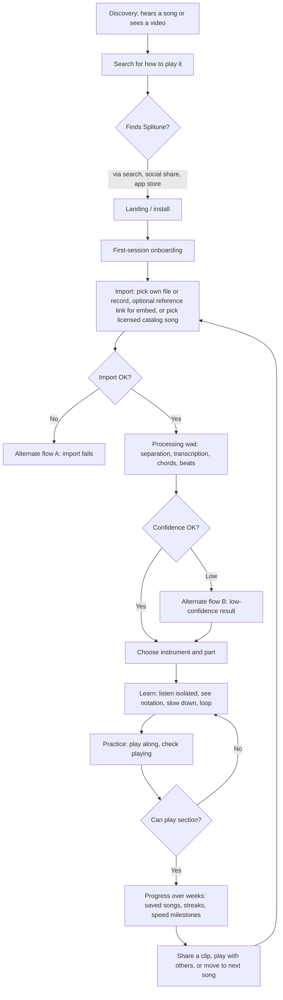
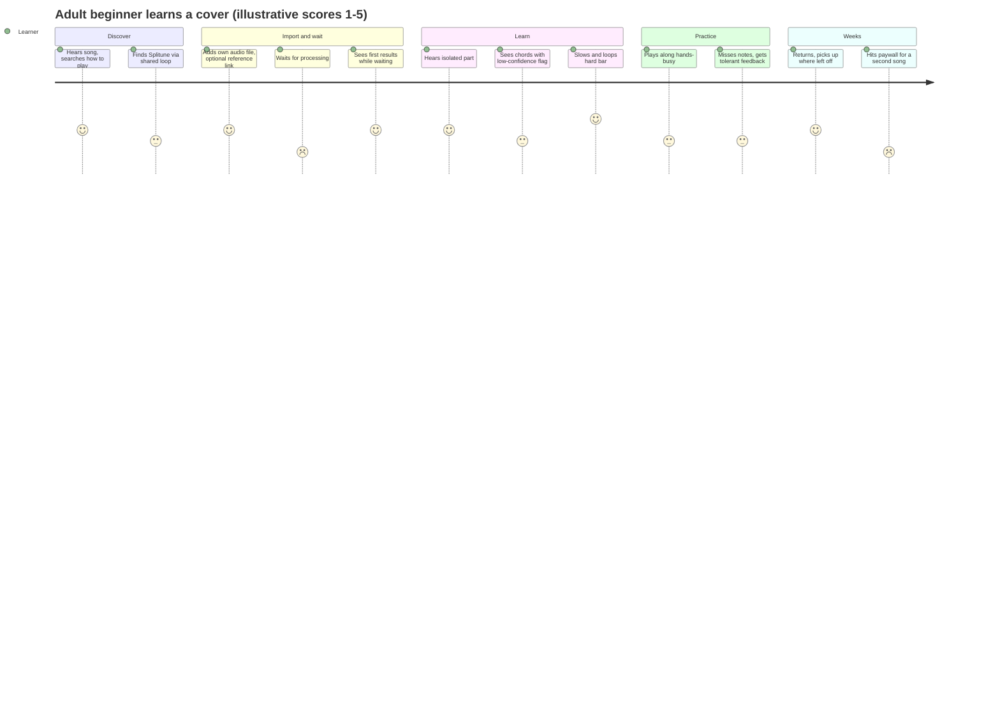
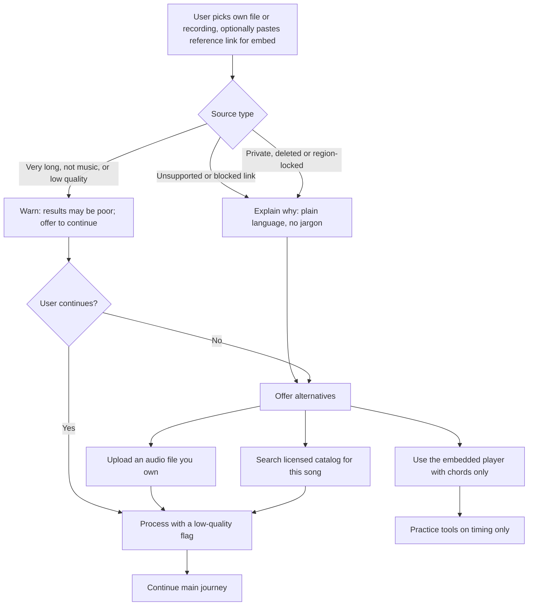
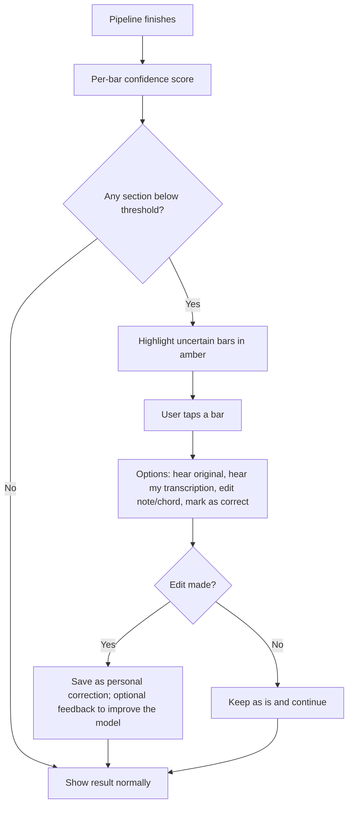
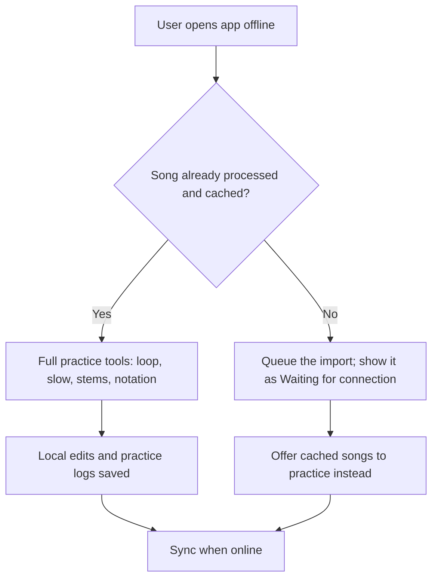
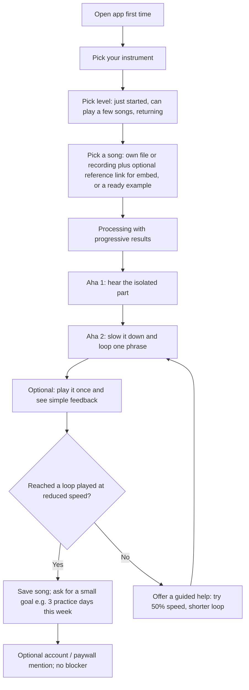

# User journeys and flows

## TL;DR
- The end-to-end journey has seven stages: discovery, import, processing wait, choose part, learn/practice, progress over weeks, share or move on. Each stage below has the evidence-backed friction and a concrete mitigation.
- Highest-risk stages (by evidence): **import** (users resort to ripping audio, a legal and technical risk), **trust of results** (wrong tabs/chords and muddy stems are the most-repeated complaints) and **paywall/billing** around first use. Processing-wait friction is plausible but **thinly evidenced** (one Trustpilot review calls Moises slow); treat as a design risk, not a measured pain.
- Core mitigations: progressive results during processing, a confidence indicator with tap-to-fix on transcriptions, an "audition" toggle between isolated part and full mix, offline/cached results, transparent trial and cancellation.
- Include three alternate paths: import fails, low-confidence result, no internet. First-session onboarding must reach a *playable loop on a real song* in minutes, since many learners have only ~2 hours of weekly practice ([Loudwire, Fender/YouGov 2021](https://loudwire.com/study-who-are-16-million-americans-learned-play-guitar-last-two-years/)).
- Stage timings and drop-off rates below are design targets or estimates unless a source is cited.

## Findings

### Journey 1: learn a song from a video (main journey)

#### Stage table: friction and mitigation

| Stage | Likely friction / drop-off (evidence) | Mitigation |
|---|---|---|
| 1. Discovery | Learners search "how to play X" and land on YouTube lessons, tab sites and apps; 67% of Fender's new guitarists watch guitar content weekly, 58% use TikTok weekly ([Loudwire](https://loudwire.com/study-who-are-16-million-americans-learned-play-guitar-last-two-years/), [Digital Music News](https://www.digitalmusicnews.com/?p=195046)). Discovery is therefore through short video and search, not app stores (inference). | Shareable result pages (a looped, slowed part with attribution); song-specific landing pages; share-sheet/extension entry from the video player. Legal limits on what can be shown: `research/legal/youtube-copyright-and-platform-policy.md`. |
| 2. Install / first use | Aggressive paywalls straight after install and free tiers where "90% of features" are unusable frustrate users ([Moises Trustpilot, Oct 2024](https://nl.trustpilot.com/review/moises.ai?page=3); basic features moved to paid "with no warning", [Moises App Store, Nov 2024](https://apps.apple.com/app/apple-store/id1515796612)). Chordify free tier caps daily songs and gates slow/loop ([GuitarChalk](https://www.guitarchalk.com/chordify-review/), [App Store](https://apps.apple.com/us/app/-/id1073624757)). | Let the first song run end-to-end free, including one loop and one slow-down; paywall on volume (songs/month, export), not on the core "aha". No surprise removals of free features. See `research/market/pricing-and-business-models.md`. |
| 3. Import | Users already shop for workarounds to get audio, such as Spotify-to-MP3 tools and lossless purchases ([BassBuzz, Oct 2025](https://forum.bassbuzz.com/t/how-can-i-make-the-bassline-more-audible/84933)); Chordify's appeal is that it works with YouTube links ([App Store listing](https://apps.apple.com/us/app/-/id1073624757)). Catalog-based apps lose songs to licensing ([flowkey](https://www.trustpilot.com/review/flowkey.com), [Drumeo](https://www.trustpilot.com/review/drumeo.com)). | Offer the import methods the legal analysis permits (e.g. embedded player sync, user-uploaded owned files, licensed catalog) with plain explanations of why one is unavailable. Never silently fail. Decision pending `research/legal/youtube-copyright-and-platform-policy.md`. |
| 4. Processing wait | Evidence is thin: a Moises reviewer found it "slow" and crash-prone ([Trustpilot, Sep 2026](https://nl.trustpilot.com/review/moises.ai?page=3)); Drumeo claims drum removal in under a minute (vendor, [Drumeo](https://www.drumeo.com/beat/moises-drumless-tracks-tutorial/)). Actual latency for Splitune depends on `research/ml/deployment-and-inference.md` (inference). Risk: user leaves the app mid-wait. | Progressive results: show waveform, tempo and key first, then chords, then stems, then notation, each as ready; allow practice with the original video while stems cook; push notification when done; cache results per track so repeat opens are instant; show honest time estimate. |
| 5. Choose part | Parts are hard to identify; separation lumps guitar and piano into "other"; bass stems muddy; bass that plays melodically is missed ([BassBuzz, 2022-2024](https://forum.bassbuzz.com/t/app-to-isolate-bass-tracks-in-songs/30572)). Lead vs rhythm guitar separation is gated to Pro in Moises ([Moises](https://moises.ai/made-for/guitarists/)). | Auto-suggest part by instrument; show a "this is what I think is the bass" audition clip with a one-tap "wrong instrument" correction; allow choosing full-mix learning if separation is poor. See `research/ml/instrument-recognition.md`. |
| 6. Learn (listen, see, slow, loop) | Tabs are unreliable and fingerings suboptimal ([BassBuzz, 2025](https://forum.bassbuzz.com/t/tab-sites/71538?page=2)); auto chords often wrong with no signal ([Chordify App Store review, 2023](https://apps.apple.com/us/app/-/id1073624757)); apps force tempo or minimum speed too high or low ([flowkey](https://www.trustpilot.com/review/flowkey.com)). Learning abstracted riffs hurts ensemble timing ([Rush 2023](https://iaspmjournal.net/index.php/IASPM_Journal/article/download/1269/1975/9547)). | Confidence indicator per bar/note with tap-to-fix; side-by-side "your tab vs what I hear" playback; speed from 25% in fine steps; loop snaps to bars; "play in context" toggle and count-in; remember per-song speed. See `research/ux/practice-tool-patterns.md`, `research/ux/music-display-ui.md`. |
| 7. Practice / check playing | Note detection misses real notes or is too lenient ([Yousician](https://www.trustpilot.com/review/yousician.com), [Simply Piano](https://www.trustpilot.com/review/simplypiano.com), [Melodics](https://apps.apple.com/us/app/melodics-real-drum-learning/id6504540940)). Hands are on the instrument; tapping to restart a loop breaks flow (inference). | Make "check my playing" optional and tolerant by default with adjustable strictness; large targets, foot-pedal/voice/auto-restart loops; see `research/ux/hands-busy-and-device-context.md`. |
| 8. Progress over weeks | About 1 in 4 new players stagnate; 33% of beginners not growing as fast as expected; nearly half quit for time reasons ([Loudwire](https://loudwire.com/study-who-are-16-million-americans-learned-play-guitar-last-two-years/), [12fret reprint](https://archive.12fret.com/?p=90708)). Lost content kills momentum ([flowkey Trustpilot](https://www.trustpilot.com/review/flowkey.com)); progress tracking glitches ([Drumeo Trustpilot](https://www.trustpilot.com/review/drumeo.com)). | Session-sized goals (10-15 min), per-song speed milestones, "come back to this loop" reminders, user-owned song library that is never removed, export. Support competence, autonomy and relatedness (Evans et al. 2013, [paper](https://selfdeterminationtheory.org/wp-content/uploads/2021/06/2013_EvansMcPhersonDavidson_Roleof.pdf)). See `research/ux/onboarding-retention-motivation.md`. |
| 9. Share / move on | Trial-to-annual billing surprises dominate negative reviews ([Yousician](https://www.trustpilot.com/review/yousician.com), [UG](https://www.trustpilot.com/review/ultimate-guitar.com), [JoyTunes](https://www.trustpilot.com/review/joytunes.com)). Moving on to next song restarts the import friction. | Renewal reminders and in-app cancellation; recent-songs queue and "learn next song" suggestions from similar songs; share a clip/practice milestone. |

### Journey 1 as an experience curve (illustrative, not measured)

Scores are the author's design hypotheses used to locate friction (inference), not user research.

### Alternate flow A: import fails

| Failure | Evidence it matters | Mitigation |
|---|---|---|
| Link not importable for policy reasons | Users reach for MP3 rippers and Spotify converters ([BassBuzz](https://forum.bassbuzz.com/t/how-can-i-make-the-bassline-more-audible/84933)); legal exposure is covered in `research/legal/youtube-copyright-and-platform-policy.md`. | Clear message plus equally easy lawful alternatives; do not recommend or link to ripping tools. |
| Catalog song removed | flowkey/Drumeo song removals ([flowkey](https://www.trustpilot.com/review/flowkey.com), [Drumeo](https://www.trustpilot.com/review/drumeo.com)). | Keep the user's derived practice data (loops, notes, speed history) even if source becomes unavailable (subject to legal review). |
| Poor source audio | Live and heavily produced recordings separate worse ([BassBuzz 2025](https://forum.bassbuzz.com/t/how-can-i-make-the-bassline-more-audible/84933)). | Pre-flight quality estimate before long processing; suggest studio version. |

### Alternate flow B: low-confidence result

- **Why.** The most repeated complaint across tab and chord tools is not that they are absent but that they are unverified. Forum members say a tab is only wrong if you can hear the error ([BassBuzz, 2024](https://forum.bassbuzz.com/t/bassborg-collective-thoughts-on-songsterr/60757?page=2)); a Chordify reviewer objected that the app does not make clear chords were not human-checked ([App Store, 2023](https://apps.apple.com/us/app/-/id1073624757)).
- **Design.** Never present machine output as authoritative; show confidence, offer the source audio beside the notation, make fixing a two-tap action. Threshold calibration is an ML question (`research/ml/transcription-guitar-and-bass-tabs.md`, `research/ml/chords-beats-key-structure.md`).

### Alternate flow C: no internet

- **Evidence/assumption.** Practice happens away from desks and strong Wi-Fi (rehearsal room, garage; inference); no source quantifies this. Whether processing can run on-device is covered in `research/ml/deployment-and-inference.md`.
- **Design.** Download stems and notation for offline practice; keep streaming-only content clearly labelled; sync practice history on reconnect.

### Journey 2: first-session onboarding

| Step | Why | Evidence or rationale |
|---|---|---|
| Ask instrument and level only | Minimum to pick defaults (tuning, notation type, speed) | Guitar, bass, drums, piano learners differ in how they learn (YouGov: electric bass and drums skew self-taught; piano skews lessons, [YouGov](https://yougov.com/en-us/articles/43512-young-americans-increasingly-exposed-music)). |
| Offer a ready example song | Avoids waiting and import/legal friction on the first run | Time budget is small for most learners ([Loudwire](https://loudwire.com/study-who-are-16-million-americans-learned-play-guitar-last-two-years/)); inference. |
| Aha moments before account | Competitor paywalls straight after install annoy users | [Moises Trustpilot](https://nl.trustpilot.com/review/moises.ai?page=3), [Moises App Store](https://apps.apple.com/app/apple-store/id1515796612). |
| Small, self-chosen goal | Autonomy and competence support | [Evans et al. 2013](https://selfdeterminationtheory.org/wp-content/uploads/2021/06/2013_EvansMcPhersonDavidson_Roleof.pdf); a generic worksheet alone did not raise self-efficacy in a pilot of adult beginners, so keep goals light ([Ritchie & Kearney 2018](https://eprints.chi.ac.uk/id/eprint/3927/)). |

Target (design, not measured): first loop at reduced speed within 5 minutes of install on the example song. See `research/ux/onboarding-retention-motivation.md`.

### Journey variants by persona (summary)
- **P3 bassist (rehearsal deadline).** Skips discovery; imports immediately; lives in stage 5-6; needs set-list view, "mute bass" mix and a confidence flag on fills; success = correct line by rehearsal date (`personas.md`).
- **P4 drummer.** Stage 7 dominates; hands and feet busy; needs voice/foot control and drumless mix.
- **P5 teen.** Short sessions on phone; share clip is a big motivator (inference); parent pays.
- **P2 pianist.** Needs notation view and hands-separate practice; most sensitive to catalog removal.

## Implications for Splitune
- **Define the "first aha" as stage 6 on a real song, in under 5 minutes**, using a bundled example, then onboard real imports.
- **Design the pipeline for partial results** (tempo/key/chords before stems before notes). This affects API/queue design: see `research/ml/deployment-and-inference.md`.
- **Confidence and correction are core UX, not polish.** They need data model support (per-bar confidence, user overrides stored separately from model output).
- **Offline/cached practice** should be part of MVP scope if on-device or downloadable stems are feasible; otherwise state the limitation.
- **Billing UX is a journey stage.** Plan trial, reminders, and cancellation flows as first-class (`research/market/pricing-and-business-models.md`).
- Import options are constrained by legal review: `research/legal/youtube-copyright-and-platform-policy.md`. Competitive baseline: `research/market/competitor-landscape.md`. Hands-busy interaction: `research/ux/hands-busy-and-device-context.md`. Practice patterns: `research/ux/practice-tool-patterns.md`.

## Open questions
- Real processing latency and cost per song-minute for Splitune's pipeline, and the drop-off curve versus wait time (prototype + analytics).
- Acceptable confidence thresholds and how users respond to amber warnings (usability test with seeded errors).
- Which import paths are lawful and App Store-compliant (legal workstream).
- Do users want stem audio offline, or is notation/loop metadata enough?
- Does a shared clip loop drive acquisition? Needs a pilot.

## Sources
- [Loudwire: Fender/YouGov 2021 survey](https://loudwire.com/study-who-are-16-million-americans-learned-play-guitar-last-two-years/) — tier 3, accessed 2026-10-20
- [Digital Music News: Fender 2021 survey](https://www.digitalmusicnews.com/?p=195046) — tier 3, accessed 2026-10-20
- [12fret archive: Fender research reprint](https://archive.12fret.com/?p=90708) — tier 3, accessed 2026-10-20
- [YouGov: Young Americans increasingly exposed to music](https://yougov.com/en-us/articles/43512-young-americans-increasingly-exposed-music) — tier 3, accessed 2026-10-20
- [Rush 2023, IASPM Journal](https://iaspmjournal.net/index.php/IASPM_Journal/article/download/1269/1975/9547) — tier 1, accessed 2026-10-20
- [Evans, McPherson & Davidson 2013](https://selfdeterminationtheory.org/wp-content/uploads/2021/06/2013_EvansMcPhersonDavidson_Roleof.pdf) — tier 1, accessed 2026-10-20
- [Ritchie & Kearney 2018](https://eprints.chi.ac.uk/id/eprint/3927/) — tier 1, accessed 2026-10-20
- [Moises: guitarists](https://moises.ai/made-for/guitarists/) — tier 2 (vendor), accessed 2026-10-20
- [Drumeo: Moises drumless tracks tutorial](https://www.drumeo.com/beat/moises-drumless-tracks-tutorial/) — tier 2 (partner), accessed 2026-10-20
- [Moises App Store listing](https://apps.apple.com/app/apple-store/id1515796612) — tier 2/4, accessed 2026-10-20
- [Chordify App Store listing](https://apps.apple.com/us/app/-/id1073624757) — tier 2/4, accessed 2026-10-20
- [Melodics App Store listing](https://apps.apple.com/us/app/melodics-real-drum-learning/id6504540940) — tier 2/4, accessed 2026-10-20
- [GuitarChalk: Chordify review](https://www.guitarchalk.com/chordify-review/) — tier 4, accessed 2026-10-20
- [Trustpilot: Moises](https://nl.trustpilot.com/review/moises.ai?page=3) — tier 4, accessed 2026-10-20
- [Trustpilot: Yousician](https://www.trustpilot.com/review/yousician.com) — tier 4, accessed 2026-10-20
- [Trustpilot: Ultimate Guitar](https://www.trustpilot.com/review/ultimate-guitar.com) — tier 4, accessed 2026-10-20
- [Trustpilot: flowkey](https://www.trustpilot.com/review/flowkey.com) — tier 4, accessed 2026-10-20
- [Trustpilot: Simply Piano](https://www.trustpilot.com/review/simplypiano.com) — tier 4, accessed 2026-10-20
- [Trustpilot: Drumeo](https://www.trustpilot.com/review/drumeo.com) — tier 4, accessed 2026-10-20
- [Trustpilot: JoyTunes](https://www.trustpilot.com/review/joytunes.com) — tier 4, accessed 2026-10-20
- [BassBuzz: How can I make the bassline more audible?](https://forum.bassbuzz.com/t/how-can-i-make-the-bassline-more-audible/84933) — tier 4, accessed 2026-10-20
- [BassBuzz: App to isolate bass tracks in songs](https://forum.bassbuzz.com/t/app-to-isolate-bass-tracks-in-songs/30572) — tier 4, accessed 2026-10-20
- [BassBuzz: Tab sites](https://forum.bassbuzz.com/t/tab-sites/71538?page=2) — tier 4, accessed 2026-10-20
- [BassBuzz: Thoughts on Songsterr](https://forum.bassbuzz.com/t/bassborg-collective-thoughts-on-songsterr/60757?page=2) — tier 4, accessed 2026-10-20
