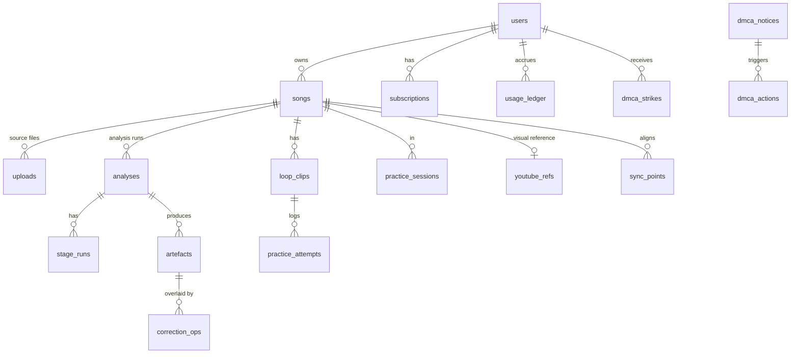

# Data model and storage

Relational schema (PostgreSQL), object-storage layout, cache/idempotency keys, retention and deletion cascade. Implements D7 (per-user private storage, no cross-user cache) and the practice data model the roadmap requires from day one ("section, tempo, passes, last attempt").

## TL;DR
- **Postgres holds metadata, practice data, corrections, billing state and compliance records; object storage holds audio and analysis JSON.** Large JSON artefacts are never stored in Postgres.
- **Everything user-derived is keyed by `user_id`**, including the cache key `hash(user_id, audio_hash, stage, model_id@version, params)`. There is no table or bucket path that two users share for derived content.
- **`audio_hash` = SHA-256 of the canonical decoded PCM** (44.1 kHz, stereo, float32 little-endian, after ffmpeg decode), so re-encodes of the same file collide *for the same user*.
- **Deletion cascades** from user → songs → uploads, analyses, artefacts, stems, corrections, loops, practice logs, local caches. DMCA takedown uses the same cascade plus a strike record.
- **Row-level authorization in the API layer plus Postgres RLS as defence in depth** (`17-security.md`).

## Entity overview



## Tables (DDL sketch; migrations are generated by the ORM in `00-tech-stack.md`)

```sql
-- Identity (auth library manages its own tables: sessions, accounts, verification, passkeys)
create table users (
  id               text primary key,            -- auth library id
  email            citext unique not null,
  display_name     text,
  primary_instrument text check (primary_instrument in ('guitar','bass','piano','drums','vocals','other')),
  level            text check (level in ('just_started','few_songs','returning')),
  handedness       text not null default 'right' check (handedness in ('right','left')),
  training_opt_in  boolean not null default false,  -- D7: separate explicit opt-in
  marketing_opt_in boolean not null default false,
  country          text,                         -- for tax/VAT and launch-market gating
  birth_year       int,                          -- only if counsel requires age gating (QL6)
  created_at       timestamptz not null default now(),
  deleted_at       timestamptz                   -- soft delete during the cascade window only
);

create table songs (
  id            uuid primary key default gen_random_uuid(),
  user_id       text not null references users(id) on delete cascade,
  title         text not null,                   -- user-entered or from file tags; never from YouTube API unless refreshed (III.E.4.c)
  artist        text,
  source_kind   text not null check (source_kind in ('upload','recording','url','example','licensed')),
  source_url    text,                            -- personal mode URL import (25-personal-mode.md §4)
  instrument    text not null,                   -- the part the learner is learning
  duration_s    numeric(9,3),
  audio_hash    text,                            -- sha256 of canonical PCM; unique per user
  status        text not null default 'importing' check (status in ('importing','analysing','ready','partial','failed','taken_down')),
  last_opened_at timestamptz,
  player_state  jsonb not null default '{}',     -- speed, mix, playback key, view, last position (M5, M14)
  created_at    timestamptz not null default now(),
  unique (user_id, audio_hash, instrument)
);
create index on songs (user_id, last_opened_at desc);

create table uploads (
  id            uuid primary key default gen_random_uuid(),
  user_id       text not null references users(id) on delete cascade,
  song_id       uuid references songs(id) on delete cascade,
  object_key    text not null,                   -- u/{user_id}/raw/{upload_id}/{filename}
  bytes         bigint not null,
  mime          text not null,
  file_sha256   text not null,                   -- byte hash for client-side dedupe

  container     text, codec text, duration_s numeric(9,3),  -- from server-side ffprobe
  rights_warranty_at timestamptz not null,       -- user ticked "I own or have permission" (ToS)
  status        text not null check (status in ('pending','uploaded','validated','rejected','expired','deleted')),
  reject_reason text,
  expires_at    timestamptz not null,            -- raw upload auto-expiry (D7); N days set with counsel
  created_at    timestamptz not null default now()
);

create table analyses (
  id               uuid primary key default gen_random_uuid(),
  user_id          text not null references users(id) on delete cascade,
  song_id          uuid not null references songs(id) on delete cascade,
  version          int not null,                 -- artefact set version (05-analysis-schema.md S4)
  pipeline_version text not null,
  config_profile   text not null,                -- e.g. production
  requested_instrument text not null,
  analysis_type    text not null check (analysis_type in ('welcome','full','lite')),
  status           text not null check (status in ('queued','running','done','partial','failed','cancelled')),
  progress         real not null default 0,
  idempotency_key  text not null,                -- see "Keys" below
  workflow_run_id  text,                          -- orchestrator run id
  cost_usd_estimate numeric(10,5),               -- vendor + GPU, filled by finalize
  created_at       timestamptz not null default now(),
  finished_at      timestamptz,
  unique (user_id, idempotency_key)
);

create table stage_runs (
  analysis_id   uuid references analyses(id) on delete cascade,
  stage         text not null,                   -- decode, beats, presence, separation, chords, notes.guitar, finalize, ...
  status        text not null,
  model_refs    jsonb not null,                  -- [{model_id, version, weights_sha256, register_tier}]
  cache_key     text not null,                   -- per-user stage cache key
  attempts      int not null default 0,
  error_code    text,
  gpu_seconds   real, vendor_minutes real, vendor_cost_usd numeric(10,5),
  started_at    timestamptz, finished_at timestamptz,
  primary key (analysis_id, stage)
);
create index on stage_runs (cache_key);

create table artefacts (
  id            uuid primary key default gen_random_uuid(),
  user_id       text not null references users(id) on delete cascade,
  analysis_id   uuid not null references analyses(id) on delete cascade,
  kind          text not null,                   -- beats, chords, notes.guitar, stems, tab.guitar, summary...
  version       int not null,
  object_key    text not null,
  bytes         int not null,
  sha256        text not null,
  model_refs    jsonb not null,
  expires_at    timestamptz,                     -- stems expire after inactivity; JSON kept while song exists
  created_at    timestamptz not null default now(),
  unique (analysis_id, kind, version)
);

create table correction_ops (
  id            bigserial primary key,
  user_id       text not null references users(id) on delete cascade,
  artefact_id   uuid not null references artefacts(id) on delete cascade,
  rev           int not null,                    -- per artefact, monotonically increasing
  op            jsonb not null,                  -- CorrectionOp (05-analysis-schema.md)
  client_op_id  uuid not null,                   -- idempotency for offline sync
  created_at    timestamptz not null default now(),
  unique (artefact_id, rev), unique (user_id, client_op_id)
);

-- Practice data model (shared by MVP self-assessment, v1 scoring, later spaced review)
create table loop_clips (
  id            uuid primary key default gen_random_uuid(),
  user_id       text not null references users(id) on delete cascade,
  song_id       uuid not null references songs(id) on delete cascade,
  name          text,                            -- "bridge riff"
  start_bar     int not null, start_beat int not null default 1, end_bar int not null, end_beat int not null,
  start_s       numeric(9,3) not null, end_s numeric(9,3) not null, -- resolved times for the current beat grid
  rest_between  text not null default 'none' check (rest_between in ('none','beat','bar')),
  count_in_bars int not null default 1,
  trainer       jsonb,                           -- V1 speed trainer settings
  best_clean_tempo_pct int,                      -- progress metric (tempo reached at clean pass)
  created_at    timestamptz not null default now()
);

create table practice_sessions (
  id            uuid primary key default gen_random_uuid(),
  user_id       text not null references users(id) on delete cascade,
  song_id       uuid not null references songs(id) on delete cascade,
  started_at    timestamptz not null, ended_at timestamptz,
  input_mode    text not null default 'touch',   -- touch | keyboard | pedal | mixed (hands-busy metric)
  client_session_id uuid not null unique
);

create table practice_attempts (
  id            bigserial primary key,
  user_id       text not null references users(id) on delete cascade,
  session_id    uuid not null references practice_sessions(id) on delete cascade,
  loop_clip_id  uuid references loop_clips(id) on delete set null,
  tempo_pct     int not null,
  outcome       text not null check (outcome in ('clean','not_yet','unrated')),   -- MVP self-assessment
  score         jsonb,                           -- v1 mic scoring details; null in MVP
  override      boolean not null default false,  -- "I played it right" (V7)
  at            timestamptz not null,
  client_attempt_id uuid not null unique
);

-- YouTube reference (Design B): only IDs and user syncpoints, no media
create table youtube_refs (
  song_id       uuid primary key references songs(id) on delete cascade,
  user_id       text not null references users(id) on delete cascade,
  video_id      text not null,
  fetched_title text,                            -- optional API data; refreshed or deleted within 30 days (III.E.4.c)
  api_data_refreshed_at timestamptz
);
create table sync_points (
  song_id uuid references songs(id) on delete cascade,
  idx int, audio_s numeric(9,3) not null, video_s numeric(9,3) not null,
  primary key (song_id, idx)
);

-- Billing and entitlements (provider is the source of truth; this is a cache + ledger)
create table subscriptions (
  user_id text primary key references users(id) on delete cascade,
  provider text not null, provider_customer_id text, provider_subscription_id text,
  plan text not null check (plan in ('free','paid_monthly','paid_yearly')),
  status text not null,                          -- active, trialing, past_due, cancelled
  current_period_start timestamptz, current_period_end timestamptz,
  cancel_at_period_end boolean not null default false,
  updated_at timestamptz not null default now()
);
create table usage_ledger (
  id bigserial primary key,
  user_id text not null references users(id) on delete cascade,
  period_start date not null,
  kind text not null check (kind in ('welcome_analysis','full_analysis','lite_analysis','extra_instrument')),  -- 23-plans-free-and-paid.md
  analysis_id uuid references analyses(id) on delete set null,
  units int not null default 1,
  created_at timestamptz not null default now()
);
create index on usage_ledger (user_id, period_start);

-- Job queue (personal mode; replaces Inngest — 25-personal-mode.md)
create table jobs (
  id            bigserial primary key,
  kind          text not null,                   -- url_import, decode, beats, separate, stem_post, chords, notes.<inst>, finalize, sweep, ...
  runner        text not null check (runner in ('python','node')),
  analysis_id   uuid references analyses(id) on delete cascade,
  payload       jsonb not null default '{}',
  status        text not null default 'queued' check (status in ('queued','running','done','failed','cancelled')),
  priority      int not null default 100,        -- Plus = lower number (priority processing)
  attempts      int not null default 0, max_attempts int not null default 3,
  run_after     timestamptz not null default now(),
  locked_by     text, locked_at timestamptz, heartbeat_at timestamptz,
  depends_on    bigint[] not null default '{}',  -- stage graph edges
  error_code    text,
  created_at    timestamptz not null default now()
);
create index on jobs (runner, status, priority, run_after);
-- Workers: SELECT ... WHERE status='queued' AND run_after<=now() AND deps done ORDER BY priority, id FOR UPDATE SKIP LOCKED LIMIT 1;
-- stale locks (heartbeat older than 2 min) are re-queued; NOTIFY 'jobs_<runner>' on insert wakes idle workers.

create table job_events (                        -- feeds SSE (04-api-contract.md)
  id bigserial primary key,
  analysis_id uuid not null references analyses(id) on delete cascade,
  user_id text not null references users(id) on delete cascade,
  event jsonb not null, at timestamptz not null default now()
);
create index on job_events (analysis_id, id);

-- Compliance (dormant in personal mode)
create table dmca_notices (
  id uuid primary key default gen_random_uuid(),
  received_at timestamptz not null, channel text not null,  -- form | email
  claimant jsonb not null, work_description text not null,
  identified_song_ids uuid[] not null default '{}',
  status text not null check (status in ('received','invalid','actioned','counter_noticed','restored','closed')),
  raw_notice_key text not null                   -- stored in a restricted compliance bucket
);
create table dmca_actions (
  id bigserial primary key, notice_id uuid references dmca_notices(id),
  song_id uuid, user_id text, action text not null, at timestamptz not null default now(), actor text not null
);
create table dmca_strikes (
  user_id text references users(id), notice_id uuid references dmca_notices(id),
  at timestamptz not null default now(), primary key (user_id, notice_id)
);
create table audit_log (
  id bigserial primary key, actor text not null, action text not null,
  subject_user_id text, subject jsonb, at timestamptz not null default now()
);
```

Notes:
- `songs.unique(user_id, audio_hash, instrument)` gives per-user dedupe; a second user with the same file gets their own song, analysis and artefacts (D7).
- `dmca_notices`, `dmca_actions` and `audit_log` deliberately **survive** user deletion (legal record), but hold no audio and only the minimum identifiers counsel requires.
- Example songs (M13) are owned by a system user; each learner gets a lightweight `songs` row with `source_kind='example'` pointing at shared, Splitune-owned artefacts. This is not a cross-user cache of user content: the content is Splitune's own recordings.

## Keys

| Key | Formula | Purpose |
|---|---|---|
| `audio_hash` | `sha256(PCM_f32le_44100_stereo)` computed server-side after ffmpeg decode. Browser decoders resample differently, so the client never tries to reproduce it | Dedupe per user; artefact header |
| `file_sha256` (`uploads.file_sha256`) | `sha256(original file bytes)`, computed in a Worker before upload | Instant "you already have this song" check for byte-identical files; the PCM-level match happens server-side after decode |
| Stage cache key | `sha256(scope ‖ audio_hash ‖ stage ‖ model_id@version ‖ weights_sha256 ‖ canonical_json(params))` where `scope` = `user_id` (commercial, D7) or the constant `global` (**personal-mode default**, `cache_scope: global`) | Skip a stage when identical inputs were already processed |
| Analysis idempotency key | `sha256(user_id ‖ audio_hash ‖ requested_instrument ‖ pipeline_version ‖ config_profile)` | `POST /analyses` returns the existing run instead of starting a duplicate |
| Client op ids | UUIDv7 generated on device | Offline-safe idempotent sync of corrections, attempts, sessions |

## Object storage layout
One private bucket per environment for user content, one for Splitune-owned assets, one restricted bucket for compliance records.

```
splitune-user-{env}/
  u/{user_id}/raw/{upload_id}/{original_filename}        # expires (lifecycle rule) after N days or after successful analysis
  u/{user_id}/a/{analysis_id}/v{n}/manifest.json
  u/{user_id}/a/{analysis_id}/v{n}/beats.json ... summary.json
  u/{user_id}/a/{analysis_id}/v{n}/stems/{stem_id}.m4a    # AAC-LC (default, every browser)
  u/{user_id}/a/{analysis_id}/v{n}/stems/{stem_id}.webm   # Opus (optional variant after a decode test)
  u/{user_id}/a/{analysis_id}/v{n}/render/{instrument}.alphatex
  u/{user_id}/rec/{recording_id}.webm                     # record-yourself (Design E)
splitune-assets-{env}/
  examples/{example_id}/...                               # Splitune-owned example songs and their analyses
  models/{register_id}/{sha256}/...                       # weights mirror, if not baked into images
splitune-compliance-{env}/                                # restricted IAM; DMCA notices, counsel memos refs
```
- Access is only through short-lived signed URLs issued by the API after an ownership check (GET 15 min; PUT/multipart parts 1 h). No public buckets, no listing permission for clients.
- Lifecycle rules: `u/*/raw/*` expire after N days (N from counsel; start with 7 days post-analysis); stems get `expires_at` tracked in Postgres and a nightly sweeper deletes stems inactive for M days (re-derivable on demand at the cost of a new analysis; counted against the cap only if the user asks for a re-run). JSON artefacts persist while the song exists (they are small and hold corrections' anchors). Personal mode (`25` §1): no expiry rules on the R2 bucket, only its default 7-day abort of incomplete multipart uploads; the sweeper does all expiry and raw uploads are kept.
- Encryption at rest is the provider default (SSE). Object keys never contain titles or emails.

## Retention and deletion
| Event | Action | SLA (proposal) |
|---|---|---|
| Analysis succeeded | Schedule raw upload deletion at `expires_at` | N days |
| User deletes a song | Delete DB rows (cascade) + enqueue object deletion for `u/{user}/…/{song}` prefixes; clients purge local caches on next sync | DB immediate; objects ≤24 h |
| User deletes account | Soft-delete marker → revoke sessions → cancel subscription at provider → delete all user prefixes → hard-delete rows; keep compliance records and billing records the law requires | ≤30 days (confirm with counsel/GDPR) |
| DMCA takedown | Same as song delete for identified songs + `songs.status='taken_down'` tombstone row until the counter-notice window closes + strike | ≤24 h after a valid notice (confirm with counsel) |
| YouTube API data | Refresh or null `youtube_refs.fetched_title` older than 30 days (nightly job) | 30 days (III.E.4.c) |
| Stem inactivity | Delete stems, keep JSON; UI shows "re-create stems" | M days |

The sweeper and cascade jobs are idempotent and logged to `audit_log` (`15-privacy-dmca-and-data-lifecycle.md`).

## Implementation notes (step 03, 2026-10-20)
Code: `packages/db` (schema, migrations, RLS, repositories, job queue; protocol and role table in `packages/db/README.md`) and `packages/storage`. Deviations from the DDL sketch above:
- **Identity columns** (`generated by default as identity`) instead of `bigserial`; same `bigint` ids, no sequence grants needed.
- **Enum checks come from `@splitune/contracts`** (`Instrument`, `SongStatus`, `UploadStatus`, `AnalysisKind`, `AnalysisStatus`, `StageName`, `StageStatus`, `Plan`, subscription status, …), so the database and the wire accept the same values; `songs.instrument`, `analyses.requested_instrument` and `stage_runs.stage/status` gained checks. `subscriptions.status` allows `expired` (as the contract does).
- `uploads.rights_warranty_at` is **nullable** (personal mode has no warranty; the commercial profile enforces it in the API).
- **Raw upload keys are `u/{user_id}/raw/{upload_id}/source.{ext}`**: only a sanitised extension of the original file name survives, so keys never contain titles (17 §3). `artefactKey`/`stemKey`/`renderKey`/`recordingKey` build the other paths and reject anything that could leave `u/{user_id}/`.
- **Added tables:** `worker_heartbeats` (worker_id, runner, hostname, version, started_at, heartbeat_at), `analytics_events` (user_id nullable, name, props jsonb, at), `feature_flags` (key, enabled, value jsonb, description, updated_at). Extra indexes: uploads (user_id, file_sha256) and expires_at, artefacts expires_at, analyses (song_id, created_at), loop_clips song_id, jobs depends_on (GIN) and analysis_id.
- **RLS** (migration `0002`): `withUser()` runs `set_config('app.user_id', …, true)` + `SET LOCAL ROLE app`, so policies apply even when the API connects as the owner (Railway's `postgres`). `sync_points`, `stage_runs` and `jobs` are scoped through their parent row. `WITH CHECK` also requires the parent row (song, artefact, session, analysis) to be visible, because FK checks ignore RLS. `analytics_events` is insert-only for `app`.
- **Worker roles** also get `songs.audio_hash`/`duration_s` updates (decode fills them) and `songs.source_url` reads (url_import). Raw upload keys travel in the job payload, so workers have no `uploads` access.
- **Job dependencies:** a job runs when every `depends_on` job is `done`; when a job fails permanently its queued dependents are cancelled transitively (`error_code = 'dependency_failed'`). Finalize-on-partial-results needs the pipeline to enqueue finalize accordingly (step 05/06).
- Migrations are forward-only; all pending ones apply in one transaction.

## Implementation notes (step 04, 2026-10-20)
- `0003_auth_and_uploads`: Better Auth tables `auth_sessions`, `auth_accounts`, `auth_verifications` (text ids, FK to `users` on delete cascade); `users` gains Better Auth's `name` (default `''`), `email_verified`, `image`, `updated_at`; `uploads` gains `multipart_upload_id` and `part_size`; new `rate_limits (key, window_start, count)`.
- `0004_auth_grants_and_cleanup_jobs`: the new tables are owner-only (Better Auth and the limiter run as the table owner); `maintenance` gets full DML. Policy `jobs_owner_cleanup` lets `app` insert/read `delete_prefix` jobs with no analysis whose payload `user_id` is the caller and whose `prefixes` are non-empty strings under `u/<user_id>/`, ending in `/`, without `.`/`..` segments — so song deletion and its object cleanup commit atomically.
- Repositories: `songs.list` keyset cursor, `songs.open` (detail + last_opened_at), `songs.delete(userId, songId, objectPrefixes)` enqueues the cleanup job; `uploads.transition` (compare-and-set on status); `users.profile`; `users.updateProfile` audits `training_opt_in` changes; `hitRateLimit` in `src/rate-limit.ts`; `ping`.

## Implementation notes (step 06, 2026-10-20)
- **Stage cache key as computed by the ML worker:** `sha256(scope \n audio_id \n stage \n sorted("model_id@version:weights_sha256", …) \n canonical_json(params))`; newline separators so adjacent fields can't run together. `audio_id` = `audio_hash`, except for `decode`, which produces it: there it is the sha256 of the source file. `params` are the stage's *effective* params (defaults filled in); for decode they include the ffmpeg version.
- **Cache reuse:** a finished `stage_runs` row with the same key (this analysis first) whose artefact rows all exist and whose objects still match their sha256. Same analysis → no work at all; another analysis → artefacts re-issued under its own keys with `analysis_id`/`user_id`/`artefact_version`/`created_at` rewritten (new sha256, no recompute).
- **Decoded FLAC lives only on the Mac:** `{ML_CACHE_DIR}/decoded/{audio_hash}.flac` (24-bit). Stages needing audio take `inputs.probe` (for `audio_hash`/`duration_s`) and `inputs.source`; a missing FLAC is re-decoded from `source` and checked against `audio_hash`.
- **Duplicate audio:** decode sets `songs.audio_hash`/`duration_s`; if that violates `unique (user_id, audio_hash, instrument)` the song is left unchanged and the worker logs `duplicate_audio_hash`. Acting on it (pointing at the existing song) is the API/orchestrator's job (step 09).

## Implementation notes (step 09, 2026-10-21)
- Migration `0005` (generated): `jobs.soft_depends_on bigint[]` (claim waits until those jobs are `done`/`failed`/`cancelled`; failures there cancel nothing) and `analyses.base_analysis_id` (the earlier analysis whose decode + beats this one reuses — Lite → Full upgrade; `on delete set null`).
- Migration `0006` (custom): `job_events` insert trigger → `NOTIFY job_events`; `app` may insert only `analysis.waiting` events and `stage.completed` of `decode`/`beats` (reused stages) for its own analyses (`job_events_owner` became SELECT-only); `analyses_owner` checks a base analysis is the user's through the `SECURITY DEFINER` function `app_owns_analysis()` (a policy can't query its own table: infinite recursion); `ml_worker` gets write-only `UPDATE (title, artist)` on songs for URL-import metadata (still no SELECT on titles).
- Migration `0007` (custom): job event ids follow commit order within an analysis — a `BEFORE INSERT` trigger (`SECURITY DEFINER`) takes the analysis row lock, held to commit, before `nextval`. Without it a concurrently committing worker could commit id N after N+1 was streamed, and SSE (paging by id / `Last-Event-ID`) skipped the event; the acceptance test caught a missing `stage.completed:beats` under parallel load.
- **Analysis idempotency key:** `audio_hash` is unknown before decode, so the key is `sha256(user ‖ source ‖ instrument ‖ type ‖ pipeline_version ‖ config_profile)` with `source` = `upload:<upload_id>` (or `url:<import_id>`); `type` is in the key because Lite and Full of the same song are different runs. Reruns use `sha256(user ‖ rerun ‖ analysis ‖ Idempotency-Key header or a random id)`. A failed run is retried with rerun, not with a repeated POST.
- **Versions** are per song: a new run is `max(version) + 1` (the song row is locked meanwhile).
- **URL imports:** raw audio at `u/{user}/raw/{import_id}/source.bin` (decode sniffs the container), optional video at `…/video.mp4` (`rawVideoKey`). The raw-upload sweeper (step 15) must keep `video.mp4` while the song exists. The URL itself lives only on `songs.source_url`; job payloads never carry it.
- **Song status** follows the latest analysis: `importing` (URL download) → `analysing` → `ready` / `partial` / `failed`, set by the API at creation, `url_import` and finalize.
- **Deleting a song** cascades its analyses' jobs (queued ones disappear; a running one loses its lock) and enqueues `delete_prefix` twice: now, and again after 30 min (`CLEANUP_REPEAT_AFTER_S`) for objects a still-running stage may upload before it notices.

## Implementation notes (step 10, 2026-10-22)
- Migration `0008_analysis_recommended_view`: nullable `analyses.recommended_view` (check from contracts' `RecommendedView`), written by finalize with the analysis' end state (the requested instrument's `summary.per_instrument[0].recommended_view`); `GRANT UPDATE (recommended_view) ON analyses TO node_worker`. The library shows "Chords only" from it without reading `summary.json`.
- `repos.songs.library(userId, { q, instrument, status, sort, limit, after })`: one page of songs plus batched queries for the latest analysis (stages finished / planned, reused decode+beats of `base_analysis_id` counted as finished), stems state (`stems` artefacts of the latest done/partial analysis only — a base analysis lends decode and beats, not stems) and the best clean loop. Keyset cursor per sort (`libraryCursor`). "Last practised" is `last_opened_at` (the existing library order) until step 12 syncs practice sessions.
- `queue.stageTimings(db)`: median wall time of each stage's latest 50 `done`/`fallback` runs in 30 days, system-wide aggregates only, run as the owner like `workerPresence`.
- Local SeaweedFS gets bucket CORS from `infra/seaweedfs/cors.json` (the `infra/r2/cors.json` rules for `http://localhost:3000` and `http://127.0.0.1:3000`), applied by `seaweedfs-init` with `put-bucket-cors` on every run. SeaweedFS 4.48 honours bucket CORS (preflight from another origin is refused; a real PUT exposes `ETag`).

## Implementation notes (step 13, 2026-10-22)
- **Example songs as built:** one bucket in personal mode, so the assets prefix is `assets/examples/{example_id}/{build}/` in `splitune-media` (R2 in production, SeaweedFS locally), `build` = UTC stamp `20261022T090536Z`, so a rebuild never overwrites cached files. Files: `beats.json`, `chords.json`, `stems.json` + `stems/*.m4a|webm`, `notes.<i>.json`, `tab.<i>.json`, `summary.json` (what practice reads). Keys: `examplePrefix`/`exampleKey`/`assertWithin` in `@splitune/storage`.
- The committed manifest is `apps/api/examples.json` (schema `ExamplesManifest`, `@splitune/contracts/examples-manifest`); the API ships it (or reads `EXAMPLES_MANIFEST`). Runtime needs no system-user rows: the system user (`system`, `ensureSystemUser()`) owns only the build-time analyses.
- **Claiming** (`examples.claim` repo): a `songs` row (`source_kind 'example'`, status `ready`, found again by `(user, audio_hash, instrument)`), a finished `analyses` row (type `full`, never charged: usage is the ledger) and `artefacts` rows with the shared `object_key`s and `expires_at` null (never swept). Loops keep the device's ids (`on conflict (id) do nothing`). Migration `0009_example_artefacts`: `GRANT INSERT ON artefacts TO app` plus a **restrictive** RLS policy allowing app inserts only for `object_key LIKE 'assets/examples/%'`. Deleting the song deletes the rows; the shared objects stay.

## Implementation notes (step 14, 2026-10-22)
- Migration `0010_billing_events` (generated): `billing_events (id text pk = provider event id, provider, type, user_id → users on delete cascade, payload jsonb, received_at)` and `subscriptions.renewal_reminder_for` (the period end the yearly reminder was sent for).
- Migration `0011_billing_grants_and_refunds` (custom): `app` gets SELECT/INSERT on `billing_events` with RLS by `user_id`; `maintenance` full DML. Trigger `analyses_release_unearned_usage` (`SECURITY DEFINER`) deletes an analysis' `usage_ledger` rows when it ends `failed`/`cancelled`, or `done`/`partial` without its headline stage (`stem_post` for full/welcome, `chords` for lite) in `done`/`fallback` — whichever role ends the run (workers have no ledger access).
- **Reservations:** `analyses.create` / `createWithSong` take an optional `UsageCharge` (kind, period_start, counted kinds, lifetime, cap); `reserve()` takes `pg_advisory_xact_lock(hashtextextended('usage:'||user))`, counts, and inserts the ledger row in the run's own transaction, or throws `AllowanceExhaustedError` (everything rolls back). A repeated idempotent request returns the existing run and is not charged. Deleting a song mid-run keeps its unit (`analysis_id` set null): user-caused, not a failure.
- Repos: `billing` (`subscription`, idempotent `applyEvent`, `markRenewalReminded` compare-and-set, `hasEvent`, `firstActivation`), system-wide `dueSubscriptions(db, { now, remindFrom, userId? })` (table owner, like `workerPresence`), `usage.summary`, `flags.list` (as role `app`, for visitors); `users.profile` flags include `value`.

## Implementation notes (step 15, 2026-10-22)
- Migrations `0012` (generated: `data_exports`, `schedule_runs`, `artefacts.purged_at`, `analytics_events.user_hash`), `0013` (drops `analytics_events.user_id` and its policy), `0014` (custom: policies/grants for the new tables and jobs, `dashboard_reader`, maintenance read on sequences/`drizzle`, the `dashboards` views). Retention as built: stems 180 days unused (`purged_at`), raw uploads kept (expiry optional), export bundles 24 h, YouTube titles nulled after 30 days, dumps 14.
- Library "Stems expired" now derives from `purged_at`, not `expires_at`.
## Open questions
- Values of N (raw upload retention) and M (stem inactivity) — counsel (QL3) and cost data.
- Whether `birth_year`/age gating is needed (teen persona P5; QL6).
- Whether to keep `practice_attempts` raw beyond 12 months or roll up to weekly aggregates.

## Sources
Cross-linked: `research/product/recommendations-and-decisions.md` D7 (data handling, cache key, retention, DMCA), `research/legal/youtube-copyright-and-platform-policy.md` (Data handling; UGC requirements; III.E.4.c), `research/ml/pipeline-overview.md` §5 (cache key, corrections), `research/ux/practice-tool-patterns.md` (shared loop data model), `05-analysis-schema.md`.
