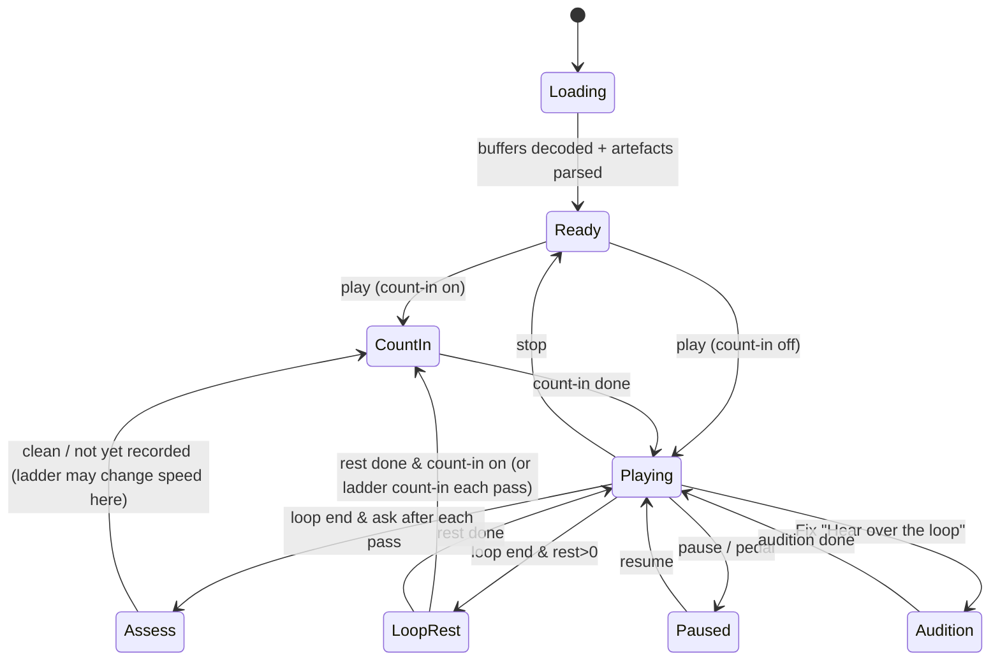

# Practice screen and notation rendering

The screen where learning happens: synchronised notation and chords, bar-snapped loops, the speed ladder, mixer, count-in, confidence-aware fixing, levels and hands-busy controls. Implements M4 (UI), M5–M11, M14, M15 and the P0 patterns in `research/ux/practice-tool-patterns.md`. Audio internals are in `11-audio-engine.md`; algorithms in `07-music-algorithms.md`; regions, sizes, states and copy in `27-screens-flows-and-content.md` §3.7; tokens in `26-design-system.md`.

Updated in step s31a (2026-11-08) for the "Night Rehearsal" redesign (`redesign/report.md`, "The Practice screen: five regions serving one loop"): five regions, the inspector tabs, the new keymap and the practice tools that later steps add. Section numbers are unchanged.

## TL;DR
- **One master clock (audio time) drives everything;** alphaTab (`@coderline/alphatab` 1.8.x) runs with `PlayerMode.EnabledExternalMedia` and only *follows* the time we push with `updatePosition(ms)`. The playhead and the sounding-note highlight are our own layer, moved by `transform` from the audio clock.
- **Five regions serve one loop** (desktop): song map (where am I?), Now column (what do I play now?), notation (which notes?), inspector with **Loop / Mix / Progress / Fix** (how do I practise?), transport dock (control this pass), plus a pass prompt after each pass. Tablets get **Stand view**, phones the glance view and a **Tools** sheet (`27` §3.7).
- **Renderer-agnostic view model:** effective artefacts (`applyCorrections`) → `music-core` tab/level → alphaTex → alphaTab. The song map, Now column, chord sheet, rolls and grids read the same view model.
- **Confidence is shown by outline + "?" + words, never colour alone, never below 4.5:1** (`26` §5); the Fix tab queues unsure spots by consequence.
- **A loop in at most two actions** (tap two bars, a section chip, or "Loop this bar"), median under 3 s; every key or pedal action confirmed within 100 ms.
- **Keys:** speed is `,` / `.` (Shift = 1 %); ↑/↓ never change speed silently; single-key shortcuts can be switched off (WCAG 2.1.4); a pedal wizard maps whatever a pedal sends (§8).

## 1. Layouts
| Device / orientation | Layout | Notes |
|---|---|---|
| Desktop, fine pointer, ≥ 1180 px | Top bar 60 · song map · Now column 264 · notation · inspector 380 · transport dock 96 | `27` §3.7.1, `redesign/mockups/Main.dc.html` |
| Desktop 1024–1179 | Inspector becomes a right drawer ("Tools" in the top bar) | |
| Desktop < 1024 | Also the Now column becomes a strip above the notation | |
| Tablet (coarse pointer, shortest side > 640) | **Stand view** by default: Now panel 400, one tab system that always fits, four 88 px pedal-mirroring buttons, page turns on the downbeat from the audio clock; "All tools" switches to the full layout with the inspector in a drawer | `Stand.dc.html`; portrait stacks two systems and turns half a page; landscape shows a slice of the next bar |
| Phone portrait | Glance view (current and next chord, beats, loop, speed) with Glance · Tab · Chords; **Tools** sheet for speed, ladder, count-in, click, vibrate, mix, level and capo | `Phone-Practice.dc.html`, `Phone-Tools.dc.html` |
| Phone landscape | Horizontally scrolling tab strip that scrolls only when needed, compact ruler, one transport row | |
| Fix mode (any layout with an inspector) | Top bar shows the "Fixing" pill and Done; the dock plays the selected bars on repeat with Listen to: Original / Your part / Tab synth / Both | `Practice-Fix.dc.html` |

Practice hides navigation chrome and holds a Screen Wake Lock for the whole session, requested again on every `visibilitychange` (`11-audio-engine.md`), with the screen tip when it can't be held. Layout selection uses feature queries (viewport, `(pointer: coarse)`, orientation), never the user agent.

## 2. Component tree (web)
```
PracticeRoute
├─ PracticeProvider     XState actor (§6) + practice store
├─ PracticeTopBar       back · title/part line · view switch · legend chip · Display · Keyboard & pedal · More
├─ SongMap              section chips (V3) · waveform overview · unsure hatch · loop band + handles · now-line · ruler
├─ NowColumn            current chord + shape · BeatPulse (V9) · next chord · then chips · Level / Capo
├─ NotationView         alphaTab host (tab / standard / drum staff) or chord sheet / chart / rolls / grid; overlay: confidence, loop, current bar, playhead
├─ PassPrompt           "Pass n at s — how was it?" Felt clean / Not yet
├─ Inspector            tabs: LoopTab (bars, nudges, SpeedLadder V1, repeats, clips) · MixTab (presets, StemRows, helpers) · ProgressTab · FixTab
├─ TransportDock        restart · play · next · position · loop pill · speed group · count-in · click · mix pill · volume
├─ StandView            (tablet) header · Now panel · one system · pedal dock
├─ GlanceView + ToolsSheet (phone)
├─ VideoPane?           personal mode: local downloaded video, muted, slaved to the master clock
├─ PedalHud             confirmation chip ≤ 100 ms
└─ InputMapper          keyboard + pedal bindings, wizard captures, single-key switch
```
Lazy outside the route budget: Fix, Progress, Tools sheet, Stand view, command palette, every popover body, notation views (`§10`).

## 3. Notation rendering with alphaTab
- **Load path:** `tab.{instrument}` + `chords` + meta → `music-core/export/alphatex.ts` → `api.tex(alphaTex)`. Re-render only changed bars where the API allows; otherwise debounce a full re-render ≤ 150 ms after an edit.
- **Player mode:** alphaTab's synth is **disabled**: `PlayerMode.EnabledExternalMedia` with an `IExternalMediaHandler` whose transport calls are no-ops (the audio engine is the only transport); the engine clock is pushed with `updatePosition(ms)` every frame; tick ↔ time from **sync points** on the beat grid (one per downbeat), so the cursor follows rubato. When the speed changes, the rate path keeps alphaTab's interpolation in step.
- **Clock and playhead:** the playhead, the current-bar wash and the sounding-note fill are our own layers on the compositor, moved with `transform`; position = f(audio clock) read once per frame from `AudioContext.getOutputTimestamp()` (fallback `currentTime` where the output timestamp is unreliable, report gate G7), with no extrapolation, so the cursor never overshoots and snaps back (alphaTab #318). Every view (tab, rolls, grid, chord sheet) reads the same clock.
- **Follow modes** (Display → "Notation follows the music"): **Page by page** (default; systems turn as the playhead enters the next one, the current bar always visible, at least one bar of look-ahead), **Scrolling** (fixed now-line, only when necessary), **Off** (for reading and fixing). Pausing stops any scrolling (WCAG 2.2.2). Reduced motion allows Page only and steps the playhead by beat. Stand view turns pages on the downbeat from the audio clock (never in the middle of a system); a pedal turn always wins over the automatic one.
- **Playhead style** (Display): Line (2 px `--playhead`, glow in Night), Block (a small block on the beat, for anyone who finds the line glaring), Bar (shade the current bar only).
- **Rhythm stems** under the tab always (stems and beams in `--faint-foreground`), chord names over the bars (`buildTab({ chordNames: true })`), bar numbers in mono.
- **Confidence styling** (`26` §5): ink via `NoteStyle`; dashed outlines, "?", underlines (edited), the sounding fill and the shaky-bar outline in the overlay positioned from `boundsLookup` (`core.includeNoteBounds = true`); alphaTab's SVG is never styled with CSS. The legend chip shows the unsure count and opens the key and "Show uncertainty".
- **Fonts and colours:** `display.resources` fonts use the reading family (JetBrains Mono digits, or Atkinson Hyperlegible Next) at `--read-tab`; staff, bar and glyph colours come from tokens via `readColor()` and are re-applied on appearance or contrast change. Notation sits on the page in both themes (no paper surface).
- **Wrapper, workers, licence:** `packages/notation` `<AlphaTabView>` owns one `AlphaTabApi`; alphaTab renders in a Web Worker; Bravura self-hosted; alphaTab MPL-2.0 kept unmodified.
- **Left-handed:** chord shapes and the fretboard mirror (not tab text) when `users.handedness = 'left'`.

## 4. Chords, the Fix tab and corrections (M8, M10)
- **Now column:** the current chord large with its shape, "Next · in n beats", then up to five chords; unsure chords dashed with "?"; Level and Capo below. Chord names follow the song's key spelling.
- **Fix tab** (replaces the editor sheet; `27` §3.7.4): entering it (tab, `E`, or tapping a "?") switches to Fix mode. The **queue** holds every unsure spot ranked by consequence (wrong pitch or string/fret, octave error, wrong chord root or quality) and then by probability; a mostly-unsure bar is one "shaky bar" spot. `J` / `K` (and the arrows in the tab) move through it; the selected bars loop at the Fix dock's speed with **Listen to: Original / Your part / Tab synth / Both**.
  - **Chord:** ranked alternatives with frequency wording ("about 1 in 3"), **Hear over the loop** (plays the alternative's voicing with a soft synth over the loop), **Use**, "Type a chord" (Harte-validated), "Split at beat n", Replace all in this song.
  - **Note:** "D4 · string 2, fret 3 ?" with "or play it as" alternatives from `alt_fingerings`, String and Fret steppers, length, **It's right** (`mark_correct` op: removes the mark, keeps the note), Delete note, Report wrong.
  - **Beat:** "Metronome off the beat?" Half tempo · Double tempo · Move downbeat ("This is beat 1"); after a beat fix, quantization re-runs in the browser (`music-core`) and a line states the consequence ("Re-barred 84 bars") with Undo.
  - **Your edits:** the corrections history with Revert per op and a "Show original" switch; edited marks are underlined, never only coloured.
- Every edit = `CorrectionOp` with `client_op_id`, applied optimistically, persisted via `POST /artefacts/{id}/corrections`; undo/redo per session; offline edits queue. "Report wrong" doesn't change the display. Copy says "Your fixes are saved for this song" and never implies the model learns from them.
- **Global fallback:** `recommended_view = chords_only` opens on chords with the banner and "Show tab anyway" (per instrument); with no chords to fall back on, the notation opens under "We're not confident in the notes for this song.".
- **Desktop full editor** (`/songs/$id/edit`) is "Open full editor" in Fix and shares its components.

## 5. Loops and practice loop (M6, M7)
- **Create (≤ 2 actions):** tap bar A then bar B on any notation view, the chord sheet, the song map or the rolls (same bar twice = one bar); tap a **section chip** (V3, when sections exist; "Part A/B/C" names when unnamed); **Loop this bar** in the glance view; `L` loops the current bar (or the sung phrase for vocals) when no loop exists; From/To steppers in the Loop tab; drag the loop handles (secondary); ⌘K "loop 17-20". Pickup-aware snapping (`07` §1).
- **Edit:** From/To steppers (one bar per step), ‹ › sixteenth-note nudges (Fine-tune), **Next phrase** (shift by the loop's own length), **×2** and **÷2**; section chips set the loop exactly to a section.
- **Repeats:** rest between repeats (None / 1 beat / 1 bar), count-in bars (Off / 1 / 2; the model allows 4), "Ask how each pass went before the next" (pauses after a pass until answered).
- **Speed ladder (V1, `21`):** on a loop clip; Start (best clean tempo, else 70 %), Goal (100 %), Step (5 %), clean passes per step (3), back down one step after n "Not yet" in a row (2; Off allowed), count-in before each pass, at the goal keep looping or stop. The tempo changes exactly at the loop seam and the count-in plays at the upcoming tempo. The ladder is an adjustable default, never presented as science (report; gate "G5 (after phase 3)" tests the defaults).
- **Saved clips:** named, listed in the Loop tab and the command palette; the active loop auto-saves as an unnamed clip; **Rename** (PATCH) and **Delete** (DELETE) from each row's menu (s37).
- **Pass tracking:** after each pass the pass prompt "Pass {n} at {speed} — how was it?" asks Felt clean (`C`, hold right pedal) / Not yet (`N`, hold left pedal); every answer is a complete data point (clip, speed, outcome, time) for Progress; `best_clean_tempo_pct` updates. **Progress** (`GET /v1/progress`, s39) shows the 30-day history and the first clean pass of each session; the retention metric is the tempo of the first clean pass in the next session, not minutes.
- **Count-in and click** follow the beat grid; the beat pulse (V9) shows the beat visually; "Metronome off the beat?" fixes live in Fix.

## 6. Player state machine (XState v5)

Context: speed, playback key, loop (start/end s), ladder state (rung, clean count, miss count), mix, view, level, follow mode, inspector tab. Side effects (scheduling audio, speed changes at the seam) live in the audio engine; the machine only sends commands.

## 7. Mixer (M4)
- **Channels:** one row per non-empty stem, "Your part" first and labelled; M / S / level (dB, −30…+6, `gain_to_unity_db` so soloed stems feel equally loud); a "Rough" badge where separation is poor. Today separation keeps the target, drums and bass where kept, and a mix-minus ("Band"); **s40a** keeps every separated stem (bass, drums, guitar, piano, vocals, other) and changes the cache key (owner gate G3); **s40b** shows them all.
- **Helpers:** Click (level + switch), **Hear the chords** (a soft synth plays the transcribed chords; s40b), master volume in the dock.
- **Presets:** **Your part loud** (+6 dB your stem, others −6 dB), **Minus-one** (mute your part → plays `mix_minus_*` when available), **Original** (unity), **Rhythm only** (bass and drums only; shown when both exist); "Use as default for {part}"; Reset mix. The dock's mix pill names the preset and the real stem count; a changed mix marks the Mix tab with a dot.
- **Safety:** a limiter at unity: no preset pushes the master above 0 dBFS (WHO H.870 safe listening, report).
- Changes are instant (gains on the pre-stretch submix bus; `11`). Every fader has a click-to-set track and a stepper (no drag needed, WCAG 2.5.7).
- **Later scope (not s32–s45):** per-drum channels ("Kick only", "Drums minus snare", lane focus) and per-hand piano audio need deeper separation.

## 8. Hands-busy input (M15)
| Action | Default keys | Pedal (after the wizard, preset "Restart loop · Play/pause") | Notes |
|---|---|---|---|
| Play / pause | Space, Enter | Right pedal | |
| Restart loop / back a bar | ←, PageUp | Left pedal | AirTurn mode 3 sends PageUp/PageDown |
| Next bar | →, PageDown | — | |
| Slower / faster 5 % | `,` / `.` (Shift: 1 %) | — | |
| ↑ / ↓ | **No speed change.** Until a pedal is set up, PedalHud shows "Pedal detected? Set it up" (opens the wizard); after setup they act only if the wizard bound them | — | AirTurn BT200S mode 2 and iRig BlueTurn send ↑/↓ out of the box |
| Felt clean / Not yet | `C` / `N` | Hold right / hold left (≥ 0.5 s) | |
| Loop on/off | `L` | — | No loop: loops the current bar (vocals: the phrase) |
| Mute your part | `M` | — | |
| Next / previous unsure spot | `J` / `K` | — | Enters Fix mode |
| Fix the playing bar | `E` | — | |
| Previous / next phrase, first note (vocals) | `[` / `]`, `P` | — | |
| Command palette | ⌘K / Ctrl K | — | Works with single keys off |
| Undo / redo | ⌘/Ctrl Z, Shift ⌘/Ctrl Z | — | |
| Shortcuts overlay | `?` | — | Desktop |
- **Single-key shortcuts** (Settings → Keyboard & pedal, WCAG 2.1.4): one switch, on by default. On: single keys act only while focus is in the practice screen and not in a text field. Off: single keys are inert; modifier chords and learned pedal keys keep working.
- **Pedal wizard** (s43): step 1 "Press your left pedal", step 2 "Now press your right pedal" (each captures whatever key the device sends: ↑/↓, PageUp/PageDown, Space/Enter…), step 3 choose what they do (Restart loop · Play/pause; Not yet · Felt clean; Back a bar · Next bar); a pedal held ≥ 0.5 s does a second action, so two pedals cover four; conflicting default keys are unassigned automatically; "I only have one pedal"; finish in the test area. Saved per device. The per-action "Learn key" table stays for advanced use. No Web MIDI requirement (Safari has none); a MIDI pad is optional where Web MIDI exists.
- **Focus:** the practice route keeps a focus sink so pedal keys never scroll the page or activate the focused control.
- **Targets:** Play 64 (phone 72), transport 52, Stand view 88, everything else 44 hit area (`26` §8); every key or pedal action shows PedalHud within 100 ms ("Speed 75 %", "Loop · bars 5–6", "Left pedal · From the top of the loop").

## 9. Accessibility checklist (practice screen)
WCAG 2.2 AA plus `28` §5: contrast 4.5:1 text / 3:1 graphics in both themes; non-colour cues for confidence, the current bar, the downbeat (square), stems, hands, "Rough" and every on-state; targets per §8; every drag has a single-pointer alternative (2.5.7); the dock, Tools sheet, drawers and pass prompt never fully cover the focused element (2.4.11); single-key shortcuts can be turned off (2.1.4); pausing stops scrolling (2.2.2); no more than 3 flashes a second at any tempo, the beat pulse confined to a small dot, downbeat by shape (2.3.1, 1.4.1); text resize to 200 %; screen-reader labels on all controls with state; a text alternative for notation per bar ("Bar 12: G chord, strum down on 1 and 3; bass notes G2, B2"), read on request, never every note live; processing progress in a polite live region by stage milestone, `role="progressbar"` with `aria-valuetext`, `role="alert"` only for blocking errors.

## 10. Performance budgets (verified in `18-testing-strategy.md` and `28` §3.1)
- Cursor/now-line jitter ≤ 1 frame at 60 fps on a mid-range tablet; no Long Animation Frame from playhead, song-map or roll code during steady playback (Chromium, CPU 4×), compared with the s32 baseline.
- Key, pedal and tap confirmation ≤ 100 ms; p75 practice-action latency ≤ 100 ms.
- Re-render after an edit ≤ 150 ms; capo/level change (Worker recompute + render) ≤ 300 ms; re-quantize after a beat fix with its consequence line ≤ 300 ms.
- **Practice route JS ≤ 320 KB gzip** (`pnpm --filter @splitune/web budget --enforce`; alphaTab and WASM excluded), about 3 KB left at the last measurement (317.1 KB, step 25). New panels load lazily outside it; raising it needs the owner.

## Implementation notes (step 12, 2026-10-22)
- `packages/notation`: `.` = light exports (ChordDiagram, types); `./view` = `AlphaTabView` (alphaTab in its worker, `PlayerMode.EnabledExternalMedia`). The external-media handler's `play/pause/seekTo` are **no-ops**: alphaTab calls them on every score reload, which paused playback; the audio engine is the only transport. `output.updatePosition(ms)` runs per frame from the engine clock; sync points come from the beat grid (one per bar). The cursor and current-bar wash are our own layers (underlay z-0: bar wash then loop shading; alphaTab z-10; confidence marks z-20; bar/note buttons z-30) positioned from `boundsLookup`, so they never wait for a re-render.
- Confidence: `NoteStyle` colours (`ink` / `conf-medium` / `conf-low`) plus dashed outlines and a "?" glyph from the overlay (never colour alone); "Show uncertainty" off keeps the ink and drops the outlines/glyphs.
- MVP mixer is **two stems** (isolated part + `mix_minus_<part>`): presets part-loud (+6/−6 dB), minus-one, original; default part 0 dB / backing −6 dB. Per-instrument faders wait for multi-stem output.
- Player: XState machine (`loading → ready → countIn → playing ↔ paused`, `loopRest`, `assess`, `audition`); state persisted with a debounced `PATCH /v1/songs/{id}` (`player_state`).
- Capo/transpose redraw measured 15–66 ms (Chromium 20, WebKit 15–18, Firefox in Docker 51–66) against the 300 ms target.
- Cursor vs audio clock (p95 / worst, audio ms; one frame at 0.7× = 11.67 ms): Chromium 0.54–0.68 / 0.72–0.88, WebKit 0.50–1.10 / 0.90–2.80 — asserted ≤ 1 frame. Firefox (Linux container, software rendering) 11.7–11.8 / 12.3–18.2 — reported, not asserted.
- alphaTab always draws "rendered by alphaTab" under the score (no setting); left as is.
- Not built: profile sync of learned pedal keys (localStorage only), YouTube embed fallback (see doc 13).

## Implementation notes (step 18b, 2026-10-24)
- Guitar and bass Notes read the clock like the tab: note times are the tab's quantized positions on the beat grid (`tickOfPosition` → `tickToTime`), so the lanes, the neck and the tab cursor agree. The lanes' canvas and the neck's state each read `audio.position()` once per frame.
- **Loop seam:** inside a loop the lanes draw past the loop's end into its next pass (each pass clipped at the end), and the neck takes the loop start's window in the loop's last half second, so the wrap neither blanks nor moves anything. A clock jump over 0.25 s between frames counts as a seek: the neck re-frames at once.
- Notes load through the chord-sheet chunk (12 §10, 7.96 KB gzip); route JS 310,392 B of the 310 KB budget (317,440 B; raised by the owner on 2026-10-24), +335 B over `dev` built in the same checkout path (build output varies by path, so only same-path builds compare).


## Implementation notes (step 18c, 2026-10-24)
- Vocals' notes load with the summary (they have no tab), go through corrections in the Worker (`buildMelody`, music-core) and keep their sung timing: no quantization, since phrasing off the beat is what a singer copies. The Worker also returns the phrases, the range and the key's scale.
- The roll and the strip each read `audio.position()` once per frame; the strip's state changes only when the phrase, the next phrase or the beat count does. Inside a loop the roll draws the next pass past the loop's end (`rollStretches`, shared with the guitar lanes), and the past to the left of the now line as it was.
- The melody and the phrase strip load through the chord-sheet and chord-strip chunks (12 §10).

## Implementation notes (step 25, 2026-10-28)
- **Drums' views:** Grid / Staff / Chords on the status bar's view switch.
  - Grid is the default once the hits pass the quality gate. Below it the chord sheet opens with "Show notes anyway".
  - Both views load lazily through the chord sheet's chunk.
- **Grid** (`drum-notes.tsx` over `@splitune/notation` `DrumGrid`, a canvas drawn from the clock):
  - Five lanes named down the left in the DOM: Cymbals, Hi-hat, Toms, Snare, Kick, top to bottom as on a drum staff.
  - Time runs left to right past a playhead a quarter of the way in, two bars in view. With reduced motion it pages two bars at a time.
  - Bar numbers, faint beat lines, the loop band. A click loops bars like a chart tap.
  - Kit-piece guesses (`approximate`) and medium or low hits are hollow and dashed; low ones add "?".
  - A flam has a small grace block. Lanes holding several pieces letter them (o, p, C, R, H, M, L, F), with a key under the grid.
- **Staff** (`drum-staff.tsx`): music-core's drum staff alphaTex in the tab's `AlphaTabView`. The hit map becomes its note map, and a guess is marked medium.
- **Levels:** Main groove / Simplified / As played in the level popover, which is titled "Level" and has no capo for drums. They are computed in the music Worker (`buildDrumScore`).
  - The `level_changed` analytics enum and the route's `?level=` gained `core_groove`.
- **Data:**
  - `notes.drums` is read with the `DrumNotes` schema once the summary exists.
  - The screen holds the analysis status until the hits are in the music, as for piano.
  - Drum hits have no editor ops, so the corrections history lists none.
- **Mixer:** unchanged. The drum stem and its mix-minus are the two channels, so "Minus one" is the band without the drums, and the count-in click is the player's.
- **Onboarding** keeps Drums as "Coming soon", as it does for piano: its song step needs an example song for the instrument, and there is no drum example yet.
- **Route budget** (`pnpm budget`, production build): 317.1 KB gzip after vs 317.0 KB before, of 320 KB. The grid and staff chunks load outside it.

## Implementation notes (practice-screen fixes, 2026-11-04)
All in `model/screen.ts` (`resolveScreen`, table-tested in `screen.test.ts`) and `model/resume.ts`; owner-approved after a Storybook check of each.
- **Level popover:** the capo field is guitar's only (it fits guitar's chord shapes); bass, like drums, gets "Level" with no capo icon.
- **Chord strip:** renders only when it has something in it: the chords, the phrases over vocals' melody, or the options at its end (level, Piano options), which phones leave out. A phone with a tab or drum hits and no chords has no strip. Piano's falling notes without chords get a strip with Piano options holding only Show hands (phones: none, as with chords).
- **Chords-only without chords:** the recommendation holds the notation back only while there are chords to show instead; otherwise the notation shows (vocals with the phrase strip) under `practice.notes_unsure`.
- **Saved view (13 §5):** `player_state.view` is `chords_only` once the learner chooses Chords and `tab` once they choose a notation or "Show tab anyway"; nothing until they choose. Resume (and `?view=tab|chords`) restores it: `tab` as "Show tab anyway", `chords` as the Chords view. Notes and Staff stay session-only and open as the first notation next time.

## Open questions
- Page vs Scroll as the default follow mode at different tempos (QX13); Page is the default until tested.
- Whether one sync point per downbeat is precise enough for live takes with strong drift, or per-beat sync points are needed (measure cursor error on the owned live-take set).
- Whether `getOutputTimestamp()` is reliable on Safari (report gate G7: measure the playhead offset against the audio) or the `currentTime` fallback is needed there.
- Stand view as the tablet default, and the ladder defaults (3 clean passes up, 2 misses down): owner checks at G4/G5.

## Sources
Cross-linked: `redesign/report.md` (five regions, transport, keymap, loops, ladder, Fix, Progress, Stand view, phones), `redesign/research/practice_science_ergonomics.md`, `redesign/research/stem_practice_players.md`, `redesign/research/notation_learning_apps.md`, `research/ux/practice-tool-patterns.md` (Patterns 1–7), `research/ux/music-display-ui.md` (alphaTab, confidence UI, scrolling modes, left-handed), `research/ux/hands-busy-and-device-context.md` (targets, pedals, distance), `research/ux/accessibility.md` (WCAG 2.2 AA), `research/product/recommendations-and-decisions.md` D13, `05-analysis-schema.md`, `07-music-algorithms.md`. [AirTurn BT200S manual](https://manualslib.com/manual/1986862/Airturn-Bt200s-Series.html?page=13) (mode 2 sends ↑/↓), [alphaTab #318](https://github.com/CoderLine/alphaTab/issues/318), [MDN getOutputTimestamp](https://developer.mozilla.org/docs/Web/API/AudioContext/getOutputTimestamp).
