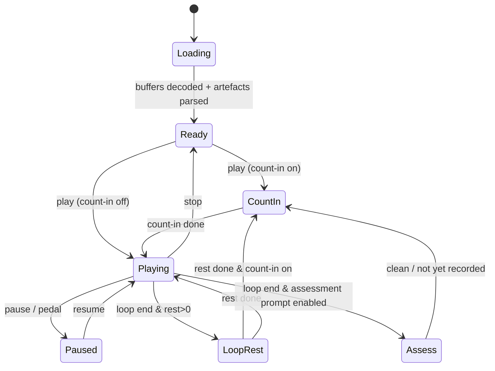

# Practice screen and notation rendering

The screen where learning happens: synchronised tab/chords, bar-snapped loops, mixer, speed, count-in, confidence-aware editing, level toggle and hands-busy controls. Implements M4 (UI), M5–M11, M14, M15 and the P0 patterns in `research/ux/practice-tool-patterns.md`. Audio internals are in `11-audio-engine.md`; algorithms in `07-music-algorithms.md`.

## TL;DR
- **One master clock (audio time) drives everything;** alphaTab (`@coderline/alphatab` 1.8.x) runs with `PlayerMode.EnabledExternalMedia` and an `IExternalMediaHandler` implementation, and only *follows* the time we push with `updatePosition(ms)`. The display never owns the clock.
- **Renderer-agnostic view model:** effective artefacts (`applyCorrections`) → `music-core` tab/level → alphaTex → alphaTab. The chord strip, waveform timeline and (v1) piano roll are custom components reading the same view model.
- **Confidence is encoded by ink value + dashed outline + "?" glyph plus a legend — never colour alone and never below 4.5:1** (WCAG 1.4.1, 1.4.3; `26-design-system.md` §5). Low global confidence → chords-only with a banner (`summary.recommended_view`).
- **Tablet-on-a-stand is the primary layout;** primary controls ≥64 CSS px in practice mode, transport at the bottom edge on touch devices (`27-screens-flows-and-content.md` §3.7); every action reachable by keyboard and Bluetooth page-turner pedals with a "learn this pedal" remap.
- **Loops are created by tapping bars** (single-pointer, WCAG 2.5.7), with numeric fields as a third method; drag handles are secondary.

## 1. Layouts
| Device / orientation | Layout | Notes |
|---|---|---|
| Tablet landscape (primary) | Top: slim status bar (song, loop status, display settings); chord strip; centre: tab (2–3 systems, page-flip by bar group by default); right: collapsible mixer drawer; above the transport: waveform timeline with sections and loop clips; **bottom: transport + speed + pass controls** (closest to the hands at a stand; safe-area aware) | Designed for 0.5–1 m reading distance (`research/ux/hands-busy-and-device-context.md`); regions and sizes in `27-screens-flows-and-content.md` §3.7 |
| Tablet portrait | Embed (if any) on top, notation below, controls in a bottom bar | Embed ≥200×200 px, no overlays |
| Phone landscape | 1–2 bars visible, large now-line, horizontal scroll; chord strip enlarged; controls in a single bottom row | Phone shows only 1–2 legible bars at distance |
| Phone portrait | Glance view by default (current/next chord, bar.beat, loop, speed) + big transport; tab on demand | `26-design-system.md` §6.3 |
| Desktop | Import/edit surface: wider systems, editor side panel, keyboard shortcuts overlay | Editing corrections is easiest here |

Practice mode hides navigation chrome and enables Screen Wake Lock (`11-audio-engine.md`).

## 2. Component tree (web)
```
PracticeRoute
├─ PracticeProvider (XState actor: player state machine; see §6)
├─ TransportBar        play/pause · speed (50–100% fine steps, % and BPM) · count-in toggle · metronome · loop toggle
├─ VideoPane?          personal mode: local downloaded video, muted, slaved to the master clock (overlay allowed); fallback: IFrame embed + syncpoints (13-import-onboarding-and-youtube-embed.md)
├─ ChordStrip          beat-synchronous chord chips, confidence style, tap → editor
├─ NotationView        alphaTab host (tab / standard / drum tab), cursor, bar tap handlers, confidence styling
├─ Timeline            stem waveform, sections, bar ruler, loop clips, tap-to-seek (bar-snapped), +/- zoom buttons
├─ MixerDrawer         per stem: mute / solo / volume, presets "Your part loud", "Minus-one", "Original"; rough-stem warning
├─ LevelToggle         M11 levels per instrument
├─ EditorSheet         note/chord editor, "play this bar from the original", alternatives, report wrong
├─ PassCounter         "Felt clean / Not yet", clean-pass streak, best clean tempo for this clip
└─ InputMapper         keyboard + pedal bindings, "learn this pedal"
```

## 3. Notation rendering with alphaTab
- **Load path:** `tab.{instrument}` + `chords` + meta → `music-core/export/alphatex.ts` → `api.tex(alphaTex)` (or build the score model directly if alphaTex lacks a needed feature). Re-render only the changed bars where the API allows; otherwise debounce full re-render ≤150 ms after an edit.
- **Player mode:** alphaTab's built-in synth is **disabled**. Set `player.playerMode = PlayerMode.EnabledExternalMedia` (available since 1.6.0) and implement `IExternalMediaHandler` (`seekTo`, `play`, `pause`, `playbackRate`, `backingTrackDuration`) as thin calls into our audio engine; push our master clock with `updatePosition(ms)` from a `requestAnimationFrame` loop (alphaTab's guide suggests ~50 ms; we push every frame for a smooth cursor and let alphaTab interpolate). Tick ↔ time mapping comes from alphaTab **sync points** generated from our beat grid (one per downbeat), so the cursor follows rubato and drifting live takes. When the speed changes, call the handler's rate path so alphaTab's internal interpolation matches ([alphaTab audio/video sync guide](https://alphatab.net/docs/guides/audio-video-sync)).
- **Wrapper:** alphaTab has no official React wrapper (it is an SDK); `packages/notation` provides a thin `<AlphaTabView>` that owns one `AlphaTabApi` instance, exposes imperative methods via ref, and never re-creates the API on React re-renders.
- **Workers:** alphaTab renders in a Web Worker on all platforms since 1.8.2; fonts (Bravura, SIL OFL) self-hosted.
- **Cursor & interaction:** beat cursor, bar highlight, click-to-seek (bar-snapped), range selection → loop.
- **Confidence styling** (`26-design-system.md` §5): high = `--ink`; medium = `--conf-medium` ink + dashed outline; low = `--conf-low` ink + dashed outline + "?" glyph; quantize-residual-flagged = dotted underline. Ink is set per note with alphaTab's `NoteStyle` (`NoteSubElement.GuitarTabFretNumber`, noteheads); outlines and glyphs are drawn in an overlay layer positioned from `boundsLookup` (`core.includeNoteBounds = true`), because alphaTab documents that CSS styling of its rendered output isn't reliable. All levels stay ≥4.5:1 (the earlier 60%/40% opacity rule dropped low-confidence digits below 3:1). Legend chip "Auto-transcribed — may contain errors (v{model})" always visible, with a toggle to hide outlines and glyphs.
- **Fonts and colours:** `display.resources.tablatureFont`, `barNumberFont`, `fretboardNumberFont` use the active reading family (Inter or Atkinson Hyperlegible Next) at the distance-preset size; staff/bar/glyph colours come from tokens via `readToken()` and are re-applied when the appearance changes.
- **Display modes:** page-flip by bar group (default for reduced motion and notation) with ≥1 bar look-ahead; continuous horizontal scroll with fixed now-line (default for tab) with a pause control.
- **Left-handed:** mirror chord diagrams/fretboard (not tab text) when `users.handedness='left'`.
- **Licence:** alphaTab is MPL-2.0 — keep it unmodified or upstream patches; record in the register (`09-…`).

## 4. Chord strip, editing and corrections (M8, M10)
- Chips aligned to beats; current chip enlarged (`--read-chord-current`); medium/low confidence → dashed border, low adds a "?" glyph; tap → `EditorSheet` with top-k alternatives, free entry (Harte-validated), split chord at beat.
- Note editor: string/fret (or pitch), duration, delete/add; "hear original" plays the bar from the mixture or stem at current speed.
- Every edit = `CorrectionOp` with `client_op_id`, applied optimistically, persisted via `POST /artefacts/{id}/corrections`; undo/redo stack per session.
- "Report wrong" = `report_wrong` op; doesn't change the display, feeds the correction-rate metric.
- **Global fallback:** if `recommended_view = chords_only`, open in chords + audio with a banner: "We're not confident in the note-level tab for this song — showing chords. [Show tab anyway]".

## 5. Loops and practice loop (M6, M7)
- **Create:** tap bar A, tap bar B → loop spans both bars (pickup-aware snapping, `07-music-algorithms.md` §1); tapping one bar extends to the enclosing phrase when sections/phrases are known; numeric "bars 17–20" fields; long-press-drag as secondary.
- **Options:** rest between repeats (none / 1 beat / 1 bar), count-in bars (default 1 on loop restart), "play loop once", nudge boundaries by 1/16.
- **Saved clips:** named, listed under the song and on the timeline (`loop_clips`).
- **Pass counter:** after each pass the "Felt clean / Not yet" control appears (pedal-mappable); clean-pass streak; `best_clean_tempo_pct` updates → this is the progress metric (tempo reached at clean pass), not minutes.
- **Count-in/metronome** follow the detected beat grid; "metronome is off the beat" → one-tap fixes: half/double tempo, shift downbeat (`tempo_octave`, `shift_downbeat` ops).

## 6. Player state machine (XState v5)

Context: speed, playback key, loop (start/end s), mix, view, level. Side effects (scheduling audio) live in the audio engine; the machine only sends commands, keeping UI logic testable without audio.

## 7. Mixer (M4)
- One row per non-empty stem: M / S / volume (dB, −∞…+6); `gain_to_unity_db` applied so soloed stems feel equally loud.
- Presets: **Minus-one** (mute my instrument → plays `mix_minus_*` when available, else mutes the isolated stem), **Your part loud** (+6 dB my stem, others −6 dB), **Original** (all stems at unity); default on first open = my part + backing at −6 dB. Preset names follow the terminology in `27-screens-flows-and-content.md` §5.2.
- Rough stems show a warning icon and tooltip text, never just colour.
- Changes are instant (gains on the pre-stretch submix bus; `11-audio-engine.md`).

## 8. Hands-busy input (M15)
| Action | Default keys (pedals send these) | Notes |
|---|---|---|
| Play/pause | Space, Enter | |
| Restart loop / previous bar | ArrowLeft, PageUp | |
| Next bar / loop next phrase | ArrowRight, PageDown | |
| Slower / faster (5%) | ArrowDown / ArrowUp | |
| Felt clean / Not yet | `C` / `N` (and remappable to pedal pair) | |
| Toggle loop | `L` | |
| Mute my part | `M` | |
- "Learn this pedal": listen for the next keydown and bind it; store per device in local storage + profile.
- Focus management: practice route keeps a focus sink so pedal keys never scroll the page; test on iPadOS Safari (QX2).
- Touch targets ≥64 CSS px for primary practice controls, 48 for secondary, ≥44 elsewhere (WCAG 2.5.8 AA 24×24 CSS px floor); every key/pedal action shows a `PedalHud` confirmation (`26-design-system.md` §8, §12.2).

## 9. Accessibility checklist (practice screen)
WCAG 2.2 AA (plus the design QA checklist in `28-ui-quality-and-design-review.md` §5): contrast 4.5:1 text / 3:1 UI and graphics; non-colour cues for confidence, current bar, stems, hands; Okabe-Ito palette for categorical colours; reduced motion (page-flip, no flashing, pause on scroll); text resize to 200% without loss; screen-reader labels on all controls; a text alternative for notation ("Bar 12: G chord, strum down on 1 and 3; bass notes G2, B2") generated from the view model; visual metronome flash ≤3/s.

## 10. Performance budgets (proposals; verified in `18-testing-strategy.md`)
- Cursor/now-line jitter ≤1 frame at 60 fps on a mid-range tablet.
- Re-render after an edit ≤150 ms; capo/level change (Worker recompute + render) ≤300 ms.
- Practice route JS ≤300 KB gz excluding alphaTab and WASM; alphaTab and Signalsmith loaded lazily on the practice route.

## Implementation notes (step 12, 2026-10-22)
- `packages/notation`: `.` = light exports (ChordDiagram, types); `./view` = `AlphaTabView` (alphaTab in its worker, `PlayerMode.EnabledExternalMedia`). The external-media handler's `play/pause/seekTo` are **no-ops**: alphaTab calls them on every score reload, which paused playback; the audio engine is the only transport. `output.updatePosition(ms)` runs per frame from the engine clock; sync points come from the beat grid (one per bar). The cursor and current-bar wash are our own layers (underlay z-0: bar wash then loop shading; alphaTab z-10; confidence marks z-20; bar/note buttons z-30) positioned from `boundsLookup`, so they never wait for a re-render.
- Confidence: `NoteStyle` colours (`ink` / `conf-medium` / `conf-low`) plus dashed outlines and a "?" glyph from the overlay (never colour alone); "Show uncertainty" off keeps the ink and drops the outlines/glyphs.
- MVP mixer is **two stems** (isolated part + `mix_minus_<part>`): presets part-loud (+6/−6 dB), minus-one, original; default part 0 dB / backing −6 dB. Per-instrument faders wait for multi-stem output.
- Player: XState machine (`loading → ready → countIn → playing ↔ paused`, `loopRest`, `assess`, `audition`); state persisted with a debounced `PATCH /v1/songs/{id}` (`player_state`).
- Capo/transpose redraw measured 15–66 ms (Chromium 20, WebKit 15–18, Firefox in Docker 51–66) against the 300 ms target.
- Cursor vs audio clock (p95 / worst, audio ms; one frame at 0.7× = 11.67 ms): Chromium 0.54–0.68 / 0.72–0.88, WebKit 0.50–1.10 / 0.90–2.80 — asserted ≤ 1 frame. Firefox (Linux container, software rendering) 11.7–11.8 / 12.3–18.2 — reported, not asserted.
- alphaTab always draws "rendered by alphaTab" under the score (no setting); left as is.
- Not built: profile sync of learned pedal keys (localStorage only), YouTube embed fallback (see doc 13).

## Implementation notes (step 18b, 2026-10-24)
- Guitar and bass Notes read the clock like the tab: note times are the tab's quantized positions on the beat grid (`tickOfPosition` → `tickToTime`), so the lanes, the neck and the tab cursor agree. The lanes' canvas and the neck's state each read `audio.position()` once per frame.
- **Loop seam:** inside a loop the lanes draw past the loop's end into its next pass (each pass clipped at the end), and the neck takes the loop start's window in the loop's last half second, so the wrap neither blanks nor moves anything. A clock jump over 0.25 s between frames counts as a seek: the neck re-frames at once.
- Notes load through the chord-sheet chunk (12 §10, 7.96 KB gzip); route JS 310,392 B of the 310 KB budget (317,440 B; raised by the owner on 2026-10-24), +335 B over `dev` built in the same checkout path (build output varies by path, so only same-path builds compare).


## Implementation notes (step 18c, 2026-10-24)
- Vocals' notes load with the summary (they have no tab), go through corrections in the Worker (`buildMelody`, music-core) and keep their sung timing: no quantization, since phrasing off the beat is what a singer copies. The Worker also returns the phrases, the range and the key's scale.
- The roll and the strip each read `audio.position()` once per frame; the strip's state changes only when the phrase, the next phrase or the beat count does. Inside a loop the roll draws the next pass past the loop's end (`rollStretches`, shared with the guitar lanes), and the past to the left of the now line as it was.
- The melody and the phrase strip load through the chord-sheet and chord-strip chunks (12 §10).

## Open questions
- Page-flip vs scroll default for tab at different tempos (QX13) — A/B in beta.
- Legibility at 1–2 m on phones (QX3) — test notation scale presets.
- Whether one sync point per downbeat is precise enough for live takes with strong drift, or per-beat sync points are needed (measure cursor error on the owned live-take set).

## Sources
Cross-linked: `research/ux/practice-tool-patterns.md` (Patterns 1–7, feature table), `research/ux/music-display-ui.md` (alphaTab, confidence UI, scrolling modes, left-handed), `research/ux/hands-busy-and-device-context.md` (targets, pedals, distance), `research/ux/accessibility.md` (WCAG 2.2 AA, Okabe-Ito), `research/product/recommendations-and-decisions.md` D13, `05-analysis-schema.md`, `07-music-algorithms.md`.
