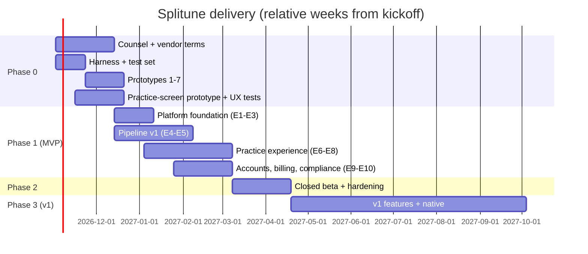

# Delivery plan

The end-to-end sequence from an empty repo to v1, tying every roadmap feature (M1–M17, V1–V14 in `research/product/feature-roadmap-beginner-to-intermediate.md`) to an epic, an implementation doc and an exit gate. Durations assume a small team (proposal: 2 full-stack/client engineers, 1 ML engineer, 1 designer, part-time PM/founder, external counsel); scale linearly with headcount at your own risk.

> **Personal mode is current (`25-personal-mode.md`).** Adjustments to this plan for a solo, low-budget (Railway Hobby + own Mac), copyright-agnostic project:
> - **Dropped tracks:** Legal/counsel, vendor trials and terms, licence sign-offs, DMCA, fake-door pricing, hosted infrastructure. Gates G0–G2 no longer have counsel or cost inputs.
> - **Phase 0** becomes: harness + test set from your own library and public datasets → P1 among open separation models → P3 fret DP → P2/P6/P7 → P4 on your Mac → (P5 later). Practice-screen prototype tested on yourself and a few friends.
> - **E3 adds URL import** (`13` §6a); **E4/E5** use self-hosted models and the Postgres job queue; **E9** uses `MockBillingProvider`; **E10** keeps only deletion cascade, sweeper and export/delete.
> - **E1** provisions the Railway project `splitune` (already created, empty): add Postgres and the `app` service when code exists; set a workspace usage alert. Storage is the R2 bucket `splitune-media` (`25` §6), created by the owner.
> - **Phase 2 "beta"** = you plus friends using the Railway HTTPS domain; SLOs become personal targets; no launch gate.
> - **Phase 3**: drums use ADTOF (no training project); sections/piano need no sign-off; native = PWA (+ optional free sideload builds), no store submission.
> - **Durations** assume one developer: roughly double the multi-person estimates below, or cut scope (e.g., MVP = guitar + bass only, no embed fallback).

## TL;DR
- **Phase 0 (weeks 0–6): de-risk.** Counsel on the four launch-gating questions, vendor terms, Prototypes 1–7, in-house test set, web practice-screen prototype tested with 8–10 P1 and P3 learners, fake-door pricing. Nothing production-grade is built except the harness, the repo skeleton and the contracts.
- **Phase 1 (weeks 6–18): MVP build** — M1–M17 for guitar and bass, web only, behind an invite list.
- **Phase 2 (weeks 18–24): closed beta → public launch** — measurement plan live, reliability and cost hardening, DMCA operations rehearsed, counsel sign-offs recorded.
- **Phase 3 (weeks 24–48): v1** — speed trainer, transpose/capo, sections, piano, drums, constrained mic scoring, offline, export, native iOS then Android.
- **Every phase ends with a go/no-go gate** whose inputs are named below. Gates can move features between tiers (e.g., P1 failure moves guitar tab behind chords).

Dates are illustrative (kickoff 2026-11-02); the plan is expressed in weeks.

## Phase 0 — de-risk (weeks 0–6)

| Track | Work | Owner | Doc | Exit criterion |
|---|---|---|---|---|
| Legal | Engage US copyright/platform counsel on QL1 (embed paywall vs III.F.3.a), QL2 (fair use of paid per-user processing), QL3 (§ 512(c) scope), QL4 (amber weights); start QL6 privacy review | Founder | `15-privacy-dmca-and-data-lifecycle.md` | Written guidance or dated plan |
| Vendors | Trials with AudioShake, Music.AI, LALAL.AI (human creates accounts); request terms: retention, training on uploads, per-user caching, deletion SLA, volume price, billing unit | Founder + ML | `00-tech-stack.md` | Terms in writing |
| ML infra | Harness, codec simulator, scoring CLI, listening app | ML | `08-evaluation-harness-and-prototypes.md` | Harness scores 10 clips |
| Data | Record owned multitrack set + 3–5 example songs (work-for-hire, rights assigned) | PM | `08-…` §2 | Sessions done, annotations started |
| ML | P1 + P3 (weeks 1–2.5); P2, P4, P6, P7 (weeks 2–4); P5 (weeks 4–6) | ML | `08-…` §3 | Gate results recorded, D2–D12 updated |
| Eng | Repo skeleton, CI, contracts package, licence register v0 in CI | Eng | `02-repo-tooling-and-ci.md`, `05-analysis-schema.md`, `09-licence-register-and-release-gates.md` | `dev` green with compliance gate |
| Product/design | Clickable web practice-screen prototype on the example song (real audio engine spike: decode, 4 stems, Signalsmith, loop); 8–10 interviews each with P1 and P3; fake-door pricing page; file-step drop-off measurement | Design + PM | `12-practice-screen-and-notation.md`, `16-…` | Go/no-go on D1 file step, D10 band, D11 instruments |

**Gate G0 (end of week 6) — "build the MVP?"** Inputs: P1/P2/P3/P4/P7 results, counsel guidance on QL1–QL4, vendor terms, interview synthesis, fake-door conversion. Outcomes: confirm or re-scope MVP stem menu (D2/D11), notation set (guitar tab vs chords-first), embed in MVP or v1 (M12), price hypothesis (D10), platform (D9 web-first stays unless P7/P5 show mobile-browser failure).

## Phase 1 — MVP build (weeks 6–18)

| Epic | Scope (roadmap ids) | Key stories (abridged) | Doc | Done when |
|---|---|---|---|---|
| E1 Platform foundation | — | Design system + UI kit + Storybook (prompt 10a, `26`, `28`); monorepo, envs (dev/staging/prod), Postgres + migrations, object storage buckets + lifecycle rules, auth, API skeleton, observability baseline, feature flags | `01`, `02`, `03`, `04`, `16`, `17`, `19` | A signed-in user can hit an authenticated endpoint in staging; traces visible |
| E2 Contracts & music-core | M8–M11 foundations | Zod contracts + Pydantic codegen; `applyCorrections`, beat grid, quantize, fret DP, level simplify, alphaTex export; golden fixtures from the example song | `05`, `07` | P3 gate still passes in CI; fixtures validate in TS + Python |
| E3 Upload & ingest | M1 | Client decode + PCM hash, resumable multipart upload to per-user prefix, server ffprobe validation, upload warranty checkbox, record-yourself (MediaRecorder) | `13`, `04`, `17` | 200 MB video uploads resumably on flaky network; unsupported files fail with plain-language reasons |
| E4 Analysis pipeline v1 | M3, M4 (server), M7 grid, M8, M9 | Orchestrated job: decode → Beat This! → tagger → vendor separation (one stem + mix-minus) → chords → Basic Pitch → finalize (music-core) → summary; progress events; partial failure; idempotent cache key; cost metering per job | `06`, `01` | P4-style gates on staging: beat grid ≤10 s, full ≤90 s p50 warm; failure rate ≤2% on the test set |
| E5 Provider interfaces & fallbacks | D2 | `separate()` with vendor A + vendor B + Spleeter fallback; vendor webhook/polling; re-alignment; loudness normalisation; Opus/AAC encoding | `06` | Kill-switch flips vendor in config without deploy |
| E6 Audio engine | M2, M5, M6 (audio), M7 | AudioWorklet graph: stem players, mixer, Signalsmith node, master clock, sample-accurate loop, count-in/metronome, latency compensation, Media Session, wake lock | `11` | Loop seam inaudible; 0.5–1.0× in 5% steps; CPU budget met on target devices |
| E7 Practice screen | M4 (UI), M6, M8, M9, M10, M11, M14, M15 | Layouts (tablet-on-stand first, phone, desktop), alphaTab tab + chord strip with confidence styles, editing + report wrong, level toggle, mixer drawer and presets, bar-tap loops + saved clips + pass counter, pedal/keyboard mapping, reduced motion; Light/Dark/Stage, reading sizes by distance | `12`, `26`, `27` | Usability round passes (P1/P3 can loop a phrase at 70% in <5 min unaided) |
| E8 Import, onboarding, library | M2, M12 (if counsel OK), M13, M14 | First-session flow with example song; instant local playback while job runs; progressive reveal; library with resume; YouTube embed + syncpoints (flagged) | `13`, `27` | Time-to-first-loop p50 ≤5 min in moderated tests |
| E9 Accounts & billing | M16 | Free/Plus split per `23` (Welcome analysis, Lite and Full allowances), checkout, customer portal, renewal reminders, one-tap cancel, entitlement checks in API and job admission, `lite` pipeline profile | `14`, `23` | Test-mode purchase → allowances enforced → cancel in one tap; free practice never blocked |
| E10 Privacy, DMCA & data lifecycle | M17 | Delete-song cascade, account deletion, raw-upload expiry job, takedown intake + processing, repeat-infringer strikes, ToS/Privacy pages, YouTube data 30-day refresh, training opt-in default off | `15` | Takedown drill deletes upload + all derivatives within SLA; audit log complete |

**Gate G1 (week 18) — "open the beta?"** Personal mode: inputs are only the E1–E10 done criteria, the accessibility audit and a self security review; the counsel and cost items below are dormant. Commercial inputs: all E1–E10 done criteria, security review (`17-security.md`), accessibility audit against WCAG 2.2 AA on the practice screen, counsel sign-off on amber models used in MVP (Basic Pitch, chord model, tagger) and on ToS/DMCA, cost per song on staging ≤ $0.28 (D10 break-even).

## Phase 2 — closed beta → public launch (weeks 18–24)
| Work | Doc | Exit |
|---|---|---|
| Invite 100–300 P1/P3 learners; measurement plan live (time-to-first-isolated-playback, time-to-first-loop, loop completions, correction rate, fallback rate, file-step drop-off, cost per song, week-4 retention) | `16` | Dashboards populated for 3 weekly cohorts |
| Reliability: SLOs, alerts, runbooks (vendor outage, GPU backlog, storage errors), load test 10× expected peak | `19` | Error budget respected 2 weeks running |
| Cost hardening: per-job cost ledger, vendor spend alerts, caps tuned | `14`, `16` | Cost per paying user within D10 margin |
| Calibrate confidence and `recommended_view` thresholds on beta corrections (opt-in data only) | `05`, `06` | Fallback rates within proposed targets or targets revised with evidence |
| DMCA agent registered and published; takedown drill; privacy policy live | `15` | Counsel confirms launch readiness |
| Pricing: switch from fake door to real checkout at the chosen price | `14` | Billing complaints = 0 in beta |

**Gate G2 (week 24) — "public launch?"** Not applicable in personal mode (no public launch). Commercial inputs: retention baseline, cost per user, SLOs, counsel's launch memo, zero open P0 security findings.

## Phase 3 — v1 (weeks 24–48)
Order is driven by evidence strength and dependencies; see `21-v1-features.md` for implementation notes and `22-native-apps.md` for native.

| Order | Feature (roadmap id) | Depends on | Gate to start |
|---|---|---|---|
| 1 | Speed trainer manual (V1), visual/haptic metronome (V9) | E6 | — |
| 2 | Transpose + capo suggestions (V2), alternative fingerings + tuning input (V12) | music-core, Signalsmith pitch | — |
| 3 | Sections (V3) | allin1 sign-off (amber) | Counsel sign-off |
| 4 | Record-and-compare (V8) | mic capture | — |
| 5 | Piano notes + roll + hand split (V4), piano wait mode via MIDI (V5), level adaptation (V13) | Transkun sign-off; P2 piano result | Counsel + P2 piano pass |
| 6 | Drums: in-house 5-class CRNN + drum grid (V6) | training on E-GMD/GMD/Slakh + owned test set | Model passes owned-set gate |
| 7 | Constrained mic scoring + tuner (V7) | P5 pass; 50-learner × 3-phone study | P5 + QX1 |
| 8 | Offline practice (V10), export (V11) | counsel on retention and portable copies | Counsel |
| 9 | Native iOS, then Android (V14) | D9 triggers | Mic latency/offline/store discovery justify it |

**Gate G3 (per feature):** each v1 feature ships behind a flag to 10% → 50% → 100% with its own success metric (e.g., V7 override rate <5%).

## Cross-cutting definition of done (every story)
- Tests per `18-testing-strategy.md` (unit + integration; audio/ML goldens where relevant) pass in CI.
- Licence gate passes; no new red/amber dependency without a register PR.
- Accessibility: keyboard/pedal operable, WCAG 2.2 AA contrast, non-colour cues, reduced-motion behaviour.
- Design: built from the design system (`26-design-system.md`), screens/states/copy per `27-screens-flows-and-content.md`, stories for new states, design QA checklist passed (`28-ui-quality-and-design-review.md` §5).
- Browser compatibility: works in all Tier 1 browsers with the documented fallbacks (`24-browser-compatibility.md`); Playwright Chromium/Firefox/WebKit green.
- Plan placement: if the story adds a user-facing capability, its Free/Plus placement follows `23-plans-free-and-paid.md` (update the matrix in the same PR).
- Analytics events from the taxonomy (`16-…`) emitted and verified in staging.
- Per-user scoping verified by an authorization test (no cross-user read of any artefact).
- Docs updated: the relevant implementation doc and, when a decision moved, the D# entry.

## Staffing assumptions and critical path
- **Critical path:** counsel guidance (QL1–QL4) → vendor contract (terms allow per-user retention) → E4/E5 → G1. Start counsel and vendor conversations on day 1.
- **Parallelisable from week 6:** E2/E6/E7 (client) vs E4/E5 (pipeline) vs E9/E10 (accounts/compliance), coupled only through `packages/contracts` and the API contract (`04-api-contract.md`).
- **Single points of failure:** one ML engineer owns E4/E5 and Phase 0 prototypes; add a second ML/infra engineer before Phase 3 drums/piano.

## Open questions
- Team size and hiring timeline (not researched).
- Whether to launch US-only first (counsel is US; EU/UK need separate review, QL9).
- Whether licensed catalog conversations (Design C/D) should start in Phase 2 to hedge R3 (learners without files).

## Sources
Cross-linked: `research/product/feature-roadmap-beginner-to-intermediate.md`, `research/product/recommendations-and-decisions.md`, `research/executive-summary.md` (4–6 week plan), `research/open-questions-and-risks.md` (P0 items, risk register), `research/ml/pipeline-overview.md` §4.
