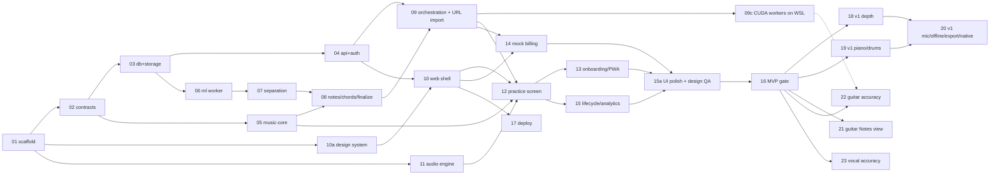

# Implementation steps

One prompt per step, each run by a **fresh agent session** in the repo root. Every prompt sends the agent to `00-shared-context.md` first, then to the specs it needs, and ends with acceptance criteria and the verification to run and report. What is done: `docs/status.md`. How the numbering works: `docs/README.md`.

## How to run a step
Start a new Claude Code session in the repo root and send:

```
Read docs/steps/sNN-<name>.md and carry out that step end to end.
```

The agent works on a branch `impl/NN-<name>` from the current `dev` (the integration branch; there is no `main`). When it finishes, read its summary and its entry at the end of `docs/progress-log.md`, review the branch, merge it into `dev` yourself, and update `docs/status.md`.

## Order and dependencies
| Step | Prompt | Depends on (steps) | Can run in parallel with |
|---|---|---|---|
| s01 | `s01-repo-scaffold.md` — monorepo, tooling, local services, CI, CLAUDE.md | — | — |
| s02 | `s02-contracts.md` — Zod schemas, JSON Schema, Pydantic codegen, fixtures | 01 | 11 |
| s03 | `s03-database-and-storage.md` — Drizzle schema, RLS, job queue, S3 adapter | 01, 02 | 05, 11 |
| s04 | `s04-api-and-auth.md` — Hono + oRPC, Better Auth, songs/uploads | 01–03 | 05, 06, 11 |
| s05 | `s05-music-core.md` — quantize, fret DP (P3), corrections, alphaTex | 02 | 03, 04, 06, 11 |
| s06 | `s06-ml-worker-and-harness.md` — Python worker, decode + beats, eval harness | 01–03 | 04, 05, 11 |
| s07 | `s07-separation.md` — open-model separation, stem post, P1 listening test | 06 | 10, 11 |
| s08 | `s08-notes-chords-finalize.md` — Basic Pitch/chords, Node finalize, P2/P6 | 05, 06, 07 | 10, 11 |
| s09 | `s09-orchestration-and-url-import.md` — job graph, SSE, URL import (yt-dlp) | 04, 06–08 | 10 (with mocks), 11 |
| s09c | `s09c-cuda-worker-wsl.md` — ML + Node workers on a Windows PC via WSL2 with CUDA: device module, `gpu` slot, `Separation.device` gains `cuda`, uv CUDA extra, systemd + Task Scheduler (**owner sets up the PC**) | 09 | 10a, 11 |
| s10a | `s10a-design-system-and-ui-kit.md` — "Music Stand" tokens, fonts, icons, shadcn/Base UI kit, Storybook + a11y tests (**runs before 10**) | 01 | 02–09, 11 |
| s10 | `s10-web-shell-import-library.md` — web app, marketing + auth UI, import, library, progress, system pages, display prefs + settings shell, copy catalogue | 04, 10a, (09) | 07–09, 11 |
| s11 | `s11-audio-engine.md` — AudioWorklet + Signalsmith WASM, clock, loops | 01 | 02–10 |
| s12 | `s12-practice-screen.md` — alphaTab sync, confidence overlay, loops, mixer, editing + `/edit` route, pedals, progressive layouts, video | 05, 09, 10, 11 | — |
| s13 | `s13-onboarding-examples-pwa.md` — first session, example songs, PWA | 09, 12 | 14, 15 |
| s14 | `s14-mock-billing-and-plans.md` — Free/Plus, allowances, mock checkout | 09, 10 | 13, 15 |
| s15 | `s15-lifecycle-analytics-observability.md` — sweepers, export/delete, events, dashboards | 09, 10, 12 | 13, 14 |
| s15a | `s15a-ui-polish-and-design-qa.md` — screen audit vs docs 26–27, copy pass, visual regression, usability round (**runs before 16**) | 10a, 10–15 | — |
| s16 | `s16-compat-a11y-hardening.md` — browser matrix, a11y, security pass (**MVP gate**) | 10–15, 15a | — |
| s17 | `s17-deploy-railway-and-mac.md` — Railway app/Postgres + R2 wiring (app token, CORS) + Mac workers (**asks before spending**) | 10 (owner's choice, 2026-10-21; full smoke test again after 16) | 11–16 |
| s18 | `s18-v1-practice-depth.md` — speed trainer, transpose/capo, fingerings, sections, record-and-compare, metronome | 16 | 19, 22 |
| s19 | `s19-v1-piano-and-drums.md` — finish piano (solo-piano path, Aria-AMT, electric-piano gate, wait mode, levels), ADTOF drums + drum grid | 16, piano work on `dev` | 18, 22 |
| s20 | `s20-v1-mic-offline-export-native.md` — P5, tuner, mic scoring, offline, export, lyrics, sideload | 16 (18 recommended; 19 for drum/piano export) | 22 |
| s21 | `s21-guitar-notes-view.md` — guitar/bass Notes view: string highway onto a live fretboard; mockups first, owner picks (**stops for the owner's choice**) | 16, piano work on `dev` | 19, 20, 22 (not 18: both change the practice screen) |
| s22 | `s22-guitar-accuracy.md` — real-song test set, then separation (incl. two-guitar parts), transcription (tuning offset, bends), clean-up, tuning detection, quantization and fret assignment measured and improved (**asks the owner for songs/tabs, time budget and default changes**) | 16 (09c helps for training) | 18–21 (22 detects the tuning; 18 owns the tuning picker) |
| s23 | `s23-vocal-accuracy.md` — vocal test set, f0 curve (RMVPE/SwiftF0…), monophonic calibrated notes, curve in the Melody view (**stops for the owner's OK on plan and time budget**) | 16, 18c on `dev` | 18, 19, 22 (not 21: both change the practice screen) |



Running steps in parallel: give each agent its own git worktree so two agents never edit the same checkout. `docs/` is tracked, so a worktree has its own copy; each agent commits its doc changes on its own branch.

```bash
git worktree add ../splitune-s11 -b impl/11-audio-engine dev
```

## Ground rules baked into every prompt
- The current mode is **personal** (`docs/specs/25-personal-mode.md`): Railway Hobby for app/Postgres, Cloudflare R2 (free tier) for storage, ML on the owner's Mac or Windows PC, mock payments, copyright out of scope.
- Agents must **ask before creating any billable Railway or Cloudflare resource** and never collect card data.
- Agents verify their work (tests, builds, measurements), report exact commands and results, and never claim unverified success.
- Agents commit on their own branch from `dev` (doc and step changes included), don't push or merge, append an entry to `docs/progress-log.md` and update `docs/status.md`.
- The practice route's JS budget is nearly used up: new practice UI loads on demand and reports before/after bytes.
- The owner doesn't play an instrument: no step may depend on owner-played recordings.

Letter suffixes slot a step between existing ones without renumbering: run s10a before s10 and s15a before s16; s09c (the owner's Windows PC as a second worker host) runs after s09. s21–s23 (2026-10-24) are v1 follow-ups: the guitar/bass Notes view, guitar accuracy and vocal accuracy.

Edit `00-shared-context.md` once to change a rule for every step.
