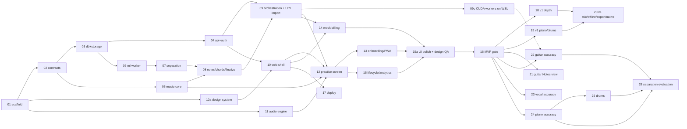
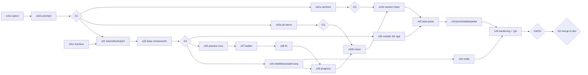

# Implementation steps

One prompt per step, each run by a **fresh agent session** in the repo root. Every prompt sends the agent to `00-shared-context.md` first, then to the specs it needs, and ends with acceptance criteria and the verification to run and report. What is done: `docs/status.md`. How the numbering works: `docs/README.md`.

## How to run a step
Start a new Claude Code session in the repo root and send:

```
Read docs/steps/sNN-<name>.md and carry out that step end to end.
```

The agent works on a branch `impl/NN-<name>` from the current `dev` (the integration branch; there is no `main`). When it finishes, read its summary and its entry at the end of `docs/progress-log.md`, review the branch, merge it into `dev` yourself, and update `docs/status.md`.

## Order and dependencies
| Step | Prompt | Depends on (steps) | Can run in parallel with |
|---|---|---|---|
| s01 | `s01-repo-scaffold.md` — monorepo, tooling, local services, CI, CLAUDE.md | — | — |
| s02 | `s02-contracts.md` — Zod schemas, JSON Schema, Pydantic codegen, fixtures | 01 | 11 |
| s03 | `s03-database-and-storage.md` — Drizzle schema, RLS, job queue, S3 adapter | 01, 02 | 05, 11 |
| s04 | `s04-api-and-auth.md` — Hono + oRPC, Better Auth, songs/uploads | 01–03 | 05, 06, 11 |
| s05 | `s05-music-core.md` — quantize, fret DP (P3), corrections, alphaTex | 02 | 03, 04, 06, 11 |
| s06 | `s06-ml-worker-and-harness.md` — Python worker, decode + beats, eval harness | 01–03 | 04, 05, 11 |
| s07 | `s07-separation.md` — open-model separation, stem post, P1 listening test | 06 | 10, 11 |
| s08 | `s08-notes-chords-finalize.md` — Basic Pitch/chords, Node finalize, P2/P6 | 05, 06, 07 | 10, 11 |
| s09 | `s09-orchestration-and-url-import.md` — job graph, SSE, URL import (yt-dlp) | 04, 06–08 | 10 (with mocks), 11 |
| s09c | `s09c-cuda-worker-wsl.md` — ML + Node workers on a Windows PC via WSL2 with CUDA: device module, `gpu` slot, `Separation.device` gains `cuda`, uv CUDA extra, systemd + Task Scheduler (**owner sets up the PC**) | 09 | 10a, 11 |
| s10a | `s10a-design-system-and-ui-kit.md` — "Music Stand" tokens, fonts, icons, shadcn/Base UI kit, Storybook + a11y tests (**runs before 10**) | 01 | 02–09, 11 |
| s10 | `s10-web-shell-import-library.md` — web app, marketing + auth UI, import, library, progress, system pages, display prefs + settings shell, copy catalogue | 04, 10a, (09) | 07–09, 11 |
| s11 | `s11-audio-engine.md` — AudioWorklet + Signalsmith WASM, clock, loops | 01 | 02–10 |
| s12 | `s12-practice-screen.md` — alphaTab sync, confidence overlay, loops, mixer, editing + `/edit` route, pedals, progressive layouts, video | 05, 09, 10, 11 | — |
| s13 | `s13-onboarding-examples-pwa.md` — first session, example songs, PWA | 09, 12 | 14, 15 |
| s14 | `s14-mock-billing-and-plans.md` — Free/Plus, allowances, mock checkout | 09, 10 | 13, 15 |
| s15 | `s15-lifecycle-analytics-observability.md` — sweepers, export/delete, events, dashboards | 09, 10, 12 | 13, 14 |
| s15a | `s15a-ui-polish-and-design-qa.md` — screen audit vs docs 26–27, copy pass, visual regression, usability round (**runs before 16**) | 10a, 10–15 | — |
| s16 | `s16-compat-a11y-hardening.md` — browser matrix, a11y, security pass (**MVP gate**) | 10–15, 15a | — |
| s17 | `s17-deploy-railway-and-mac.md` — Railway app/Postgres + R2 wiring (app token, CORS) + Mac workers (**asks before spending**) | 10 (owner's choice, 2026-10-21; full smoke test again after 16) | 11–16 |
| s18 | `s18-v1-practice-depth.md` — speed trainer, transpose/capo, fingerings, sections, record-and-compare, metronome | 16 | 19, 22 |
| s19 | `s19-v1-piano-and-drums.md` — finish piano practice (wait mode, levels); drums moved to s25 | 16, piano work on `dev` | 18, 22 |
| s20 | `s20-v1-mic-offline-export-native.md` — P5, tuner, mic scoring, offline, export, lyrics, sideload | 16 (18 recommended; 19 for piano export, 25 for drum export) | 22 |
| s21 | `s21-guitar-notes-view.md` — guitar/bass Notes view: string highway onto a live fretboard; mockups first, owner picks (**stops for the owner's choice**) | 16, piano work on `dev` | 19, 20, 22 (not 18: both change the practice screen) |
| s22 | `s22-guitar-accuracy.md` — real-song test set, then separation (incl. two-guitar parts), transcription (tuning offset, bends), clean-up, tuning detection, quantization and fret assignment measured and improved (**asks the owner for songs/tabs, time budget and default changes**) | 16 (09c helps for training) | 18–21 (22 detects the tuning; 18 owns the tuning picker) |
| s23 | `s23-vocal-accuracy.md` — vocal test set, f0 curve (RMVPE/SwiftF0…), monophonic calibrated notes, curve in the Melody view (**stops for the owner's OK on plan and time budget**) | 16, 18c on `dev` | 18, 19, 22 (not 21: both change the practice screen) |
| s24 | `s24-piano-accuracy.md` — pop-piano test set, then mixture fallback, stereo input, bleed gate, real per-note confidence, solo-piano bypass, separation, Aria-AMT and ensembles, pedal, electric-piano gate, PM2S hands (**stops for the owner's OK on plan and time budget**) | 16, piano work on `dev` | 18, 21, 22, 23 (19 only for wait mode/levels: both touch piano rendering) |
| s25 | `s25-drums.md` — drums end to end: drum test set (P2d), ADTOF and other candidates measured, calibrated `notes.drums`, drum score + core-groove level, drum grid and drum tab, drums gate (**stops for the owner's OK on plan, time budget, any training and the gate**) | 16, 24 on `dev` (its method and harness) | 18, 22, 23 (19 only for piano: both touch the practice notation) |
| s28 | `s28-separation-evaluation.md` — separation measured on real-upload conditions: silent-reference scoring, MSST metrics, unbiased P1 selection, robustness matrix (loud masters, codecs, mono, 48 kHz), loud-master fix, full songs/seams/determinism, regression suite, MoisesDB reader and listening export (**stops for the owner's OK on the plan and on any map, contract or cache-key change**) | 22, 24, 25, 27 on `dev` (P2g/P2p/P2d harnesses) | — |
| s31a | (no prompt file; the row in `redesign/orchestrator/prompt.md` §5) — redesign specs: docs 26, 27, 28 rewritten for Night Rehearsal, 12 and 21 updated, the UI rule in `CLAUDE.md`, `AGENTS.md`, `00-shared-context.md` | — | s31c |
| s31b | (no prompt file; the row in `redesign/orchestrator/prompt.md` §5) — these redesign step prompts s32–s45 and their rows here | s31a | — |
| s31c | (no prompt file; the row in `redesign/orchestrator/prompt.md` §5) — mockup harness: reference renders of `redesign/mockups` and the fidelity probe (`scripts/redesign`) | — | s31a, s31b |
| s32 | `s32-tokens-fonts-perf-baseline.md` — Night Rehearsal + Daylight tokens, Instrument Sans + JetBrains Mono, `BACKGROUND_HEX`/manifest/Storybook, the practice perf baseline (**after G1**; legibility check to the owner) | G1 (s31a, s31b) | s40a, s41a |
| s33 | `s33-base-components.md` — every `app/ui` component restyled with stable props, all states storied; ends at **G2** (owner approves the foundations look) | s32 | s40a, s41a |
| s34 | `s34-shell-library-add-song.md` — app shell, ⌘K palette, Library, Add song dialog/sheet | G2 | s35, s36, backend lane |
| s35 | `s35-practice-core.md` — five-region practice, notation restyle, progressive "Getting ready", new keymap (opens the practice lane) | G2 | s34, s36, backend lane |
| s36 | `s36-marketing-auth-settings-system.md` — home, auth, onboarding, pricing/billing, settings IA, system states | G2 | s34, s35, backend lane |
| s37 | `s37-speed-ladder-loop-tab.md` — speed ladder V1 (`v1.speed_trainer` on), clip rename/delete (contracts) | 35 | s34, s36, backend lane (not another contracts step) |
| s38 | `s38-fix-tab.md` — Fix mode: unsure-spot queue, alternatives in frequencies, audition, desktop editor | 37 | screens and backend lanes |
| s39 | `s39-progress.md` — Progress tab and library strips from `GET /v1/progress` (contracts if needed) | 38, 34 | backend lane (not another contracts step) |
| s40a | `s40a-all-stems-backend.md` — keep every separated stem, cache-key change (**G3**: owner approval, `eval:regression`, listening; plan dep on `impl/29-separation-improvements`, an owner action) | G1 | s32–s39 (not s41a unless their files are split; not another contracts step) |
| s40b | `s40b-multi-stem-mixer.md` — every stem in the mixer, presets, Rough, Click and "Hear the chords", phone mini-mixer | 39, 40a | backend lane |
| s41a | `s41a-sections-backend.md` — `stage_sections` (allin1 in a `legacy` island) + `music-core` novelty fallback, pipeline scheduling (**G3**) | G1 | s32–s40b (not s40a unless their files are split) |
| s41b | `s41b-section-chips.md` — section chips in the song map, loop a section, rename | 40b, 41a | backend lane |
| s42 | `s42-beat-pulse-sound-delay.md` — beat pulse V9 (≤ 3 changes/s), vibrate, tap-along sound delay (−150…+500 ms) | 41b, 36 | backend lane |
| s43 | `s43-phone-tablet-pedal.md` — Stand view (tablet default), phone glance + Tools sheet, phone fit rule, pedal wizard (closes the practice lane) | 42 | backend lane |
| s44 | `s44-notify-when-ready.md` — Web Push end to end, migration `0016` (VAPID keys are an owner action) | 34, G1 | practice lane, s36, s41a (not another contracts/migration step) |
| s45 | `s45-hardening-and-qa.md` — WCAG 2.2 gates, perf gate, full visual matrix after **G4**, Music Stand removal, docs; **G5** human checks, then **G6** final merge | all of s32–s44 | — |



### Redesign steps (s31a–s45, "Night Rehearsal")
The redesign is driven by one orchestrator session (`redesign/orchestrator/prompt.md`), not by hand. Its steps **branch from `impl/redesign`, not `dev`**, each on `impl/<id>-<name>` in its own worktree, and the **orchestrator merges** them into `impl/redesign` one at a time; only the owner's explicit "go" merges `impl/redesign` into `dev` (gate G6). Workers don't edit `docs/status.md`, `docs/progress-log.md` or this file: they put their progress-log entry in their report and the orchestrator records it. Each prompt names its owned globs (from the plan table), hard deps and gates (G1 specs and prompts; G2 foundations look; G3 separation/sections; G4 screen reviews on devices; G5 human-only checks; G6 final merge), and is wrapped in the orchestrator's worker brief (§6), which carries the generic rules.

Lanes (prompt.md §5): s32 → s33 → G2; then the screens lane (s34 and s36 in parallel with s35); the practice lane strictly in order s35 → s37 → s38 → s39 → s40b → s41b → s42 → s43; the backend lane (s40a, s41a, then s44 after s34) fills free slots after G1; s45 last. Never two steps with overlapping owned files at once, and only one in-flight step at a time may change `packages/contracts/**`, generated contracts, `packages/db/src/schema/**` or migrations.



Running steps in parallel: give each agent its own git worktree so two agents never edit the same checkout. `docs/` is tracked, so a worktree has its own copy; each agent commits its doc changes on its own branch.

```bash
git worktree add ../splitune-s11 -b impl/11-audio-engine dev
```

## Ground rules baked into every prompt
- The current mode is **personal** (`docs/specs/25-personal-mode.md`): Railway Hobby for app/Postgres, Cloudflare R2 (free tier) for storage, ML on the owner's Mac or Windows PC, mock payments, copyright out of scope.
- Agents must **ask before creating any billable Railway or Cloudflare resource** and never collect card data.
- Agents verify their work (tests, builds, measurements), report exact commands and results, and never claim unverified success.
- Agents commit on their own branch from `dev` (doc and step changes included), don't push or merge, append an entry to `docs/progress-log.md` and update `docs/status.md`.
- The practice route's JS budget is nearly used up: new practice UI loads on demand and reports before/after bytes.
- The owner doesn't play an instrument: no step may depend on owner-played recordings.

Letter suffixes slot a step between existing ones without renumbering: run s10a before s10 and s15a before s16; s09c (the owner's Windows PC as a second worker host) runs after s09. s21–s24 (2026-10-24) are v1 follow-ups: the guitar/bass Notes view, guitar accuracy, vocal accuracy and piano accuracy. s25 (2026-10-28) takes drums over from s19. s28 (2026-11-06) re-evaluates separation on real-upload conditions. s31a–s45 (2026-11-08) are the "Night Rehearsal" redesign (see "Redesign steps" above).

Edit `00-shared-context.md` once to change a rule for every step.
