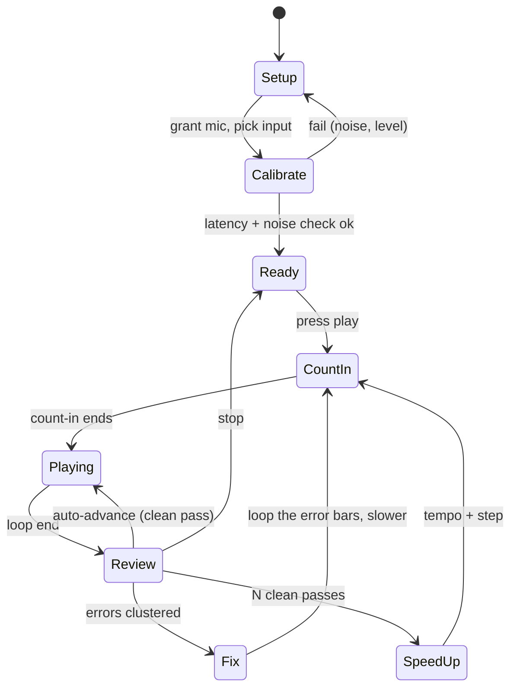

# Practice tool patterns

## TL;DR
- Build the practice screen around a **bounded loop** with a speed trainer, count-in, per-stem mix, and a synchronised display. All of these are shipped by incumbents (Soundslice, Guitar Pro, Moises, flowkey) and map to learning-science principles P1-P5 in `ux/learning-science-principles.md`.
- Microphone "listen and score" is the highest-risk feature. Vendors themselves tell users to tune with the in-app tuner, reduce noise, use headphones, and switch to MIDI/USB when recognition fails. Published transcription benchmarks use clean recordings; I found **no published accuracy figures for phone-mic polyphonic guitar or piano** (labelled gap).
- Latency budget matters: Android's own docs say about 10 ms round trip is what musicians generally need and 20 ms is the platform maximum for the "pro audio" feature. Scoring must have a calibration step and tolerance windows, and must let the learner override a verdict.
- Make destructive ambiguity cheap: every automatic judgement ("wrong note") needs a one-tap "I played it right" and every loop boundary needs a non-drag alternative (WCAG 2.5.7; see `ux/accessibility.md`).
- A prioritised feature-candidate table closes this doc as input to `product/feature-roadmap-beginner-to-intermediate.md`.

## Findings

### Competitor practice-tool baseline (verified from official pages)

| Tool | Loop | Slow-down | Speed trainer | Count-in / metronome | Stems | Transpose / capo | Listen-and-score |
|---|---|---|---|---|---|---|---|
| Soundslice | Drag across music; snaps to notes, rests, barlines; mobile loop icon; "play loop once"; "play with count-in" ([looping](https://www.soundslice.com/help/en/player/basic/4/looping/)) | Slow down without pitch change ([player index](https://www.soundslice.com/help/en/player/)) | Initial, final, step, plays-per-speed, optional count-in each pass ([speed training](https://www.soundslice.com/help/en/player/basic/286/speed-training/)) | Metronome on every beat or downbeats only; count-in 1, 2, or 3 bars, at start only or before each loop ([metronome](https://www.soundslice.com/help/en/player/basic/8/metronome-and-count-in/)) | Per-stem volume; click name to solo, only for slices where uploader supplied stems ([stems](https://www.soundslice.com/help/en/player/advanced/319/multitrack-stems/)) | Transposition listed ([player index](https://www.soundslice.com/help/en/player/)) | Not found on the player index page |
| Guitar Pro 8 | Select bars then Loop toggle | Relative 25-100% presets, customisable 10-300%; fixed BPM ([speed](https://www.guitar-pro.com/docs/gp8/audio/playback/speed)) | "Progressive Speed": start/end 10-300%, repetitions, increment | Metronome, countdown, countdown between loops, visual metronome flash ([tempo and metronome](https://www.guitar-pro.com/docs/gp8/audio/playback/tempo-metronome)) | n/a here | n/a here | None observed |
| Moises | Not mentioned on features page | "Smart Metronome" slows songs without changing pitch, then brings tempo back up | Described as slow then bring back up; not a stepped trainer | Metronome | Solo or mute vocals, drums, bass, other | Pitch/transpose; **Capo Mode** finds capo positions and chord shapes that simplify fingering | None ([features](https://moises.ai/features/)) |
| flowkey | "Select a section and replay it" (App Store listing) | A reviewer cites 50% and 75% (not in the developer's feature list) | Not listed | Not listed | Hand selection (practise left or right hand) | n/a | **Wait Mode** pauses until correct notes/chords; works via device mic or Bluetooth/MIDI; users say MIDI is far more accurate ([App Store](https://apps.apple.com/us/app/flowkey-learn-to-play-piano/id1020357408)) |
| Yousician | Not documented on the page I could open | Not documented | Not documented | Not documented | n/a | Built-in tuner | Uses device mic for "instant feedback" and points for accuracy and timing ([guitar page](https://yousician.com/guitar)) |

Notes: the Yousician support-centre articles returned HTTP 403 to my fetches; information from them below is from search-engine excerpts and is marked as such. Pricing and feature tiers belong to `market/feature-matrix.md`.

### Pattern 1. A-B loop
- **Competitors.** See table. Soundslice snaps to bar structure and offers "play once" and count-in from the loop menu. On touch devices a tap on a Loop icon creates a loop at the playhead measure, which the user then resizes ([looping](https://www.soundslice.com/help/en/player/basic/4/looping/)).
- **Evidence it helps.** Isolating and repeating the problem passage is what separated better pianists in the Duke et al. study (P1-P2).
- **Interaction spec (recommendations).**
  - Create: tap a bar to set A, tap another to set B (sets both ends to bar lines); long-press and drag as the *secondary* method. Provide numeric bar fields as a third, keyboard-friendly method. A drag-only loop handle fails WCAG 2.5.7 (single-pointer alternative required).
  - Defaults: one phrase, 2-4 bars; when the user taps a single bar, extend to the enclosing phrase if phrase boundaries are known (see `ml/chords-beats-key-structure.md`).
  - Optional rest beat between repeats ("thinking time", P4). Offer 0 / 1 beat / 1 bar.
  - Persist loops per song as named clips ("bridge riff") and list them under the song.
  - Show loop pass counter and clean-pass streak.
- **Edge cases.** Loop boundary in the middle of a held note or a tempo change; sections with pickup bars (snap A to the pickup beat, not the bar line); audio-only loops need sample-accurate seam (Soundslice states audio-only loops are sample-accurate while video loops have a slight delay between iterations); transcription errors in bar detection shift loop points, so allow manual nudge by 1/16 note.

### Pattern 2. Speed trainer (gradual tempo increase)
- **Competitors.** Soundslice and Guitar Pro (table). Soundslice's documented example is 50% to 100% in 10% steps with 4 plays per speed, which is 24 passes.
- **Evidence.** Systematic tempo variation distinguished stronger pianists in Duke et al. (secondary description); spacing and gradual challenge are motor-learning heuristics. No controlled study of speed-trainer parameters found.
- **Interaction spec (recommendations).**
  - Mode A "I choose" (like competitors): start, end, step, plays per step.
  - Mode B "Auto" (differentiator for Splitune because scoring exists): +5% after 3 consecutive clean passes, -5% after 2 failed passes in a row, stop after 10 passes at the same level and suggest slowing down or splitting the loop. All numbers are recommendations to be A/B tested.
  - Count-in uses the *upcoming* tempo (Soundslice does this).
  - Show both percentage and BPM; allow BPM entry.
- **Edge cases.** Time-stretch artefacts at below 60% (see `ml/playback-time-stretch-pitch-shift.md`); tempo maps with ritardandi (scale the map, do not flatten it); stems separately stretched must remain phase aligned.

### Pattern 3. Count-in and metronome
- **Competitors.** Soundslice count-in 1-3 bars with frequency options; Guitar Pro countdown between loops plus a visual metronome flash (setting volume to 0 gives visual-only).
- **Evidence.** Provides the preparation moment that expert practisers use (P4); the effect size of a click specifically is not established in the sources I read.
- **Spec (recommendations).** Default on for loop restart, 1 bar; metronome follows the detected beat grid of the *recording* (Soundslice ties metronome to syncpoints; our beat tracking comes from `ml/chords-beats-key-structure.md`); expose "metronome is off the beat" as a one-tap re-align action; visual flash option for accessibility (`ux/accessibility.md`).
- **Edge cases.** Songs with tempo drift (live recordings): offer "click to the recording's beats" versus "fixed BPM click"; odd meters and swing; count-in over silence at song start.

### Pattern 4. Transposition and capo
- **Competitors.** Moises Capo Mode finds capo positions and chord shapes that simplify fingerings; Soundslice transposes notation live ([Moises](https://moises.ai/features/); [Soundslice](https://www.soundslice.com/help/en/player/)).
- **Evidence.** Reducing intrinsic difficulty via easier voicings is a scaffolding strategy; no direct trial found. Intrinsic cognitive load differs by notation in the P.I.A.N.O. study (see P8) but that is about representation, not transposition.
- **Spec (recommendations).** Two separate controls: *playback key* (pitch-shift audio in semitones, see `ml/playback-time-stretch-pitch-shift.md`) and *shapes key / capo* (changes the displayed chord shapes without changing the sound). Show "sounds like original key" confirmation. For guitar, offer "easiest shapes" suggestion with capo fret.
- **Edge cases.** Alternate tunings (half-step down, drop D) change tab; pitch-shifted stems of vocals sound artefact-heavy beyond about +/-3 semitones (to be verified in prototype).

### Pattern 5. Per-stem mute / solo / volume
- **Competitors.** Moises solo/mute of vocals, drums, bass, other; Soundslice per-stem volume and solo (stems only if uploaded).
- **Evidence.** Hearing the part isolated is the core Splitune promise; the learning benefit of isolation versus full mix is not quantified in sources I opened. See `ml/source-separation.md` for artefacts.
- **Spec (recommendations).** Mixer drawer with one row per stem: mute (M), solo (S), volume; "Minus-one" preset (mute my instrument) and "My part loud" preset (+6 dB my stem, others down). Remember mix per song. Visible warning if a stem has low separation confidence. Default to "my part + full backing at -6 dB" on first open.
- **Edge cases.** Multiple guitars (rhythm + lead) lumped into one "other"/"guitar" stem; bass/kick masking on small speakers; phase cancellation when all stems are summed after independent time-stretch.

### Pattern 6. Waveform and section navigation
- **Competitors.** Moises lists "Song Sections" jump to verse, chorus, bridge and a key/chord display in real time ([features](https://moises.ai/features/)).
- **Spec (recommendations).** Timeline = waveform of the *selected stem* with section labels, bar numbers, and loop clips; tap-to-seek snaps to bar; pinch-zoom with a non-gesture alternative (+/- buttons; WCAG 2.5.1). Labels come from `ml/chords-beats-key-structure.md`; always editable.
- **Edge cases.** Wrong section boundaries from the model; waveform is low-contrast for quiet stems (normalise for display).

### Pattern 7. Synchronised displays
- **Spec (recommendations).** One master clock (audio time) drives: score cursor, falling notes, fretboard, chord strip, lyrics, and video. A visible latency-offset slider for display versus audio (Soundslice has an "Adjusting latency" help topic listed on its player index). Never let the display be the clock. Display details are in `ux/music-display-ui.md`.
- **Edge cases.** Video (YouTube) playback has its own buffering and may drift from separated audio; resync on seek and every N seconds; see `ml/video-and-audio-visual-analysis.md`.

### Pattern 8. Wait mode, hand/part separation, and record-and-compare
- **Competitors.** flowkey Wait Mode and per-hand practice; a "Just Play" mode that keeps going on missed notes ([App Store listing](https://apps.apple.com/us/app/flowkey-learn-to-play-piano/id1020357408)).
- **Spec (recommendations).** Wait mode only for piano/keys via MIDI/USB initially (reliable input); for mic input use "follow" mode with generous tolerance. Record-and-compare supports thinking-time (P4): record a pass, play it back next to the reference stem.

### Pattern 9. Real-time "listen and score" through the microphone

- **How competitors do it.**
  - Yousician: listens through the device microphone, gives instant feedback and points for accuracy and timing ([Yousician guitar](https://yousician.com/guitar)). Its guitar troubleshooting article (read via search excerpt; page returned 403) tells users to tune with the in-app tuner, reduce background noise (wired or Bluetooth headphones), check microphone permissions and the input device, recalibrate latency, reduce the buffer, and turn off guitar effects; the Game settings describe a smaller buffer as reducing latency at some performance risk ([support article](https://support.yousician.com/hc/en-us/articles/46277332028817-Guitar-sound-recognition-issues), [Game settings](https://support.yousician.com/hc/en-us/articles/203751452-Game-Settings-tab)).
  - Simply Piano: uses the phone mic by default; its help article for the mic asks users to enable permissions, keep the mic uncovered, consider turning Bluetooth off, and use an instrument-based course rather than a "touch" course for mic input ([Simply Piano help](https://piano-help.hellosimply.com/en/articles/12647864-enable-microphone-access-for-simply-piano)). Search excerpts of Simply's other help pages say a MIDI/USB connection avoids recognition issues and that headphones help the mic ignore backing music; I did not open those pages.
  - flowkey: mic or Bluetooth/MIDI; user reviews say MIDI is much more accurate (community evidence, tier 4) ([App Store](https://apps.apple.com/us/app/flowkey-learn-to-play-piano/id1020357408)).
  - Rocksmith+: uses a cable, not the mic. Ubisoft says the game's own input and tone-chain latency is negligible, the output path dominates, and it discourages Bluetooth audio ([Ubisoft latency post](https://www.ubisoft.com/en-us/game/rocksmith/plus/news-updates/0ObO0tPaR4kiGmmgpkeJZ/minimizing-audio-latency-on-console)).
- **Published accuracy limits.** The Basic Pitch model (16,782 parameters) is an instrument-agnostic polyphonic note transcriber whose authors report it is state of the art on GuitarSet to their knowledge, and slightly below specialised systems for piano and vocals; it uses note scoring where onset must be within 50 ms and pitch within a quarter tone ([Basic Pitch abstract](https://arxiv.org/abs/2203.09893); [paper PDF](https://arxiv.org/pdf/2203.09893)). Benchmarks are on curated datasets, not on a phone mic in a noisy room playing chords with sustained overlap. I could not find a source quantifying polyphonic accuracy through a phone mic; treat the gap as open and see `ml/transcription-general.md` and `ml/instrument-recognition.md` for model-level numbers.
- **Latency constraints.** Android's NDK audio guide gives 20 ms as the CDD maximum round-trip, about 10 ms as what musicians generally need, 45 ms maximum continuous output latency for `android.hardware.audio.low_latency`, and 20 ms round-trip for `android.hardware.audio.pro`; it also advises using the `VOICE_RECOGNITION` input preset to avoid unwanted signal processing and warns that device mic acoustics are not guaranteed good ([Android audio latency](https://developer.android.com/ndk/guides/audio/audio-latency)). A round-trip budget is largely irrelevant for *scoring* (we compare against a known reference, so only a constant offset matters) but critical for *monitoring* ("hear yourself with the backing"). Therefore: calibrate a constant offset once (tap or clap test) and recompute per audio route change; never score before calibration.
- **False-negative frustration.** Vendor troubleshooting pages show detection failures are common enough to document at length. Learners who played correctly but were marked wrong will lose trust; mitigations (recommendations):
  - Scoring tolerance: accept onsets within +/-50 ms at 100% tempo, widening proportionally to beat length at slower tempos (50 ms is the benchmark tolerance from the note-F-measure definition, not a perceptual threshold).
  - Chord scoring at chord-level (root plus quality), not per-string, for mic input.
  - "I played that right" one-tap override that excludes the note from the score and logs it as a detector error for tuning.
  - An input-quality indicator before play (level, noise, tuned?) with plain-language fixes.
  - Never block progress on a mic verdict; offer self-assessment ("Felt clean / Not yet") alongside.
  - Tell users to play the backing track through headphones so it does not bleed into the mic (Yousician and Simply advise this); prefer wired, since Ubisoft cautions that Bluetooth audio is too slow for most players.
  - Offer USB/MIDI/audio-interface input for keys and electric guitar as the "reliable" path.
- **Edge cases.** Out-of-tune instrument (offer an in-app tuner first, as Yousician does); effects pedals on electric guitar; bleed from the backing track into the mic; very low bass notes (phone mics roll off; verify in prototype); drums (mic sees kit as impulsive noise; see `ml/transcription-drums.md`); vocals (monophonic pitch is easier; see `ml/transcription-vocals-melody.md`).

## Implications for Splitune
- Treat the **loop + clean-pass counter + speed trainer** as one component with a shared data model (section, tempo, pass count, last attempt). Everything else (mixer, display, wait mode) plugs into it.
- Ship **self-assessed practice first, mic scoring second**: scoring depends on ML accuracy that is unpublished for phone mics. If scoring is included in v1, constrain it (single-note lines, piano via MIDI, tolerance windows, override).
- Reuse the same beat grid and section labels for count-in, metronome, loop snapping, and navigation, so errors in `ml/chords-beats-key-structure.md` surface in exactly one place with one correction UI.
- Keep input and output paths explicit in the UI (headphones vs speaker; mic vs line/MIDI), since the largest real-world failure mode is acoustic bleed and latency.
- For where these patterns sit in user flows see `users/user-journeys-and-flows.md`; for personas who need them see `users/personas.md`; for competitor details see `market/feature-matrix.md`.

## Prioritised feature candidates (beginner to intermediate)

Priority reflects need strength and evidence quality. "Evidence" cites the strongest source; "Recommendation" means supported only by design reasoning.

| # | Feature | User need | Evidence | Priority |
|---|---|---|---|---|
| 1 | Bar-snapped A-B loop with pass counter and saved clips | Isolate the hard bit; stop replaying from the start | Duke et al. 2009; all competitors ship it | P0 |
| 2 | Slow-down without pitch change (50-100%) | Play along at an achievable tempo | Competitor parity (Soundslice, Guitar Pro, Moises); tempo variation in Duke et al.; `ml/playback-time-stretch-pitch-shift.md` | P0 |
| 3 | Per-stem mute / solo / volume with "minus-one" preset | Hear my part; play along without it | Competitor parity (Moises, Soundslice stems); Splitune core promise | P0 |
| 4 | Count-in and metronome following detected beats | Start together and stay in time | Soundslice, Guitar Pro; Palese & Duke (preparation moment) | P0 |
| 5 | Synchronised primary display (tab or falling notes or chords) with fixed "now" marker | Know what to play without searching | Rogers et al. 2014 (split attention); Kalyuga et al. 1999 | P0 |
| 6 | Low-confidence shading and "report wrong note" / edit | Trust and fix imperfect ML transcription | Transcription limits (`ml/transcription-general.md`); design reasoning | P0 |
| 7 | Speed trainer (manual steps) | Gradually reach full tempo | Soundslice, Guitar Pro; Duke et al. | P1 |
| 8 | Auto speed trainer driven by clean passes | Remove tempo bookkeeping | Recommendation (builds on #7 plus scoring) | P2 |
| 9 | Transpose and capo/easier-shape suggestion | Fit voice or simplify fingering | Moises Capo Mode; recommendation | P1 |
| 10 | Section navigation (verse/chorus) from structure analysis | Jump to the part I am learning | Moises Song Sections; `ml/chords-beats-key-structure.md` | P1 |
| 11 | Piano wait mode via MIDI/USB | Self-paced note learning | flowkey Wait Mode | P1 |
| 12 | Mic "follow along" scoring with calibration and override | Know if I played it right | Yousician, flowkey, Simply Piano; unpublished phone-mic accuracy (risk) | P2 |
| 13 | Record-and-compare (play back my take vs stem) | Self-evaluation and thinking time | Palese & Duke 2022 | P2 |
| 14 | Spaced review queue of learned sections | Retain songs over weeks | Donovan & Radosevich 1999; Cepeda et al. 2006 (shape only) | P2 |
| 15 | Mixed practice mode (rotate loops) | Possible retention boost | Carter & Grahn 2016 (weak) | P3 |
| 16 | Visual/haptic metronome and large-target controls | Accessibility and hands-busy use | `ux/accessibility.md`, `ux/hands-busy-and-device-context.md` | P1 |

Onboarding and retention candidates (first-song flow, goals, streak alternatives) are in `ux/onboarding-retention-motivation.md`.

## Open questions
- What is the real note-level accuracy of the candidate transcription/scoring stack on phone-mic audio for acoustic guitar chords and piano? Experiment: record 50 learners at home on 3 phone models, compare to MIDI/DI ground truth, report F-measure at 50 ms.
- Are there Yousician/Simply Piano published latency or accuracy statements beyond support articles? I could not open Yousician support pages (HTTP 403).
- Do loop tolerance windows of +/-50 ms feel fair at 60% tempo? Needs a user test.
- Do beginners prefer the auto speed trainer over manual control (autonomy versus convenience)? A/B test.
- How do Bluetooth headphones' latency profiles affect the monitoring experience on iOS vs Android? Needs device measurement.

## Sources
- [Soundslice help: player index](https://www.soundslice.com/help/en/player/) — tier 2, accessed 2026-10-20
- [Soundslice: Looping](https://www.soundslice.com/help/en/player/basic/4/looping/) — tier 2, accessed 2026-10-20
- [Soundslice: Speed training](https://www.soundslice.com/help/en/player/basic/286/speed-training/) — tier 2, accessed 2026-10-20
- [Soundslice: Metronome and count-in](https://www.soundslice.com/help/en/player/basic/8/metronome-and-count-in/) — tier 2, accessed 2026-10-20
- [Soundslice: Multitrack stems](https://www.soundslice.com/help/en/player/advanced/319/multitrack-stems/) — tier 2, accessed 2026-10-20
- [Guitar Pro 8: Playback speed](https://www.guitar-pro.com/docs/gp8/audio/playback/speed) — tier 2, accessed 2026-10-20
- [Guitar Pro 8: Tempo and metronome](https://www.guitar-pro.com/docs/gp8/audio/playback/tempo-metronome) — tier 2, accessed 2026-10-20
- [Moises features](https://moises.ai/features/) — tier 2, accessed 2026-10-20
- [flowkey on the App Store](https://apps.apple.com/us/app/flowkey-learn-to-play-piano/id1020357408) — tier 2 (listing) with tier 4 user reports, accessed 2026-10-20
- [Yousician guitar page](https://yousician.com/guitar) — tier 2, accessed 2026-10-20
- [Yousician support: Guitar sound recognition issues (403 on fetch; search excerpt)](https://support.yousician.com/hc/en-us/articles/46277332028817-Guitar-sound-recognition-issues) — tier 2, accessed 2026-10-20
- [Yousician support: Game settings tab (403 on fetch; search excerpt)](https://support.yousician.com/hc/en-us/articles/203751452-Game-Settings-tab) — tier 2, accessed 2026-10-20
- [Simply Piano help: enable microphone access](https://piano-help.hellosimply.com/en/articles/12647864-enable-microphone-access-for-simply-piano) — tier 2, accessed 2026-10-20
- [Ubisoft: Minimizing audio latency on console (Rocksmith+)](https://www.ubisoft.com/en-us/game/rocksmith/plus/news-updates/0ObO0tPaR4kiGmmgpkeJZ/minimizing-audio-latency-on-console) — tier 2, accessed 2026-10-20
- [Basic Pitch (arXiv abstract)](https://arxiv.org/abs/2203.09893) — tier 1, accessed 2026-10-20
- [Basic Pitch (arXiv PDF)](https://arxiv.org/pdf/2203.09893) — tier 1, accessed 2026-10-20
- [Android NDK: Audio latency](https://developer.android.com/ndk/guides/audio/audio-latency) — tier 2, accessed 2026-10-20
- [Duke, Simmons & Cash 2009 (journal page)](https://journals.sagepub.com/doi/10.1177/0022429408328851) — tier 1, accessed 2026-10-20
- [Palese & Duke 2022](https://cml.music.utexas.edu/sites/default/files/documents/paleseduke2022.pdf) — tier 1, accessed 2026-10-20
- [Donovan & Radosevich 1999](https://www.gwern.net/docs/spaced-repetition/1999-donovan.pdf) — tier 1, accessed 2026-10-20
- [Cepeda et al. 2006](https://www.evullab.org/pdf/CepedaPashlerVulWixtedRohrer-PB-2006.pdf) — tier 1, accessed 2026-10-20
- [Carter & Grahn 2016](https://pmc.ncbi.nlm.nih.gov/articles/PMC4989027) — tier 1, accessed 2026-10-20
- [Rogers et al., P.I.A.N.O. (ITS 2014)](https://www.uni-ulm.de/fileadmin/website_uni_ulm/iui.inst.100/1-hci/hci-paper/2014/2014-gugenheimer-piano.pdf) — tier 1, accessed 2026-10-20
- [Kalyuga, Chandler & Sweller 1999](https://tecfa.unige.ch/tecfa/teaching/methodo/Kalyuga99.pdf) — tier 1, accessed 2026-10-20
