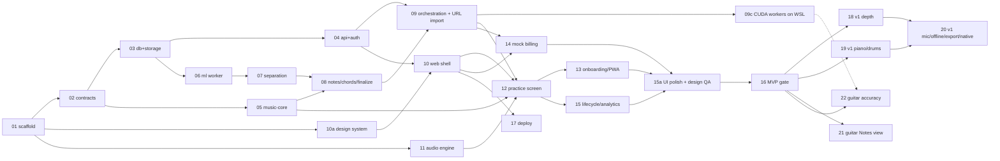

# Splitune implementation prompts

One prompt per implementation step, each for a **fresh agent session** started in the repo root. Every prompt points the agent at `00-shared-context.md` first, then at the implementation docs it needs, and ends with acceptance criteria and the verification it must run and report.

## Git setup (already done)
- `docs/` and `prompts/` are **untracked on purpose** — excluded via `.git/info/exclude` (local only, never committed).
- The integration branch is **`dev`** (renamed from `main`; there is no `main`). Every step branches from the current `dev` as `impl/NN-<name>`.

## How to use
Start a new Claude Code session in `/Users/hnt/Projects/Splitune` and send:

```
Read prompts/implementation/NN-<name>.md and carry out that step end to end.
```

When the agent finishes, check its summary and the entry it appended to `docs/implementation/PROGRESS.md`, review the branch `impl/NN-<name>`, merge it into `dev` yourself, then start the next step from `dev`.

## Status (2026-10-24)
Status comes from `docs/implementation/PROGRESS.md`. **The MVP (01–17) is built and deployed; v1 is not.** "Partial" means the code is done and the listed owner checks are still open.

| # | Status |
|---|---|
| 01–06, 08–15, 10a | Done |
| 07 | Partial: P1 listening ratings pending |
| 09c | Not started (optional; needs the owner's Windows PC) |
| 15a | Partial: usability round and real-device checks pending |
| 16 | Partial: real-device checks pending (MVP gate otherwise passed) |
| 17 | Partial: signed-in device smoke test and real sleep/wake pending |
| 18 | Not started (only groundwork: contracts, `speed_trainer` flag, `suggestCapo`) |
| 19 | Piano mostly done (see below); wait mode, piano levels and all of drums not started |
| 20 | Not started |
| 21, 22 | New (2026-10-24), not started |

**Steps done without a prompt** (ad-hoc work, logged in PROGRESS only): 07b separation inference settings · 09b storage moved to Cloudflare R2 · 12b–12d chord-strip overflow, ML worker Ctrl-C, dev dashboard · 17c guitar practice redesign (tab first, one transport) · 17d piano chord chart and keyboard voicings · **PROGRESS "Step 18"** piano notes (Transkun stage, hand split, falling-notes roll) and **18a** piano grand staff. Those last two are the piano half of prompt **19**, not prompt 18 — PROGRESS's step numbers after 17 don't match the prompt numbers.

## Order and dependencies
| # | Prompt | Depends on | Can run in parallel with |
|---|---|---|---|
| 01 | `01-repo-scaffold.md` — monorepo, tooling, local services, CI, CLAUDE.md | — | — |
| 02 | `02-contracts.md` — Zod schemas, JSON Schema, Pydantic codegen, fixtures | 01 | 11 |
| 03 | `03-database-and-storage.md` — Drizzle schema, RLS, job queue, S3 adapter | 01, 02 | 05, 11 |
| 04 | `04-api-and-auth.md` — Hono + oRPC, Better Auth, songs/uploads | 01–03 | 05, 06, 11 |
| 05 | `05-music-core.md` — quantize, fret DP (P3), corrections, alphaTex | 02 | 03, 04, 06, 11 |
| 06 | `06-ml-worker-and-harness.md` — Python worker, decode + beats, eval harness | 01–03 | 04, 05, 11 |
| 07 | `07-separation.md` — open-model separation, stem post, P1 listening test | 06 | 10, 11 |
| 08 | `08-notes-chords-finalize.md` — Basic Pitch/chords, Node finalize, P2/P6 | 05, 06, 07 | 10, 11 |
| 09 | `09-orchestration-and-url-import.md` — job graph, SSE, URL import (yt-dlp) | 04, 06–08 | 10 (with mocks), 11 |
| 09c | `09c-cuda-worker-wsl.md` — ML + Node workers on a Windows PC via WSL2 with CUDA: device module, `gpu` slot, `Separation.device` gains `cuda`, uv CUDA extra, systemd + Task Scheduler (**owner sets up the PC**) | 09 | 10a, 11 |
| 10a | `10a-design-system-and-ui-kit.md` — "Music Stand" tokens, fonts, icons, shadcn/Base UI kit, Storybook + a11y tests (**runs before 10**) | 01 | 02–09, 11 |
| 10 | `10-web-shell-import-library.md` — web app, marketing + auth UI, import, library, progress, system pages, display prefs + settings shell, copy catalogue | 04, 10a, (09) | 07–09, 11 |
| 11 | `11-audio-engine.md` — AudioWorklet + Signalsmith WASM, clock, loops | 01 | 02–10 |
| 12 | `12-practice-screen.md` — alphaTab sync, confidence overlay, loops, mixer, editing + `/edit` route, pedals, progressive layouts, video | 05, 09, 10, 11 | — |
| 13 | `13-onboarding-examples-pwa.md` — first session, example songs, PWA | 09, 12 | 14, 15 |
| 14 | `14-mock-billing-and-plans.md` — Free/Plus, allowances, mock checkout | 09, 10 | 13, 15 |
| 15 | `15-lifecycle-analytics-observability.md` — sweepers, export/delete, events, dashboards | 09, 10, 12 | 13, 14 |
| 15a | `15a-ui-polish-and-design-qa.md` — screen audit vs docs 26–27, copy pass, visual regression, usability round (**runs before 16**) | 10a, 10–15 | — |
| 16 | `16-compat-a11y-hardening.md` — browser matrix, a11y, security pass (**MVP gate**) | 10–15, 15a | — |
| 17 | `17-deploy-railway-and-mac.md` — Railway app/Postgres + R2 wiring (app token, CORS) + Mac workers (**asks before spending**) | 10 (owner's choice, 2026-10-21; full smoke test again after 16) | 11–16 |
| 18 | `18-v1-practice-depth.md` — speed trainer, transpose/capo, fingerings, sections, record-and-compare, metronome | 16 | 19, 22 |
| 19 | `19-v1-piano-and-drums.md` — finish piano (solo-piano path, Aria-AMT, electric-piano gate, wait mode, levels), ADTOF drums + drum grid | 16, piano work on `dev` | 18, 22 |
| 20 | `20-v1-mic-offline-export-native.md` — P5, tuner, mic scoring, offline, export, lyrics, sideload | 16 (18 recommended; 19 for drum/piano export) | 22 |
| 21 | `21-guitar-notes-view.md` — guitar/bass Notes view: string highway onto a live fretboard; mockups first, owner picks (**stops for the owner's choice**) | 16, piano work on `dev` | 19, 20, 22 (not 18: both change the practice screen) |
| 22 | `22-guitar-accuracy.md` — real-song test set, then separation, transcription, clean-up and fret assignment measured and improved (**asks the owner for songs/tabs and time budget**) | 16 (09c helps for training) | 18–21 |



Running steps in parallel: give each agent its own git worktree so two agents never edit the same checkout. Worktrees only contain tracked files, so link the untracked docs and prompts into each one (the local exclude rules cover the links too):

```bash
git worktree add ../splitune-11 -b impl/11-audio-engine dev
ln -s /Users/hnt/Projects/Splitune/docs ../splitune-11/docs
ln -s /Users/hnt/Projects/Splitune/prompts ../splitune-11/prompts
```

## Ground rules baked into every prompt
- The current mode is **personal** (`docs/implementation/25-personal-mode.md`): Railway Hobby for app/Postgres, Cloudflare R2 (free tier) for storage, ML on the owner's Mac, mock payments, copyright out of scope.
- Agents must **ask before creating any billable Railway or Cloudflare resource** and never collect card data.
- Agents verify their work (tests, builds, measurements), report exact commands and results, and never claim unverified success.
- Agents commit on their own branch from `dev`, don't push or merge, never add `docs/` or `prompts/` to git, and log progress in `docs/implementation/PROGRESS.md` (untracked).
- The practice route's JS budget is nearly used up: new practice UI loads on demand and reports before/after bytes.
- The owner doesn't play an instrument: no step may depend on owner-played recordings.

Steps `21` and `22` (2026-10-24) are guitar follow-ups to the piano work: 21 gives guitar and bass the same kind of moving Notes view piano has; 22 pushes guitar transcription accuracy as far as it measurably goes. Steps `10a` and `15a` were added for the UI/UX flow (docs `26`–`28`); the letter suffix keeps the existing numbering stable — run 10a before 10 and 15a before 16. Step `09c` (optional, owner's Windows PC as a second worker host) runs after 09; its PC verification happens in a session inside WSL on the PC.

Edit `00-shared-context.md` once to change a rule for every step.
